# Entrega 2 — Público-alvo e análise de concorrência

**Data:** 02/09/2026
**Status:** 🟩 concluído
**Responsabilidade mínima:** cada integrante analisa pelo menos 1 concorrente/interface representativa; a equipe produz síntese comparativa.

## Objetivo da atividade

Compreender soluções do mesmo domínio **e também interfaces familiares ao público-alvo**. O objetivo não é copiar telas, mas identificar convenções, padrões, affordances percebidas, problemas recorrentes, expectativas e oportunidades de design.

> **Concorrente não precisa ser idêntico ao produto.** Pode atuar na mesma área, resolver objetivo semelhante ou disputar a mesma necessidade. Quando não houver concorrente direto, use produtos análogos e softwares que o público já utiliza.

### Para TCCs que não previam interface

Não procure apenas um “concorrente do algoritmo”. Investigue **interfaces profissionais que materializam atividades semelhantes** às que o usuário escolhido precisaria realizar.

Exemplos:

- TCC de banco de dados → consoles de administração, ferramentas para DBA, monitoramento e análise de consultas;
- TCC de LLM/ML → painéis de experimentos, gestão de modelos/datasets, comparação de métricas, revisão de resultados;
- TCC de análise de dados → dashboards, ferramentas de BI, filtros, relatórios e exploração;
- TCC de infraestrutura/API → portais administrativos, observabilidade, logs, gestão de credenciais e uso;
- TCC de cibersegurança → consoles de alertas, triagem, histórico e auditoria.

A pergunta é: **“que convenções esse perfil já conhece para executar tarefas equivalentes?”**

## Entrada obrigatória da Entrega 1

Retome o mapa inicial de alternativas e produtos citado na Entrega 1. Aqui a equipe deixa de trabalhar apenas com impressão inicial e passa a **investigar sistematicamente** cada solução.

| Softwares Mercado | Tipo | Razão | Status inicial | Decisão nesta entrega |
|---|---|---|---|---|
| Bayer - Field View | Análogo | Software renomado no mercado, com objetivos similares à certa parte da nossa interface | F | Analisar |
| John Deere Operations Center | Análogo | Software que traz uma grande visualização do que acontece no talhão. | F | Analisar |
| Croptimus™ Platform | Concorrente | Software muito semelhante com as intenções do que temos na interface prevista, assim como os objetivos do produto. | F | Analisar |
| Plantix | Concorrente | Software mobile com características muito similares ao que pretendemos utilizar, utiliza visão computacional e traz um layout interessante para isso. | F | Analisar |
| OneSoil Platform | Ferramenta Cotidiana | Software mobile sem objetivo específico bastante utilizado na comunidade agrícola, a ideia é extrair um estilo geral padrão, com navegação entre as utilidades/telas. | F | Analisar |

Se uma hipótese da Entrega 1 for confirmada ou refutada durante esta análise, atualize `H01`, `H02`... em [`../RASTREABILIDADE.md`](../RASTREABILIDADE.md).

## 1. Público-alvo desta análise

Alinhado à Entrega 1 revisada, a análise considera **dois fluxos distintos**, que podem ou não ser realizados pela mesma pessoa (hipótese H26, a investigar):

- **Fluxo A — captura e diagnóstico** (inspetor de campo: pragueiro/trabalhador rural treinado). Melhor representado pelo **Plantix** (C02).
- **Fluxo B — acompanhamento espacial, registros e decisão** (responsável pelo manejo: dono/gestor, possivelmente agrônomo). Melhor representado por **FieldView** (C01) e **OneSoil** (C03).

> **Natureza das evidências visuais.** Cada print foi classificado como **[Tela de uso]**, **[Material promocional/mockup]**, **[Documentação oficial]** ou **[Frame de vídeo]**. Prints promocionais sustentam conceitos de interação, mas não comportamento dinâmico real (passos, feedback em tempo real, recuperação de erro).

## 2. Concorrentes diretos/indiretos

### Análise C01 — Bayer - Field View Ferramenta

**Autor(a):** Pedro Henrique Ferreira Valim - 24.123.048-1
**Tipo:** análogo  
**Link oficial:** https://climate.com/pt-br.html
**Data de acesso:** 02/09/2026

#### Contexto e proposta

O Climate FieldView é uma plataforma de **agricultura** digital que ajuda produtores rurais a **gerenciar suas fazendas de forma inteligente** através de dados coletados diretamente no campo.

#### Funcionalidades relevantes

| Funcionalidade | Como é realizada | Evidência/print | Observação de IHC |
|--- |---|---|---|
| **Monitoramento** | Através de mapas de satélite gerados frequentes que medem a densidade e a saúde da biomassa da lavoura. Ajuda a detectar anomalias, como ataques de pragas, doenças ou estresse hídrico, antes que fiquem visíveis a olho nu. Para auxiliar o monitoramento é possível marcar pontos específicos no mapa com fotos salvando as coordenadas exatas por GPS. | 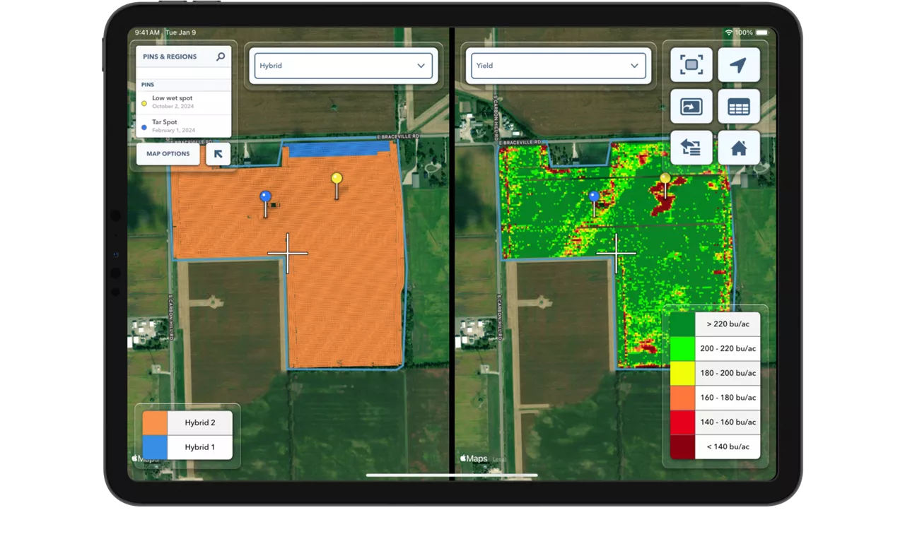 | Os mapas são mais 'realistas' do que pensávamos, interessante para passar uma visão mais séria para o usuário. Os mapas ocupam bastante espaço na tela com ícones/botões de funcionalidade nas extremidades. |
| **Coleta e Integração de Dados em Tempo Real** | Realizada por um dispositivo físico conectado na entrada de dados das máquinas que transmite, via Bluetooth, dados de plantio, pulverização e colheita direto para o iPad ou celular. |  e 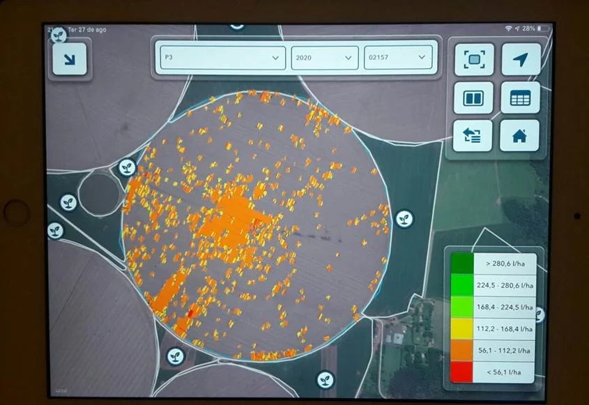 | A visualizações dos dados adquiridos em campos são bem precisar e também objetivas, sem muitas possibilidades de visualizações ao mesmo tempo, evitando a poluição visual. Poucos botões na tela e também possibilidade de filtro de talhão, facilitando a visão múltipla sem poluição. |
| **Análise de Resultados** | Cruza os dados do plantio com os da colheita para gerar relatórios automáticos mostrando qual variedade de semente (híbrido) rendeu mais e em qual tipo de solo ela teve melhor performance. | 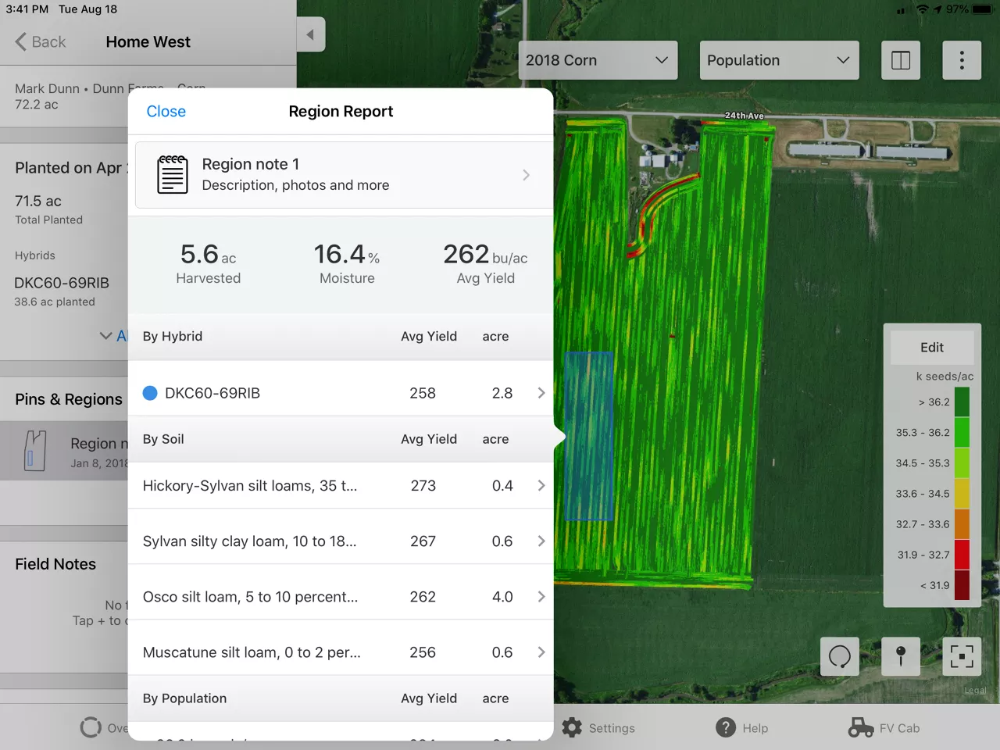 | O que podemos observar é que o relatório pode ser exportado e obtido a parte, porém o software também opta por proporcionar uma visão rápida na própria tela do mapa, ou seja, o analista pode verificar os dados e observar os números de forma fácil... Também é interessante observar que mesmo com MUITOS dados no sistema, o relatório usa KPIs precisos e impactantes para o negócio. |

#### Experiência do usuário e opiniões

Alguns relatos interessante sobre a interface da plataforma que podem nos guiar para um desenvolvimento mais preparado para o mercado são:
- Design "Otimizado para Cabine" (Cab-Friendly): O aplicativo foi desenhado com botões grandes, poucos menus e fontes de alta legibilidade. --- Isso é muito interessante para os operadores de máquinas, que relatam fácil uso e visibilidade mesmo com condições não favoráveis para o uso.
- Também foi muito falado sobre a facilidade para aprender a usar a plataforma, o menu inicial contém poucos botões, consequentemente tendo poucos direcionamentos de tela. Assim fica fácil mesmo para quem não tem tanta afinidade ficar acostumado com o software.
- O ponto mais forte dos relatos são as visualizações de mapas lado a lado, tanto com mapas de volumes quanto com mapas de marcação, assim é interessante trazer insights como "Onde foi marcado o ponto, teve um aumento de concentração de pragas ou frutas mortas..."
- Um último ponto, agora negativo, muito citado pelo público alvo é a poluição visual na tela, principalmente com fazendo com uma alta carga de dados ao longo do tempo: "alguns gestores reclamam que o sistema de filtragem de mapas na interface poderia ser mais ágil, pois o menu de seleção tende a ficar longo e poluído visualmente."

**OBS**: Os dados foram retirados do vídeo que apresenta o software: https://www.youtube.com/watch?v=tBFafg21hnA&t=37s e também algumas avaliações na apple store.

#### Preço/modelo de negócio

Plano de Entrada (Prime): Custa cerca de R$ 250,00 por ano.
Plano Plus: Custa R$ 1.500,00 por ano.
FieldView Drive: O conector Bluetooth que vai acoplado na cabine custa em média R$ 980,00 a R$ 1.500,00 por unidade.

#### Padrões e tendências percebidos

Baixas opções de navegações entre as interfaces; Grande quantidade de dados nos mapas; Facilidade na observação de diferentes funções como mapas conjuntos, mostrando tendências e marcações e também relatórios gerados na interface de monitoramento dos mapas; Mais amplamente, as interfaces tendem sempre a ter uma visualização facilitada por conta das condições de campo.

#### Pontos positivos, limitações e lições

| Ponto | Evidência | Implicação para nosso projeto |
|---|---|---|
| Uma interface completa e em certa forma não poluída visualmente | Isso pode ser observado através das funcionalidade que nos trazem muitas informações relevantes para o negócio e também através dos relatos que podem ser visualizados acima, alguns usuários trazem um excesso de informação na tela assim como outros dizem ser 'clean' e de fácil compreensão. | Isso implica diretamente no nosso projeto pensando na _feature_ de **geolocalização** para interpretação do comportamento das pragas, infestações e pontos estratégicos para aplicação de produtos agrícolas.  |
| Facilidade de navegação pela plataforma e aplicações conjuntas | Aqui conseguimos perceber isso observando as imagens atreladas no documento, todas as interfaces tem poucos botões e os relatórios são gerados no mesmo menu do monitoramento. Também foi um ponto relatado pelos usuários. | Novamente aqui é muito bom para entendermos como gerar os relatórios das pragas para que os gestores consigam analisar e gerar insights para agir sobre. |

### Análise C02 — Plantix

**Autor(a):** Guilherme Morais Escudeiro — 24.123.005-1
**Tipo:** direto 
**Link oficial:** https://plantix.net/pt/  
**Data de acesso:** 02/09/2026

#### Contexto e proposta

Aplicativo mobile que ajuda agricultores e jardineiros a diagnosticar doenças, pragas e deficiências nutricionais em plantas através de fotos tiradas pelo celular

#### Funcionalidades relevantes

| Funcionalidade | Como é realizada | Evidência/print | Observação de IHC |
|---|---|---|---|
| Câmera com orientação de enquadramento | O usuário aponta a câmera para a planta; a moldura da câmera muda conforme o que a câmera enxerga | 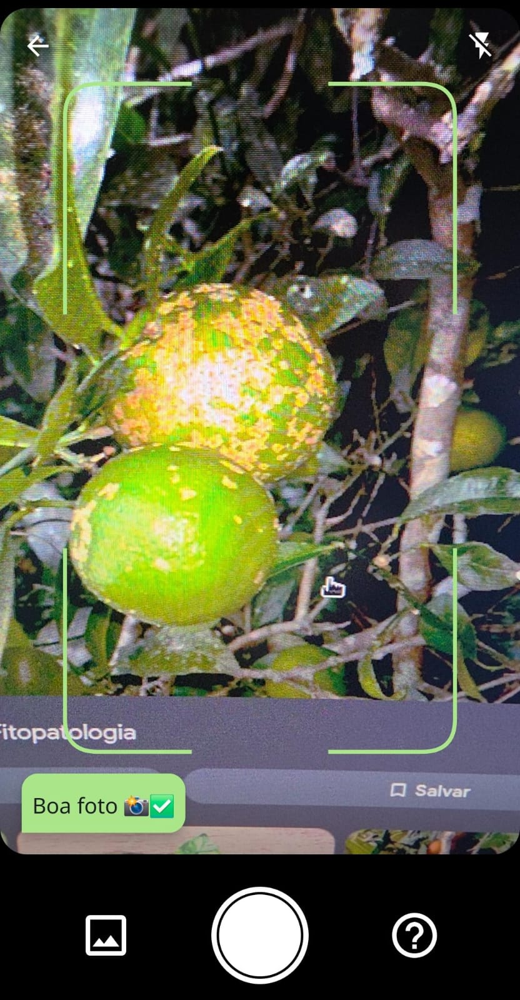 *[Tela de uso]* e 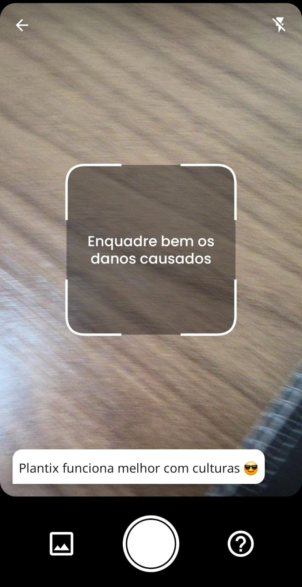 *[Tela de uso]* | **O que vejo:** (1) com frutos cítricos à frente, a moldura é **verde**, com cantos abertos, e aparece o balão "Boa foto ✅" (mensagem do próprio app); (2) com a câmera apontada para uma superfície de madeira, a moldura é **branca**, menor, com o texto "**Enquadre bem os danos causados**" e o balão "Plantix funciona melhor com culturas" (também do app). Em ambas: voltar, flash, galeria, botão de captura grande e "?" (ajuda). **Padrão:** a moldura **reage ao conteúdo** da câmera, com cor e mensagem diferentes. **Por que importa:** comprova um feedback antes da captura que depende do que está no quadro (RC01). **Interpretação:** as mensagens do app tratam de **presença e enquadramento da cultura/dano** ("Boa foto", "Enquadre bem os danos causados", "funciona melhor com culturas"). **Limite:** as duas telas não mostram se o app avalia também **foco, distância ou luz**; o critério exato do verde é inferência. |
| Detecção após a foto | Depois da captura, o app informa o que está fazendo | 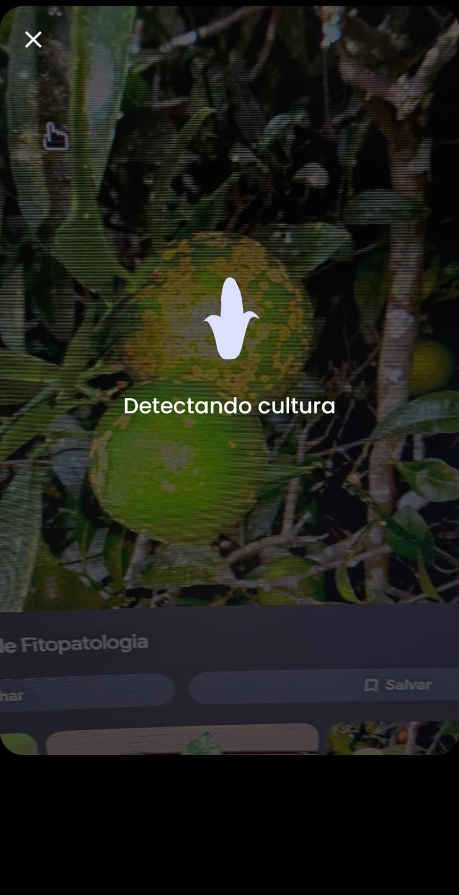 e 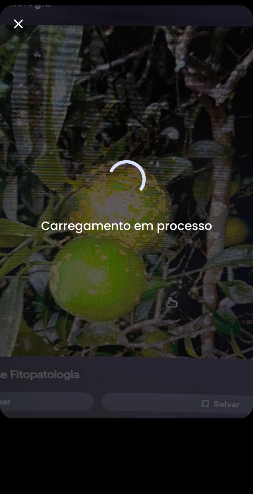 *[Tela de uso]* | **O que vejo:** a imagem escurecida com ícone e o texto "**Detectando cultura**" e, em seguida, um indicador giratório com "**Carregamento em processo**", com botão "X" para cancelar. **Padrão:** feedback de estado em duas etapas, com opção de cancelar. **Por que importa:** o projeto, com processamento rápido no dispositivo (TCC), precisa decidir se uma etapa de espera visível é necessária (H31). |
| Resultado do diagnóstico | O app apresenta o problema identificado e pede confirmação antes do tratamento | 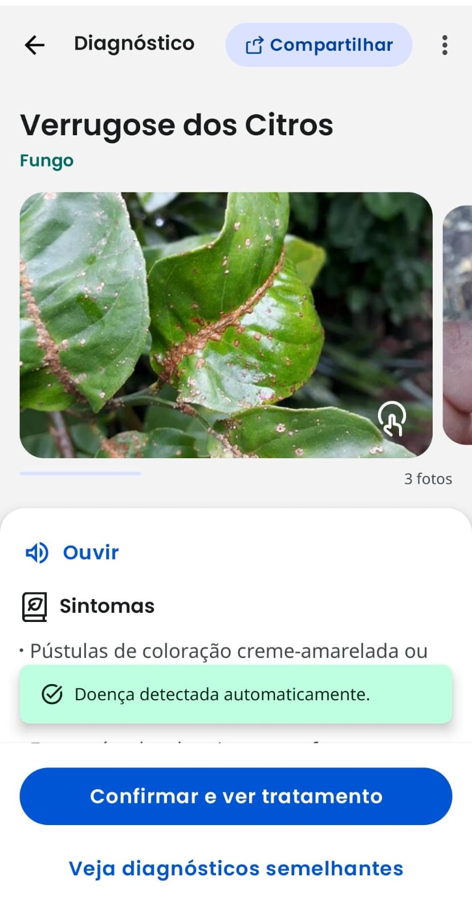 *[Tela de uso]* | **O que vejo:** nome do problema ("Verrugose dos Citros") e categoria ("Fungo") em destaque, galeria de 3 fotos, botão **Ouvir** (ícone de alto-falante), seção "Sintomas", aviso verde "**Doença detectada automaticamente.**", botão primário "**Confirmar e ver tratamento**" e link "Veja diagnósticos semelhantes". **Padrões:** hierarquia título → categoria → imagem → ação; resultado marcado como automático; **a pessoa confirma** antes de ver o tratamento; alternativas semelhantes oferecidas. **Por que importa:** é uma referência real de divisão IA × pessoa (H27) e de acessibilidade por áudio (RC03). **Limite:** o print não mostra a tela de tratamento nem o que o botão Ouvir lê. |
| Tratamentos recomendados e alerta de doenças próximas | Tratamento após confirmação; alertas por localização | *(sem print; os arquivos promocionais foram removidos)* | Mantidos apenas como **fonte textual** (descrição/avaliações do app): alerta é regional, não pontual. Não há evidência de tela para estes dois itens. |

> **Natureza das evidências de C02:** os cinco prints são **telas de uso real** do app. As capturas parecem ter sido feitas apontando a câmera para uma imagem exibida em outra tela (linhas de varredura e textos de outro aplicativo visíveis) e o diagnóstico mostrado é de verrugose, e não de leprose; isso serve para o padrão de interação, não para avaliar a precisão do diagnóstico. **Ainda não cobertos:** tela inicial, erro de foto ruim, histórico, tela de tratamento e navegação.

#### Experiência do usuário e opiniões

O aplicativo possui uma nota média de 4,6 estrelas na Play Store, analisando as avaliações do app, encontram-se as seguintes opiniões:

Elogios:
- Eficácia no aprendizado agrícola: Profissionais da área relatam que o app ajuda no dia a dia do campo e funciona como uma excelente ferramenta de aprendizado prático.
- Precisão do diagnóstico por imagem: Os usuários destacam a rapidez e a assertividade da inteligência artificial ao detectar mais de 400 a 780 tipos de danos e pragas em segundos através de uma simples foto.
- Utilidade dos recursos extras: A calculadora de fertilizantes, os alertas locais de doenças e a previsão do tempo integrada recebem avaliações muito positivas por auxiliarem no gerenciamento completo da lavoura.
- Rede social interna: A seção de comunidade é elogiada por permitir a troca de ideias e experiências diretamente com outros agricultores e especialistas do setor.

Críticas:
- Limitações na interação social: Há reclamações de que a aba da comunidade carece de recursos básicos de redes sociais, como a impossibilidade de buscar perfis de membros específicos, ver quem seguiu você ou interagir por mensagens diretas privadas.
- Restrição de culturas: Usuários focados em jardinagem doméstica apontam que o catálogo de diagnóstico é estrito a 30 grandes culturas comerciais (como milho, soja e tomate), deixando a desejar para plantas ornamentais comuns.
- Preocupações com privacidade de dados: A seção de segurança de dados gera ressalvas de alguns usuários na Play Store, já que o aplicativo exige o compartilhamento de informações como localização aproximada, atividade do app e IDs do dispositivo com terceiros.

#### Preço/modelo de negócio

O aplicativo é gratuito, porém, quando o app diagnostica uma praga, ele recomenda produtos (defensivos químicos ou biológicos) e conecta o produtor a lojas e fornecedores locais. A empresa recebe comissões pelas vendas geradas por meio dessa integração.
Além disso, utilizando o mesmo ecossistema do aplicativo, a empresa oferece soluções B2B focadas no mercado agrícola, como licenciamento do software para ser integrado em outras soluções, e o uso dos dados gerados pelo aplicativo para que as empresas entendam o comportamento agrícola regional.

#### Padrões e tendências percebidos

- **Observado (telas de uso):** a câmera é a metáfora central; a moldura muda de cor e de mensagem conforme o conteúdo da câmera; após a captura há duas mensagens de estado ("Detectando cultura", "Carregamento em processo") com cancelamento; o resultado é marcado como "detectado automaticamente" e exige **confirmação** antes do tratamento; há leitura em áudio ("Ouvir").
- **Não verificado:** que a câmera replique a câmera nativa (a aparência é semelhante, mas é interpretação [H]) e a rapidez ("em segundos"), que é alegação do fornecedor.

#### Pontos positivos, limitações e lições

| Ponto | Evidência | Implicação para nosso projeto |
|---|---|---|
| Feedback de enquadramento antes da captura | `plantix_enquadramento.jpeg` e `plantix_sem_enquadramento.jpeg`: moldura verde e "Boa foto" com a planta; moldura branca e "Enquadre bem os danos causados" sem planta | **Comprovado:** existe feedback visual antes da captura que reage ao conteúdo. **Não comprovado:** que avalie foco, distância ou luz. Para o projeto, a ideia de câmera guiada é sustentada pelo Plantix; a necessidade de foco e distância precisos para alvo submilimétrico vem do **protocolo de captura do TCC** (RC01). |
| Feedback de estado após a captura | `plantix_processamento_1/2.jpeg`: "Detectando cultura" e "Carregamento em processo", com "X" | Referência de feedback em duas etapas com cancelamento; verificar se o TCC (processamento rápido) precisa de etapa de espera visível (H31). |
| Resultado automático com confirmação humana | `plantix_diagnostico.jpeg`: "Doença detectada automaticamente." + "Confirmar e ver tratamento" | Referência real para a divisão IA × pessoa (H27): o app apresenta e a pessoa confirma antes de seguir. A necessidade de confirmação no nosso fluxo continua hipótese. |
| Leitura em áudio dos resultados | `plantix_diagnostico.jpeg`: botão "Ouvir" visível | **Existência do recurso comprovada** (visível no print). **Utilidade para o nosso público continua hipótese:** investigar dificuldade de leitura, mãos ocupadas, atenção dividida e preferência. Não é funcionalidade obrigatória. |
| Desalinhamento entre modelo mental do usuário e funcionalidade social oferecida | Usuários criticam a ausência de recursos básicos esperados de redes sociais (buscar perfis, seguir, mensagens diretas) na comunidade do app. | Caso implementemos funcionalidades sociais/comunitárias, é importante alinhar com convenções já conhecidas pelo usuário. |

### Análise C03 — OneSoil Platform 

**Autor(a):** Lucas Tonoli Cabral Duarte R.A: 24.123.032-5  
**Tipo:** análogo  
**Link oficial:** https://onesoil.ai/pt/solutions/farmers  
**Data de acesso:** 02/09/2026

#### Contexto e proposta

 É uma plataforma global de agricultura de precisão que utiliza imagens de satélite e inteligência artificial para simplificar o gerenciamento de lavouras.

#### Funcionalidades relevantes
| Funcionalidade | Como é realizada | Evidência/print | Observação de IHC |
|---|---|---|---|
| Mapeamento | Dividir o talhão em regiões de alto, médio e baixo potencial de rendimento para planejar onde investir mais insumos |  | A interface do mapa deve garantir alta densidade de informação visual e baixo esforço cognitivo: os talhões precisam ter delimitações gráficas distintas e carregamento de imagem de satélite em alta resolução, permitindo ao usuário navegar via geolocalização sem ambiguidades. |
| Criação de mapas de precisão | Cria arquivos de configuração para que os tratores e pulverizadores apliquem quantidades diferentes de fertilizantes ou sementes em cada ponto do campo de acordo com a necessidade |  | A criação desses mapas de precisão deve garantir alta qualidade de informação visual de modo a ser específico ao mostrar as informações necessárias para cada um dos mapas |
| Inspeção de Campo Otimizada | Direciona a equipe de campo exatamente para os pontos críticos da lavoura, economizando tempo de inspeção. | 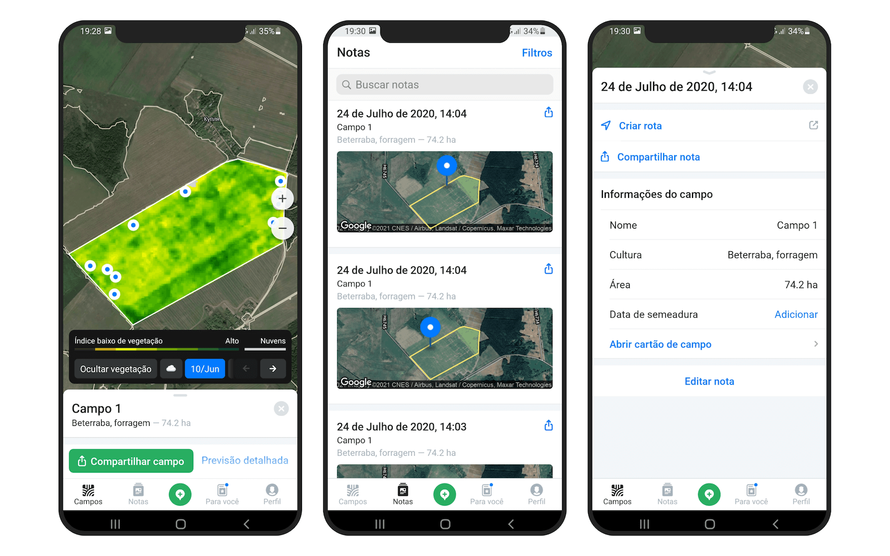 | A interface de inspeção é otimizada para dispositivos móveis com alto contraste para visualização sob luz solar direta. O aplicativo permite o registro rápido de pragas e fotos com poucos cliques, oferecendo navegação por GPS em tempo real e funcionamento 100% offline |

#### Experiência do usuário e opiniões

- "Experimentei várias aplicações para mapas VRA, e a OneSoil destaca-se. A qualidade dos mapas VRA para a aplicação de azoto é a melhor entre as outras aplicações que experimentei. Tornou-se uma ferramenta indispensável."
- "A OneSoil é uma plataforma que permite aos produtores tomar decisões informadas sem esforço, com uma utilização simples e interativa. O seu design intuitivo e as informações de dados abrangentes transformaram o nosso processo de tomada de decisões."
- "A poupança é substancial. A OneSoil ajudou-nos a poupar 11 USD por hectare com a aplicação de taxa variável. Esta solução económica não só impulsionou os nossos resultados, como também promoveu práticas agrícolas sustentáveis."
  
#### Preço/modelo de negócio

Uso para agricultores: As ferramentas básicas de monitoramento de lavouras via satélite, índices de vegetação (NDVI) e histórico de campos são gratuitas no aplicativo e na web.
Para empresas e parceiros: Soluções corporativas, de revenda de insumos ou pacotes voltados para prestadores de serviços agrícolas possuem preços sob consulta, disponíveis mediante solicitação direta no site oficial.

#### Padrões e tendências percebidos

- Há um padrão de mapeamento de talhões com informações relevantes onde, para que ele funcione, seguem um padrão automatizado baseado em inteligência artificial e imagens de satélite.
- Há um padrão de interface de inspeção onde, para que ele funcione, seguem um padrão de interface limpa, com pouca poluição visual e poucos caminhos até chegar à funcionalidade requisitada e utilizam inteligência artificial para funcionalidade de inspeção

#### Pontos positivos, limitações e lições

| Ponto | Evidência | Implicação para nosso projeto |
|---|---|---|
| Facilidade de visualizar mapas | A evidência disso são os relatos positivos apresentados no site e a funcionalidade apresentada nas fotos | Isso implica diretamente no nosso sistema de monitoramento e mapeamento a partir de inteligência artificial e imagens de satélite |
| Facilidade ao usar o app |A evidência dessa facilidade está nos relatos dos clientes que já utilizaram o app e nas fotos que há na internet sobre | Isso implica diretamente no nosso app, onde utiliza uma interface característica para trabalhadores rurais utilizando inteligência artificial |

## 3. Softwares que o público-alvo usa no cotidiano

| Software | Por que o público usa | Padrões relevantes | Prints | O que aprender |
|---|---|---|---|---|
| WhatsApp | **[H]** Provável canal de comunicação no campo — envio de fotos de pragas/doenças para agrônomos, grupos de cooperativa, áudios em vez de texto (hábito do público-alvo **não confirmado**; investigar nas Entregas 3/7) | Botão de câmera em destaque, envio de áudio com um toque, preview de imagem antes de enviar, indicadores de status (enviado/lido) | 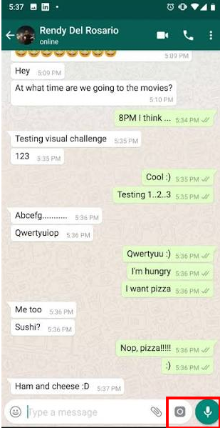 | **Padrão familiar potencial** (a hipótese de que o público envia áudio em vez de digitar precisa ser investigada antes de justificar voz no app); preview de foto antes de confirmar é um padrão amplamente conhecido que pode ser avaliado na tela de captura |
| Google Maps / Waze | **[H]** Navegação até talhões, fornecedores, cooperativas; alguns usam para localizar pontos dentro da própria propriedade (uso pelo público-alvo não confirmado) | Marcação de pin em localização específica, zoom por gesto, alto contraste em modo satélite, ícones grandes tocáveis | 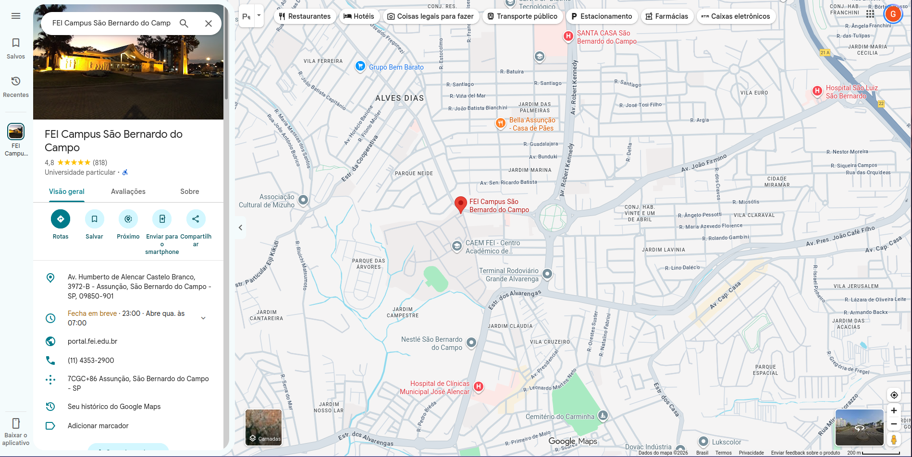 | O padrão de "marcar um pino no mapa e adicionar uma nota/foto" é semelhante ao registro georreferenciado de ocorrências que estamos investigando (hipótese de trabalho) |
| Aplicativo de previsão do tempo (ex: Climatempo) | Decisão de quando pulverizar, colher ou irrigar depende diretamente da previsão | Ícones grandes e universais (sol, chuva), informação resumida no topo da tela, alertas push para eventos críticos | 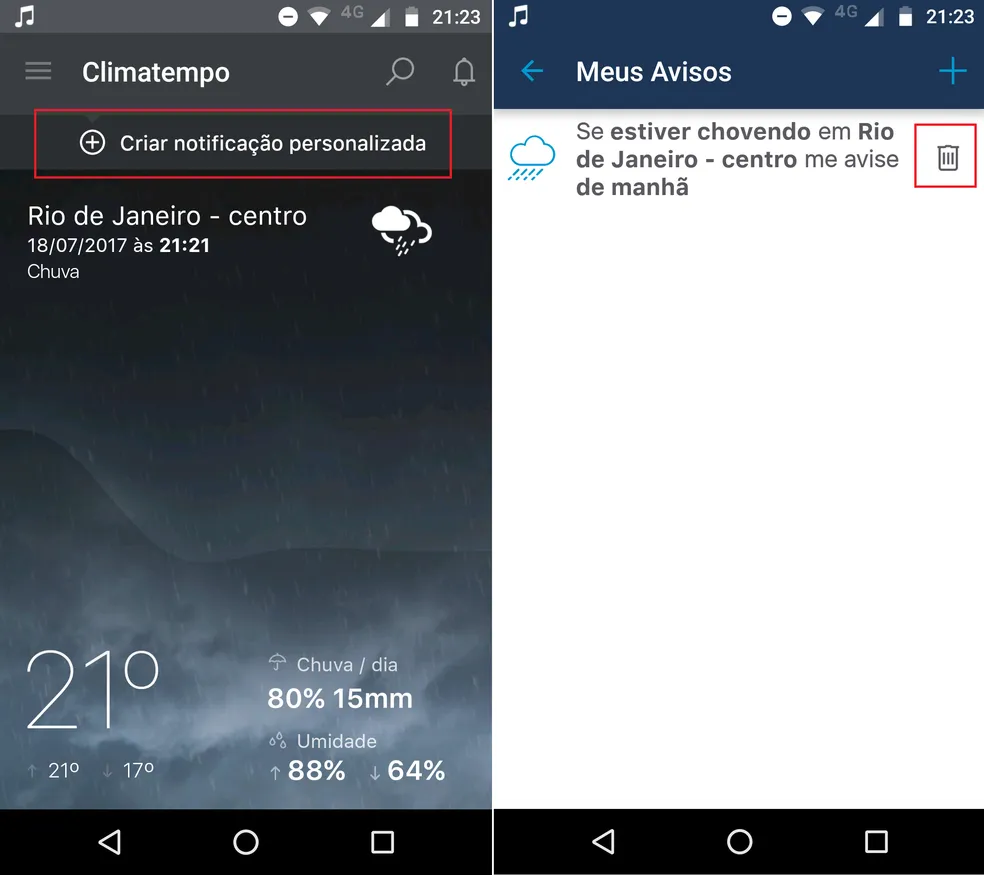 | Uso de ícones universais em vez de texto extenso é um padrão a seguir para diagnósticos rápidos; a necessidade de alertas ainda não foi demonstrada para o nosso público (ver H32 da Entrega 1) |

## 3.1 Padrões de interface relevantes ao escopo de IHC

Registre somente padrões encontrados nas soluções analisadas e que possam ter relação com objetivos reais da equipe.

| Padrão observado | Produto(s) | Para qual tarefa serve | Vantagem percebida | Risco/limitação | Aplicável ao nosso escopo? |
|---|---|---|---|---|---|
| Representação espacial por pontos, regiões, cores e camadas (convenção recorrente) | C01 (FieldView), C03 (OneSoil) | Visualizar dados distribuídos no talhão | Convenção estabelecida no domínio agrícola | Pode poluir a tela se houver muitos dados sobrepostos (relatado por usuários do C01) | Convenção a adotar **quando justificada pela tarefa**; qual representação faz sentido (ponto, agrupamento, região, intensidade) depende do usuário do mapa, da decisão e do significado agronômico — ainda a investigar |
| Relatório automático comparativo | C01 (FieldView) | Cruzar dados e gerar insight de negócio (ex: rendimento por variedade) | Visão rápida sem sair da tela do mapa | Pode ficar denso com muitos dados acumulados | Talvez, poderia comparar zonas de infestação/tratamento ao longo do tempo |
| Histórico + filtro por talhão | C01 (FieldView) | Focar a visualização em uma área específica | Facilita visão múltipla sem poluição | Usuários relatam que o menu de filtros fica longo e poluído | Candidata a validar — só se houver tarefa de consulta confirmada; filtros mínimos, evitando o erro relatado no C01 |
| Câmera guiada com feedback visual antes da captura (moldura que muda de cor e mensagem; **comprovado** nos prints de uso do C02; não comprovado que meça foco/distância) | C02 (Plantix) | Garantir foto com qualidade suficiente para a detecção | Potencialmente reduz fotos inutilizáveis | Depende de boa iluminação | Sim; o padrão vem do Plantix e a exigência de foco/distância para alvo submilimétrico vem do **protocolo de captura do TCC** (AE/AF Lock) |
| Administração/CRUD | Não observado claramente em C01/C02/C03 | — | — | — | Não parece um padrão relevante para o público final (trabalhador de campo) |

> O objetivo não é concluir “todo concorrente tem dashboard, então teremos um”. O padrão só será adotado se apoiar uma tarefa rastreável.

## 4. Síntese comparativa da equipe

| Critério | C01 (FieldView) | C02 (Plantix) | C03 (OneSoil) | Oportunidade para o projeto |
|---|---|---|---|---|
| Navegação | Mapas lado a lado com controles laterais e filtros superiores | Câmera como metáfora central; moldura reativa e mensagem "Enquadre bem os danos causados" (telas de uso) | Navegação inferior persistente e mapa como contexto | Fluxo curto entre abrir, capturar e ver resultado é objetivo do projeto; tempo/passos reais ainda devem ser medidos |
| Feedback/estado | Mapas com camadas e cores (observado) | Moldura verde com "Boa foto" ou branca com "Enquadre bem os danos causados" antes da captura; "Detectando cultura" e "Carregamento em processo" depois; resultado com "detectado automaticamente" (telas de uso) | Cores indicam regiões do talhão (observado) | Feedback imediato da ação; qualidade/distância do enquadramento é necessidade do TCC (alvo sub-milimétrico) |
| Prevenção/recuperação de erro | Não demonstrado nas imagens analisadas | Parcial: mensagem "Enquadre bem os danos causados" quando não há planta, botão "X" para cancelar o processamento e confirmação antes do tratamento; erro de foto ruim não capturado | Não relatado claramente | Sem aprendizado de concorrente aqui. O travamento de foco/exposição (AE/AF Lock) e a distância mínima de foco vêm exclusivamente do **protocolo de captura do TCC** |
| Terminologia | Termos técnicos agronômicos (híbrido, taxa variável) | Mensagens curtas e diretas ("Detectando cultura", "Enquadre bem os danos causados", "Confirmar e ver tratamento") | Mistura termos técnicos com simples | Investigar o vocabulário real do público antes de fixar a linguagem |
| Acessibilidade | Botões grandes/alta legibilidade (relato de usuários) | Botão "Ouvir" visível no resultado (tela de uso) | Alto contraste (descrição do produto) | Legibilidade sob sol e áudio são hipóteses a validar com o público; não são requisitos |
| Eficiência | Menu inicial enxuto (relato) | Diagnóstico em segundos (alegação do fornecedor; não medido) | Registro rápido (descrição do produto) | Minimizar etapas entre captura e resultado é objetivo próprio; as alegações de eficiência dos concorrentes não foram verificadas |

## 5. Recomendações derivadas

Cada recomendação registra **evidência observada → aprendizado → implicação**, a **origem** (concorrente, decisão técnica do TCC ou hipótese de design) e um **status**:
*Adotar como diretriz* · *Reforça decisão já existente* · *Candidata a validar com usuários* · *Manter apenas como referência* · *Descartar por enquanto*.

| ID | Recomendação | Origem | Evidência / justificativa | Status |
|---|---|---|---|---|
| RC01 | Dar apoio ao enquadramento/qualidade da captura antes de registrar a foto | **Mista:** (a) padrão do Plantix, **comprovado em telas de uso**: moldura que muda de cor e mensagem conforme o conteúdo da câmera; (b) restrições técnicas do TCC (alvo submilimétrico, foco, distância, AE/AF Lock). **Não** comprovado que o Plantix meça foco ou distância | `plantix_enquadramento.jpeg`, `plantix_sem_enquadramento.jpeg`; protocolo de captura do TCC | Candidata a validar com usuários (padrão observado; necessidade técnica reforçada pelo TCC) |
| RC02 | Priorizar contraste e tamanho de elementos legíveis em campo aberto | Hipótese de design a partir de contexto de uso (H30) e relatos sobre FieldView/OneSoil | **Característica visível:** contraste, tamanho relativo, hierarquia. **Benefício esperado (não validado):** melhor legibilidade sob sol — exige teste, relato ou documentação | Candidata a validar com usuários |
| RC03 | Investigar leitura em áudio de resultados | Botão "Ouvir" visível em `plantix_diagnostico.jpeg` (tela de uso). O que ele lê não aparece no print | Existência do recurso observada; **não há evidência de que o público do projeto precise**: investigar dificuldade de leitura, mãos ocupadas, atenção dividida, preferência | Candidata a validar (hipótese de necessidade; **não é funcionalidade obrigatória**) |
| RC04 | Funcionamento offline | **Decisão técnica já existente no TCC** (TensorFlow Lite embarcado); OneSoil apenas reforça a coerência com produtos agrícolas | `Interface_OneSoil.png` não mostra offline; vem da descrição do produto. A **sincronização posterior** não estava prevista: registrada como hipótese nova | Reforça decisão já existente (offline); sincronização = candidata a validar |
| RC05 | Adotar convenções de representação espacial (pontos, regiões, cores, camadas) quando justificadas pela tarefa | Observação dos prints de FieldView e OneSoil | Prints confirmam o uso recorrente de mapas, regiões, polígonos, zonas coloridas, pontos, filtros e camadas. **Retirada** a afirmação de "zona de risco adjacente": o padrão visual não justifica um modelo de propagação/risco. Representação adequada depende de usuário, tarefa, decisão e significado agronômico (a investigar) | Candidata a validar com usuários |
| RC06 | Evitar poluição visual em telas com muitos dados | Prints de FieldView (muita informação simultânea) + crítica de usuários ao menu de filtros longo | `Mapa_Marcacao.webp`, `relatorio.webp`, relatos da Apple Store | **Adotar como diretriz** — a verificar nas telas de mapa dos protótipos (Entregas 6, 11 e 13) |
| RC07 | Ser transparente sobre o uso de dados de localização | **Fonte:** críticas de usuários e política de dados do Plantix (Play Store), não os prints. **Aprendizado:** localização é dado sensível para parte dos usuários. **Implicação:** comunicar finalidade de coleta, armazenamento e compartilhamento | Avaliações do Plantix na Play Store | Adotar como diretriz (princípio de transparência) |

## Referências

- Climate FieldView (Bayer). Disponível em: https://climate.com/pt-br.html
- Plantix. Disponível em: https://plantix.net/pt/
- Avaliações de usuários — Google Play Store (Plantix)
- Capturas de tela de uso do Plantix (`plantix_enquadramento.jpeg`, `plantix_sem_enquadramento.jpeg`, `plantix_processamento_1.jpeg`, `plantix_processamento_2.jpeg`, `plantix_diagnostico.jpeg`): obtidas em 08/11/2026 no dispositivo Samsung Galaxy S26 Ultra.
- OneSoil Platform. Disponível em: https://onesoil.ai/pt/solutions/farmers
  
## Checklist

- [x] O mapa inicial de alternativas da Entrega 1 foi revisitado e aprofundado.
- [x] Hipóteses relevantes sobre mercado/padrões foram atualizadas na rastreabilidade quando surgiram evidências.
- [x] Há pelo menos uma análise completa por integrante.
- [x] Cada análise contém prints legíveis da interface.
- [x] Prints mostram telas/estados relevantes, não apenas logos/homepage (C02/Plantix agora usa telas de uso reais; resta o FieldView Drive, material promocional, identificado como tal).
- [x] Foram analisados concorrentes e/ou interfaces representativas ao público.
- [x] Em TCC sem interface original, foram investigadas ferramentas profissionais análogas às atividades do usuário escolhido.
- [x] Padrões como dashboard, relatório, filtros e CRUD foram analisados como soluções para tarefas, não como requisitos automáticos.
- [x] Opiniões de UX têm fonte.
- [x] A síntese compara critérios comuns e produz recomendações.
- [x] Não há “copiar porque o concorrente faz”; há justificativa de adequação ao público/contexto.
