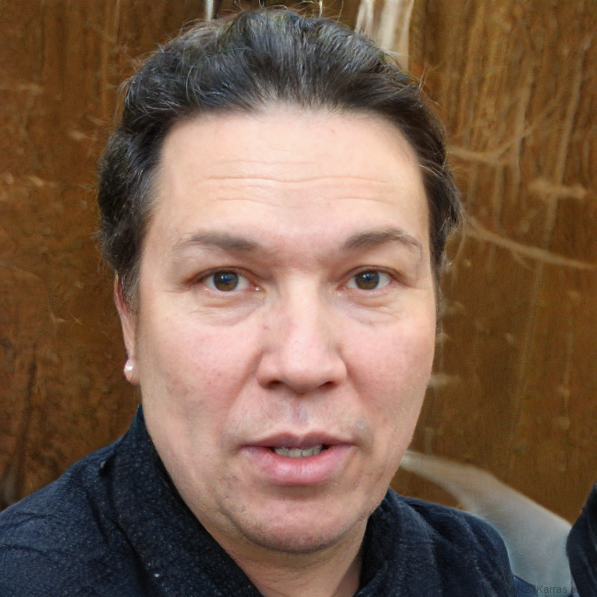
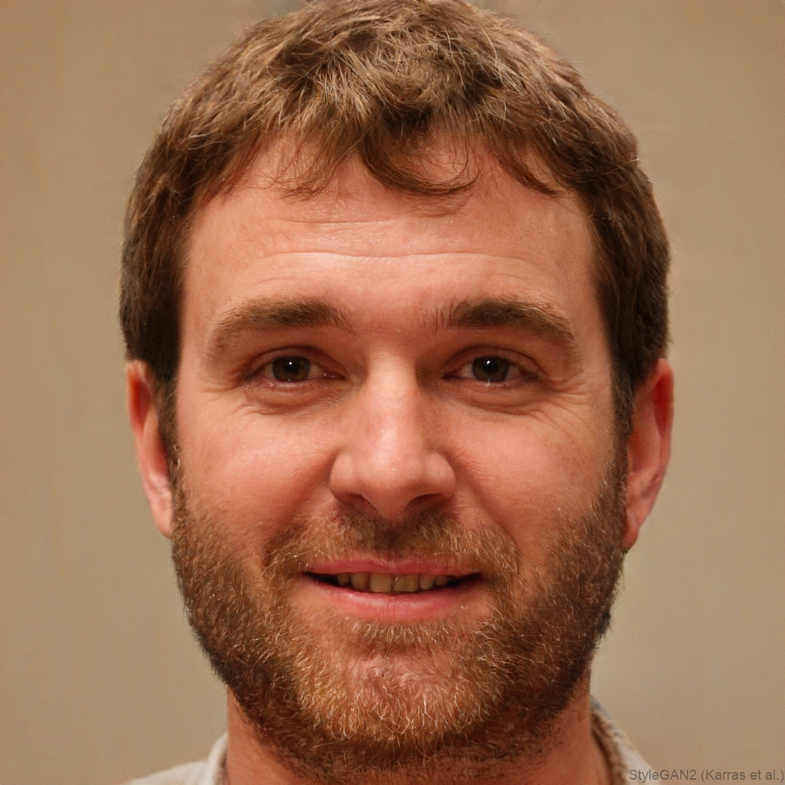
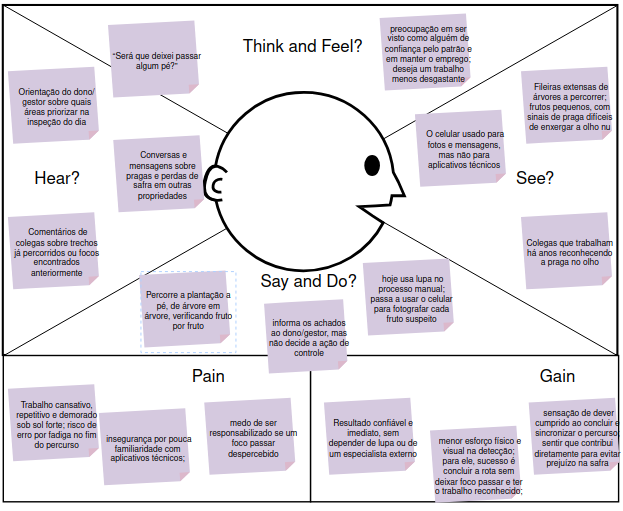

# Entrega 3 — Personas, mapa de empatia, contexto de uso e jornada

**Data:** 09/09/2026 
**Status:** 🟩 concluído
**Responsabilidade:** 1 persona por integrante; 1 mapa de empatia, 1 contexto de uso consolidado e 1 jornada por equipe (salvo orientação diferente do docente).

## Objetivo da atividade

Representar grupos de usuários de forma útil para decisões de design. Persona não é personagem decorativo: suas características devem alterar requisitos, prioridades, linguagem, fluxos ou critérios de avaliação.

## Atenção a projetos técnicos

Em TCCs sem interface original, a persona pode representar um **profissional que se apropria da contribuição técnica**: DBA, analista, cientista de dados, administrador, pesquisador, técnico, operador, gestor ou especialista de domínio.

Não escolha um perfil apenas porque "parece combinar" com a tecnologia. Explique **qual objetivo esse perfil teria e qual parte da contribuição do TCC produziria valor para ele**. Se ainda for hipótese, mantenha como hipótese/proto-persona a validar.

Também considere papéis diferentes quando houver tarefas distintas, por exemplo:

- operador que executa análises;
- administrador que configura e gerencia permissões;
- especialista que interpreta resultados;
- gestor que consulta relatórios e decide;
- auditor que revisa histórico.

## Entradas da Entrega 1

Antes de criar personas, retome os tipos de usuários, características relevantes, objetivos e hipóteses registradas na Entrega 1. A persona **não deve transformar uma hipótese inicial em fato por meio de uma história fictícia**.

| Item da Entrega 1 | Status inicial | Evidência disponível agora | Como será tratado nesta entrega |
|---|---|---|---|
| Inspetor de campo (pragueiro/trabalhador treinado) | H | [F07] descreve a inspeção por pessoa treinada; quem usaria o app é [H26] | incorporar como P02 (hipótese) |
| Dono/gestor da fazenda | H | [H19], [H21] não confirmados | incorporar como P01 (proto-persona) |
| Verificar os frutos em busca de sinais da praga | F | [F16] O trabalho descreve a inspeção como atividade recorrente | incorporar |
| Decidir onde e quando aplicar o produto de controle | H | [H04] Ainda não confirmado quem exatamente toma essa decisão no dia a dia | incorporar |
| Acompanhar se o problema está se espalhando pela propriedade | H | [H05] Ainda não confirmado como esse acompanhamento é feito hoje | incorporar |
| As pessoas da fazenda usam celular no dia a dia, mas não necessariamente têm prática com aplicativos técnicos. | H | [H28] / [H20] (antes [F12], rebaixado na Entrega 1 revisada) | incorporar como hipótese |
| O trabalho de campo é feito ao ar livre, muitas vezes com pouco ou nenhum sinal de internet. | F | [F13] | incorporar |
| Agrônomo da propriedade participa da definição do período de coleta de dados, junto à equipe | F | [F08] (fato do processo de pesquisa do TCC; **não** prova papel operacional no manejo) | incorporar apenas como proto-persona |

> **Aviso geral desta entrega (revisada):** persona organiza o que já aprendemos sobre usuários; **não cria fatos novos**. Nenhuma entrevista ou observação com pessoas da fazenda foi registrada no repositório até esta data. Por isso, **P01, P02 e P03 são proto-personas a validar** (Entregas 7 e 14). Informações de identidade (idade, trajetória, rotina) são **ilustrativas e hipotéticas**, incluídas apenas por alterarem decisões de interface, e estão marcadas como tal.

## 1. Personas

### Persona P01, Jaime Carteiro

**Autor(a):** Pedro Henrique Ferreira Valim - 24.123.048-1  
**Tipo:** primária  
**Base de evidências:** entrevista / observação   
**Hipóteses da Entrega 1 relacionadas:** H04, H05, H21

*Imagem ilustrativa gerada por IA (thispersondoesnotexist.com); não retrata uma pessoa real.*

| Campo | Descrição |
|---|---|
| contexto relevante | Pessoa com responsabilidade de gestão administrativa e estratégica da fazenda (dono, gerente etc.). |
| Ocupação/papel | Dono da Fazenda |
| Conhecimento do domínio | Administrativo |
| Experiência tecnológica | Pouco |
| Objetivos | Identificar os focos de infestação para embasar a tomada de decisão sobre manejo. |
| Necessidades | Ter acesso a dados confiáveis sobre os focos de infestação para orientar as ações de manejo. |
| Dores/frustrações | Dependência do profissional "pragueiro" para detecção e mapeamento de pragas. |
| Motivadores | Ganhar autonomia na detecção e no monitoramento de pragas, reduzindo a dependência de terceiros. |
| Restrições/acessibilidade | Baixo conhecimento técnico para identificar a praga por conta própria; depende da confiabilidade do sistema para validar os alertas recebidos. |
| Ambiente típico de uso | Escritório da propriedade, com visitas eventuais ao talhão para acompanhamento. |
| Comportamentos relevantes | Acompanha periodicamente as métricas e mapas do aplicativo para obter uma visão macro da propriedade e apoiar decisões estratégicas. |

**Decisões de design influenciadas por P01:**

- Interface com características 'clean' e objetivas.
- Diferentes visões de mapas e pontos de infestações.
- Menu lateral de métricas e dados mais especificados sobre os resultados obtidos em campo.

### Persona P02, Antônio Ferreira

**Autor(a):** Lucas Tonoli Cabral Duarte - 24.123.032-5  
**Tipo:** primária  
**Base de evidências:** hipótese (a validar em entrevista/observação de campo)  
**Hipóteses da Entrega 1 relacionadas:** H03, H09, H20

*Imagem ilustrativa gerada por IA (thispersondoesnotexist.com); não retrata uma pessoa real.*

| Campo | Descrição |
|---|---|
| contexto relevante | Trabalhador rural que realiza a inspeção direta da plantação em busca de sinais da praga, sem formação técnica em agronomia. |
| Ocupação/papel | Trabalhador de campo / inspetor de pragas ("pragueiro") |
| Conhecimento do domínio | Alto conhecimento prático de campo (reconhece sinais visuais de praga por experiência), baixo conhecimento técnico/digital |
| Experiência tecnológica | Pouco |
| Objetivos | Verificar os frutos em busca de sinais da praga de forma rápida e confiável, sem depender de equipamento extra como lupa |
| Necessidades | Confirmação clara e imediata se há ou não sinal de praga; aplicativo funcionando mesmo sem internet |
| Dores/frustrações | Trabalho cansativo, repetitivo e demorado; sol forte; risco de deixar um foco de infestação passar despercebido no fim do dia |
| Motivadores | Realizar a inspeção corretamente sem se desgastar tanto; contribuir para evitar prejuízo na safra |
| Restrições/acessibilidade | Dificuldade de leitura extensa em tela pequena sob luz solar direta; pouca familiaridade com aplicativos técnicos |
| Ambiente típico de uso | A pé, entre as árvores, ao ar livre, sob sol forte, com pouco tempo disponível por planta e sem sinal de internet |
| Comportamentos relevantes | Tira a foto, olha o resultado na hora e segue para a próxima árvore; normalmente informa o achado, mas não é quem decide a ação a ser tomada |

**Decisões de design influenciadas por P02:**

- Botão de captura grande, de fácil acesso com uma mão, sem exigir múltiplos toques para tirar a foto.
- Resultado exibido com ícones/cores (ex.: sinal verde/vermelho) em vez de texto longo, para leitura rápida sob sol.
- Feedback em tempo real de enquadramento antes de tirar a foto, evitando capturas ruins.
- Funcionamento 100% offline, com sincronização automática quando houver conexão.
- Alto contraste visual para uso sob luz solar direta.
- Possível leitura em voz de instruções simples, para reduzir dependência de leitura em tela.
  
### Persona P03, Marcelo Fidalgo

**Autor(a):** Guilherme Morais Escudeiro - 24.123.005-1  
**Tipo:** secundária *(proto-persona a validar)*  
**Base de evidências:** **fato** apenas de que um agrônomo participou da definição do período de coleta do TCC [F08]. Todo o restante (consultor remoto, recebe fotos soltas, valida focos, consulta histórico, recomenda produto/dose/período, depende dos dados do aplicativo) é **hipótese** não confirmada. P03 é uma **proto-persona a validar**, mantida provisoriamente; confirmar antes de consolidar telas para ela se esse papel existe no fluxo da propriedade e quais informações usa.  
**Hipóteses da Entrega 1 relacionadas:** H04, H07

*Imagem ilustrativa gerada por IA (thispersondoesnotexist.com); não retrata uma pessoa real.*

| Campo | Descrição |
|---|---|
| contexto relevante | Profissional de agronomia que presta consultoria técnica à propriedade, com formação especializada em fitossanidade e manejo de citros; não está presente no dia a dia do campo. |
| Identidade *(ilustrativa, hipótese)* | Cerca de 45 anos; engenheiro agrônomo com mais de 15 anos de atuação em citricultura; atende várias propriedades, com visitas pontuais; comunica-se por e-mail, planilhas e mensagens. Detalhes biográficos são hipóteses mantidas por afetarem o tipo de detalhe técnico e o canal de comunicação (H04, H07). |
| Ocupação/papel | Agrônomo consultor da propriedade |
| Conhecimento do domínio | Alto conhecimento técnico/científico sobre pragas, fitossanidade e manejo de citros |
| Experiência tecnológica | Moderada, usa e-mail, planilhas e relatórios técnicos; pouco contato com aplicativos de campo |
| Objetivos | Validar tecnicamente os focos de infestação identificados e recomendar o manejo mais adequado (produto, dose, período de aplicação) |
| Necessidades | Acesso a dados históricos e geolocalizados das inspeções, com detalhe técnico suficiente para embasar um parecer |
| Dores/frustrações | **[H]** Hoje recebe informações informais e incompletas do campo (relatos verbais, fotos soltas sem contexto), o que dificulta um diagnóstico preciso e a comparação ao longo do tempo |
| Motivadores | Emitir recomendações tecnicamente embasadas, evitando aplicação incorreta ou desnecessária de defensivos |
| Restrições/acessibilidade | Não acompanha a propriedade presencialmente no dia a dia; depende inteiramente dos dados repassados pelo aplicativo para decidir remotamente |
| Ambiente típico de uso | Escritório próprio ou de outra propriedade, consultando remotamente os dados enviados pela equipe de campo, com visitas técnicas pontuais |
| Comportamentos relevantes | Analisa o histórico de ocorrências e a distribuição espacial dos focos antes de emitir um parecer técnico, cruzando dados de diferentes inspeções ao longo do tempo |

**Decisões de design influenciadas por P03:**

Candidatas a investigar (dependem de confirmar o papel de P03; **não** são requisitos consolidados):

- Histórico de inspeções com filtro por período e localização (H22).
- Metadados de cada detecção (data, geolocalização, imagem original) para parecer remoto (H07).
- Diferenciação entre "sinal detectado pela IA" e "confirmação humana" (H27).

### Síntese das personas

P01 decide com base em dados agregados, no escritório, pouco exposto ao campo, P02 coleta a informação direto na plantação, sob sol, sem internet, e P03 interpreta remotamente o histórico técnico para validar o diagnóstico e recomendar o manejo. São papéis complementares, não sobrepostos.

**Classificação (revisada).** "Interagir diretamente com o aplicativo" **não** basta para ser persona primária. Critérios usados: foco prioritário do design, objetivos que precisam ser atendidos, se as necessidades podem ser atendidas pela solução projetada para outra persona e se o perfil exige decisões de interação próprias. Resultado:

- **P02 — primária:** é o foco do fluxo principal definido na Entrega 1 revisada (inspeção) e exige decisões próprias (contexto de campo, uso rápido).
- **P01 — secundária:** seu objetivo (acompanhar o mapa) depende de H21 e do Fluxo B, ainda hipótese; suas necessidades podem ser atendidas depois de definido o fluxo de P02.
- **P03 — secundária / proto-persona:** existência do papel não confirmada.

Manter mais de uma primária seria possível; a decisão aqui é concentrar o design em P02 até haver mais evidência.

## 2. Mapa de empatia — equipe

**Persona escolhida:** P02, Antônio Ferreira  
**Legenda de evidência:** 🟦 **Fato** (sustentado pelo TCC) · 🟨 **Hipótese** (inferido; não observado). A imagem `mapa_de_empatia.png` **não** distingue visualmente fatos de hipóteses; **pendente: regenerar a imagem aplicando a legenda de cores** (🟦/🟨). A tabela textual abaixo já separa os dois por item.  
**Justificativa:** P02 é a persona prioritária da equipe (ver Síntese das personas), pois é quem executa a interação de captura de imagem e recebe o resultado da detecção, fluxo definido como escopo de IHC na Entrega 1. Entender profundamente seu contexto emocional e físico é o que mais influencia decisões de interface do fluxo principal.

| Dimensão | Descrição | Status |
|---|---|---|
| O que vê | 🟦 Frutos pequenos, com sinais de praga difíceis de enxergar a olho nu [F19]; plantação a céu aberto [F21]; falta de sinal de internet [F13]. 🟨 Sol forte incidindo sobre a plantação [H30]; colegas reconhecendo a praga "no olho"; propriedades vizinhas com prejuízo; celular usado para fotos e mensagens, não para aplicativos técnicos [H28] | Fato: [F19], [F21], [F13]. Hipótese: restante |
| O que ouve | 🟨 Orientação do dono/gestor sobre quais áreas priorizar na inspeção do dia; comentários de colegas sobre trechos já percorridos ou focos encontrados anteriormente; conversas e mensagens (grupos de WhatsApp da fazenda/região, rádio) sobre pragas e perdas de safra em outras propriedades | Hipótese |
| O que diz/faz | 🟦 Percorre a plantação a pé verificando os frutos com lupa [F18]; smartphone com câmera é o dispositivo previsto [F22]. 🟨 Passa a fotografar cada fruto suspeito; informa os achados ao dono/gestor sem decidir a ação [H04]; comenta com colegas e troca fotos | Fato: [F18], [F22]. Hipótese: restante |
| O que pensa/sente | 🟦 O processo manual é cansativo e demorado e deixa parte da plantação sem cobertura [F19]. 🟨 "Será que deixei passar algum pé?"; cansaço crescente e receio de deixar passar um foco nos últimos pés [H08]; ansiedade breve na espera; alívio/atenção conforme o resultado; preocupação em ser visto como alguém de confiança pelo patrão e em manter o emprego; desejo de trabalho menos desgastante (**sentimentos são hipóteses, não conhecimento sobre trabalhadores reais**) | Fato: [F19]. Hipótese: restante |
| Dores | 🟦 Trabalho cansativo e demorado [F19]; falta de internet [F13]; erro pode agravar o prejuízo [F25]. 🟨 Risco de erro por fadiga [H08]; insegurança com aplicativos técnicos [H03/H20]; medo de ser responsabilizado se um foco passar despercebido | Fato: [F19], [F13], [F25]. Hipótese: restante |
| Ganhos | 🟦 Agir cedo reduz prejuízo [F14]. 🟨 Resultado confiável e imediato sem lupa ou especialista externo [H23]; menor esforço físico e visual [H24]; sucesso é concluir a rota sem deixar foco passar e ter o trabalho reconhecido; sensação de dever cumprido ao concluir e sincronizar | Fato: [F14]. Hipótese: restante (antes citados como [F03]/[F04], rebaixados para [H23]/[H24]) |

## 3. Contexto de uso, consolidação

| Dimensão | Descrição | Implicação de design |
|---|---|---|
| Usuários | P02 (trabalhador de campo/pragueiro, primária) no fluxo de captura; P01 (dono/gestor, secundária) e P03 (agrônomo, secundária/proto-persona) como perfis a validar. | Interface precisa comportar níveis de uso distintos: operacional e rápido em campo, analítico em consulta no escritório e técnico/detalhado para o parecer remoto. |
| Tarefas | A01, verificar frutos em busca de sinais da praga (P02), A02, decidir onde/quando aplicar controle (P01, com recomendação de P03), A03, acompanhar disseminação do problema (P01, P03). | Fluxo de captura precisa ser curto e direto, fluxo de mapa e histórico precisa sustentar comparação ao longo do tempo. |
| Equipamentos | Smartphone com câmera, eventualmente com lente macro acoplada. | Botões grandes e alcançáveis com uma mão, app deve tolerar variação de hardware entre dispositivos. |
| Ambiente físico | Campo aberto, sol forte, calor, deslocamento constante entre árvores, pouco tempo por planta [F21], [F23]. Piso de terra irregular entre as fileiras; iluminação variando entre sol direto (reflexo na tela) e sombra das copas; obstáculos como galhos e frutos em alturas diferentes; mãos possivelmente sujas ou suadas (hipótese). P01 e P03 usam o app em escritório, sob condições controladas. | Alto contraste, textos curtos, pouca dependência de leitura extensa, alvos de toque grandes e operação com uma mão. |
| Ambiente social/organizacional | **[H04]** Quem inspeciona nem sempre é quem decide a ação; pode haver uma etapa de comunicação entre P02, P01 e P03 (antes registrado como [F24]; não há evidência direta). Em campo, o trabalhador tende a seguir a rota orientada pelo gestor e trocar informações com colegas (hipótese). | **Candidato a investigar:** como a informação sai de P02 e chega a P01/P03 (alerta visível, dados acessíveis). Não é requisito consolidado. |
| Papéis/permissões/governança | Ainda não confirmado se haverá diferenciação formal de perfil/login entre trabalhador e gestor. | Lacuna a investigar nas próximas entregas, relacionada a H21. |
| Volume de dados/histórico | Inspeções são recorrentes ao longo do ano [F16]; necessidade de histórico ainda é hipótese (H09, H22), dependente da validação de P03. | **Candidato a investigar** antes de prototipar histórico/mapa acumulado. |

---

## 4. Jornada do usuário, equipe

**Persona:** P02, Antônio Ferreira  
**Objetivo da jornada:** Inspecionar os frutos da propriedade e reportar, de forma confiável, se há sinais da praga em cada ponto percorrido.  
**Início e fim da jornada (revisados):** Começa **antes da interface**, na situação que motiva o uso (início de um ciclo de inspeção e necessidade de procurar sinais da praga); passa pelo uso durante a rota; e termina **depois do uso**, com a confirmação do que foi inspecionado e o valor obtido por Antônio (menos retrabalho e mais segurança de ter coberto a rota).  
**Observação:** esta jornada representa a experiência com a futura solução; etapas apoiadas em hipóteses da Entrega 2 (rota, cor, sincronização automática, primeiro uso guiado) são **alternativas de design**, não decisões. Captura e processamento offline são justificados pelo TCC.

| Etapa | Situação/ação | Objetivo | Pensamento/emoção | Dor | Oportunidade de design | Evidência |
|---|---|---|---|---|---|---|
| A | **Antes:** inicia-se um ciclo de inspeção; Antônio recebe a área/rota a verificar e se prepara para entrar no campo | Saber o que e onde inspecionar hoje | "Preciso cobrir tudo e não deixar nada passar"; cobrança por cobertura (hipótese) | A inspeção manual com lupa é cansativa e deixa parte sem cobertura [F19] | Mostrar, ao abrir, o que falta inspecionar (alternativa de design) | F18, F19, H04 |
| 0 | Recebe o aplicativo instalado no celular e é orientado pelo gestor a usá-lo na inspeção | Entender como usar o app sem atrasar o trabalho | "Mais uma coisa no celular... será que é difícil?"; desconfiança e insegurança | Pouca familiaridade com aplicativos técnicos | Primeiro uso guiado, curto e visual, levando direto à captura *(alternativa de design)* | H28, H03, H20 |
| 1 | Chega à propriedade e inicia o percurso de inspeção entre as árvores | Começar a rota do dia | "Hoje é mais um dia de rota"; disposição, rotina já conhecida | Percurso longo pela frente, calor já presente | Indicar de forma simples por onde continuar, se houver histórico de rota *(alternativa de design; depende de H09)* | F21, H09 |
| 2 | Posiciona o smartphone sobre o fruto para capturar a imagem | Obter uma foto de qualidade suficiente para a detecção | "Será que essa foto ficou boa?"; concentração, incerteza | Dificuldade de manter distância/foco adequados sem apoio de lupa | Apoio ao enquadramento e à distância antes da captura (necessidade técnica do TCC; feedback dinâmico é candidata a validar) | F22, RC01, Entrega 2 |
| 3 | Aguarda o resultado da análise diretamente no app | Saber se há sinal da praga naquele ponto | "Tem bicho ou não tem?"; ansiedade breve | Falta de internet poderia impedir o resultado | Processamento offline (decisão do TCC), resposta em poucos segundos | F13, RC04, Entrega 2 |
| 4 | Vê o resultado indicado na tela | Confirmar se precisa agir ou seguir em frente | "Posso seguir" ou "preciso avisar o patrão"; alívio ou atenção | Texto técnico demais poderia confundir | Resultado com ícone ou cor de leitura rápida *(alternativa de design a avaliar)* | H03, RC02, Entrega 2 |
| 5 | Segue para a próxima árvore repetindo o processo | Cobrir o máximo de pontos possível no tempo disponível | "Falta muito ainda?"; cansaço crescente | Fadiga aumenta risco de pular pontos ou apressar a captura | Fluxo com o mínimo de toques entre foto e resultado | F18, F19, H08 |
| 6 | Ao final do percurso, ou quando há sinal, o app sincroniza os dados com o servidor central | Repassar os achados para quem decide | "Será que chegou lá?"; dever cumprido, com dúvida sobre o envio | Não saber se a sincronização realmente ocorreu | Indicação clara de status de sincronização *(hipótese nova, RC04)* | H04, RC04, Entrega 2 |
| B | **Depois:** encerra a rota e recebe confirmação do que foi inspecionado e de que o achado chegou a quem precisa | Saber que o ciclo foi cumprido e que não precisa voltar ao mesmo ponto por falta de informação | "Cumpri a rota"; segurança de ter coberto o percurso e de que o aviso chegou (hipótese) | Incerteza sobre o que foi coberto; risco de retrabalho; dúvida se o achado foi visto | Resumo de cobertura da rota; confirmação de recebimento pelo responsável; sinalização de área a revisitar, se houver (alternativas a validar; dependem de H04, H21) | H04, H21, H08 |

---

## Síntese

- O fluxo de captura, apoio ao enquadramento e resultado imediato (justificados pelo TCC) deve aparecer nos cenários e no modelo de tarefas da Entrega 5; a sincronização posterior é hipótese nova.
- O repasse de informação entre P02, P01 e P03 é **candidato a investigar** (H04); só se tornará requisito de fluxo se confirmado.
- O primeiro uso do app (etapa 0 da jornada) e o feedback não punitivo, vindos do mapa de empatia, devem ser considerados na prototipação.
- As hipóteses H03, H09 e H21, além da camada social do mapa de empatia, seguem em aberto e devem orientar a investigação da Entrega 7.

## Checklist

- [x] Existe pelo menos uma persona por integrante.
- [x] As personas não são apenas diferenças demográficas superficiais.
- [x] Está claro o que é dado real e o que é hipótese/proto-persona.
- [x] A persona não "validou por ficção" uma hipótese da Entrega 1; afirmações continuam marcadas como hipótese quando não há evidência.
- [x] Objetivos e dores têm consequência para o design.
- [x] Contexto de uso está coerente com a Entrega 1.
- [x] Em TCC sem interface original, a persona possui relação explícita com a contribuição técnica.
- [x] Papéis administrativos, técnicos e decisórios só foram criados quando possuem objetivos/tarefas diferentes.
- [x] Jornada possui etapas, dores e oportunidades e não é apenas wireflow.
- [x] IDs das personas foram adicionados à rastreabilidade (ver `RASTREABILIDADE.md`, seção 6).
