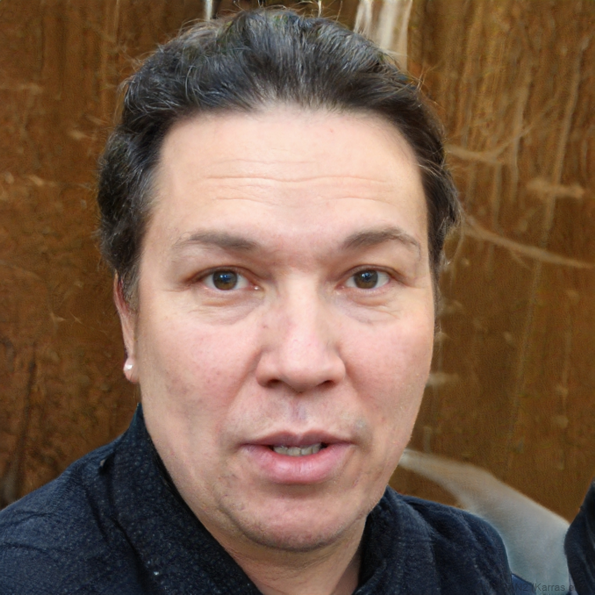

# Entrega 3 — Personas, mapa de empatia, contexto de uso e jornada

**Data:** 09/09/2026  
**Status:** 🟨 em revisão  
**Responsabilidade:** 1 persona por integrante; mapa de empatia, contexto de uso e jornada consolidados pela equipe.

## Objetivo da atividade

Representar os usuários e seu contexto para orientar decisões de interação. As informações ainda não verificadas com usuários reais permanecem identificadas como hipóteses.

## Entradas da Entrega 1

| Item | Situação nesta entrega |
|---|---|
| Inspetor de campo realiza inspeções recorrentes | Base para P02; o uso efetivo do aplicativo por esse perfil ainda deve ser validado. |
| Dono/gestor acompanha os resultados e decide o manejo | Hipótese representada em P01. |
| Agrônomo interpreta dados e orienta decisões | Papel operacional ainda não confirmado; representado provisoriamente em P03. |
| Campo com conexão limitada | Restrição registrada no TCC e relevante para o fluxo de captura. |

> P01, P02 e P03 são **proto-personas**. Idades, histórias pessoais, hábitos e sentimentos não foram obtidos por entrevistas e não devem ser apresentados como fatos observados.

## 1. Personas

### P01 — Jaime Carteiro

**Autor:** Pedro Henrique Ferreira Valim — 24.123.048-1  
**Tipo:** secundária; proto-persona a validar.  
**Papel:** dono/gestor de fazenda de citros.  
**Objetivo:** compreender os focos identificados e decidir as prioridades de manejo.  
**Necessidade:** distinguir áreas examinadas de áreas não examinadas e interpretar resultados por talhão.  
**Hipóteses:** consulta mapas e histórico, recebe os achados do trabalhador e decide onde aplicar o produto. A divisão real dessas responsabilidades precisa ser investigada.

*Imagem ilustrativa; não representa participante da pesquisa.*

### P02 — Antônio Ferreira

**Autor:** Lucas Tonoli Cabral Duarte — 24.123.032-5  
**Tipo:** primária; proto-persona a validar.  
**Origem:** procedimento de inspeção descrito no TCC e hipóteses H03, H09 e H20.

*Imagem ilustrativa; não representa participante da pesquisa.*

| Campo | Descrição |
|---|---|
| Papel | Trabalhador de campo que inspeciona frutos em busca de sinais da praga. |
| Conhecimento | Experiência prática de inspeção; grau de familiaridade com aplicativos técnicos ainda não verificado. |
| Objetivo | Examinar os frutos com rapidez e interpretar corretamente a indicação recebida. |
| Necessidades | Obter uma imagem utilizável, entender o resultado e saber o que fazer quando houver dúvida. |
| Contexto | Deslocamento entre árvores, uso do celular ao ar livre e conexão possivelmente indisponível. |
| Dores | Inspeção manual repetitiva e cansativa; possibilidade de perder um foco ou ter dúvida sobre um sinal. |
| Papel na decisão | Sua participação no repasse dos achados é hipótese; não se deve presumir que ele decide o manejo. |
| Identidade ilustrativa | Idade, trajetória profissional e hábitos específicos atribuídos a Antônio são hipóteses, não dados coletados. |

**Consequências para o design a investigar:**

- Apoio para obter uma foto adequada, conforme as exigências técnicas da captura.
- Resultado curto e compreensível, que diferencie “sem sinal nesta imagem” de “área sem praga”.
- Caminho para repetir a foto ou registrar dúvida.
- Funcionamento da análise no dispositivo sem depender de internet.
- Necessidade real de registrar localização, cobertura da rota e confirmação de envio.

### P03 — Marcelo Fidalgo

**Autor:** Guilherme Morais Escudeiro — 24.123.005-1  
**Tipo:** secundária; proto-persona a validar.  
**Papel hipotético:** agrônomo consultor que examina os achados e orienta o manejo.  
**Objetivo hipotético:** reunir evidências suficientes para emitir parecer técnico.  
**Lacuna:** a participação de um agrônomo no período de coleta do TCC não confirma que exista um consultor remoto no processo cotidiano da propriedade.

*Imagem ilustrativa; não representa participante da pesquisa.*

### Síntese das personas

P02 é o foco principal da interação de captura e leitura do resultado. P01 e P03 representam possíveis necessidades posteriores de decisão e interpretação técnica. A existência, a divisão de responsabilidades e a necessidade de interfaces próprias para esses dois papéis devem ser verificadas na coleta.

## 2. Mapa de empatia — P02

| Dimensão | Registro |
|---|---|
| Vê | **Fato do TCC:** frutos e sinais difíceis de observar; inspeção em campo. **Hipótese:** reflexo do sol na tela e uso cotidiano de mensagens no celular. |
| Ouve | **Hipótese:** orientações do responsável pela área e relatos de colegas. |
| Diz/faz | **Fato:** percorre a plantação e examina frutos. **Hipótese:** fotografa frutos suspeitos e comunica achados ao gestor. |
| Pensa/sente | **Hipótese:** dúvida diante de marcas no fruto e preocupação em concluir a inspeção. Não há relato de participante que confirme sentimentos específicos. |
| Dores | **Fato:** inspeção manual cansativa e demorada; possibilidade de conexão limitada. **Hipótese:** incerteza sobre cobertura e envio dos achados. |
| Ganhos | **Hipótese:** interpretar o resultado rapidamente e evitar retrabalho. |

> **Pendência gráfica:** a imagem do mapa de empatia ainda precisa distinguir visualmente fatos e hipóteses. A tabela acima já faz essa distinção.

## 3. Contexto de uso

| Dimensão | Contexto e implicação |
|---|---|
| Usuário prioritário | P02 executa a inspeção. O fluxo deve considerar uma atividade repetida muitas vezes durante o percurso. |
| Equipamento | Smartphone com câmera; verificar se há lente/acessório exigido pelo protocolo técnico. |
| Ambiente | Pomar ao ar livre, deslocamento, iluminação variável e conexão limitada. |
| Tarefa | Capturar imagem, obter indicação e decidir se segue, repete a captura ou comunica uma suspeita. |
| Organização | Quem define a área, recebe o achado e toma a decisão de manejo ainda precisa ser confirmado. |
| Dados | Necessidade de histórico, rota formal, sincronização e permissões permanece hipótese. |

## 4. Jornada de P02

**Objetivo:** examinar os frutos e comunicar achados, quando isso fizer parte do processo real de trabalho.

| Etapa | Ação/necessidade | Problema ou pergunta | Oportunidade a validar |
|---|---|---|---|
| Antes | Receber a área a examinar e preparar-se para o campo. | Quem define a área e como ela é comunicada? | Indicação simples da área, se houver rota formal. |
| Captura | Posicionar o celular e obter uma foto utilizável. | Distância, foco, iluminação e enquadramento podem comprometer a análise. | Orientação de captura e possibilidade de refazer. |
| Análise | Aguardar a indicação no próprio dispositivo. | Não depender de sinal de internet. | Feedback de processamento, caso a espera seja perceptível. |
| Interpretação | Entender o que a indicação significa. | Um resultado da imagem não equivale a diagnóstico de todo o talhão. | Linguagem curta, indicação de incerteza e próximo passo. |
| Continuação | Seguir para outro fruto ou examinar novamente. | A tarefa é repetitiva e ocorre sob restrições de tempo. | Reduzir etapas desnecessárias. |
| Depois | Encerrar o percurso e, se aplicável, repassar os achados. | Cobertura, canal e confirmação de recebimento não foram confirmados. | Investigar registro e status de envio. |

## Síntese

O fluxo prioritário para as próximas entregas é **captura → análise local → interpretação → continuação ou nova captura**. Rota, histórico, repasse e confirmação de recebimento permanecem hipóteses a investigar com os perfis envolvidos.

## Checklist

- [x] Há uma proto-persona identificada por integrante.
- [x] P02 possui objetivos, contexto e consequências para o design.
- [x] O texto diferencia dados do TCC e hipóteses.
- [x] O contexto e a jornada incluem a atividade antes e depois do uso.
- [ ] A imagem do mapa de empatia distingue fatos e hipóteses.
- [ ] A participação de P01 e P03 no processo real foi confirmada.
- [ ] Os vínculos foram conferidos em `RASTREABILIDADE.md`.
