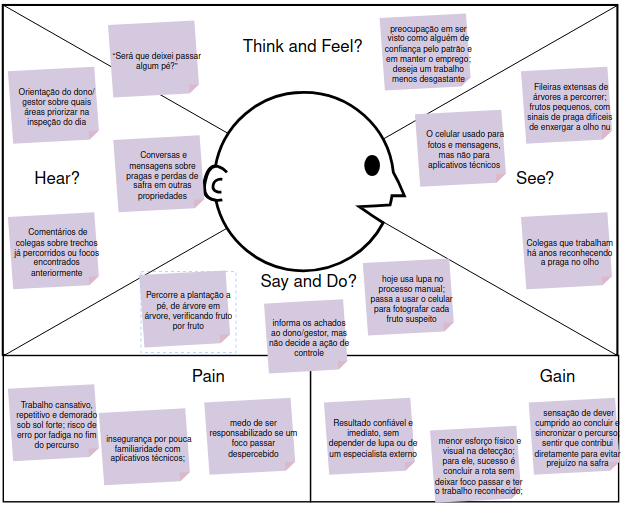

# Entrega 3 — Personas, mapa de empatia, contexto de uso e jornada

**Data:** 09/09/2026  
**Status:** 🟩 concluído como modelagem inicial; personas ainda dependem de validação com usuários  
**Responsabilidade:** uma persona por integrante; mapa de empatia, contexto e jornada consolidados pela equipe.

## Objetivo da atividade

Representar os objetivos, tarefas e restrições dos perfis envolvidos na inspeção de citros. Nenhuma das personas abaixo corresponde a uma pessoa entrevistada. Identidade, trajetória e comportamentos não sustentados pelo TCC são **hipóteses de proto-personas**.

## 1. Personas

| ID | Persona | Autor | Papel e prioridade |
|---|---|---|---|
| P01 | Jaime Carteiro | Pedro Henrique Ferreira Valim | Responsável pelo manejo; secundária e a validar. |
| P02 | Antônio Ferreira | Lucas Tonoli Cabral Duarte — 24.123.032-5 | Inspetor de campo; primária para o fluxo de captura. |
| P03 | Marcelo Fidalgo | Guilherme Morais Escudeiro | Agrônomo consultor; secundária e a validar. |

### P01 — Jaime Carteiro

Jaime representa o possível responsável por receber informações do campo e decidir o manejo. A necessidade de cobertura, histórico e comparação entre ciclos ainda depende de confirmar seu papel e as decisões que realmente toma. Sua descrição não constitui evidência de entrevista ou observação.

### P02 — Antônio Ferreira

**Autor:** Lucas Tonoli Cabral Duarte — 24.123.032-5  
**Tipo:** primária para o fluxo de inspeção  
**Base:** procedimento de inspeção descrito no TCC e hipóteses da Entrega 1; não houve entrevista com Antônio.

| Campo | Descrição |
|---|---|
| Papel | Trabalhador de campo que inspeciona frutos em busca de sinais da praga. |
| Conhecimento | Experiência prática de campo; grau de conhecimento técnico e digital a confirmar. |
| Objetivo | Examinar frutos de forma rápida e confiável e compreender o significado da indicação obtida. |
| Necessidades | Capturar imagem utilizável, reconhecer dúvida ou erro e saber se um achado foi registrado ou comunicado. |
| Restrições conhecidas | Trabalho em campo aberto e possibilidade de conexão ausente ou instável. |
| Restrições hipotéticas | Reflexo do sol na tela, cansaço, mãos ocupadas e dificuldade com aplicativos técnicos; verificar com usuários. |
| Local de uso | Pomar, durante deslocamento entre árvores. |
| Papel na decisão | A hipótese é que ele informa o achado e outra pessoa decide o manejo; confirmar essa divisão. |

**Decisões de interação candidatas:** orientação de captura, resultado curto que não dependa apenas de cor, indicação de incerteza e distinção entre registro local e envio. Leitura em áudio e acompanhamento de rota continuam alternativas a testar, não requisitos confirmados.

### P03 — Marcelo Fidalgo

Marcelo representa um possível agrônomo que interpreta evidências de campo e emite parecer. O TCC registra participação de um agrônomo na definição de um período de coleta, mas isso **não confirma** que exista consultoria remota, validação individual de detecções ou emissão de parecer no fluxo operacional da propriedade. Esse papel deverá ser investigado.

### Classificação das personas

P02 orienta inicialmente o design porque a captura em campo é o fluxo principal da contribuição técnica e possui restrições próprias. P01 e P03 têm objetivos diferentes, mas suas rotinas e a necessidade de interfaces específicas permanecem hipóteses.

## 2. Mapa de empatia — P02

**Legenda:** 🟦 sustentado pelo TCC; 🟨 hipótese a investigar. A tabela é a referência textual; a imagem é ilustrativa.

| Dimensão | Conteúdo |
|---|---|
| Vê | 🟦 Frutos e sinais difíceis de observar; plantação a céu aberto e conexão limitada. 🟨 Reflexo intenso na tela e colegas trocando fotos ou mensagens. |
| Ouve | 🟨 Orientações sobre a área a percorrer e relatos de colegas. Confirmar quem dá essas orientações. |
| Diz/faz | 🟦 Percorre a plantação e examina frutos com lupa no processo manual. 🟨 Registra fotos e comunica achados a outra pessoa. |
| Pensa/sente | 🟦 A inspeção manual é cansativa e demorada. 🟨 Pode sentir dúvida diante de um ponto suspeito e receio de deixar uma área sem exame. |
| Dores | 🟦 Esforço da inspeção manual e falta de internet em parte do campo. 🟨 Dúvida sobre qualidade da foto, cobertura da rota e entrega do aviso. |
| Ganhos | 🟦 Identificar cedo um foco pode reduzir prejuízos. 🟨 Menos retrabalho e mais segurança de que o achado foi compreendido. |

## 3. Contexto de uso

| Dimensão | Descrição | Implicação de design |
|---|---|---|
| Usuário principal | P02 durante a inspeção. | Apoiar captura e interpretação sem exigir longa navegação. |
| Equipamento | Smartphone com câmera previsto no TCC. | Considerar tela pequena, enquadramento e gesto de captura. |
| Ambiente | Campo aberto, deslocamento e conexão limitada. | Testar legibilidade, operação rápida e tratamento de ausência de conexão. |
| Organização | Divisão entre inspetor, gestor e agrônomo ainda não confirmada. | Não presumir permissões, alertas e repasses automáticos. |
| Dados | Inspeção recorrente; necessidade de histórico e mapa a investigar. | Prototipar apenas o que apoiar tarefas verificáveis. |

## 4. Jornada de P02

**Objetivo:** examinar os frutos e compreender o que fazer diante de uma indicação ou dúvida. A jornada inclui a situação anterior e o resultado posterior ao uso.

| Etapa | Ação/situação | Dor ou dúvida | Oportunidade a testar |
|---|---|---|---|
| Antes | Recebe uma área para inspecionar, se essa divisão de trabalho se confirmar. | Não saber como comprovar cobertura. | Identificar a área e o que falta examinar. |
| Preparação | Abre o recurso de captura no celular. | Não conhecer o funcionamento da interface. | Orientação breve no primeiro uso. |
| Captura | Posiciona o celular e fotografa um fruto. | Foto sem foco ou enquadramento adequado. | Feedback de captura compreensível. |
| Processamento | Aguarda a indicação. | Conexão indisponível ou ausência de estado visível. | Processar offline e comunicar o estado. |
| Resultado | Interpreta sinal, ausência de sinal ou resultado inconclusivo. | Confundir “sem sinal na foto” com ausência da praga no talhão. | Explicar o alcance e a incerteza do resultado. |
| Continuação | Examina outro fruto ou repete uma foto duvidosa. | Retrabalho e fadiga. | Caminho curto para continuar ou repetir. |
| Depois | Verifica o que registrou e se algum achado chegou ao destinatário, caso exista esse repasse. | Confundir “salvo no celular” com “enviado”. | Estados distintos de registro e envio. |

As etapas de rota, repasse e sincronização são hipóteses de design. A Entrega 7 deverá investigar se correspondem ao trabalho real.

## Checklist

- [x] Existe uma persona por integrante.
- [x] P02 tem objetivo, tarefa, ambiente e restrições que influenciam o design.
- [x] Fatos e hipóteses foram distinguidos.
- [x] O mapa de empatia distingue a origem das afirmações na tabela.
- [x] A jornada inclui antes, durante e depois do uso.
- [x] P01–P03 e seus vínculos constam em `../RASTREABILIDADE.md`.
