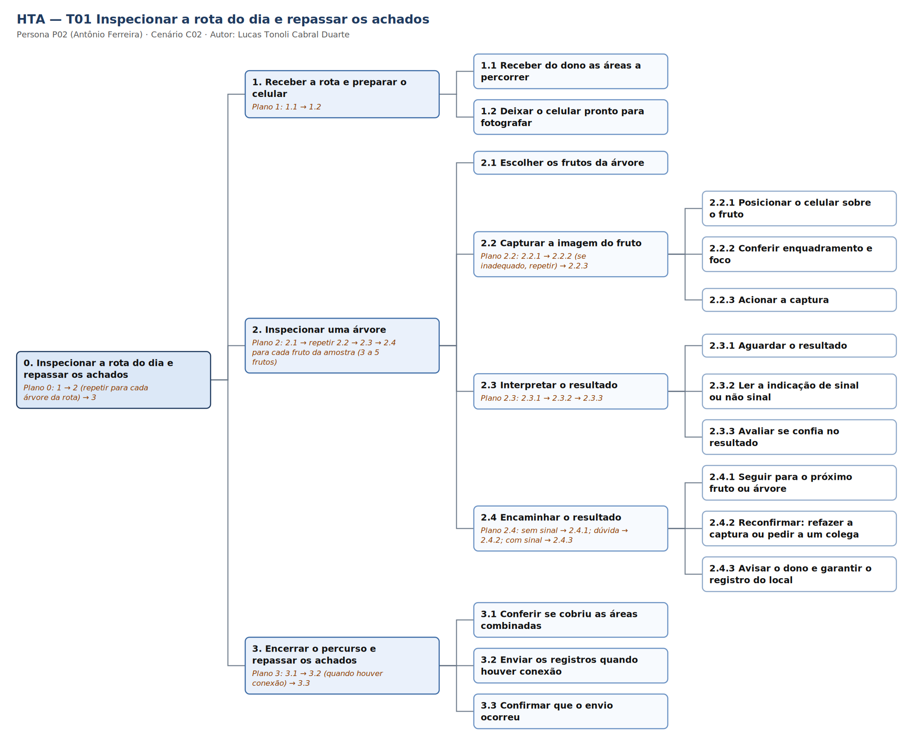
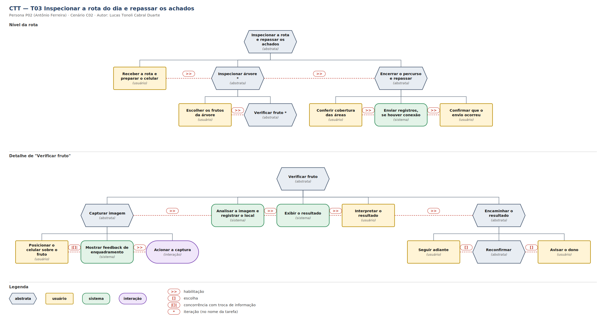
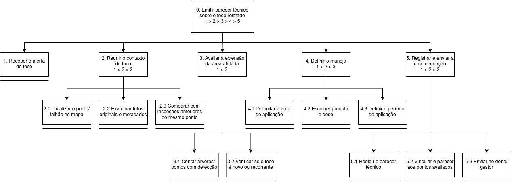
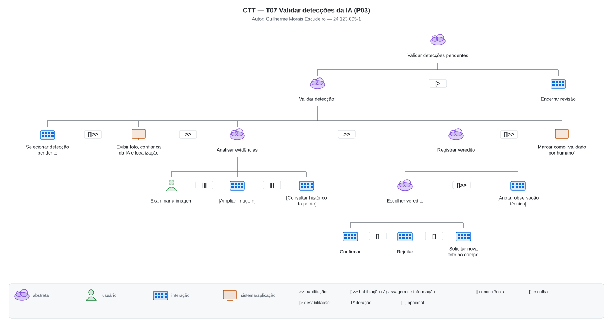
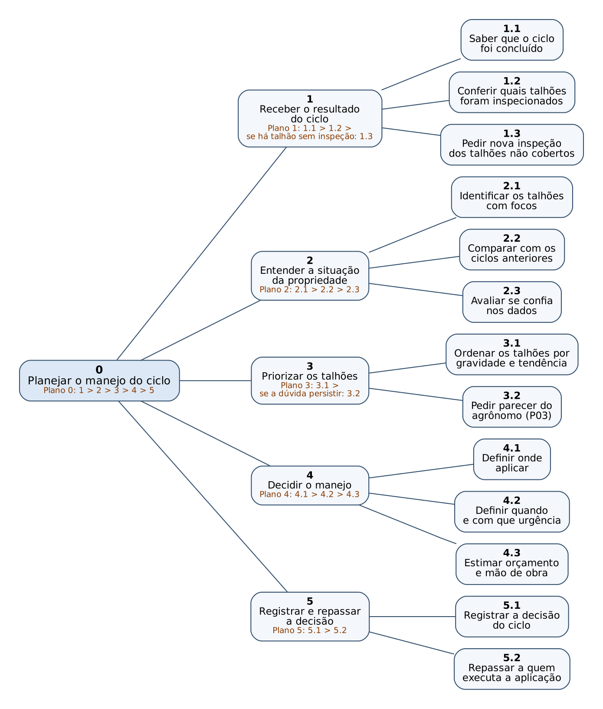
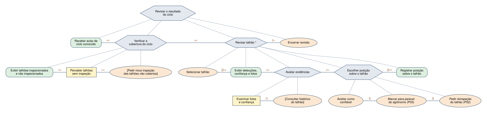

# Entrega 5 — Análise de tarefas: HTA, GOMS e CTT

**Data:** 23/09/2026  
**Status:** 🟨 em andamento  
**Responsabilidade:** cada integrante modela pelo menos 1 HTA, 1 GOMS e 1 CTT. As três técnicas podem abordar a mesma funcionalidade ou funcionalidades distintas, conforme a orientação da disciplina.

## Objetivo da atividade

Modelar tarefas importantes sob perspectivas complementares: decomposição hierárquica (HTA), estrutura de metas/métodos/operações (GOMS) e relações temporais entre tarefas (CTT). O diagrama deve ser acompanhado de interpretação textual.

## Para projetos cujo TCC não previa interface

Modele **tarefas humanas relacionadas ao uso da contribuição técnica**, e não a implementação interna do algoritmo. Exemplos de boas tarefas para análise:

- investigar uma consulta de baixo desempenho;
- configurar uma análise e selecionar parâmetros;
- submeter um dataset e verificar sua validade;
- acompanhar uma execução demorada;
- comparar dois resultados/modelos;
- interpretar uma recomendação e decidir se a aceita;
- localizar uma execução anterior usando busca/filtros;
- gerar e compartilhar um relatório;
- administrar papéis/permissões quando isso for parte do trabalho real;
- revisar um alerta e registrar uma decisão.

Um CRUD pode gerar tarefas relevantes, mas “cadastrar usuário” só merece modelagem se tiver significado no domínio (papéis, validações, riscos, permissões, dependências).

## Seleção das tarefas

| ID | Tarefa | Persona/cenário de origem | Frequência/criticidade | Autor responsável |
|---|---|---|---|---|
| T01 | Inspecionar a rota do dia e repassar os achados (HTA) | P02 / C02 | Frequência alta: a inspeção se repete ao longo do ano, em ciclos de cerca de 14 dias [F16], [F17]. Criticidade alta: um foco que passa despercebido continua se espalhando [F20], [F25] | Lucas Tonoli Cabral Duarte - 24.123.032-5 |
| T02 | Verificar um fruto e encaminhar o resultado (GOMS) | P02 / C02 | Frequência muito alta: repetida a cada fruto de cada árvore da rota [F16], [F17]. Criticidade alta: é onde o foco é detectado ou passa despercebido [F19], [F20] | Lucas Tonoli Cabral Duarte - 24.123.032-5 |
| T03 | Inspecionar a rota do dia e repassar os achados (CTT) | P02 / C02 | Frequência alta e criticidade alta, como em T01 | Lucas Tonoli Cabral Duarte - 24.123.032-5 |
| T04 | Planejar o manejo do ciclo: decidir onde aplicar, quando e com que orçamento (HTA) | P01 / C01 | Frequência: a cada ciclo de inspeção, de cerca de 14 dias (valor do protocolo citado no C02, a confirmar com um dono real) [H05]. Criticidade **alta**: decidir onde aplicar é a atividade mais crítica [H06]; uma decisão errada gera gasto em área sem problema ou foco que se espalha [F20], [F25] | Pedro Henrique Ferreira Valim - 24.123.048-1 |
| T05 | Emitir parecer técnico sobre um foco de infestação | P03 / C03 | Algumas vezes por mês; **crítica** (erro gera aplicação em área errada ou atraso de dias) | Guilherme Morais Escudeiro |
| T06 | Localizar no histórico as inspeções de um talhão | P03 / C03 | Sempre que um parecer é emitido; **alta** (base da comparação temporal) | Guilherme Morais Escudeiro |
| T07 | Validar (confirmar/rejeitar) uma detecção da IA | P03 / C03 | A cada detecção positiva; **alta** (separa "sinal da IA" de "confirmação humana") | Guilherme Morais Escudeiro |
| T08 | Avaliar a evolução de um talhão entre ciclos (GOMS) | P01 / C01 | A cada ciclo, para os talhões de interesse [H05]; **alta** (base para saber se a praga avança e se a última aplicação funcionou [H09], [H22]). | Pedro Henrique Ferreira Valim - 24.123.048-1 |
| T09 | Revisar o resultado do ciclo e decidir se confia nele (CTT) | P01 / C01 | A cada ciclo; **alta** (Jaime não valida a praga sozinho e precisa diferenciar "sem alerta" de "ninguém passou" [H09]) | Pedro Henrique Ferreira Valim - 24.123.048-1 |

> Priorize tarefas necessárias para que o usuário alcance objetivos centrais. Não desperdice a modelagem em ações triviais isoladas, como “clicar em login”, se o objetivo relevante é maior. Da mesma forma, não modele o funcionamento interno do algoritmo como se fosse uma tarefa humana.

---

## HTA — T01 Inspecionar a rota do dia e repassar os achados

**Autor(a):** Lucas Tonoli Cabral Duarte - 24.123.032-5

### Descrição da tarefa

Antônio (P02) recebe do dono as áreas que deve percorrer, caminha entre as árvores, verifica de três a cinco frutos por árvore e precisa saber, para cada fruto, se há sinal de praga. Quando há sinal, o achado precisa chegar a quem decide [F24]. **Início:** Antônio recebe a rota do dia. **Conclusão esperada:** todas as áreas combinadas foram percorridas e os achados foram repassados, com a certeza de que chegaram. **Contexto:** campo aberto, sol forte, pouco tempo por planta, pouca ou nenhuma internet [F23]. A tarefa é descrita no nível do que P02 faz ao usar a contribuição do TCC (celular com detecção), sem desenhar telas. Parte da sequência vem de hipóteses ainda não validadas com um pragueiro real ([H08], [H09]) e será confirmada na Entrega 7.

### Diagrama

### Decomposição e planos

| ID | Objetivo/operação | Plano/ordem | Problema ou decisão de design observada |
|---|---|---|---|
| 0 | Inspecionar a rota do dia e repassar os achados | 1 > 2 (repetir por árvore) > 3 | Quem inspeciona nem sempre decide [F24]: a tarefa só se completa quando o achado chega a quem decide |
| 1.2 | Deixar o celular pronto para fotografar | — | Pouca familiaridade com aplicativos técnicos [H20]: preparação mínima, sem atrasar a rota |
| 2.1 | Escolher os frutos da árvore | 3 a 5 frutos; ramos internos se não houver frutos adequados | Decisão do próprio pragueiro, que precisa lembrar quais árvores já cobriu [H09] |
| 2.2.1 | Posicionar o celular sobre o fruto | — | Sem a lupa, é preciso manter a distância certa com uma só mão, andando e sob sol forte [F23] |
| 2.2.2 | Conferir enquadramento e foco | Repetir 2.2.1–2.2.2 até ficar adequado | Principal ponto de erro: foto ruim leva a resultado ruim. Decisão: avisar sobre o enquadramento antes da captura |
| 2.2.3 | Acionar a captura | — | Fadiga e pouco tempo por planta [F19]: o mínimo de gestos possível |
| 2.3.1 | Aguardar o resultado | — | Sem internet [F13]: o resultado precisa vir sem depender de conexão e sem espera longa |
| 2.3.2 | Ler a indicação de sinal ou não sinal | — | Leitura sob luz solar direta em tela pequena [H03]: indicação curta e visual |
| 2.3.3 | Avaliar se confia no resultado | — | Antônio já tem dúvida entre ácaro e marca da casca (C02, Q2): decidir como o resultado comunica incerteza |
| 2.4.2 | Reconfirmar: refazer a captura ou pedir a um colega | Se a dúvida persistir após refazer, chamar colega | Custa tempo em campo: precisa ser rápido e não punir o erro |
| 2.4.3 | Avisar o dono e garantir o registro do local | Só quando há sinal | Hoje a foto e o aviso saem sem local preciso (C02, Q3; C03): o local não pode depender da memória nem de esforço extra |
| 3.1 | Conferir se cobriu as áreas combinadas | — | Hoje não há registro do percurso, e fica a dúvida "deixei passar um pé?" [H08], [H09] |
| 3.2 | Enviar os registros quando houver conexão | Condicionado à conexão | O envio não pode bloquear o trabalho nem exigir ação em campo |
| 3.3 | Confirmar que o envio ocorreu | — | Dúvida "será que chegou lá?" (jornada de P02, etapa 6): status de envio visível |

**Verificação do HTA:**

- O objetivo 0 representa uma meta do usuário? **Sim:** inspecionar e repassar com confiança, não "usar o app".
- As subtarefas são necessárias e suficientes? **Sim:** ficaram de fora a decisão de manejo (A02, do dono e do agrônomo) e o funcionamento interno da detecção.
- Os **planos** indicam ordem, alternativa, repetição ou condição? **Sim:** ordem (1 > 2 > 3), repetição (por fruto e por árvore), condição (2.4, 3.2) e alternativa (2.4.1, 2.4.2, 2.4.3).
- A decomposição parou em nível útil para projeto de interação? **Sim:** parou em posicionar, conferir, acionar, ler e decidir, sem descer a toques de tela.

---

## GOMS — T02 Verificar um fruto e encaminhar o resultado

**Autor(a):** Lucas Tonoli Cabral Duarte - 24.123.032-5

O modelo cobre o ciclo repetido a cada fruto (subtarefas 2.2 a 2.4 do HTA T01), onde estão as alternativas de execução e as decisões do usuário.

### Goal

`G0: Verificar um fruto e encaminhar corretamente o resultado`

- `G1: Obter uma imagem utilizável do fruto`
- `G2: Interpretar o resultado`
- `G3: Encaminhar o resultado`

### Métodos, operadores e regras de seleção

- **Method M1 (G1, captura direta):**
  - Operators: perceber o fruto e a luz; posicionar o celular sobre o fruto; perceber o feedback de enquadramento; acionar a captura.
- **Method M2 (G1, captura com ajuste):**
  - Operators: perceber que o enquadramento ou a luz está inadequado (reflexo, sombra, desfoque); ajustar ângulo ou distância, ou fazer sombra com o corpo ou a mão; perceber o feedback de enquadramento; acionar a captura.
- **Method M3 (G2, leitura direta):**
  - Operators: aguardar o resultado; perceber a indicação; decidir que confia nela.
- **Method M4 (G2, reconfirmação):**
  - Operators: perceber a dúvida; repetir G1 ou chamar um colega e mostrar o fruto e a tela; comparar com o que o colega vê; decidir.
- **Method M5 (G3, seguir adiante):**
  - Operators: decidir que não há sinal; deslocar-se até o próximo fruto ou árvore.
- **Method M6 (G3, avisar o dono):**
  - Operators: decidir que há sinal; avisar o dono (pessoalmente ou por mensagem); conferir que o local ficou registrado; seguir adiante.
- **Selection Rule SR1 (G1):** usar M1 quando o feedback indica enquadramento adequado de primeira; usar M2 quando há reflexo, sombra ou desfoque.
- **Selection Rule SR2 (G2):** usar M3 quando o resultado é claro e coerente com o que Antônio vê no fruto; usar M4 quando o resultado contradiz sua percepção ou ele fica em dúvida. *Hipótese a validar: refazer a captura uma ou duas vezes antes de chamar um colega.*
- **Selection Rule SR3 (G3):** usar M5 quando não há sinal; usar M6 quando há sinal confirmado.

> Não chame qualquer passo de “método”. Em GOMS, métodos são sequências alternativas capazes de atingir uma meta; regras de seleção explicam quando escolher entre eles.

**Interpretação:** o custo se concentra em M2 e M4, os caminhos em que Antônio perde tempo e atenção justamente quando está cansado e com pouco tempo por planta. Isso indica que o feedback de enquadramento (reduz o uso de M2) e a forma de comunicar incerteza (reduz idas e vindas em M4) são decisões de interação prioritárias. M6 mostra que o registro do local precisa acontecer sem esforço extra, ligando este modelo ao problema do C03. Não foram estimados tempos (KLM), apenas a estrutura de metas, métodos e regras.

---

## CTT — T03 Inspecionar a rota do dia e repassar os achados

**Autor(a):** Lucas Tonoli Cabral Duarte - 24.123.032-5

### Descrição

O modelo mostra a relação temporal entre as tarefas de Antônio e as do sistema ao longo da rota: preparar, inspecionar árvore a árvore, verificar cada fruto e repassar os achados. O diagrama está em dois níveis para ficar legível.

### Diagrama

### Legenda e relações temporais usadas

| Operador/relação | Significado no diagrama | Exemplo no modelo |
|---|---|---|
| `>>` (habilitação) | A tarefa seguinte só começa quando a anterior termina | Analisar a imagem `>>` Exibir o resultado `>>` Interpretar o resultado |
| `[]` (escolha) | Apenas uma das alternativas é executada | Seguir adiante `[]` Reconfirmar `[]` Avisar o dono, conforme o resultado |
| `*` (iteração) | A tarefa se repete até a condição de parada | Inspecionar árvore (para cada árvore da rota); Verificar fruto (3 a 5 frutos por árvore) |
| `\|[]\|` (concorrência com troca de informação) | As tarefas acontecem ao mesmo tempo e uma alimenta a outra | Posicionar o celular `\|[]\|` Mostrar feedback de enquadramento |

**Tipos de tarefa (formato do nó):** hexágono = abstrata; retângulo = usuário; arredondado = sistema; estádio = interação.

Identifique, quando aplicável, tarefas de usuário, sistema, interação e tarefas abstratas. Verifique se concorrência, escolha, habilitação, desabilitação e repetição estão representadas corretamente segundo a notação adotada em aula.

**Interpretação:** três pontos merecem atenção no projeto de interação. Primeiro, posicionar o celular e receber o feedback de enquadramento acontecem juntos, e só depois a captura é habilitada. É aqui que se decide se a foto sai boa. Segundo, depois do resultado, Antônio escolhe entre seguir, reconfirmar ou avisar o dono, e essa escolha depende da leitura rápida e da confiança no resultado. Terceiro, o envio dos registros só ocorre se houver conexão, então a tarefa precisa fechar sem ele e Antônio só confirma o envio depois. Não há tarefa do dono ou do agrônomo neste modelo: elas aparecem nas tarefas de P01 e P03. O operador de desabilitação não se aplicou a esta tarefa.

---

## Modelagens de Guilherme Morais Escudeiro — P03 / C03

As três modelagens abaixo partem do cenário C03 (Entrega 4) e da persona P03, Marcelo Fidalgo, agrônomo consultor. Ele valida remotamente os focos de infestação e recomenda o manejo. Como o C03 sugere, a tarefa "reunir contexto suficiente para emitir parecer" é tratada como uma tarefa própria de P03, distinta da captura feita por P02. As tarefas descrevem o que o agrônomo faz com os **resultados** da detecção, e não o funcionamento interno da rede neural.

---

## HTA — T05 Emitir parecer técnico sobre um foco de infestação

**Autor(a):** Guilherme Morais Escudeiro — 24.123.005-1

### Descrição da tarefa

- **Objetivo:** emitir uma recomendação de manejo tecnicamente embasada (área, produto, dose e período) para um foco de ácaro-da-leprose detectado em campo.
- **Ponto de início:** Marcelo recebe o alerta de que há detecções novas em uma propriedade que atende. Hoje isso chega por ligação do dono e fotos soltas; no escopo de IHC, chegaria como alerta do próprio sistema.
- **Conclusão esperada:** a recomendação fica registrada, vinculada aos pontos avaliados, e é enviada ao dono/gestor (P01), que decide a execução.
- **Contexto:** trabalho remoto, no escritório, sem presença na fazenda. Marcelo depende totalmente da informação repassada pelo campo, que hoje chega incompleta (sem local, data ou relação entre as fotos).

### Diagrama

### Decomposição e planos

| ID | Objetivo/operação | Plano/ordem | Problema ou decisão de design observada |
|---|---|---|---|
| 0 | Emitir parecer técnico sobre o foco relatado | 1 > 2 > 3 > 4 > 5 | O modelo descreve o caminho em que o contexto reunido basta para o parecer. O caso de informação insuficiente (ruptura do C03) é tratado no CTT T07, pela saída *Solicitar nova foto ao campo*. |
| 1 | Receber o alerta do foco | — | O alerta precisa levar direto ao foco (talhão/ponto), e não a uma tela genérica, para Marcelo não precisar procurar. |
| 2 | Reunir o contexto do foco | 2.1 > 2.2 > 2.3 | Do geral para o específico: primeiro onde está o foco, depois o que mostram as fotos, por fim o que já aconteceu naquele ponto. |
| 2.1 | Localizar o ponto/talhão no mapa | — | Geolocalização registrada automaticamente na captura, e não informada pela memória do trabalhador. |
| 2.2 | Examinar fotos originais e metadados | — | Imagem original, sem compressão de mensageiro, com data, hora e identificação da árvore. |
| 2.3 | Comparar com inspeções anteriores do mesmo ponto | — | Exige histórico por local; depende da tarefa T06 (GOMS abaixo). |
| 3 | Avaliar a extensão da área afetada | 3.1 > 3.2 | Resume o contexto reunido em 2 em uma estimativa de área, base para a decisão de manejo em 4. |
| 3.1 | Contar árvores/pontos com detecção | — | Contagem agregada por talhão evita a contagem manual de fotos. |
| 3.2 | Verificar se o foco é novo ou recorrente | — | Indicar visualmente os pontos que já tiveram detecção antes. |
| 4 | Definir o manejo | 4.1 > 4.2 > 4.3 | A área vem primeiro porque ela determina a quantidade de produto; o erro relatado no C03 (aplicar em área maior que a necessária) acontece em 4.1. |
| 4.1 | Delimitar a área de aplicação | — | Seleção de área diretamente sobre o mapa de focos. |
| 4.2 | Escolher produto e dose | — | Fora do escopo da interface: conhecimento técnico de Marcelo; o sistema apenas registra. |
| 4.3 | Definir o período de aplicação | — | — |
| 5 | Registrar e enviar a recomendação | 5.1 > 5.2 > 5.3 | O parecer vinculado aos pontos avaliados cria o histórico que hoje não existe (mensagens soltas que se perdem). |
| 5.1 | Redigir o parecer técnico | — | — |
| 5.2 | Vincular o parecer aos pontos avaliados | — | — |
| 5.3 | Enviar ao dono/gestor (P01) | — | Quem executa o manejo é P01, e não P03; o repasse deve ser explícito (ligação com a síntese da Entrega 3). |

**Verificação do HTA:**

- **O objetivo 0 representa uma meta do usuário?** Sim. É a meta profissional de P03 registrada na Entrega 3 ("validar tecnicamente os focos e recomendar o manejo").
- **As subtarefas são necessárias e suficientes?** Cobrem o ciclo do C03 no caminho em que a informação basta: receber, entender, dimensionar, decidir e comunicar. O pedido de novos dados ao campo ficou fora do HTA e está modelado no CTT T07.
- **Os planos indicam ordem, alternativa, repetição ou condição?** Todos os planos são sequenciais (`1 > 2 > 3`). A ordem adotada vai do geral para o específico em 2, segue a dependência área → produto → período em 4 e termina no repasse a P01 em 5.
- **A decomposição parou em nível útil?** Parou nas operações que viram ações de interface (localizar no mapa, examinar foto, delimitar área). A 4.2 não foi decomposta porque é julgamento técnico de Marcelo, sem interação a projetar.

---

## GOMS — T06 Localizar no histórico as inspeções de um talhão

**Autor(a):** Guilherme Morais Escudeiro — 24.123.005-1

A tarefa é um recorte da subtarefa 2.3 do HTA T05. O modelo supõe a interface proposta no escopo de IHC, com mapa de focos e histórico com filtros (decisões de design de P03 na Entrega 3). O nível de detalhe dos operadores é de ações de interface (CMN-GOMS).

### Goal

`G0: Encontrar todas as detecções registradas no talhão X nas últimas N semanas, para comparar com o foco atual`

### Métodos, operadores e regras de seleção

- **Method M1: localizar pelo mapa** (parte do *onde*)
  - Operators:
    1. abrir a visão de mapa da propriedade;
    2. perceber a posição do talhão X no mapa;
    3. apontar e tocar/clicar no talhão X;
    4. perceber a lista de pontos com detecção do talhão;
    5. ajustar o intervalo de datas para as últimas N semanas;
    6. perceber e ler a lista de detecções resultante.
- **Method M2: localizar pelo histórico com filtros** (parte do *quando*)
  - Operators:
    1. abrir a tela de histórico de inspeções;
    2. selecionar o filtro de período e informar as últimas N semanas;
    3. selecionar o filtro de local e escolher o talhão X na lista;
    4. confirmar os filtros;
    5. perceber e ler a lista de detecções resultante.
- **Method M3: navegar a partir do alerta atual** (parte do foco que está sendo avaliado)
  - Operators:
    1. abrir a detecção recebida no alerta;
    2. acionar "ver histórico deste ponto/talhão";
    3. perceber e ler a lista de detecções anteriores do mesmo local.
- **Selection Rule SR1:** usar **M3** quando a busca nasce de um alerta que Marcelo está avaliando naquele momento (caso típico do C03); usar **M1** quando ele sabe *onde* está o problema mas não reconhece o nome/código do talhão; usar **M2** quando busca um *período* específico ou vai comparar vários talhões no mesmo intervalo.

**Observações de design a partir do modelo:**

- M3 tem o menor número de operadores e cobre o caso mais frequente. Por isso, o atalho "ver histórico deste ponto" deve estar na própria tela da detecção.
- M1 depende de o talhão ser reconhecível no mapa. Rótulos e limites dos talhões precisam ser visíveis sem zoom excessivo.
- M2 exige que Marcelo saiba o nome/código do talhão. Isso é hipótese: ele atende a várias propriedades e pode não memorizar a nomenclatura de cada uma (validar na Entrega 7).
- Os três métodos terminam no mesmo formato de lista. O resultado deve ser idêntico independentemente do caminho, para não gerar dúvida sobre "qual lista está certa".

---

## CTT — T07 Validar detecções da IA

**Autor(a):** Guilherme Morais Escudeiro — 24.123.005-1

### Descrição

Marcelo revisa as detecções positivas geradas pela IA em campo e decide, para cada uma, se confirma, rejeita ou pede uma nova foto. A tarefa responde à decisão de design de P03 que separa claramente "sinal detectado pela IA" de "confirmação/validação humana". Ela alimenta a subtarefa 3 do HTA T05: só focos confirmados entram no dimensionamento da área. A revisão é iterativa (várias detecções por sessão) e pode ser encerrada a qualquer momento.

### Diagrama

### Legenda e relações temporais usadas

| Operador/relação | Significado no diagrama | Exemplo no modelo |
|---|---|---|
| `T*` (iteração) | A tarefa se repete um número indeterminado de vezes | *Validar detecção\** se repete para cada detecção pendente |
| `[>` (desabilitação) | A tarefa da direita interrompe e encerra a da esquerda | *Encerrar revisão* interrompe o ciclo *Validar detecção\** a qualquer momento |
| `[]>>` (habilitação com passagem de informação) | A tarefa da direita só começa quando a da esquerda termina, e recebe dela um dado | *Selecionar detecção* passa a detecção escolhida para *Exibir foto, confiança e localização*; *Registrar veredito* passa o veredito para *Marcar como "validado por humano"* |
| `>>` (habilitação) | A tarefa da direita só começa quando a da esquerda termina | *Exibir...* >> *Analisar evidências* >> *Registrar veredito* |
| `\|\|\|` (concorrência independente) | As tarefas podem ser feitas em qualquer ordem ou intercaladas | Marcelo examina a imagem enquanto amplia e consulta o histórico do ponto |
| `[]` (escolha) | Apenas uma das alternativas é executada | *Confirmar* [] *Rejeitar* [] *Solicitar nova foto ao campo* |
| `[T]` (opcional) | A tarefa pode ser omitida | *[Ampliar imagem]*, *[Consultar histórico do ponto]*, *[Anotar observação técnica]* |

**Tipos de tarefa no modelo:**

- **Abstratas:** *Validar detecções pendentes*, *Validar detecção\**, *Analisar evidências*, *Registrar veredito*, *Escolher veredito*. São decompostas em subtarefas.
- **Usuário:** *Examinar a imagem*, atividade cognitiva de julgamento técnico sem interação com o sistema.
- **Interação:** *Selecionar detecção pendente*, *[Ampliar imagem]*, *[Consultar histórico do ponto]*, *Confirmar*, *Rejeitar*, *Solicitar nova foto ao campo*, *[Anotar observação técnica]*, *Encerrar revisão*.
- **Sistema/aplicação:** *Exibir foto, confiança da IA e localização*, *Marcar como "validado por humano"*.

**Leitura do modelo e implicações:**

- A concorrência em *Analisar evidências* indica que imagem, zoom e histórico precisam estar acessíveis **na mesma tela**. Navegar entre telas quebraria a análise intercalada.
- *Solicitar nova foto ao campo* cobre o caso que o HTA T05 deixa de fora (contexto insuficiente para o parecer), como uma das três saídas possíveis da validação. É o ponto de ligação entre P03 e P02.
- O nível de confiança da IA é exibido *antes* da análise humana. Isso pode induzir viés de confirmação; vale discutir no protótipo se ele deve aparecer só depois do veredito (a avaliar na Entrega 7).
- A desabilitação por *Encerrar revisão* exige que o progresso seja salvo por detecção: o que já foi validado não pode se perder se Marcelo interromper a sessão.

---

### Síntese das modelagens de P03

- **Requisitos que surgem:** geolocalização e metadados gravados automaticamente na captura; histórico acessível a partir da detecção (M3); veredito humano registrado separado do resultado da IA; pedido de nova foto direcionado a um ponto específico.
- **Candidatos ao protótipo e ao teste de usabilidade:** o fluxo *alerta → detecção → histórico do ponto → veredito* (T07 + M3 do T06), por concentrar a principal dor do C03 em poucas telas.
- **Hipóteses que continuam abertas:** H04, H07 e H21 (ver C03); frequência real dos pareceres e metadados mínimos exigidos por um agrônomo, a validar na Entrega 7.

## Modelagens de Pedro Henrique Ferreira Valim — P01 / C01
 
As três modelagens abaixo partem do cenário C01 (Entrega 4) e da persona P01, Jaime Carteiro, dono da fazenda. Ele não inspeciona nem valida a praga: decide, a cada ciclo, onde aplicar o manejo e com que orçamento, a partir do que chega do campo. As tarefas descrevem o que o gestor faz com os **resultados** da detecção, e não o funcionamento interno da rede neural. Elas se encaixam nas dos colegas: o que P02 captura em T01 a T03 é o que P01 revisa aqui, e o parecer que P03 emite em T05 volta para P01 como entrada da decisão.
 
---
 
## HTA — T04 Planejar o manejo do ciclo
 
**Autor(a):** Pedro Henrique Ferreira Valim — 24.123.048-1
 
### Descrição da tarefa
 
- **Objetivo:** decidir onde aplicar o produto de controle, quando e com que orçamento e mão de obra, com base nos resultados do ciclo de inspeção, e deixar a decisão registrada e repassada a quem executa.
- **Ponto de início:** Jaime fica sabendo que o ciclo de inspeção terminou. Hoje isso chega por conversa ou mensagem do pragueiro; no escopo de IHC, chegaria como aviso do próprio sistema.
- **Conclusão esperada:** a decisão do ciclo fica registrada e chega a quem aplica o produto [H02].
- **Contexto:** escritório da propriedade, com visitas eventuais ao talhão (persona P01); baixo conhecimento técnico para identificar a praga; decisão repetida a cada ciclo. Quem inspeciona não é quem decide [F24].
A tarefa é descrita no nível do que P01 faz ao usar a contribuição do TCC, sem desenhar telas. Parte da sequência vem de hipóteses ainda não validadas com um dono de fazenda real ([H04], [H05], [H06], [H09], [H21]) e será confirmada na Entrega 7.
 
### Diagrama
 

 
*Fonte editável: `hta_t04.dot` (Graphviz).*
 
### Decomposição e planos
 
| ID | Objetivo/operação | Plano/ordem | Problema ou decisão de design observada |
|---|---|---|---|
| 0 | Planejar o manejo do ciclo | 1 > 2 > 3 > 4 > 5 | A decisão é a atividade mais crítica de P01 [H06] e quem inspeciona nem sempre decide [F24]: a tarefa só se completa quando a decisão chega a quem executa |
| 1 | Receber o resultado do ciclo | 1.1 > 1.2 > se há talhão sem inspeção: 1.3 | Hoje o resultado chega por relato verbal ou mensagem, quase sempre de memória (C01, Q1) |
| 1.1 | Saber que o ciclo foi concluído | — | Sem aviso estruturado, Jaime depende de o pragueiro lembrar de avisar; o aviso do ciclo evita esperar pelo relato |
| 1.2 | Conferir quais talhões foram inspecionados | — | Hoje ele não diferencia "sem praga" de "ninguém passou" (C01, Q5; C02, [H09]): a cobertura precisa aparecer antes da leitura dos resultados |
| 1.3 | Pedir nova inspeção dos talhões não cobertos | Só se 1.2 mostrar talhão sem inspeção | Depende de poucos pragueiros (C01, Q4): o pedido precisa ser direto e não virar mais uma conversa solta |
| 2 | Entender a situação da propriedade | 2.1 > 2.2 > 2.3 | Do geral para o específico: primeiro onde estão os focos, depois como evoluíram, por fim se os dados merecem confiança |
| 2.1 | Identificar os talhões com focos | — | Falta um quadro por talhão [H19]; a leitura precisa ser objetiva e sem exigir conhecimento técnico (persona P01) |
| 2.2 | Comparar com os ciclos anteriores | — | Hoje o histórico fica só na memória e em conversas antigas [H05], [H09]; detalhado no GOMS T08 |
| 2.3 | Avaliar se confia nos dados | — | Jaime não valida a praga sozinho (persona P01): o alerta precisa mostrar o que foi detectado e com que confiança, em linguagem simples; detalhado no CTT T09 |
| 3 | Priorizar os talhões | 3.1 > se a dúvida persistir: 3.2 | Hoje ele não consegue priorizar com segurança (C01, cenário refinado) |
| 3.1 | Ordenar os talhões por gravidade e tendência | — | Decisão em aberto: mostrar só o dado ou também sugerir uma ordem. Sugerir pode invadir o papel do agrônomo (P03) |
| 3.2 | Pedir parecer do agrônomo (P03) | Só quando a dúvida persiste após 2.3 | É o ponto em que a tarefa T05 de Guilherme começa. O pedido deve levar o talhão e o motivo da dúvida, para P03 não partir do zero (C03) |
| 4 | Decidir o manejo | 4.1 > 4.2 > 4.3 | A área vem primeiro porque ela determina urgência e custo; o erro de aplicar em área maior que a necessária acontece em 4.1 [H06] |
| 4.1 | Definir onde aplicar | — | A decisão é de Jaime, embora [H04] ainda não confirme quem decide no dia a dia; a escolha por talhão deve partir do mesmo mapa usado para entender a situação |
| 4.2 | Definir quando e com que urgência | — | Depende da tendência (2.2) e do tempo que a praga leva para se espalhar [F14] |
| 4.3 | Estimar orçamento e mão de obra | — | Fora do escopo da interface: é julgamento administrativo de Jaime. O sistema apenas fornece a área e o número de talhões envolvidos, e por isso o passo não foi decomposto |
| 5 | Registrar e repassar a decisão | 5.1 > 5.2 | Sem registro, a decisão não vira histórico para o ciclo seguinte [H22] |
| 5.1 | Registrar a decisão do ciclo | — | Permite saber, no ciclo seguinte, se a aplicação funcionou (liga com T08) |
| 5.2 | Repassar a quem executa a aplicação | — | Quem aplica pode não ser quem usa o app [H02]: o repasse precisa ser explícito |
 
**Verificação do HTA:**
 
- **O objetivo 0 representa uma meta do usuário?** Sim. É a meta de P01 registrada na persona e na Entrega 1 (A02, [F15]): proteger a produção, gastando menos e agindo no lugar certo. Não é "usar o app".
- **As subtarefas são necessárias e suficientes?** Cobrem o ciclo do C01: receber, entender, priorizar, decidir e registrar. Ficaram de fora a captura da imagem (P02, T01 a T03), a validação técnica da detecção (P03, T07) e a aplicação do produto no campo.
- **Os planos indicam ordem, alternativa, repetição ou condição?** Sim. Ordem (1 > 2 > 3 > 4 > 5 e dentro de cada bloco), condição em 1.3 (só com talhão sem inspeção) e em 3.2 (só se a dúvida persistir). A repetição por ciclo está no contexto da tarefa, e não dentro do diagrama.
- **A decomposição parou em nível útil para projeto de interação?** Parou nas operações que viram decisões de interface (conferir cobertura, comparar ciclos, avaliar confiança, ordenar, repassar). A 4.3 não foi decomposta por ser julgamento administrativo, sem interação a projetar.
---
 
## GOMS — T08 Avaliar a evolução de um talhão entre ciclos
 
**Autor(a):** Pedro Henrique Ferreira Valim — 24.123.048-1
 
O modelo é um recorte da subtarefa 2.2 do HTA T04. Ele supõe a interface proposta no escopo de IHC, com visão de mapa, lista de talhões e histórico por talhão (decisões de design de P01 na Entrega 3). Esses elementos são hipóteses de solução, e não requisitos: "dashboard" e "histórico" aparecem como "talvez" na seção 8 da Entrega 1 ([H14], [H15]), e a comparação entre ciclos ainda precisa ser confirmada com um dono real. O nível de detalhe dos operadores é de ações de interface (CMN-GOMS), como no T06.
 
### Goal
 
`G0: Saber, para o talhão X, se a infestação está avançando, estável ou recuando entre ciclos, e se a última aplicação funcionou`
 
- `G1: Obter a comparação do talhão X entre o ciclo atual e os anteriores`
- `G2: Interpretar a tendência`
### Métodos, operadores e regras de seleção
 
- **Method M1 (G1, pelo mapa, comparando ciclos):**
  - Operators:
    1. abrir a visão de mapa da propriedade;
    2. selecionar o ciclo atual;
    3. alternar para o ciclo anterior (ou ativar a comparação entre os dois);
    4. perceber a mudança dos pontos no talhão X e nos vizinhos.
- **Method M2 (G1, pela evolução do talhão):**
  - Operators:
    1. abrir o talhão X (no mapa ou na lista);
    2. abrir a evolução do talhão por ciclo;
    3. perceber a variação de um ciclo para o outro.
- **Method M3 (G1, pela lista de talhões ordenada por variação):**
  - Operators:
    1. abrir a lista de talhões;
    2. ordenar por variação entre ciclos;
    3. localizar o talhão X;
    4. perceber a variação do talhão X.
- **Method M4 (G2, leitura direta):**
  - Operators: perceber a tendência (avançando, estável ou recuando); relacionar com a última aplicação feita no talhão; decidir a conclusão.
- **Method M5 (G2, leitura com verificação de cobertura):**
  - Operators: perceber que um dos ciclos comparados teve cobertura incompleta ou detecções de baixa confiança; abrir a cobertura dos ciclos comparados; decidir se a comparação é válida; só então concluir ou marcar o talhão como inconclusivo.
- **Selection Rule SR1 (G1):** usar **M3** quando Jaime começa o planejamento sem um talhão em mente e quer um panorama dos candidatos; usar **M1** quando quer ver se a praga está se espalhando para os vizinhos (atividade A03); usar **M2** quando já tem o talhão X em mente, por exemplo para conferir se a última aplicação funcionou. *Hipótese a validar na Entrega 7: qual dos três é o ponto de partida mais comum.*
- **Selection Rule SR2 (G2):** usar **M4** quando o talhão foi inspecionado por inteiro nos ciclos comparados e a variação é clara; usar **M5** quando há cobertura incompleta, detecção de baixa confiança ou variação pequena e ambígua.
**Observações de design a partir do modelo:**
 
- M2 tem o menor número de operadores, mas exige que Jaime já saiba qual talhão olhar. M3 serve ao panorama e é o caminho natural no início do planejamento (HTA 3.1).
- M1 depende de o mapa mostrar dois ciclos de forma comparável. Se ele só mostrar o ciclo atual, o caminho vira alternar telas e confiar na memória, que é o problema do C01.
- M5 acrescenta passos, mas protege de uma conclusão errada: sem a cobertura, "recuou" pode significar apenas "ninguém passou". A cobertura precisa estar a um toque da comparação, e não numa área separada.
- Os três métodos de G1 terminam na mesma informação. O resultado deve ser idêntico independentemente do caminho, para não gerar dúvida sobre qual leitura está certa.
- Não foram estimados tempos (KLM), apenas a estrutura de metas, métodos e regras.
---
 
## CTT — T09 Revisar o resultado do ciclo e decidir se confia nele
 
**Autor(a):** Pedro Henrique Ferreira Valim — 24.123.048-1
 
### Descrição
 
Ao fim de cada ciclo, Jaime revisa o resultado antes de decidir o manejo. Como não sabe identificar a praga, ele não valida a detecção: confere o que foi inspecionado e, talhão a talhão, decide se aceita o resultado como confiável, se pede o parecer do agrônomo ou se pede uma nova inspeção. O modelo é um recorte das subtarefas 1 e 2.3 do HTA T04. A revisão é iterativa (um talhão por vez) e pode ser encerrada a qualquer momento.
 
### Diagrama
 

 
*Fonte editável: `ctt_t09_revisar_ciclo.dot` (Graphviz).*
 
### Legenda e relações temporais usadas
 
| Operador/relação | Significado no diagrama | Exemplo no modelo |
|---|---|---|
| `>>` (habilitação) | A tarefa da direita só começa quando a da esquerda termina | *Receber aviso de ciclo concluído* `>>` *Verificar a cobertura do ciclo* `>>` *Revisar talhão* |
| `[]>>` (habilitação com passagem de informação) | A tarefa da direita só começa quando a da esquerda termina e recebe dela um dado | *Selecionar talhão* passa o talhão escolhido para *Exibir detecções, confiança e fotos*; *Escolher posição* passa a decisão para *Registrar posição* |
| `*` (iteração) | A tarefa se repete até a condição de parada | *Revisar talhão\** se repete para cada talhão com detecção |
| `[>` (desabilitação) | A tarefa da direita interrompe e encerra a da esquerda | *Encerrar revisão* interrompe o ciclo *Revisar talhão\** a qualquer momento |
| `\|\|\|` (concorrência independente) | As tarefas podem ser feitas em qualquer ordem ou intercaladas | Examinar fotos e confiança `\|\|\|` consultar o histórico do talhão |
| `[]` (escolha) | Apenas uma das alternativas é executada | *Aceitar como confiável* `[]` *Marcar para parecer do agrônomo* `[]` *Pedir reinspeção do talhão* |
| `[T]` (opcional) | A tarefa pode ser omitida | *[Pedir nova inspeção dos talhões não cobertos]*, *[Consultar histórico do talhão]* |
 
**Tipos de tarefa (formato e cor do nó):** hexágono cinza = abstrata; retângulo amarelo = usuário; retângulo arredondado verde = sistema; elipse laranja = interação.
 
- **Abstratas:** *Revisar o resultado do ciclo*, *Verificar a cobertura do ciclo*, *Revisar talhão\**, *Avaliar evidências*, *Escolher posição sobre o talhão*. São decompostas em subtarefas.
- **Usuário:** *Perceber talhões sem inspeção*, *Examinar fotos e confiança*, atividades cognitivas de leitura e julgamento.
- **Interação:** *[Pedir nova inspeção dos talhões não cobertos]*, *Selecionar talhão*, *[Consultar histórico do talhão]*, *Aceitar como confiável*, *Marcar para parecer do agrônomo (P03)*, *Pedir reinspeção do talhão (P02)*, *Encerrar revisão*.
- **Sistema/aplicação:** *Receber aviso de ciclo concluído*, *Exibir talhões inspecionados e não inspecionados*, *Exibir detecções, confiança e fotos*, *Registrar posição sobre o talhão*.
**Leitura do modelo e implicações:**
 
- A cobertura (*Verificar a cobertura do ciclo*) é habilitada antes da revisão dos talhões (`>>`). É nesse ponto que Jaime diferencia "sem alerta" de "ninguém passou" (C01, Q5), e isso depende do que P02 registra em campo (C02, [H09]).
- Em *Avaliar evidências*, a concorrência indica que fotos, confiança e histórico do talhão precisam estar acessíveis na mesma tela. Como Jaime não consegue conferir a praga sozinho, é o histórico que lhe permite dizer "esse ponto já tinha problema antes".
- *Escolher posição* tem três saídas. *Marcar para parecer do agrônomo* leva ao T07 de P03 (validar a detecção) e *Pedir reinspeção do talhão* leva ao T01 de P02. Jaime decide em quem confiar, e não se a praga existe. Se o fluxo não tornar essas duas saídas fáceis, ele tende a aceitar tudo ou a duvidar de tudo.
- A desabilitação por *Encerrar revisão* exige que a posição de cada talhão seja salva ao ser registrada: o que já foi revisado não pode se perder se Jaime interromper a sessão.
- Não há tarefa de P02 ou P03 dentro do modelo: elas aparecem como destino das duas saídas, mas são modeladas em T01 a T03 e T05 a T07. A repetição de *Revisar talhão\** não tem número fixo de voltas: ela termina quando todos os talhões com detecção foram revisados ou quando Jaime escolhe *Encerrar revisão*. A disponibilidade do pragueiro para uma reinspeção (C01, Q4) fica fora do modelo.
---
 
### Síntese das modelagens de P01
 
- **Requisitos que surgem:** aviso de ciclo concluído; cobertura do ciclo visível antes dos resultados; visão por talhão com tendência entre ciclos; evidência e grau de confiança em linguagem simples; pedido de parecer (P03) e de reinspeção (P02) a partir do próprio fluxo; registro da decisão por ciclo.
- **Candidatos ao protótipo e ao teste de usabilidade:** o fluxo *aviso do ciclo → cobertura → revisão por talhão → posição* (T09) combinado com a comparação entre ciclos (M3 e M2 do T08), por concentrar a principal dor do C01 em poucas telas.
- **Hipóteses que continuam abertas:** H04, H05, H06, H09 e H21 (ver C01); se a comparação entre ciclos é necessidade real, qual intervalo de tempo faz sentido e o que dá confiança a Jaime num alerta, a validar na Entrega 7.

## Síntese da equipe

Quais problemas de interação, oportunidades e requisitos apareceram a partir das modelagens? Quais tarefas irão para o protótipo e para o teste de usabilidade?

**Contribuição do Pedro (P01):**
 
- **Problemas de interação:** resultado do ciclo sem aviso nem cobertura, o que impede diferenciar "sem praga" de "ninguém passou" (1.1, 1.2); comparação entre ciclos sem histórico (2.2); confiança num alerta sem conhecimento técnico para conferi-lo (2.3); fronteira indefinida entre mostrar o dado e sugerir uma ordem de prioridade (3.1); decisão que não fica registrada nem chega com clareza a quem aplica (5.1, 5.2).
- **Requisitos que emergiram:** aviso de ciclo concluído; cobertura visível antes dos resultados; visão por talhão com tendência entre ciclos; evidência e confiança em linguagem simples; caminhos para pedir parecer e reinspeção sem sair do fluxo; registro da decisão por ciclo.
- **Para o protótipo e o teste de usabilidade:** o fluxo "aviso do ciclo → cobertura → revisão por talhão → posição" (T09) e a comparação entre ciclos (T08). A síntese final da equipe deve cruzá-los com a cobertura e a reinspeção de P02 e com o parecer e a validação de P03.

**Contribuição do Lucas (P02):**

- **Problemas de interação:** foto ruim por enquadramento sem apoio (2.2.2), dúvida sobre o resultado e como comunicá-la (2.3.3, 2.4.2), local do achado dependente da memória (2.4.3), dúvida sobre cobertura da rota e sobre o envio (3.1, 3.3).
- **Requisitos que emergiram:** feedback de enquadramento antes da captura; leitura rápida do resultado sob sol; funcionamento sem internet; registro automático do local; indicação clara de cobertura e de status de envio.
- **Para o protótipo e o teste de usabilidade:** o ciclo "Verificar fruto" (captura, resultado, encaminhamento) e o fechamento do percurso (cobertura e envio). A síntese final da equipe deve juntar isto com as tarefas de P01 e P03.

## Checklist

- [ ] Cada integrante produziu ao menos 1 HTA, 1 GOMS e 1 CTT.
- [ ] Cada artefato identifica autor e tarefa.
- [ ] Diagramas são legíveis e possuem fonte editável quando possível.
- [ ] HTA contém planos, não apenas árvore de tópicos.
- [ ] GOMS distingue Goals, Operators, Methods e Selection Rules.
- [ ] CTT usa operadores temporais e tipos de tarefa coerentes.
- [ ] Há texto explicando cada diagrama.
- [ ] Tarefas estão ligadas a cenários/personas na rastreabilidade.
- [ ] Em TCC técnico, as tarefas descrevem o que a pessoa faz com a contribuição/resultados, não passos internos do código.
- [ ] CRUDs, relatórios, filtros e atividades administrativas foram escolhidos por relevância ao objetivo do usuário.
