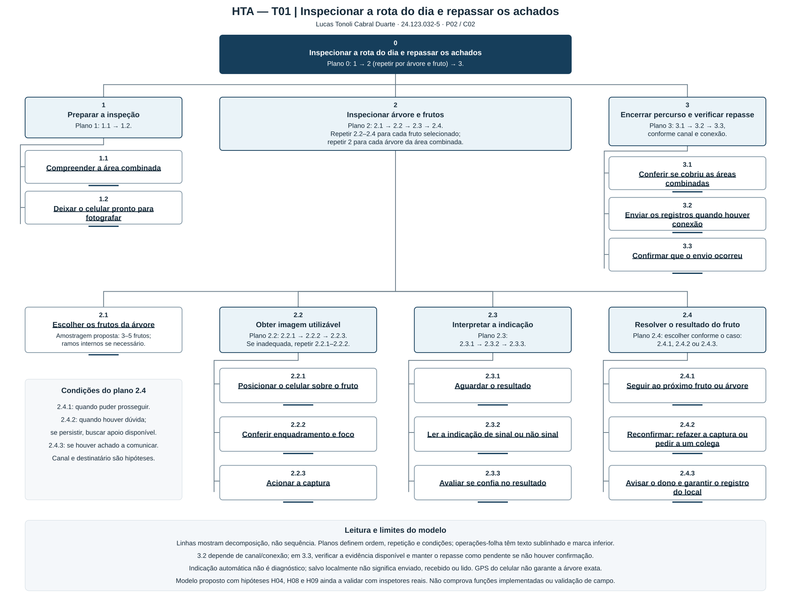
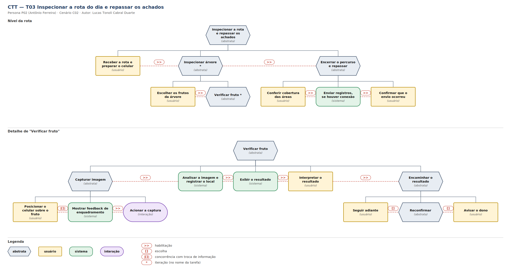

# Entrega 5 — Análise de tarefas: HTA, GOMS e CTT

**Data:** 23/09/2026  
**Status:** 🟩 contribuição de Lucas concluída; diagramas dos outros integrantes devem ser conferidos pelos respectivos autores  
**Responsabilidade:** cada integrante produz ao menos um HTA, um GOMS e um CTT.

## Objetivo da atividade

Modelar tarefas humanas de inspeção e uso dos resultados. O algoritmo interno de detecção não é apresentado como tarefa do usuário.

## 1. Seleção das tarefas

| ID | Tarefa | Persona/cenário | Técnica | Autor |
|---|---|---|---|---|
| T01 | Inspecionar a rota e repassar achados | P02/C02 | HTA | Lucas Tonoli Cabral Duarte |
| T02 | Verificar um fruto e encaminhar o resultado | P02/C02 | GOMS | Lucas Tonoli Cabral Duarte |
| T03 | Inspecionar a rota e repassar achados | P02/C02 | CTT | Lucas Tonoli Cabral Duarte |
| T04 | Planejar o manejo do ciclo | P01/C01 | HTA | Pedro Henrique Ferreira Valim |
| T05 | Emitir parecer sobre um foco | P03/C03 | HTA | Guilherme Morais Escudeiro |
| T06 | Localizar inspeções anteriores de um talhão | P03/C03 | GOMS | Guilherme Morais Escudeiro |
| T07 | Validar detecção da IA | P03/C03 | CTT | Guilherme Morais Escudeiro |
| T08 | Avaliar a evolução entre ciclos | P01/C01 | GOMS | Pedro Henrique Ferreira Valim |
| T09 | Revisar o resultado do ciclo | P01/C01 | CTT | Pedro Henrique Ferreira Valim |

T01–T03 têm alta frequência potencial, pois a verificação se repete por fruto e árvore. O repasse, a cobertura de rota e a sincronização são hipóteses que dependem da confirmação dos papéis reais.

## 2. HTA — T01 Inspecionar a rota do dia e repassar achados

**Autor:** Lucas Tonoli Cabral Duarte — 24.123.032-5  
**Persona:** P02, Antônio Ferreira  
**Cenário:** C02

**Início:** recebe a área combinada para inspeção, caso esse modo de organização se confirme.  
**Conclusão:** examina os frutos previstos e conhece o estado de registro e de eventual repasse dos achados.  
**Contexto:** campo aberto, repetição do exame, possibilidade de conexão ausente.

**Fonte editável:** `../assets/05_tarefas/hta_t01.dot`. As operações-folha estão grifadas no SVG.

| ID | Objetivo/operação | Plano |
|---|---|---|
| 0 | Inspecionar a rota e repassar achados. **Input:** área informada pelo responsável e condições de inspeção. **Feedback:** áreas examinadas e estado do repasse conhecido. | 1 > 2 repetidamente > 3; envio condicionado à existência de canal e conexão. |
| 1 | Preparar a inspeção. | 1.1 > 1.2. |
| 1.1 | Compreender a área combinada. | Operação-folha. |
| 1.2 | Preparar o celular para fotografar. | Operação-folha. |
| 2 | Inspecionar árvore e frutos. | 2.1 > 2.2 > 2.3 > 2.4; repetir conforme a amostragem. |
| 2.1 | Escolher frutos. | Operação-folha. |
| 2.2 | Obter imagem utilizável. | 2.2.1 > 2.2.2 > 2.2.3; repetir posicionamento/conferência se necessário. |
| 2.2.1 | Posicionar o celular. | Operação-folha. |
| 2.2.2 | Conferir enquadramento e foco. | Operação-folha. |
| 2.2.3 | Acionar a captura. | Operação-folha. |
| 2.3 | Interpretar a indicação. | 2.3.1 > 2.3.2 > 2.3.3. |
| 2.3.1 | Aguardar resultado. | Operação-folha. |
| 2.3.2 | Ler a indicação. | Operação-folha. |
| 2.3.3 | Avaliar se o resultado resolve a dúvida. | Operação-folha. |
| 2.4 | Resolver o resultado do fruto. | 2.4.1 **ou** 2.4.2 **ou** 2.4.3, conforme o caso. |
| 2.4.1 | Seguir ao próximo fruto. | Operação-folha. |
| 2.4.2 | Reconfirmar por outra foto ou apoio disponível. | Operação-folha. |
| 2.4.3 | Comunicar achado pelo canal existente. | Operação-folha; canal e destinatário a confirmar. |
| 3 | Encerrar percurso e verificar repasse. | 3.1 > 3.2 se houver canal/conexão > 3.3 se houver confirmação. |
| 3.1 | Conferir as áreas combinadas. | Operação-folha. |
| 3.2 | Enviar registros quando houver conexão. | Operação-folha; necessidade de sincronização a validar. |
| 3.3 | Verificar se ocorreu o envio. | Operação-folha; ausência de confirmação deve ser comunicada como tal. |

**Interpretação:** obter uma foto utilizável e resolver uma indicação duvidosa são pontos críticos. “Sem sinal na foto” não significa “talhão sem praga”. Da mesma forma, um registro salvo localmente não equivale a informação recebida pelo responsável.

## 3. GOMS — T02 Verificar um fruto e encaminhar o resultado

**Autor:** Lucas Tonoli Cabral Duarte — 24.123.032-5

**GOAL 0 — Verificar um fruto e encaminhar corretamente o resultado.**

1. **GOAL 1 — Obter imagem utilizável.**
   - **SELECTION RULE 1:** usar METHOD 1.A quando o enquadramento estiver adequado; usar METHOD 1.B quando houver reflexo, sombra ou desfoque.
   - **METHOD 1.A — Captura direta:** perceber fruto e luz → posicionar celular → perceber feedback → capturar → **verificar se a imagem foi capturada/aceita**.
   - **METHOD 1.B — Ajustar captura:** perceber inadequação → ajustar ângulo/distância/luz → conferir novamente → capturar → **verificar se a imagem foi capturada/aceita**.
2. **GOAL 2 — Interpretar a indicação.**
   - **SELECTION RULE 2:** usar METHOD 2.A se o resultado for compreensível; METHOD 2.B se houver dúvida ou contradição.
   - **METHOD 2.A — Leitura direta:** aguardar → ler → comparar com a observação → **verificar se compreendeu o próximo passo**.
   - **METHOD 2.B — Reconfirmar:** perceber dúvida → repetir GOAL 1 ou buscar apoio disponível → comparar → **verificar se a dúvida foi resolvida ou continua pendente**.
3. **GOAL 3 — Seguir ou comunicar.**
   - **SELECTION RULE 3:** usar METHOD 3.A se puder continuar; METHOD 3.B se um achado exigir comunicação.
   - **METHOD 3.A — Continuar:** decidir seguir → deslocar-se → **verificar o próximo ponto a examinar**.
   - **METHOD 3.B — Comunicar:** identificar achado/local → informar pelo canal existente → **verificar recebimento ou registrar ausência de confirmação**.

Cada método termina com verificação do estado alcançado. Não foram estimados tempos KLM. Repetição de foto e consulta a colega são hipóteses a validar, não procedimentos observados.

## 4. CTT — T03 Inspecionar a rota e repassar achados

**Autor:** Lucas Tonoli Cabral Duarte — 24.123.032-5

O modelo começa com o recebimento da área, evento externo que motiva a tarefa. Depois da preparação, Antônio repete a inspeção por árvore e fruto. Posicionar o celular e receber orientação de enquadramento ocorrem em conjunto; a captura habilita a análise no dispositivo, que habilita a apresentação e a interpretação do resultado. Após interpretá-lo, há escolha entre continuar, reconfirmar ou comunicar um achado. O envio eventual é condicionado à conexão.

| Relação | Significado no modelo |
|---|---|
| `>>` | Habilitação: a tarefa seguinte começa após a anterior. |
| `[]` | Escolha entre seguir, reconfirmar ou comunicar. |
| `*` | Repetição por fruto/árvore. |
| `\|[]\|` | Concorrência com troca de informação entre posicionamento e orientação de enquadramento. |

**Tipos:** tarefa abstrata representa agrupamento; tarefa do usuário representa ação ou julgamento; tarefa de interação envolve pessoa e interface; tarefa do sistema representa análise e apresentação. O repasse para gestor ou agrônomo é uma ligação com as tarefas deles, não uma ação atribuída a P02 sem confirmação.

## 5. Articulação com as modelagens da equipe

| Persona | Modelos | Relação com T01–T03 |
|---|---|---|
| P01 — Pedro | T04, T08, T09 | Pode receber e analisar os resultados da inspeção, se esse papel for confirmado. |
| P03 — Guilherme | T05, T06, T07 | Pode solicitar evidência adicional e emitir parecer, se esse fluxo existir na prática. |

Os modelos de P01 e P03 continuam identificados com seus respectivos autores. A conferência final de seus diagramas e fontes editáveis cabe a eles; não é atribuída a Lucas.

## Síntese de Lucas

- **Problemas:** captura inadequada, resultado inconclusivo, local de achado dependente da memória e confusão entre dado salvo e dado enviado.
- **Para o protótipo:** captura → indicação → continuar/reconfirmar/comunicar; considerar também ausência de conexão e estado do eventual envio.
- **Para investigar:** quem recebe o achado, necessidade de rota/cobertura, necessidade de sincronização e modo como inspetores lidam hoje com dúvidas.
- **Rastreabilidade:** P02 → C02 → T01/T02/T03, registrada em `../RASTREABILIDADE.md`.

## Checklist

- [x] Lucas produziu HTA, GOMS e CTT com autoria e tarefa identificadas.
- [x] O HTA T01 apresenta tarefa 0, input, feedback, planos e todas as operações; as folhas estão grifadas no SVG.
- [x] O GOMS T02 distingue Goals, Methods, Selection Rules e operadores; cada método termina com verificação.
- [x] O CTT T03 identifica ação externa, repetição, escolha, habilitação e tipos de tarefa.
- [x] As tarefas descrevem ações humanas relacionadas à contribuição técnica.
- [x] Os vínculos de Lucas foram registrados em `../RASTREABILIDADE.md`.
- [ ] Diagramas e fontes de T04–T09: conferência final dos autores Pedro e Guilherme.
