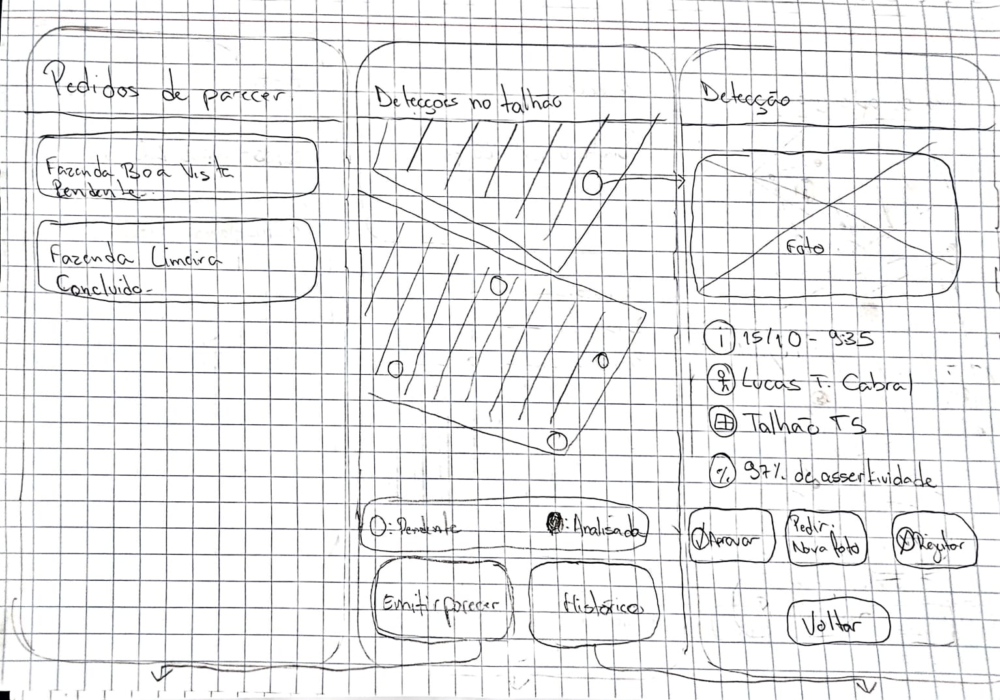
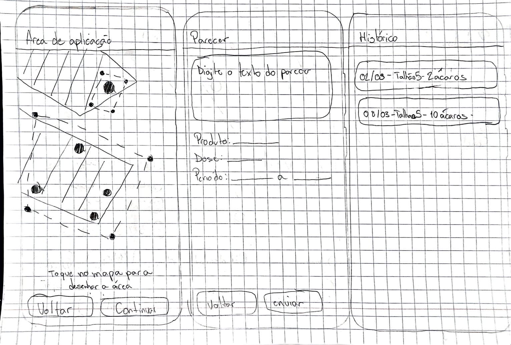

# Entrega 6 — Prototipação em papel

**Data:** 11/10/2026 
**Status:** 🟨 em andamento 
**Responsabilidade:** 1 solução integrada por equipe

## Objetivo da atividade

Explorar ideias de interação em baixa fidelidade, seguindo o ciclo **construir → simular → observar → revisar**.

## 1. Escopo do protótipo

### Funcionalidade — Lucas

**Funcionalidade:** inspeção de frutos e repasse dos achados. 
**Persona:** P02 — Antônio Ferreira, trabalhador de campo/pragueiro. 
**Cenários/tarefas cobertos:** C02; T01 e T03 — inspecionar a rota e repassar os achados; T02 — verificar um fruto e encaminhar o resultado. 
**Objetivos principais:** facilitar a captura da foto, apresentar resultados claros, registrar o local e conferir a cobertura da rota e o envio dos registros.

### Funcionalidade — Guilherme

**Funcionalidade:** validação remota das detecções da IA e emissão do parecer técnico sobre o foco. 
**Persona:** P03 — Marcelo Fidalgo, agrônomo consultor. 
**Cenários/tarefas cobertos:** C03; T07 — validar (confirmar/rejeitar) as detecções da IA; T06 — localizar no histórico as inspeções do talhão (método M3, a partir da detecção); T05 — emitir parecer técnico sobre o foco (passos 1 a 5). 
**Objetivos principais:** levar o alerta direto ao foco, reunir foto original, data, autor e talhão da detecção, dar acesso ao histórico do talhão, separar "sinal da IA" de "confirmação humana", permitir pedir nova foto ao campo e registrar um parecer vinculado aos pontos avaliados e repassado ao gestor.

### Funcionalidade — Pedro

**Funcionalidade:** revisão do resultado do ciclo, avaliação da evolução dos talhões e registro da decisão de manejo.  
**Persona:** P01 — Jaime Carteiro, dono da fazenda.  
**Cenários/tarefas cobertos:** C01; T09 — revisar o resultado do ciclo e decidir se confia nele; T08 — avaliar a evolução de um talhão entre ciclos; T04 — planejar o manejo do ciclo (passos 1, 2, 3, 4 e 5).  
**Objetivos principais:** conferir a cobertura do ciclo antes dos resultados, mostrar onde estão os focos e como evoluem, dar ao gestor evidência que ele consiga avaliar sem conhecimento técnico, permitir pedir parecer ou reinspeção e registrar a decisão do ciclo.

## 1.1 Possíveis famílias de interface

**Lucas:**

- **Entrada de dados:** captura da foto com orientação de foco.
- **Acompanhamento de execução:** análise da imagem e cancelamento.
- **Resultados:** sinal suspeito, ausência de sinal na foto ou resultado inconclusivo.
- **Acompanhamento da rota e envio:** pontos registrados, pendências e situação do repasse.

**Guilherme:**

- **Alertas/ocorrências:** pedidos de parecer por propriedade atendida, com a situação de cada pedido (pendente ou concluído).
- **Resultados:** pontos com detecção do talhão em mapa, com a situação de cada um (pendente ou analisado).
- **Explicabilidade/detalhamento:** foto original, data, hora, quem fotografou, talhão e avaliação da IA.
- **Histórico/comparação:** detecções anteriores do talhão, com data e quantidade de ácaros.
- **Encaminhamento e registro:** veredito por detecção (aprovar, rejeitar ou pedir nova foto), área de aplicação, parecer com produto, dose e período, e repasse ao gestor.

**Pedro:**

- **Visão geral:** resumo do ciclo e cobertura da propriedade por talhão.
- **Alertas/ocorrências:** aviso de ciclo concluído.
- **Resultados:** talhões com focos, em mapa e em lista ordenada.
- **Explicabilidade/detalhamento:** fotos, grau de confiança e local de cada talhão.
- **Histórico/comparação:** evolução do talhão entre ciclos e última aplicação.
- **Encaminhamento e registro:** pedido de parecer ou reinspeção, decisão do ciclo e repasse.

## 2. Fluxos escolhidos

| Responsável | Fluxo | Tarefa/objetivo | Por que foi priorizado |
|---|---|---|---|
| Lucas | PF01 | Fotografar o fruto, interpretar e registrar o resultado — T02. | Tarefa frequente, sujeita a erros de captura e interpretação. |
| Lucas | PF02 | Conferir a rota e o envio dos achados — T01/T03. | Reduz dúvidas sobre pontos esquecidos e registros não enviados. |
| Guilherme | PF03 | Validar as detecções do foco, consultando o histórico do ponto — T07 e T06 (M3). | Só focos confirmados por humano devem entrar no dimensionamento da área [H07]; hoje Marcelo recebe fotos soltas, sem local nem histórico (C03). |
| Guilherme | PF04 | Dimensionar a área, registrar o parecer e repassá-lo ao gestor — T05 (passos 3, 4 e 5). | O erro relatado no C03 (aplicar em área maior que a afetada) ocorre na delimitação da área, e o parecer hoje se perde em mensagens soltas. |
| Pedro | PF05 | Revisar o resultado do ciclo, conferir a cobertura e decidir se confia — T09 (e T04, passos 1 e 2.3). | Sem a cobertura, o gestor não diferencia "sem praga" de "ninguém passou" [H09], e ele não valida a praga sozinho. |
| Pedro | PF06 | Avaliar a evolução de um talhão e registrar a decisão do ciclo — T08 e T04 (passos 2.2, 3, 4 e 5). | Decidir onde aplicar é a atividade mais crítica do gestor [H06] e depende de saber se a praga avança e se a última aplicação funcionou. |

## 3. Telas e estados

**Desenho do protótipo em papel:** concluído na parte de Guilherme (fotos ao fim da seção); pendente nas partes de Lucas e Pedro, cujas telas abaixo ainda representam o planejamento.

### Funcionalidade — Lucas

| Tela | Conteúdo previsto | Controles e mudanças de estado |
|---|---|---|
| P01 | Rota do dia e pontos pendentes. | Iniciar inspeção → P02; revisar rota → P06. |
| P02 | Câmera com orientação de foco. | Fotografar → P03; ajustar foto inadequada; voltar → P01. |
| P03 | Análise da imagem sem internet. | Exibir resultado → P04; cancelar → P02. |
| P04 | Resultado suspeito, sem sinal na foto ou inconclusivo. | Salvar → P05; refazer foto → P02. |
| P05 | Confirmação do registro salvo e identificação do local. | Próximo fruto/árvore → P02; revisar rota → P06. |
| P06 | Pontos registrados e pendentes da rota. | Retomar inspeção → P02; encerrar indicando pendências → P07. |
| P07 | Situação do envio ao gestor. | Enviar quando houver conexão; tentar novamente após falha; voltar → P06. |

**Caminho principal:** P01 → P02 → P03 → P04 → P05 → P06 → P07.

**Erros e retornos:** foto inadequada exige ajuste; resultado inconclusivo permite refazer; falta de GPS permite identificar o local manualmente; falha no envio mantém os registros salvos para nova tentativa.

**Informações importantes:** distinguir “salvo no celular” de “enviado”. Ausência de sinal na foto não significa que toda a árvore esteja livre da praga.

### Funcionalidade — Guilherme

| Tela/estado | Conteúdo previsto | Controles e mudanças de estado |
|---|---|---|
| A01 | Pedidos de parecer (vindos de G04) por propriedade, com a situação de cada pedido ("pendente" ou "concluído"). | Abrir pedido → A02 (direto no talhão do foco). |
| A02 | Detecções no talhão: mapa do talhão com os pontos com detecção e legenda da situação de cada ponto (○ pendente, ● analisado). | Selecionar ponto → A03; emitir parecer → A06; histórico → A05. |
| A03 | Detecção do ponto: foto original, data e hora, quem fotografou, talhão e grau de assertividade da IA. | Aprovar ou rejeitar → A02 (ponto passa a "analisado"); pedir nova foto → A02 (pedido enviado à rota do trabalhador, sem tela própria; o ponto continua "pendente" até a nova foto ser avaliada); voltar → A02. |
| A05 | Histórico de detecções do talhão em lista, com data e quantidade de ácaros encontrados. | Voltar → A02. |
| A06 | Área de aplicação: mapa do talhão com os pontos analisados; Marcelo toca no mapa para desenhar a área. | Continuar → A07; voltar → A02. |
| A07 | Parecer: texto técnico e campos livres de produto, dose e período (o sistema só registra). | Enviar → A01 (pedido passa a "concluído"); voltar → A06. |

**Caminho principal:** A01 → A02 → A03 → A02 (repete por ponto) → A06 → A07 → A01. O desvio A02 → A05 → A02 cobre a consulta ao histórico (T06), e o pedido de nova foto em A03 cobre a terceira saída do veredito no CTT T07. 
**Erros e retornos:** foto insuficiente leva ao pedido de nova foto em vez de forçar aprovar ou rejeitar; todas as telas permitem voltar à anterior sem perder o que já foi preenchido. O protótipo não representa falha no envio do parecer, já que a tela A08 foi retirada.

**Alterações em relação ao planejamento:** as telas A04 (pedido de nova foto) e A08 (situação do parecer) foram retiradas no desenho, por serem consideradas redundantes. O pedido de nova foto virou um botão direto em A03, ao lado de aprovar e rejeitar, sem formulário de motivo e prazo. A situação do parecer passa a aparecer na própria lista de pedidos (A01), que mostra o pedido como "concluído" após o envio. Os demais identificadores foram mantidos para não quebrar as referências nas outras entregas.

**Informações importantes:** distinguir "detectado pela IA" de "validado por humano" em todas as telas.

### Funcionalidade — Pedro

| Tela/estado | Conteúdo previsto | Controles e mudanças de estado |
|---|---|---|
| G01 | Resumo do ciclo concluído: data, quantos talhões foram inspecionados e quantos têm focos. | Ver cobertura → G02. |
| G02 | Cobertura do ciclo: talhões inspecionados e não inspecionados, bem diferenciados de "sem focos". | Pedir nova inspeção dos talhões não cobertos (confirma e permanece em G02); continuar → G03. |
| G03 | Talhões com focos, em mapa e em lista ordenada por gravidade e tendência. | Selecionar talhão → G04; encerrar revisão → G07; voltar → G02. |
| G04 | Detalhe do talhão no ciclo: fotos, grau de confiança em linguagem simples (sem números técnicos), local e aviso se a cobertura do talhão foi incompleta. | Aceitar como confiável, marcar para parecer do agrônomo ou pedir reinspeção → G05; ver evolução → G06; voltar → G03. |
| G05 | Confirmação da posição registrada para o talhão (confiável, parecer pedido ou reinspeção pedida). | Próximo talhão → G03; encerrar revisão → G07. |
| G06 | Evolução do talhão por ciclo (avançando, estável ou recuando), com a última aplicação marcada. Avisa quando algum ciclo comparado teve cobertura incompleta. | Ver cobertura dos ciclos comparados → G02; voltar → G04. |
| G07 | Decisão do ciclo: talhões com a posição registrada e escolha de onde e quando aplicar, com urgência. | Registrar decisão → G08; voltar → G03. |
| G08 | Confirmação da decisão registrada e do repasse a quem aplica o produto. | Repassar; tentar novamente após falha. |

**Caminho principal:** G01 → G02 → G03 → G04 → G05 → G03 (próximo talhão) → G07 → G08. O desvio G04 → G06 → G04 corresponde à avaliação da evolução (T08). 
**Erros e retornos:** talhão sem inspeção permite pedir nova inspeção em G02 sem sair da tela; cobertura incompleta aparece em G04 e G06 e impede que a comparação pareça conclusiva; a dúvida do gestor leva a "parecer do agrônomo" ou "reinspeção", e não bloqueia o fluxo; encerrar a revisão a qualquer momento mantém as posições já registradas; falha no repasse mantém a decisão salva para nova tentativa.

## 4. Simulação / walkthrough

A simulação deverá envolver uma pessoa que não participou da elaboração das telas. Um colega pode participar desta iteração formativa, sem substituir os participantes finais da Entrega 14.

### Funcionalidade — Lucas

**Situação:** pendente, após desenhar as telas. 
**Condutor:** Lucas. 
**Participante:** {{...}} 
**Data da simulação:** {{...}}

**Roteiro:** pedir que a pessoa fotografe um fruto, interprete o resultado, salve sem internet, confira a rota e verifique o envio quando a conexão retornar.

| Observação | Tela/ação | Evidência | Consequência para o design |
|---|---|---|---|
| A verificar: compreensão da captura. | P02 — fotografar ou ajustar a imagem. | Registrar dúvidas e pedidos de ajuda. | Revisar instruções conforme observado. |
| A verificar: interpretação do resultado. | P04 — salvar ou refazer. | Registrar como a pessoa explica o resultado. | Ajustar mensagens que causarem confusão. |
| A verificar: compreensão das pendências. | P06/P07 — conferir rota e envio. | Registrar se distingue pendente, salvo e enviado. | Revisar legendas e mensagens de estado. |

As observações reais serão preenchidas após a simulação.

### Funcionalidade — Guilherme

**Situação:** telas desenhadas; simulação pendente. 
**Condutor:** Guilherme. 
**Participante:** a definir (pessoa que não participou da elaboração das telas). 
**Data da simulação:** a definir.

**Roteiro:** pedir que a pessoa, no papel de agrônomo consultor, abra o pedido de parecer recebido, abra um ponto do talhão, decida entre aprovar, rejeitar ou pedir nova foto e explique por quê, consulte o histórico do talhão, delimite a área de aplicação, preencha o parecer e envie ao gestor, e diga em seguida se o parecer foi entregue.

| Observação | Tela/ação | Evidência | Consequência para o design |
|---|---|---|---|
| A verificar: chegada direta ao foco. | A01/A02 — abrir o pedido e encontrar os pontos no mapa. | Registrar se a pessoa reconhece os pontos com detecção no mapa. | Revisar o agrupamento dos pedidos e as marcas no mapa. |
| A verificar: influência da assertividade da IA. | A03 — aprovar, rejeitar ou pedir nova foto. | Registrar se a pessoa decide pela foto ou apenas pelo percentual da IA. | Decidir se a avaliação da IA fica visível desde o início ou recolhida. |
| A verificar: uso do histórico. | A02/A05 — consultar o histórico do talhão. | Registrar se a pessoa encontra o histórico e o relaciona ao ponto avaliado. | Ajustar o acesso ao histórico (a partir do talhão ou do ponto). |
| A verificar: situação do parecer após o envio. | A07/A01 — enviar o parecer. | Registrar se a pessoa entende que "concluído" em A01 significa que o parecer chegou ao gestor. | Avaliar se é preciso voltar a mostrar a situação do envio separadamente. |

### Funcionalidade — Pedro

**Situação:** pendente, após desenhar as telas. 
**Condutor:** Pedro. 
**Participante:** a definir (pessoa que não participou da elaboração das telas). 
**Data da simulação:** a definir.

**Roteiro:** pedir que a pessoa, no papel de dono da fazenda, abra o resumo do ciclo, diga quais talhões não foram inspecionados, escolha um talhão com foco, explique se confia no resultado e por quê, compare com o ciclo anterior, registre a posição do talhão e a decisão do ciclo e repasse a decisão.

| Observação | Tela/ação | Evidência | Consequência para o design |
|---|---|---|---|
| A verificar: diferença entre "sem focos" e "não inspecionado". | G01/G02 — conferir a cobertura. | Registrar como a pessoa descreve um talhão sem inspeção. | Revisar rótulos, cores e textos da cobertura. |
| A verificar: compreensão da confiança do resultado. | G04 — decidir se confia. | Registrar o que a pessoa usa para decidir (fotos, grau de confiança, local). | Ajustar a forma de mostrar evidência e confiança. |
| A verificar: leitura da evolução entre ciclos. | G06 — avaliar tendência e última aplicação. | Registrar se a pessoa conclui "avançando", "estável" ou "recuando" e se nota a cobertura incompleta. | Revisar a forma de mostrar a comparação e o aviso de cobertura. |
| A verificar: diferença entre registrada e repassada. | G08 — registrar e repassar. | Registrar se a pessoa sabe se a decisão chegou a quem aplica. | Revisar legendas e mensagens de estado. |

## 5. Alterações após a simulação

### Funcionalidade — Lucas

**Pendente:** preencher após o teste, relacionando cada alteração a uma dificuldade realmente observada.

| Antes | Problema | Depois | Justificativa |
|---|---|---|---|
| {{Elemento da versão testada}} | {{Dificuldade observada}} | {{Alteração realizada}} | {{Evidência que motivou a revisão}} |

### Funcionalidade — Guilherme

| Antes | Problema | Depois | Justificativa |
|---|---|---|---|
| {{...}} | {{...}} | {{...}} | {{...}} |

### Funcionalidade — Pedro

| Antes | Problema | Depois | Justificativa |
|---|---|---|---|
| {{...}} | {{...}} | {{...}} | {{...}} |

## Checklist

**Situação referente ao planejamento da parte de Lucas. A parte de Guilherme já tem o protótipo em papel desenhado, mas ainda sem simulação. A consolidação da equipe permanece pendente.**

- [x] O escopo planejado do protótipo cobre tarefas relevantes da Entrega 5.
- [x] Cada tela/estado planejado pode ser justificado por uma tarefa, decisão ou informação necessária.
- [x] O projeto não criou dashboard/CRUD/login apenas para parecer “completo”.
- [x] Telas/estados estão numerados e têm caminhos de navegação indicados na documentação.
- [ ] Há pelo menos uma simulação/walkthrough documentado.
- [ ] Críticas não foram apenas listadas: geraram decisão de revisão.
- [ ] O protótipo em papel foi elaborado e permanece em baixa fidelidade; detalhes visuais não mascaram problemas de fluxo.
