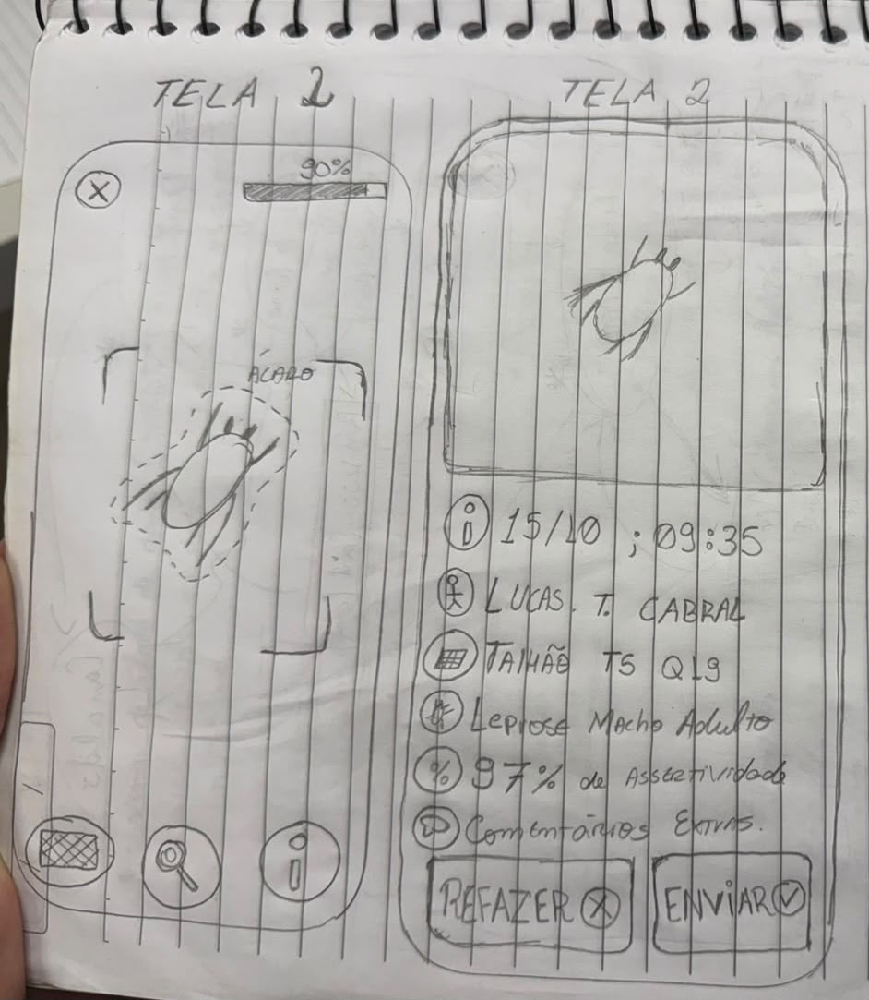
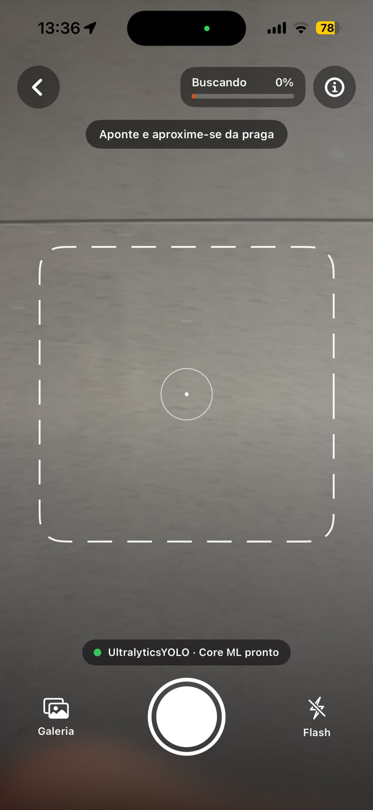
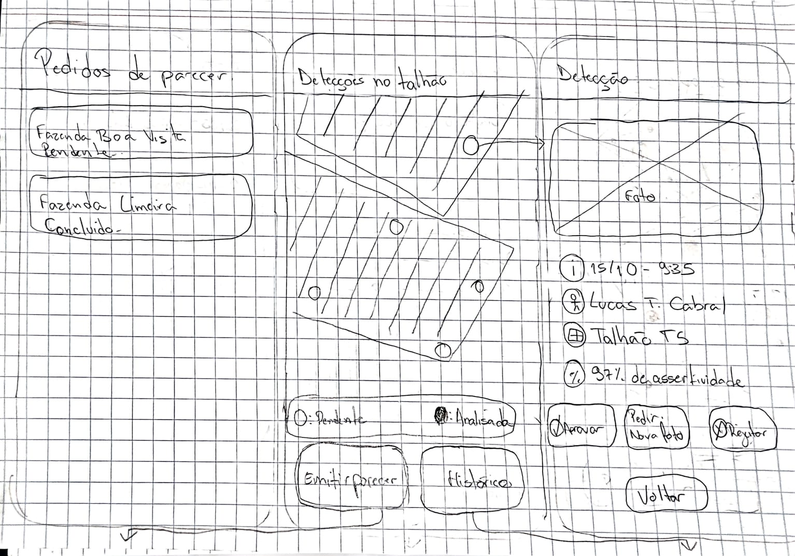
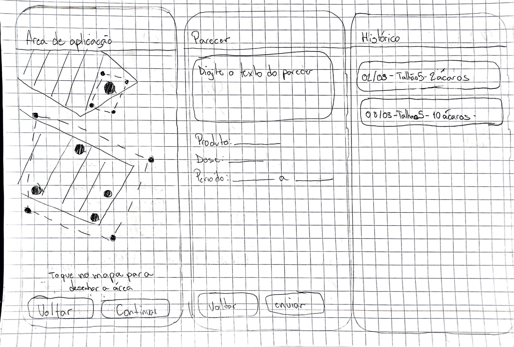
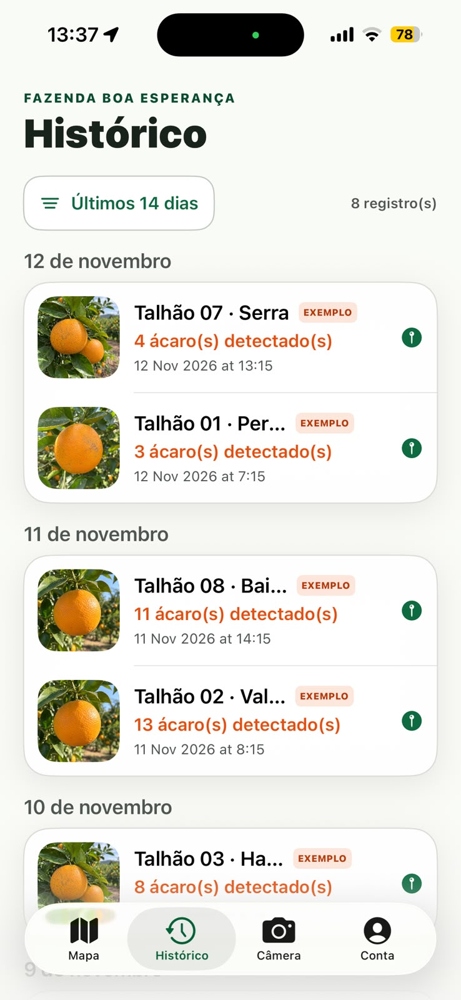
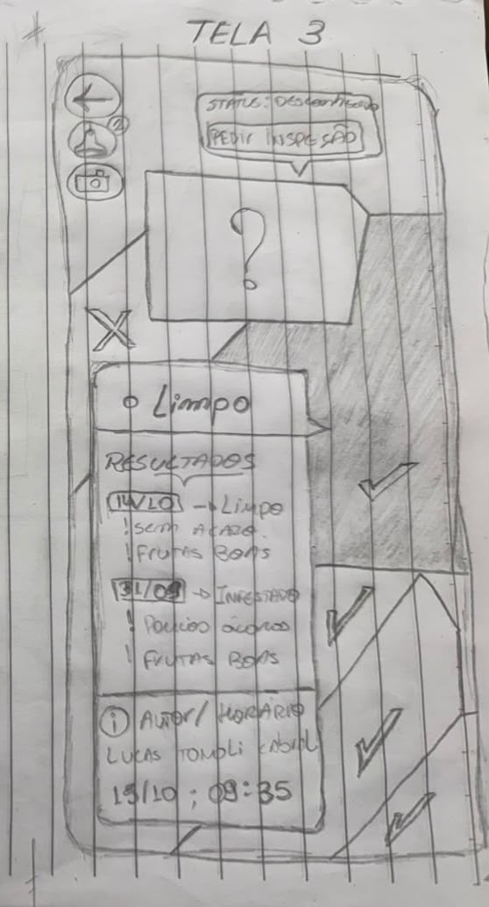
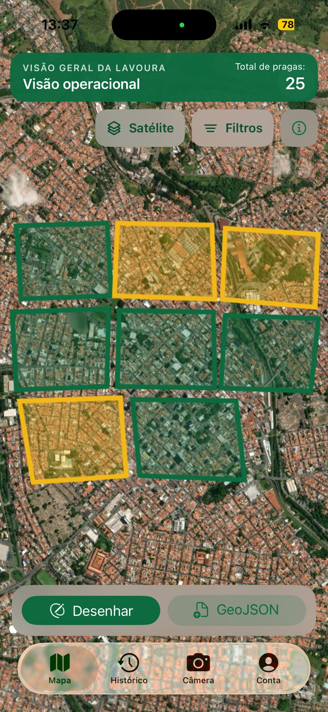
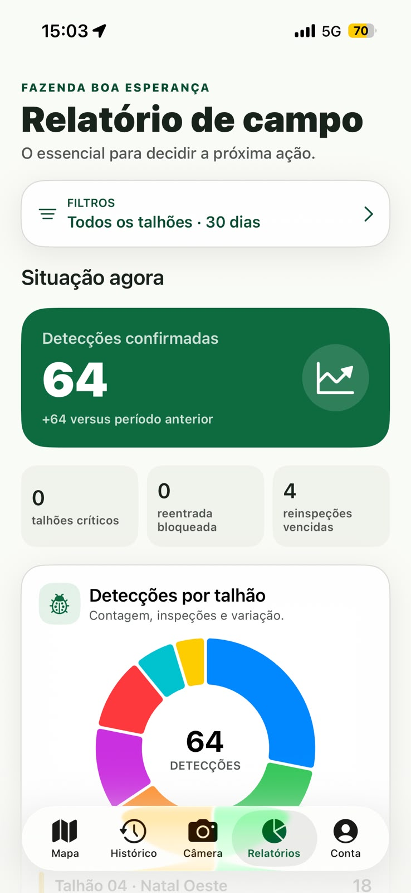

# Entrega 6 — Prototipação em papel

**Data:** 15/11/2026  
**Status:** 🟩 concluída — iteração formativa e revisão documentadas  
**Responsabilidade:** 1 solução integrada por equipe (Lucas Cabral, Guilherme e Pedro)

## Objetivo da atividade

Explorar a estrutura da interação em baixa fidelidade pelo ciclo **construir → simular → observar → revisar**. Os desenhos em papel registram a concepção inicial; as capturas do aplicativo registram a revisão realizada após os feedbacks. A avaliação descrita abaixo é formativa e não substitui o teste com participantes finais da Entrega 14.

## 1. Escopo do protótipo

### Funcionalidade — Lucas Cabral

**Funcionalidade:** inspecionar frutos com a câmera e consultar os achados da rota.  
**Persona:** P02 — Antônio Ferreira, trabalhador de campo/pragueiro.  
**Cenários/tarefas:** C02; T01 e T03 (inspecionar a rota e repassar achados); T02 (fotografar o fruto e interpretar o resultado).  
**Objetivo:** orientar a captura, mostrar o andamento da análise, comunicar o resultado e permitir retomar os registros da inspeção.

### Funcionalidade — Guilherme

**Funcionalidade:** examinar detecções e emitir parecer técnico.  
**Persona:** P03 — Marcelo Fidalgo, agrônomo consultor.  
**Cenários/tarefas:** C03; T07 (validar detecções), T06 (consultar histórico) e T05 (delimitar a área e emitir parecer).  
**Objetivo:** distinguir a indicação da IA da avaliação humana, conferir evidências e histórico e registrar a orientação técnica.

### Funcionalidade — Pedro

**Funcionalidade:** acompanhar talhões e decidir o manejo da fazenda.  
**Persona:** P01 — Jaime Carteiro, dono da fazenda.  
**Cenários/tarefas:** C01; T09 (revisar resultados), T08 (avaliar evolução) e T04 (planejar manejo).  
**Objetivo:** localizar talhões que exigem atenção, consultar informações resumidas e registrar ou encaminhar decisões.

## 1.1 Famílias de interface escolhidas

- **Lucas:** captura de imagem, acompanhamento da análise e resultado da inspeção.
- **Guilherme:** pedidos de parecer, mapa de detecções, detalhe, histórico e registro do parecer.
- **Pedro:** mapa com filtros e seleção de talhão, histórico e relatório para apoiar decisões.

Não foram incluídas telas de login, administração ou CRUD apenas para aumentar o número de telas.

## 2. Fluxos escolhidos

| Responsável | Fluxo | Tarefa/objetivo | Por que foi priorizado |
|---|---|---|---|
| Lucas | PF01 | Fotografar um fruto, acompanhar a análise e interpretar o resultado (T02). | A captura e a leitura do resultado afetam diretamente a qualidade do registro. |
| Lucas | PF02 | Retomar achados da inspeção e conferir a rota (T01/T03). | O trabalhador precisa localizar o que já foi registrado. |
| Guilherme | PF03 | Abrir uma detecção, examinar foto e histórico e validar ou pedir nova foto (T07/T06). | Evita tratar uma indicação automática como diagnóstico confirmado. |
| Guilherme | PF04 | Delimitar a área e emitir o parecer (T05). | Conecta a evidência à orientação enviada ao gestor. |
| Pedro | PF05 | Localizar talhões com ocorrências e examinar os resultados (T09). | Ajuda o gestor a decidir o que merece inspeção ou ação. |
| Pedro | PF06 | Consultar histórico e relatório antes de definir o manejo (T08/T04). | A decisão depende do contexto e da evolução, não de um ponto isolado. |

## 3. Telas e estados

Os códigos abaixo identificam estados da conversa. **Papel** indica o que foi fotografado no desenho inicial; **app revisado** indica a captura do aplicativo após a discussão. Estados previstos, mas não visíveis nas fotos, são explicitados como tal e não são apresentados como desenhos concluídos.

### Funcionalidade — Lucas Cabral

| Estado | Conteúdo e controles | Evidência |
|---|---|---|
| P01 | Início/rota de inspeção → abrir câmera. | Planejado no fluxo; não aparece na fotografia do papel. |
| P02 | Câmera: enquadrar o fruto; capturar → P03; voltar → inspeção. | Desenho em `Tela1-Tela2.jpeg`; câmera implementada em `Camera.jpeg`. |
| P03 | Análise: informar andamento e aguardar resultado → P04; voltar/cancelar → P02, se disponível. | A captura `Camera.jpeg` mostra o feedback de processamento; o estado completo não foi fotografado em papel. |
| P04 | Resultado da inspeção: examinar achado e dados associados; refazer captura → P02. | Desenho em `Tela1-Tela2.jpeg`; demais retornos dependem da implementação. |
| P05–P07 | Confirmação do registro, revisão da rota e situação do envio. | Caminhos previstos; não há fotografias desses estados em papel nesta entrega. |

**Caminho principal representado:** captura P02 → análise P03 → resultado P04. **Retorno relevante:** refazer uma foto inadequada. Não inferir que “sem sinal nesta foto” signifique ausência de pragas em toda a árvore ou no talhão. A captura do app exibe orientação para aproximar a câmera e um indicador de andamento da busca.

### Funcionalidade — Guilherme

| Estado | Conteúdo e controles | Evidência |
|---|---|---|
| A01 | Lista de pedidos de parecer por fazenda; abrir pedido → A02. | `prototipo_fluxo_2-1.jpeg`. |
| A02 | Detecções no talhão e situação dos pontos; escolher ponto → A03; histórico → A05; área → A06. | `prototipo_fluxo_2-1.jpeg`. |
| A03 | Foto e contexto da detecção; aprovar, rejeitar ou pedir nova foto → A02. | `prototipo_fluxo_2-1.jpeg`. A porcentagem desenhada é uma indicação da IA, não confirmação agronômica. |
| A05 | Histórico de detecções; retornar → A02. | `prototipo_fluxo_2-2.jpeg`; captura revisada em `Historico.jpeg`. |
| A06 | Área de aplicação desenhada sobre o talhão; continuar → A07; voltar → A02. | `prototipo_fluxo_2-2.jpeg`. |
| A07 | Parecer com orientação, produto, dose e período; enviar → A01. | `prototipo_fluxo_2-2.jpeg`. |

**Caminho principal:** A01 → A02 → A03 → A02 → A06 → A07 → A01. **Alternativas:** A02 → A05 → A02 para consultar o histórico; em A03, pedir nova foto quando a evidência for insuficiente. O botão de pedir nova foto foi incorporado ao detalhe, e a situação do parecer retorna à lista de pedidos, sem telas separadas para essas ações.

### Funcionalidade — Pedro

| Estado | Conteúdo e controles | Evidência |
|---|---|---|
| G01 | Resumo da situação para decidir o que examinar; abrir mapa/relatório. | Parte do desenho em `Tela3.jpeg`; visão revisada em `Relatorio.jpeg`. |
| G02 | Conferir cobertura de inspeção; distinguir não inspecionado de sem ocorrência. | Planejado; não há fotografia própria do estado em papel. |
| G03 | Mapa de talhões: filtrar, escolher talhão e examinar ocorrências → G04. | Desenho parcial em `Tela3.jpeg`; mapa revisado em `Mapa.jpeg`. |
| G04 | Detalhe de ocorrência com contexto e encaminhamento para parecer/reinspeção. | Parte visível em `Tela3.jpeg`. |
| G05–G08 | Confirmação de posição, evolução, decisão e repasse. | Caminhos previstos; não há fotografias desses estados em papel nesta entrega. |

**Caminho principal previsto:** G01 → G02 → G03 → G04 → decisão. **Retornos relevantes:** voltar ao mapa, alterar filtros, pedir avaliação ou reinspeção quando os dados não bastarem. A captura revisada do mapa exibe os controles de **Filtros** e **Desenhar**; ela, isoladamente, não comprova a execução de uma pulverização. A tela de relatório resume detecções e reinspeções. Segundo o registro da equipe, as métricas de irrigação também estão disponíveis **na extração do relatório**, embora não estejam visíveis na captura da tela de resumo.

## 4. Simulação / walkthrough formativo

**Participação relatada pela equipe:** Vitor, da fazenda parceira, examinou o aplicativo e comentou os fluxos do mapa e do relatório do perfil administrativo. Guilherme examinou as interfaces preparadas por Lucas e Pedro; Lucas e Pedro examinaram a interface de Guilherme em outro dia. As datas individuais, o roteiro exato, a sequência de ações e eventuais falas literais não foram preservados; por isso, o registro abaixo contém apenas os comentários informados, sem atribuir falas ou tempos inventados. O contato com Vitor ocorreu **no aplicativo após os desenhos iniciais**; não equivale a afirmar que ele executou um walkthrough formal de todas as telas em papel.

| Observação relatada | Tela/ação | Evidência disponível | Consequência para o design |
|---|---|---|---|
| Vitor recomendou que os relatórios do administrador incluíssem métricas da fazenda, como pontos irrigados e momento de irrigar. | Relatórios do perfil administrativo. | Relato da equipe após apresentação do app a Vitor. A captura `Relatorio.jpeg` mostra o resumo; a equipe informa que os indicadores de irrigação aparecem na **extração**, não nessa tela. | Manter o resumo direto e disponibilizar as métricas detalhadas no relatório extraído. Conferir essa parte com participantes finais na Entrega 14. |
| Vitor recomendou um mapa com informação mais enxuta, filtros e ações objetivas sobre o talhão, inclusive marcar talhão para pulverização. | Mapa e seleção de talhões. | Relato da equipe; `Mapa.jpeg` mostra **Filtros**, polígonos e **Desenhar**. A imagem não demonstra, sozinha, o registro da pulverização. | Priorizar leitura do talhão, filtro e marcação; verificar em teste posterior se a ação de pulverização é encontrada e entendida. |
| Houve avaliação cruzada dos desenhos/interfaces pelos integrantes em dias diferentes. | Lucas e Pedro avaliados por Guilherme; Guilherme avaliado por Lucas e Pedro. | Relato da equipe e fotografias dos desenhos. Não há notas individuais de hesitação, erro ou fala. | Registrar a revisão entre integrantes como feedback interno; não tratá-la como validação externa das personas. |

**Limite da evidência:** estes registros documentam a iteração formativa informada pela equipe. Não permitem medir sucesso, tempo ou dificuldades por tarefa nem comprovar testes de todos os estados previstos. A avaliação com usuários representativos e o roteiro de observação devem ser aprofundados na Entrega 14.

## 5. Alterações após o feedback

| Antes | Problema apontado | Depois | Justificativa e limite da evidência |
|---|---|---|---|
| Desenhos iniciais e discussão do mapa com muitos detalhes possíveis por talhão. | Vitor pediu informações mais enxutas, filtro e foco em marcar/agir sobre o talhão. | Revisão diretamente no app: `Mapa.jpeg` mostra mapa operacional, **Filtros** e **Desenhar**. | A captura comprova a presença dos controles e a organização geral. O fluxo completo de marcação/pulverização precisa ser verificado em uso. |
| Discussão inicial de relatórios sem as métricas operacionais citadas por Vitor. | Necessidade de pontos irrigados e indicação de quando irrigar. | `Relatorio.jpeg` mostra o resumo para decisão; segundo a equipe, as métricas de irrigação constam **na extração do relatório**. | Mantém a visualização resumida e concentra detalhes na exportação. A captura disponível não comprova o conteúdo exportado; incluir amostra da extração se o docente exigir evidência visual. |
| Consulta às detecções do talhão apresentada no desenho em papel. | Necessidade de recuperar ocorrências em contexto temporal. | `Historico.jpeg` registra a tela implementada, com período selecionável e lista de registros. | A revisão torna a consulta visível; a efetividade do filtro ainda depende de teste com usuário. |
| Câmera e resultado esboçados em papel. | Necessidade de orientar a captura e comunicar que a análise está em andamento. | `Camera.jpeg` mostra orientação para aproximar a câmera e indicador de busca. | Dá feedback durante a operação; a compreensão do resultado ainda deverá ser observada. |

As decisões acima resultam dos comentários relatados e da revisão que a equipe implementou **no código do aplicativo**, não de uma segunda versão desenhada em papel. Não há registro específico de mudanças decorrentes exclusivamente da avaliação cruzada dos colegas.

## Checklist

- [x] Os desenhos e a revisão no app cobrem partes relevantes das tarefas da Entrega 5.
- [x] Cada tela/estado fotografado está associado a uma tarefa, decisão ou informação necessária.
- [x] Não foram criados login, CRUD ou dashboard apenas para parecer “completo”.
- [x] Estados fotografados estão identificados na documentação, com caminhos e retornos descritos; os estados apenas planejados estão explicitamente diferenciados.
- [x] Há registro de uma avaliação formativa com Vitor e de avaliação cruzada entre integrantes, com a limitação da ausência de protocolo detalhado declarada.
- [x] O feedback relatado gerou decisões de revisão, documentadas com as quatro capturas do aplicativo.
- [x] Os desenhos iniciais permanecem em baixa fidelidade e suas limitações não são mascaradas pelas capturas da implementação.

**Limitações remanescentes:** não há fotografia em papel de todos os estados inicialmente previstos, protocolo de observação individual ou captura do relatório exportado. Esses materiais não são presumidos como existentes; se forem exigidos para avaliação da disciplina, deverão ser anexados como evidência adicional.
