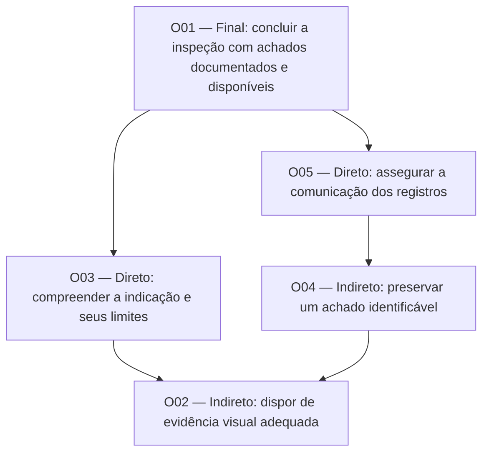
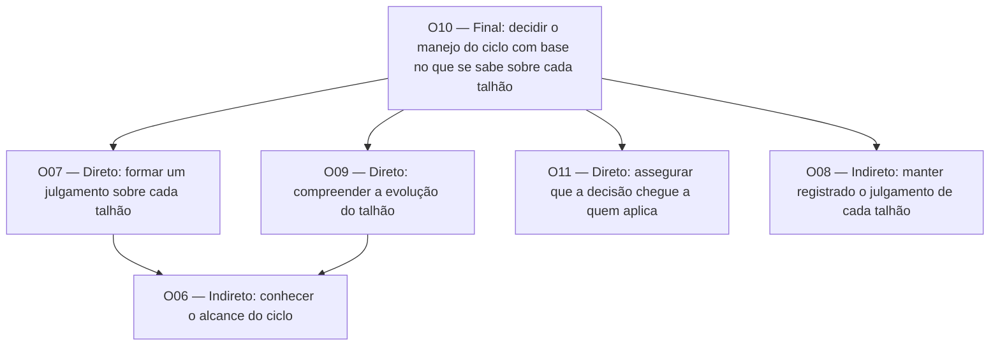
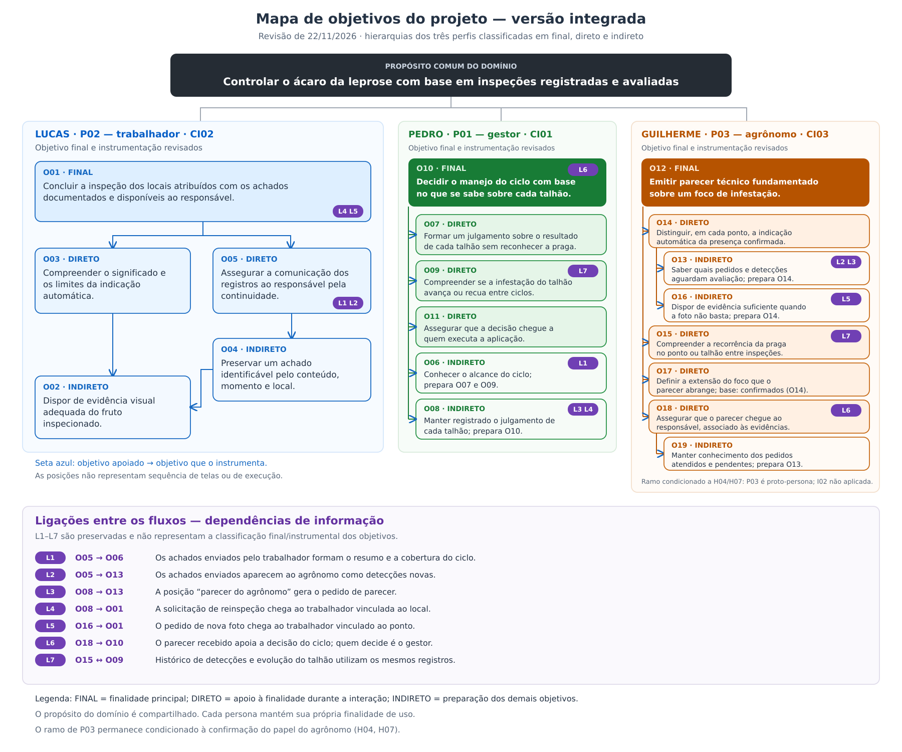

# Entrega 9 — Modelo conceitual e design centrado na comunicação

**Data:** 01/11/2026  
**Revisão:** 20/11/2026  
**Status:** 🟨 em andamento  
**Responsabilidade:** soluções individuais, com consolidação da equipe para mapa de objetivos e esquema de signos.

## Objetivo da atividade

Passar dos cenários de problema para uma concepção da interação, explicitando objetivos, tópicos de conversa, falas e signos compreensíveis aos usuários.

## Transformando resultados técnicos em conceitos compreensíveis

No fluxo do trabalhador, termos como “inferência”, “metadados EXIF” e “sincronização” serão comunicados como **analisando a foto**, **local do registro** e **situação do envio**. A interface distinguirá um sinal apontado pela IA de uma confirmação humana.

Essas expressões pertencem ao Design Centrado na Comunicação e ao esquema de signos. O cenário CI02 descreve a intervenção sem fixar textos ou controles da interface.

No fluxo do agrônomo, “probabilidade/score do modelo”, “caixa delimitadora (bounding box)”, “rótulo verdadeiro” e “metadados de geolocalização” serão comunicados como **sinal forte ou fraco**, **região indicada no fruto**, **veredito do agrônomo** e **local, data e hora da captura**. O resultado do modelo aparece como indicação automática, e só o veredito humano muda o ponto para “confirmado”.

**Limite do modelo:** esta entrega descreve uma concepção de interação. Recursos propostos não devem ser apresentados como implementados apenas por constarem do cenário, do DCC ou da tabela de signos. A correspondência com a versão disponível deve permanecer explícita nas Entregas 11 e 12.

A revisão de Lucas abrange CI02, DCC, objetivos O01–O05, seu ramo no mapa integrado e os signos relacionados ao trabalhador. A revisão de Pedro abrange CI01, objetivos O06–O11, seu ramo no mapa integrado e os signos de P01. As partes de Guilherme permanecem sujeitas às correções indicadas ao final.

## 1. Cenários de interação

### CI01 — Revisão do ciclo e decisão do manejo por talhão

**Autor(a):** Pedro — 24.123.048-1  
**Origem:** cenário de problema C01, “Planejamento do manejo sem visão consolidada da propriedade ao longo dos ciclos”.

Jaime é dono de uma fazenda de citros e cuida da parte administrativa e estratégica da propriedade. Ele conhece pouco a praga e depende de quem inspeciona para saber se há infestação e onde. *Hipóteses ainda não confirmadas com gestores reais (P01 é proto-persona; H05 e H21 abertas): a inspeção é feita por poucas pessoas, em ciclos de cerca de duas semanas, e cabe ao gestor decidir o manejo e repassar a decisão a quem aplica.* **Quando um ciclo termina, a solução informa Jaime e apresenta um resumo do alcance do ciclo e de onde houve indicações, sem depender do relato verbal de quem inspecionou.**

Antes, Jaime recebia uma impressão geral (“tem uns focos no fundo da fazenda”), sem um quadro do que aconteceu em cada talhão. **A solução distingue os talhões inspecionados, os não inspecionados e os que tiveram indicações, de modo que a ausência de inspeção nunca seja apresentada como ausência de praga. Diante de um talhão que ficou de fora, Jaime pode solicitar que ele seja examinado.**

Como não sabe identificar a praga sozinho, Jaime não tem como conferir o que vê. **Ao examinar um talhão com indicações, tem acesso às fotos, ao local e a uma expressão compreensível do grau de segurança da indicação automática, que não é apresentada como confirmação. Jaime registra seu julgamento sobre o talhão: aceitar o resultado, solicitar avaliação especializada ou solicitar nova inspeção. A dúvida não impede a continuidade, e uma revisão interrompida preserva o que já foi registrado.**

Jaime não sabia se a infestação estava crescendo ou diminuindo, nem se a última aplicação funcionou. **A solução mostra a evolução do talhão entre ciclos e a última aplicação, e alerta quando a comparação envolve um ciclo com cobertura incompleta, para que uma aparente melhora não seja confundida com falta de inspeção.**

No fim, Jaime planejava o manejo com base em impressão. **Agora registra a decisão do ciclo a partir dos julgamentos sobre os talhões. A solução pode organizar os talhões por um critério que ela própria explica, mas não recomenda produto, dose nem prioridade. Jaime consegue saber se a decisão foi apenas registrada ou se chegou a quem aplica; se essa comunicação falhar, a decisão é preservada e pode ser comunicada de novo.**

Os trechos em **negrito** descrevem a intervenção em relação ao problema C01. São uma proposta de design, não um relato de uso real. Os nomes dos julgamentos, dos estados da tendência e das mensagens ficam no DCC e no esquema de signos.

**Delimitação:** a correspondência com a Entrega 6 é parcial. G01, G03 e G04 têm desenho em papel (`Tela3.jpeg`, `Relatorio.jpeg`, `Mapa.jpeg`); G02 e G05–G08 ficaram apenas planejados, sem desenho próprio. Aviso de ciclo, estado “não inspecionado”, julgamento por talhão, evolução por ciclo, decisão e repasse não são apresentados como implementados no aplicativo.

### Diferenças relevantes — CI01

| Alteração | Por que foi necessária | Evidência/artefato que justifica |
|---|---|---|
| Aviso e resumo do ciclo concluído. | Jaime não depender do relato do pragueiro para saber que o ciclo acabou. | C01; HTA T04, passo 1.1 (Entrega 5). |
| Cobertura que separa “inspecionado”, “não inspecionado” e “com focos”. | Evitar confundir “sem alerta” com “ninguém passou”. | C01, Q5; CTT T09; hipótese H09. |
| Evidência com grau de segurança compreensível e julgamento do talhão com saídas para avaliação especializada ou nova inspeção. | Jaime não valida a praga; precisa decidir em quem confiar. | Persona P01; HTA T04, passo 2.3; CTT T09. |
| Evolução entre ciclos com última aplicação e alerta de cobertura incompleta. | Responder se a praga avança e se a aplicação funcionou, sem conclusão enganosa. | C01, Q3; GOMS T08; hipóteses H05 e H09. |
| Ordenação dos talhões por critério explicado, apresentada como dado, não como recomendação. | Não invadir o papel do gestor nem do agrônomo (P03). | HTA T04, passo 3.1; fronteira ainda em aberto (H21). |
| Distinção entre decisão registrada e decisão comunicada a quem aplica. | A decisão precisa chegar a quem aplica, que pode não usar o sistema. | C01; hipótese H02; protótipo G08 (Entrega 6). |

### CI02 — Inspeção dos frutos e repasse dos achados

**Autor(a):** Lucas Tonoli Cabral Duarte — 24.123.032-5  
**Origem:** cenário de problema C02, “Inspeção manual de frutos com lupa, sob fadiga e sem registro do percurso”.

Antônio recebe do gestor as áreas que deve percorrer e caminha entre as árvores do pomar. **Na solução proposta, consulta os locais previstos para inspeção e distingue aqueles que já possuem registros dos que ainda precisam ser examinados. Solicitações de reinspeção do gestor e de nova fotografia do agrônomo são relacionadas ao local correspondente, permitindo compreender a origem da solicitação e o trabalho necessário.**

Em cada árvore, escolhe os frutos para inspeção. O ácaro é pequeno e pode ser confundido com marcas da casca. **O aplicativo orienta a obtenção de uma imagem adequada e permite corrigir a captura quando necessário. Durante a análise, informa o andamento e apresenta a indicação automática com seus limites, sem tratá-la como confirmação profissional. Quando a evidência não permite uma conclusão suficiente, Antônio pode obter outra imagem ou preservar o registro para conferência posterior.**

Quando encontra um sinal que precisa de avaliação, Antônio deve informar o local a quem dará continuidade ao trabalho. **A solução mantém a imagem associada à data, à hora e à referência espacial disponível. Antônio pode conferir essa associação e, quando a localização automática não estiver disponível ou não for suficiente, identificar o local por uma alternativa manual, com a origem dessa informação explicitada. A posição do telefone não é tratada como identificação garantida de uma árvore.**

Ao final do percurso, Antônio costumava depender da memória para saber se deixou algum ponto passar. **Na interação proposta, consegue reconhecer o alcance da inspeção e as pendências antes de encerrar a atividade. Também distingue a preservação dos registros no aparelho da sua comunicação ao destinatário. Se o envio não ocorrer, o sistema mantém os registros e oferece uma possibilidade de recuperação, sem afirmar que houve recebimento ou leitura.**

Os trechos em **negrito** descrevem a intervenção em relação ao problema C02. São uma proposta de design, não um relato de uso real.

**Delimitação:** rota completa, pedidos integrados, controle de cobertura, apresentação alternativa do resultado e envio entre papéis permanecem conceitos propostos quando não estiverem materializados na versão do aplicativo. O cenário não comprova funcionamento integral sem conexão.

### Diferenças relevantes — CI02

| Alteração | Por que foi necessária | Evidência/artefato que justifica |
|---|---|---|
| Identificação do trabalho previsto e das pendências. | Reduzir dependência da memória sobre locais examinados. | C02; HTA T01 e CTT T03 da Entrega 5. |
| Entrada contextualizada de pedidos de reinspeção e de nova fotografia. | Integrar a continuidade da inspeção às solicitações dos demais papéis. | Ligações L4/L5; conversas previstas nos fluxos P01/P03. |
| Orientação para obtenção e revisão da imagem. | Evitar que uma captura inadequada comprometa a análise. | C02; GOMS T02; Entrega 2. |
| Comunicação da indicação automática e de seus limites. | Evitar interpretação do resultado como diagnóstico definitivo. | Dúvida do trabalhador em C02; GOMS T02. |
| Associação do registro à referência espacial, com origem explícita. | Permitir localizar o achado sem depender apenas da memória. | C02; HTA T01, etapa de comunicar o achado. |
| Distinção entre preservação do registro e comunicação ao destinatário. | Evitar conclusão falsa de repasse e permitir recuperação. | Jornada de P02 da Entrega 3; CTT T03. |

As justificativas ligam decisões aos artefatos anteriores. Não representam comprovação empírica das funcionalidades futuras.

### CI03 — Emitir parecer técnico sobre um foco de infestação

**Autor(a):** Guilherme Morais Escudeiro — 24.123.005-1  
**Origem:** cenário de problema C03, “Parecer técnico remoto sem contexto suficiente sobre o foco de infestação”.  
**Atores:** Marcelo (agrônomo consultor, P03), Jaime (dono e gestor da Fazenda Boa Vista, P01) e o trabalhador de campo (P02).

Marcelo é o agrônomo consultor de uma propriedade de citros. Ele atende a mais de uma propriedade e costuma revisar relatos de campo pelo menos algumas vezes por mês, geralmente quando o dono percebe algo fora do padrão durante a rotina da fazenda. ~~Certa manhã, o dono da fazenda liga para ele preocupado, dizendo que um dos trabalhadores encontrou "alguns frutos estranhos" durante a inspeção da plantação. Pouco depois, Marcelo recebe pelo celular algumas fotos soltas enviadas por mensagem, tiradas por diferentes trabalhadores em momentos diferentes do dia.~~ **[ALTERADO] Certa manhã, ao abrir o sistema no computador do escritório, Marcelo vê na lista de pedidos que Jaime, o dono da Fazenda Boa Vista, pediu um parecer sobre o talhão T12, com 5 pontos pendentes de validação. A mesma lista mostra outras detecções novas, separadas por propriedade e talhão, que ainda não têm pedido de parecer.**

~~Para emitir um parecer em que confia, Marcelo precisaria minimamente saber onde cada foto foi tirada dentro da propriedade, em que data e horário, e se os frutos fotografados pertencem à mesma árvore ou a árvores distintas (nenhuma dessas informações acompanha as fotos que recebe). Ele tenta reconstruir o cenário por telefone, perguntando ao dono onde exatamente cada trabalhador estava, mas as respostas são baseadas na memória de quem estava em campo horas antes, e nem sempre são precisas.~~ **[ALTERADO] Ao abrir o pedido, o sistema leva Marcelo direto ao mapa do talhão T12, com os pontos marcados pela situação de cada um: os 5 ainda estão pendentes. Os pontos que já tiveram detecção em ciclos anteriores aparecem destacados. Ele abre o ponto 3 e vê a foto original, que pode ampliar, com a data e hora da captura, a árvore (L3-27) e a localização registradas automaticamente quando o trabalhador fotografou. Não precisa mais ligar para ninguém para saber onde a foto foi tirada.**

~~Ele também não tem como comparar essas fotos com inspeções de semanas anteriores, porque não existe um registro histórico organizado, apenas mensagens soltas que se perdem na conversa.~~ **[ALTERADO] Na mesma tela, abaixo da foto, aparecem as inspeções anteriores daquele ponto: em 31/10 e em 03/10 houve sinal confirmado, e em 17/10 a detecção foi rejeitada. Quando quer ver mais, Marcelo pede o histórico daquele ponto e o sistema mostra as detecções já filtradas pelo ponto, nas últimas 8 semanas; ele amplia o período sem perder a seleção do local. A avaliação da IA não aparece de início: Marcelo examina a foto primeiro e só depois consulta a avaliação, que informa que o sinal é forte e qual região do fruto motivou a detecção.**

**[ALTERADO] Para cada ponto, Marcelo escolhe entre confirmar, rejeitar ou pedir nova foto. Ele confirma o ponto 3, que passa a aparecer como "validado por humano", e o sistema indica o próximo ponto pendente. No ponto 1, conclui que a marca na casca não é do ácaro e rejeita a detecção; os pontos 2 e 5 também são confirmados. No ponto 4, a foto está desfocada:** ~~quando a resposta não é suficiente, ele chega a pedir que um trabalhador volte ao local para tirar novas fotos, ou, em casos mais sérios, agenda uma visita presencial extra à propriedade, o que pode levar mais de um dia para acontecer.~~ **em vez de decidir sem certeza, Marcelo pede uma nova foto sem sair da detecção: o pedido, já ligado ao ponto e à árvore, entra na rota do trabalhador no celular. O ponto continua "pendente" até a nova foto chegar e ser avaliada, e por isso não entra na área de aplicação. A visita presencial continua possível, mas deixa de ser o único recurso.**

~~Sem saber com certeza a extensão da área afetada, nem se o problema já havia aparecido antes naquele ponto da propriedade, Marcelo precisa decidir se recomenda a aplicação de um produto de controle, e onde.~~ **[ALTERADO] Com os pontos validados e o histórico consultado, Marcelo passa à delimitação da área de aplicação. O mapa mostra apenas os pontos confirmados (2, 3 e 5), e o sistema avisa que o ponto 4 ainda está pendente. Marcelo decide seguir assim mesmo, delimita a área em torno dos pontos confirmados (1,8 ha do talhão T12) e preenche produto, dose e período, que o sistema apenas registra. O parecer é montado com a área e os pontos vinculados listados automaticamente; ele escreve a justificativa técnica e envia para Jaime.** Ele sabe que recomendar a aplicação em uma área maior do que o necessário gera custo e impacto ambiental evitáveis, mas que recomendar pouco, ou no lugar errado, corre o risco de deixar a praga se espalhar sem controle. **[ALTERADO] Por isso, a área desenhada sobre os pontos confirmados substitui a estimativa feita de memória que, numa ocasião anterior, levou a uma aplicação maior do que a necessária.**

**[ALTERADO] Ao enviar, Marcelo volta à lista de pedidos, onde o pedido da Fazenda Boa Vista aparece como "concluído". Na primeira tentativa a conexão falha; o sistema avisa, mantém o texto do parecer e Marcelo envia de novo. Quando a nova foto do ponto 4 chegar, o ponto aparece de novo para avaliação, ligado ao mesmo talhão.**

Os trechos marcados como **[ALTERADO]** descrevem a interação proposta e substituem os trechos riscados do cenário de problema C03. Eles ainda precisam ser avaliados com usuários; não são observações de uso real. Os passos correspondem às telas A01–A03 e A05–A07 do protótipo em papel (Entrega 6), revisadas para o Figma (Entrega 11, telas FA); os números de pontos, datas e áreas são os mesmos dados fictícios do protótipo FA.

### Diferenças relevantes — CI03

| Alteração | Por que foi necessária | Evidência/artefato que justifica |
|---|---|---|
| O pedido de parecer chega como item no sistema, agrupado por propriedade e talhão, em vez de ligação e fotos soltas. | Marcelo atende várias propriedades e hoje recebe relatos informais sem contexto. | C03 (cenário inicial e Q1); HTA T05, passo 1; P03 (dores). |
| Entrada direta no mapa do talhão com a situação de cada ponto. | Do geral para o específico: primeiro onde está o foco, sem procurar o talhão. | HTA T05, plano 2; protótipo A02. |
| Local, data, hora e árvore gravados automaticamente com a foto. | Hoje o local depende da memória de quem estava em campo. | C03 refinado (Q2); HTA T05, 2.1 e 2.2; síntese de P03 (Entrega 5). |
| Histórico do ponto na mesma tela da detecção e atalho para o histórico filtrado. | Comparar com inspeções anteriores era impossível; M3 é o método mais curto e mais frequente. | GOMS T06 (M3, SR1); CTT T07; H22. |
| Avaliação da IA recolhida até o agrônomo abrir. | Reduzir o possível viés de confirmação; decisão ainda a testar. | CTT T07; pergunta 15 da entrevista I02 (Entrega 7). |
| Três saídas para cada ponto: confirmar, rejeitar ou pedir nova foto. | Quando a foto não basta, o agrônomo não é forçado a decidir. | CTT T07; C03 refinado (Q3). |
| Pedido de nova foto ligado ao ponto e à árvore; o ponto continua pendente. | Ligar P03 a P02 sem perder o ponto. | CTT T07; protótipo A03 e P01 (Entrega 6). |
| Delimitação apenas com pontos confirmados e aviso de pendências. | Só focos validados por humano devem entrar [H07]. | C03 (Q5); HTA T05, 3 e 4.1; protótipo A06. |
| Parecer com pontos vinculados e repasse ao gestor. | O parecer fica associado à evidência; quem decide a execução é P01. | HTA T05, passo 5; síntese da Entrega 3; [F24]; H21. |
| Produto, dose e período como campos livres. | O sistema registra o julgamento técnico, não recomenda. | HTA T05, 4.2; Entrega 8. |

## 2. Design centrado na comunicação

**Convenção:** `U` = usuário; `D` = preposto do designer/sistema. As falas representam intenções comunicativas, não frases obrigatoriamente pronunciadas pelo participante.

### Design centrado na comunicação — Lucas

**Nome do cenário:** CI02 — inspeção dos frutos e repasse dos achados.

Os textos abaixo são propostas de comunicação. Os assuntos de rota, pedidos integrados, resultado inconclusivo e envio pertencem ao modelo conceitual quando não estiverem disponíveis no aplicativo.

| Tópico > subtópico | Falas e signos envolvidos | Intenção/efeito esperado |
|---|---|---|
| Organizar a inspeção > reconhecer o trabalho previsto | `U: Quero saber o que falta inspecionar.` / `D: Estes locais possuem registro; estes ainda estão pendentes.` Signos: ponto planejado, situação do ponto na rota. | Orientar a continuidade sem afirmar que todas as árvores foram examinadas. |
| > compreender uma solicitação recebida | `U: Por que preciso voltar a este local?` / `D: Solicitação de reinspeção do gestor / nova foto solicitada pelo agrônomo, vinculada a este ponto.` Signos: pedido de reinspeção, pedido de nova foto, origem do pedido, ponto planejado. | Explicar as entradas L4/L5 e distinguir primeira inspeção de retorno. |
| Capturar o fruto > ajustar a imagem | `U: Quero obter uma imagem adequada.` / `D: Ajuste a distância e mantenha o aparelho firme.` Signos: foto do fruto, qualidade da foto. | Prevenir captura inadequada. |
| Analisar a foto > acompanhar a análise | `U: Quero saber se a análise terminou.` / `D: Analisando a foto / análise concluída / não foi possível concluir.` Signo: situação da análise. | Tornar o andamento compreensível sem prometer funcionamento integral offline. |
| Entender o resultado > sinal suspeito | `U: Quero compreender o que foi indicado.` / `D: Sinal suspeito nesta foto; precisa de confirmação.` Signo: resultado da foto. | Comunicar a indicação automática e seu limite. |
| > nenhum sinal na foto | `U: Isso significa que a árvore está livre?` / `D: Nenhum sinal nesta foto; isso não garante que toda a árvore esteja livre.` | Evitar conclusão além da imagem analisada. |
| > evidência inconclusiva | `U: Quero continuar sem assumir uma conclusão incerta.` / `D: Não foi possível concluir; obtenha outra foto ou preserve o registro para conferência.` | Oferecer recuperação no fluxo proposto. |
| Registrar o achado > conferir o local | `U: Quero identificar onde o registro foi feito.` / `D: Local obtido automaticamente / local informado manualmente.` Signos: local do achado, árvore, data e hora. | Mostrar a origem do local sem garantir identificação da árvore por GPS. |
| Repassar os achados > conferir a comunicação | `U: Quero saber se os dados foram comunicados.` / `D: Salvo no celular / aguardando conexão / enviando / enviado / falha no envio.` Signos: situação do registro, destinatário dos achados, situação do envio. | Diferenciar salvamento, envio e falha; enviado não significa lido. |

### Design centrado na comunicação — Pedro

**Nome do cenário:** CI01 — revisão do ciclo e decisão do manejo por talhão.

| Tópico > subtópico | Falas e signos envolvidos | Intenção/efeito esperado |
|---|---|---|
| Saber do ciclo > aviso e resumo | `U: O ciclo terminou?` / `D: Ciclo concluído em [data]: X talhões inspecionados, Y com focos.` | Dispensar o relato do pragueiro e informar o alcance do ciclo. |
| Conferir a cobertura > talhão não inspecionado | `U: Todos os talhões foram vistos?` / `D: Não inspecionado: talhão [nome]. Isso não significa que esteja livre da praga.` | Impedir que “não inspecionado” seja lido como “sem focos”. |
| > pedir nova inspeção | `U: E o que falta?` / `D: Pedir nova inspeção deste talhão?` | Dar uma saída sem sair da tela de cobertura. |
| Avaliar o talhão > evidência e confiança | `U: Posso confiar neste resultado?` / `D: Confiança [alta/média/baixa]. Veja as fotos e o local; o sistema não confirma a praga.` | Mostrar a evidência e o limite da indicação. |
| Registrar a posição > escolher a saída | `U: Eu não sei se é a praga.` / `D: Aceitar como confiável, pedir parecer do agrônomo ou pedir nova inspeção.` | Permitir a dúvida sem bloquear a revisão. |
| Acompanhar a evolução > ler a tendência | `U: A praga está se espalhando?` / `D: Neste talhão: avançando / estável / recuando. Última aplicação marcada no ciclo [data].` | Responder com o histórico, sem exigir memória. |
| > cobertura incompleta | `U: Posso concluir que recuou?` / `D: Atenção: o ciclo [data] não cobriu todo o talhão. A comparação pode não ser confiável.` | Evitar conclusão enganosa na comparação. |
| Decidir o manejo > registrar a decisão | `U: Onde e quando aplico?` / `D: Talhões ordenados por detecções no ciclo e tendência [critério exibido]. Escolha onde, quando e com que urgência aplicar.` | Apresentar dados sem recomendar produto, dose nem prioridade. |
| Repassar a decisão > conferir o repasse | `U: Quem vai aplicar já sabe?` / `D: Decisão registrada / repassada a [quem aplica] / falha no repasse: tentar novamente.` | Diferenciar registro, repasse e falha. |

Os rótulos de confiança (“alta”, “média” e “baixa”), os nomes das posições e os estados da tendência são propostas iniciais, a testar com usuários. Eles foram retirados do CI01 e permanecem aqui, no artefato adequado.

### Design centrado na comunicação — Guilherme

**Nome do cenário:** CI03 — Emitir parecer técnico sobre um foco de infestação.

| Tópico > subtópico | Falas e signos envolvidos | Intenção/efeito esperado |
|---|---|---|
| Emitir parecer técnico sobre um foco (O12) | `U: O que tenho para analisar?` / `D: Estes são os pedidos de parecer e as detecções novas das propriedades que você atende.` Signos: pedido de parecer, propriedade, talhão, solicitante, pontos pendentes. | Distinguir pedido do gestor de detecção sem pedido. |
| > Escolher o foco a avaliar (O13) | `U: Quero ver o pedido do talhão T12.` / `D: Aqui está o talhão T12. Estes 5 pontos têm detecção e estão pendentes. Os pontos destacados já tiveram detecção antes.` Signos: mapa do talhão, ponto, situação da validação, detecção anterior. | Entrada direta no foco; a contagem por situação mostra quanto falta. |
| Validar as detecções do talhão (O14) | `U: Quero examinar o ponto 3.` / `D: Esta é a foto original do ponto 3, árvore L3-27, tirada em 14/11 às 09:35, com a localização registrada. Antes, neste ponto, houve detecções confirmadas em 31/10 e 03/10 e uma rejeitada em 17/10.` Signos: foto do fruto, data e hora da captura, árvore, local do achado, detecções anteriores do ponto. | Reunir evidências na mesma conversa. |
| > Examinar a foto | `U: Quero ampliar a foto.` / `D: Foto ampliada, com a mesma identificação do ponto.` | Julgamento técnico sem sair do contexto. |
| > Consultar a avaliação da IA | `U: Quero ver o que a IA avaliou.` / `D: A IA detectou sinal forte de ácaro nesta região do fruto. Esta é uma indicação automática; a validação é sua.` Signos: avaliação da IA, intensidade do sinal, região indicada. | Separar detecção automática de validação humana. |
| > Registrar o veredito | `U: Confirmo que há sinal da praga neste ponto.` / `D: Ponto 3 validado por você. O próximo pendente é o ponto 1.` Ou `U: Não há sinal da praga no ponto 1.` / `D: Ponto 1 rejeitado por você. Restam 3 pontos pendentes.` Signos: veredito, validado por, observação técnica. | Feedback do registro, com autoria. |
| > Pedir nova foto ao campo (O16) | `U: A foto não é suficiente; quero outra.` / `D: Pedido de nova foto do ponto 4, árvore L5-11, enviado à rota do campo. O ponto continua pendente.` Signo: pedido de nova foto. | Manter o ponto pendente até nova avaliação. |
| > Encerrar a revisão sem concluir | `U: Vou parar por agora.` / `D: Os vereditos registrados foram mantidos. Restam 3 pontos pendentes no talhão T12.` | Interromper sem perda de trabalho. |
| Consultar o histórico de um ponto ou talhão (O15) | `U: Quero ver o histórico deste ponto.` / `D: Detecções do ponto 3 nas últimas 8 semanas.` / `U: Quero ampliar para 6 meses.` / `D: Detecções do ponto 3 nos últimos 6 meses.` Ou `D: Não há detecções neste período para o ponto 3.` Signos: histórico de detecções, período, local do filtro. | A mesma lista é acessada por caminhos diferentes, com filtro coerente e resultado vazio comunicado. |
| Delimitar a área de aplicação (O17) | `U: Quero definir a área de aplicação.` / `D: Estes são os pontos confirmados do talhão T12. Atenção: o ponto 4 ainda está pendente; ele não entra na área.` / `U: Esta é a área; produto, dose e período são estes.` / `D: Área de 1,8 ha registrada.` Signos: área de aplicação, pontos confirmados, produto, dose, período de aplicação. | Apoiar a delimitação e comunicar pendências. |
| > Talhão sem ponto confirmado | `U: Quero definir a área de aplicação.` / `D: Ainda não há pontos confirmados no talhão T12. Valide ao menos um ponto antes de delimitar a área.` | Impedir área sem base em validação humana [H07]. |
| Registrar e repassar o parecer (O18) | `D: Este é o parecer: área de 1,8 ha, pontos 2, 3 e 5 vinculados, destinatário Jaime. Escreva a justificativa técnica.` / `U: Enviar.` / `D: Parecer enviado a Jaime. O pedido do talhão T12 está concluído.` Signos: parecer técnico, pontos vinculados, destinatário do parecer, situação do pedido. | Associar parecer, pontos e destinatário. |
| > Campos obrigatórios vazios | `U: Quero enviar o parecer.` / `D: Para enviar, informe produto, dose e a justificativa técnica.` | Evitar envio incompleto. |
| > Acompanhar a situação do pedido (O19) | `D: Não foi possível enviar o parecer. O texto foi mantido.` / `U: Enviar.` / `D: Parecer enviado. Pedido concluído.` | Comunicar falha e recuperação. |

## 3. Mapa de objetivos

### Mapa individual — Lucas

**Objetivo final de P02 — O01:** concluir a inspeção dos locais atribuídos com os achados documentados e disponíveis ao responsável pela continuidade do trabalho.

Os IDs O01–O05 foram mantidos. A revisão explicita a finalidade e a relação entre os objetivos, sem tratar passos como ajustar foco, abrir câmera ou acionar um controle como objetivos autônomos.

| ID | Objetivo revisado | Classificação | Relação com o objetivo final |
|---|---|---|---|
| O01 | Concluir a inspeção dos locais atribuídos com os achados documentados e disponíveis ao responsável. | Final. | Motiva o uso da solução pelo trabalhador. |
| O02 | Dispor de evidência visual adequada do fruto inspecionado. | Instrumental indireto. | Prepara a interpretação de O03 e a documentação de O04, contribuindo para O01. |
| O03 | Compreender o significado e os limites da indicação automática. | Instrumental direto. | Permite reconhecer o que foi indicado sem assumir confirmação profissional, apoiando O01. |
| O04 | Preservar um achado identificável pelo conteúdo, momento e local. | Instrumental indireto. | Prepara a consulta e a comunicação de O05, contribuindo para O01. |
| O05 | Assegurar a comunicação dos registros ao responsável pela continuidade. | Instrumental direto. | Permite encerrar a atividade com conhecimento do alcance da comunicação, apoiando O01. |

Nesta classificação, os instrumentais diretos apoiam a finalidade principal na interação; os indiretos preparam evidências e registros necessários aos demais objetivos.

#### Hierarquia individual revisada

As ligações indicam instrumentação, não ordem de execução. A sequência e os mecanismos de interação pertencem à análise de tarefas e ao MoLIC.

O01 mantém a ligação com T01 e CI02. O02–O05 mantêm seus IDs para rastreabilidade. Os títulos revisados deverão ser reutilizados na atualização da Entrega 10.

### Mapa individual — Pedro

**Objetivo final de P01 — O10:** decidir o manejo do ciclo com base no que se sabe sobre cada talhão.

Os IDs O06–O11 foram mantidos. A revisão expressa finalidades e indica qual objetivo cada um instrumenta. Passos como receber o aviso, abrir fotos ou escolher uma saída deixaram de ser listados como objetivos; pertencem às tarefas, ao CI01 e ao MoLIC M03.

| ID | Objetivo revisado | Classificação | Relação com o objetivo final |
|---|---|---|---|
| O10 | Decidir o manejo do ciclo com base no que se sabe sobre cada talhão. | Final. | Motiva o uso da solução pelo gestor. Depende da hipótese H21 (o gestor decide); se ela for refutada, o objetivo final de P01 deve ser revisto. |
| O07 | Formar um julgamento sobre o resultado de cada talhão sem precisar reconhecer a praga. | Instrumental direto. | Fornece a base da decisão de O10 durante a interação. |
| O09 | Compreender se a infestação do talhão avança ou recua entre ciclos. | Instrumental direto. | Informa a urgência e o efeito da última aplicação para O10. |
| O11 | Assegurar que a decisão chegue a quem executa a aplicação. | Instrumental direto. | Permite encerrar a decisão sabendo se ela foi comunicada, apoiando O10. |
| O06 | Conhecer o alcance do ciclo: quais talhões foram e quais não foram inspecionados. | Instrumental indireto. | Prepara O07 e O09, evitando que ausência de dados seja lida como ausência de praga. |
| O08 | Manter registrado o julgamento de cada talhão, inclusive quando depende de outra avaliação. | Instrumental indireto. | Prepara O10 e permite retomar a revisão; origina as ligações L3 e L4. |

#### Hierarquia individual revisada

As ligações indicam instrumentação, não ordem de execução.

### Mapa individual — Guilherme

**Objetivo principal (O12):** emitir parecer técnico sobre um foco de infestação.

- **O12 — Emitir parecer técnico sobre um foco de infestação**
  - **O13 — Escolher o foco a avaliar** (pedidos de parecer e detecções novas).
  - **O14 — Validar as detecções do talhão** (confirmar ou rejeitar cada ponto).
    - **O16 — Pedir nova foto de um ponto ao campo**, quando a foto não basta.
  - **O15 — Consultar o histórico de detecções** de um ponto ou talhão.
  - **O17 — Delimitar a área de aplicação** com os pontos confirmados.
  - **O18 — Registrar e repassar o parecer ao gestor.**
  - **O19 — Acompanhar a situação dos pedidos de parecer.**

### Mapa de objetivos do projeto — integrado

O mapa revisado incorpora a hierarquia de Lucas (O01 final; O03/O05 diretos; O02/O04 indiretos) e a de Pedro (O10 final; O07/O09/O11 diretos; O06/O08 indiretos).

O bloco de Guilherme foi preservado e está identificado como pendente de classificação. O mapa completo ainda depende da revisão desse bloco.

**Propósito comum do domínio:** apoiar o controle do ácaro da leprose na propriedade com base em inspeções registradas e avaliadas. Esse propósito organizacional não substitui o objetivo final de cada persona.

**Fonte editável:** [mapa_objetivos_integrado.svg](../assets/09_modelo_conceitual/mapa_objetivos_integrado.svg).

**Leitura do ramo de Lucas:**

- O01 representa a finalidade principal.
- O03 e O05 apoiam diretamente O01.
- O02 prepara a interpretação de O03 e a documentação de O04.
- O04 prepara a comunicação de O05.
- As setas azuis ligam o objetivo apoiado ao objetivo que o instrumenta.

**Leitura do ramo de Pedro:**

- O10 representa a finalidade principal do gestor.
- O07, O09 e O11 apoiam diretamente O10.
- O06 prepara O07 e O09; O08 prepara O10.
- As posições dos elementos não representam uma sequência de telas.

As ligações L1–L7 representam dependências de informação entre fluxos. Não substituem as relações de instrumentação dos objetivos.

| Ligação | De → para | O que passa de um fluxo ao outro | Signo envolvido |
|---|---|---|---|
| L1 | O05 → O06 | Os achados enviados pelo trabalhador formam o resumo e a cobertura do ciclo. | situação do envio → cobertura do talhão |
| L2 | O05 → O13 | Os achados enviados aparecem ao agrônomo como detecções novas. | situação do envio → detecção |
| L3 | O08 → O13 | A posição “parecer do agrônomo” gera o pedido de parecer. | posição do talhão → pedido de parecer |
| L4 | O08 → O01 | A solicitação de reinspeção é vinculada ao local a ser novamente examinado. | pedido de reinspeção → ponto planejado |
| L5 | O16 → O01 | O pedido de nova foto é recebido pelo trabalhador, vinculado ao ponto. | pedido de nova foto → ponto planejado |
| L6 | O18 → O10 | O parecer recebido apoia a decisão do ciclo; quem decide é o gestor. | parecer técnico → decisão do ciclo |
| L7 | O15 ↔ O09 | Histórico de detecções e evolução do talhão usam os mesmos registros. | histórico de detecções ↔ tendência do talhão |

L4 e L5 foram incorporadas conceitualmente ao CI02 e ao DCC de Lucas. A hipótese H04 continua podendo alterar o destino e a interpretação de L6.

### Dicionário de objetivos

| ID | Objetivo | Persona(s) | Cenário(s) | Classificação | Prioridade |
|---|---|---|---|---|---|
| O01 | Concluir a inspeção dos locais atribuídos com os achados documentados e disponíveis ao responsável. | P02 | CI02 | Final. | Alta |
| O02 | Dispor de evidência visual adequada do fruto inspecionado. | P02 | CI02 | Instrumental indireto; apoia O03/O04 e O01. | Alta |
| O03 | Compreender o significado e os limites da indicação automática. | P02 | CI02 | Instrumental direto; apoia O01. | Alta |
| O04 | Preservar um achado identificável pelo conteúdo, momento e local. | P02 | CI02 | Instrumental indireto; apoia O05 e O01. | Alta |
| O05 | Assegurar a comunicação dos registros ao responsável pela continuidade. | P02 | CI02 | Instrumental direto; apoia O01. | Alta |
| O06 | Conhecer o alcance do ciclo: quais talhões foram e quais não foram inspecionados. | P01 | CI01 | Instrumental indireto; apoia O07/O09 e O10. | Alta |
| O07 | Formar um julgamento sobre o resultado de cada talhão sem precisar reconhecer a praga. | P01 | CI01 | Instrumental direto; apoia O10. | Alta |
| O08 | Manter registrado o julgamento de cada talhão, inclusive quando depende de outra avaliação. | P01 | CI01 | Instrumental indireto; apoia O10. | Alta |
| O09 | Compreender se a infestação do talhão avança ou recua entre ciclos. | P01 | CI01 | Instrumental direto; apoia O10. | Alta |
| O10 | Decidir o manejo do ciclo com base no que se sabe sobre cada talhão. | P01 | CI01 | Final (depende de H21). | Alta |
| O11 | Assegurar que a decisão chegue a quem executa a aplicação. | P01 | CI01 | Instrumental direto; apoia O10. | Alta |
| O12 | Emitir parecer técnico sobre um foco de infestação. | P03 | CI03 | A classificar por Guilherme. | Alta |
| O13 | Escolher o foco a avaliar a partir dos pedidos de parecer e das detecções novas. | P03 | CI03 | A classificar por Guilherme. | Alta |
| O14 | Validar as detecções do talhão. | P03 | CI03 | A classificar por Guilherme. | Alta |
| O15 | Consultar o histórico de detecções de um ponto ou talhão. | P03 | CI03 | A classificar por Guilherme. | Alta |
| O16 | Pedir nova foto de um ponto ao campo. | P03 | CI03 | A classificar por Guilherme. | Média |
| O17 | Delimitar a área de aplicação com os pontos confirmados. | P03 | CI03 | A classificar por Guilherme. | Alta |
| O18 | Registrar e repassar o parecer ao gestor. | P03 | CI03 | A classificar por Guilherme. | Alta |
| O19 | Acompanhar a situação dos pedidos de parecer. | P03 | CI03 | A classificar por Guilherme. | Média |

**Numeração:** O01–O05 identificam o mapa de Lucas; O06–O11, o de Pedro; e O12–O19, o de Guilherme. Os objetivos de Guilherme foram renumerados anteriormente para evitar colisões.

## 4. Esquema conceitual de signos

Tabela única da equipe, organizada por entidade e não por autor.

A coluna **Fluxo** identifica P02 (Lucas), P01 (Pedro) e P03 (Guilherme).

**Escopo de Lucas:** estados de rota, pedidos integrados, resultados alternativos e envio entre papéis são propostas conceituais quando ausentes do aplicativo. Restrições, valores padrão e mensagens referentes a esses recursos são decisões de aplicação, não regras profissionais confirmadas.

Nos signos compartilhados, a interpretação relativa a P02 respeita esse limite. Os signos de P01 foram revisados por Pedro em 20/11/2026; aviso de ciclo, cobertura, posição, tendência, decisão e repasse são propostas de aplicação, ausentes do aplicativo atual. As partes de P03 continuam sujeitas à revisão do responsável.

| Grupo | Signo | Fluxo | Origem | Observações/semântica | Tipo de conteúdo | Restrição | Valor padrão | Prevenção | Recuperação |
|---|---|---|---|---|---|---|---|---|---|
| Propriedade | propriedade | P03 | domínio | Fazenda atendida pelo agrônomo; agrupa pedidos e detecções. Fornecida pelo sistema. | texto | só propriedades atendidas pelo agrônomo | — | PA: propriedades não atendidas não aparecem | — |
| Propriedade | + talhão | P01, P02, P03 | domínio | Subdivisão da propriedade, com rótulo e limites visíveis no mapa. Unidade da rota, da cobertura e do parecer. | texto e área no mapa | não nulo | — | PP: rótulo visível no mapa | — |
| Ponto | + ponto | P02, P03 | domínio | Local amostrado. Na proposta de P02, pode receber referência de talhão, linha e árvore; essa identificação não é garantida por coordenada do telefone. | identificador e referência espacial | origem da referência explícita | — | PP: identificador visível | RA: conferir e corrigir a referência |
| Ponto | árvore | P02, P03 | domínio | Árvore fotografada. Para P02, sua identificação deve ser conferida ou informada; GPS não comprova automaticamente qual árvore foi examinada. | texto | não preencher por falsa inferência de precisão | — | PP: explicitar a origem da identificação | RA: corrigir antes da comunicação |
| Rota | ponto planejado | P02 | domínio | Local indicado para inspeção na rota proposta; não significa que foi visitado. | identificador e local | vinculado ao trabalho atribuído | próximo pendente, como proposta | PP: identificação do ponto | RA: conferir ou selecionar outro ponto |
| Rota | situação do ponto na rota | P02 | aplicação | “Com registro” ou “pendente”; não representa ausência de praga nem validação humana. | estado | não confundir com resultado da foto | pendente | PP: texto e símbolo | RA: conferir os registros |
| Rota | pedido de reinspeção | P02, P01 | aplicação | Solicitação do gestor para examinar novamente um local; entrada proposta de L4. | solicitação vinculada ao local | identificar origem e local | nenhuma solicitação | PP: distinguir de primeira inspeção | RA: consultar o pedido e retomar o local correspondente |
| Rota | origem do pedido | P02 | aplicação | Identifica se o retorno foi solicitado pelo gestor ou pelo agrônomo e sua natureza, sem exigir dados pessoais desnecessários. | função e tipo de solicitação | vinculada ao pedido | sem pedido | PP: origem e finalidade visíveis | RA: consultar o contexto da solicitação |
| Captura | foto do fruto | P02, P03 | domínio | Imagem obtida em campo e analisada; para o agrônomo, foto original e ampliável. | imagem | qualidade suficiente para análise | nenhuma | PP: orientar foco, distância e iluminação | RA: refazer a foto ou pedir outra evidência |
| Captura | qualidade da foto | P02 | aplicação | Orientação sobre condições da captura; não equivale à certeza de identificação da praga. | estado ou mensagem | não confundir qualidade com confiança do modelo | aguardando captura | PP: orientação antes da captura | RA: reposicionar e tentar novamente |
| Análise | situação da análise | P02 | aplicação | “Analisando”, “concluída” ou “falhou”, como estados conceituais. | estado ou mensagem | não representar conclusão inexistente | aguardando foto | PP: andamento compreensível | RA: nova tentativa preservando o que estiver disponível |
| Análise | resultado da foto | P02, P01 | aplicação | Para P02, indicação automática vinculada à imagem; “sinal suspeito”, “nenhum sinal nesta foto” e “inconclusivo” são propostas de comunicação. | texto e símbolo | não equivale a confirmação humana nem a diagnóstico da árvore | nenhum | PP: explicar alcance e incerteza | RA: nova captura ou conferência posterior |
| Análise | avaliação da IA | P03 | aplicação | Intensidade em faixas e região indicada. Probabilidade numérica não exibida; triagem, não diagnóstico. | texto e destaque na imagem | — | recolhida até consulta | PP: indicação automática separada da validação humana, a testar | — |
| Análise | confiança do resultado | P01 | aplicação | Faixa calculada a partir da pontuação que o modelo atribui às detecções do talhão. Indica quão nítido foi o sinal nas fotos analisadas; não é a probabilidade de a praga estar presente na árvore nem validação humana. Serve ao gestor para decidir se aceita o resultado ou pede outra avaliação. Os limites das faixas dependem do modelo do TCC e ainda não foram definidos. | texto, alta/média/baixa como proposta | sem números técnicos; vinculada às fotos | nenhum | PP: mostrar fotos e local | RA: pedir parecer ou reinspeção |
| Registro | data e hora da captura | P02, P03 | domínio | Momento da obtenção da foto; distinto do envio e da sincronização. | data e hora | não nula | captura atual | PP: informação junto ao registro | RA: conferir a origem ou obter novo registro, sem alterar silenciosamente o momento original |
| Registro | local do achado | P02, P03 | domínio | Posição obtida automaticamente ou referência informada manualmente. Para P02, preservar a distinção entre coordenada, talhão e identificação da árvore. | coordenada ou referência espacial | origem explícita; não presumir precisão não demonstrada | tentar localização automática | PP: indicar origem e disponibilidade | RA: usar alternativa manual oferecida, sem inventar coordenadas |
| Registro | situação do registro | P02 | aplicação | “Salvo no celular”; não comprova envio, recebimento ou leitura. | estado ou mensagem | confirmar apenas o salvamento efetivo | não salvo | PP: confirmação | RA: nova tentativa sem descarte silencioso da foto |
| Repasse dos achados | destinatário dos achados | P02 | domínio | Papel responsável pela continuidade do trabalho. O gestor é o destinatário adotado no cenário, sujeito à investigação das responsabilidades. | função | definido antes da comunicação | gestor da rota, se definido | PP: função visível | RA: corrigir antes do envio |
| Repasse dos achados | situação do envio | P02 | aplicação | “Aguardando conexão”, “enviando”, “enviado” ou “falha”, como proposta; enviado não significa lido. | estado ou mensagem | separada do salvamento e do reconhecimento humano | aguardando, se houver fila offline implementada | PP: pendência explícita | RA: nova tentativa mantendo os registros |
| Ciclo | aviso de ciclo concluído | P01 | aplicação | Informa término com data; não garante cobertura de todos os talhões. | mensagem e data | associado ao ciclo | nenhum | PP: apresentar cobertura | RA: reabrir resumo |
| Ciclo | cobertura do talhão | P01 | domínio | Inspecionado, não inspecionado ou cobertura incompleta. | estado | não confundir com sem focos | não inspecionado | PP: texto, símbolo e limite | RA: pedir nova inspeção |
| Ciclo | situação do talhão no ciclo | P01 | aplicação | Com focos, sem focos nesta inspeção ou não inspecionado. | estado | sem focos somente para talhão inspecionado | não inspecionado | PP: distinguir os estados | RA: conferir cobertura |
| Posição do gestor | posição do talhão | P01 | aplicação | Escolha: confiável, parecer do agrônomo ou reinspeção; não valida a praga. | estado escolhido | uma posição por talhão e ciclo | sem posição | PP: saídas claras | RA: alterar antes da decisão |
| Evolução | tendência do talhão | P01 | aplicação | Avançando, estável ou recuando entre ciclos; mesma base do histórico. | estado e ciclos | avisar cobertura incompleta | sem comparação | PP: texto e símbolo; AL: cobertura incompleta | RA: consultar cobertura |
| Evolução | última aplicação | P01 | domínio | Marca no histórico o ciclo com aplicação. | data ou ciclo | não indica produto nem dose | nenhuma | PP: marca na linha do tempo | RA: corrigir registro |
| Pedido de parecer | + pedido de parecer | P01, P03 | aplicação | Solicitação do gestor para avaliar talhão; distinta de detecção nova. | registro composto | ligado a um talhão | — | — | — |
| Pedido de parecer | solicitante | P03 | domínio | Função e nome de quem pediu o parecer. | texto | — | — | — | — |
| Pedido de parecer | pontos pendentes | P03 | aplicação | Quantidade de pontos com detecção sem veredito. | inteiro | ≥ 0 | — | — | — |
| Pedido de parecer | situação do pedido | P03 | aplicação | Pendente ou concluído após envio do parecer. | estado | — | pendente | PP: texto além de cor | RA: preservar texto e pendência após falha |
| Validação | situação da validação | P03 | aplicação | Pendente, confirmado por humano ou rejeitado; nova foto mantém pendência. | estado | um por vez | pendente | PP: legenda, símbolo e texto | RA: alterar até enviar parecer |
| Validação | veredito | P03 | domínio | Confirmar, rejeitar ou pedir nova foto. | escolha | confirmar ou rejeitar remove pendência | nenhum | PP: efeito das opções | RA: alterar até enviar |
| Validação | validado por | P03 | aplicação | Nome e função de quem registrou, com data e hora. | texto e data/hora | automático | usuário conectado | — | — |
| Validação | observação técnica | P03 | domínio | Nota opcional sobre o ponto. | texto | até 500 caracteres | vazio | PA: contador e limite | RA: editar |
| Validação | pedido de nova foto | P03, P02 | aplicação | Solicitação para fotografar novamente um ponto; para P02, chegada contextualizada por L5, sem presumir integração implementada. | solicitação | ligada ao ponto e à origem | — | PP: identificar local e finalidade; ponto continua pendente na proposta | RA: obter nova imagem e associá-la ao pedido |
| Histórico | detecção anterior | P03 | aplicação | Indica detecção em inspeções anteriores. | indicador visual | — | — | — | — |
| Histórico | detecções anteriores do ponto | P03 | aplicação | Resumo de inspeções na mesma tela da foto. | lista | até três itens | últimas três | — | — |
| Histórico | histórico de detecções | P03 | aplicação | Lista única, acessível por caminhos diferentes; base da tendência de P01. | lista | mais recente primeiro | — | — | RA: ausência de resultados e ampliação do período |
| Histórico | período | P03 | domínio | Intervalo de datas do filtro. | intervalo | início ≤ fim | últimas oito semanas | PA: fim anterior indisponível | RA: alterar |
| Histórico | local do filtro | P03 | domínio | Propriedade, talhão ou ponto conforme origem. | seleção | — | conforme origem | PP: filtro ativo visível | RA: remover |
| Parecer | área de aplicação | P03 | domínio | Região delimitada pelo agrônomo no mapa. | polígono e hectares | ao menos um ponto confirmado | — | PA: base de confirmados; AL: pendências | RA: redesenhar |
| Parecer | produto | P03 | domínio | Produto indicado pelo agrônomo; sistema registra. | texto | obrigatório para enviar | vazio | PP: não substitui receituário; PA: bloquear envio incompleto | RA: editar |
| Parecer | dose | P03 | domínio | Dose indicada pelo agrônomo. | texto | obrigatório para enviar | vazio | PA: bloquear envio sem dose | RA: editar |
| Parecer | período de aplicação | P03 | domínio | Quando aplicar, indicado pelo agrônomo. | data ou intervalo | início ≥ hoje | — | PA: datas passadas indisponíveis | RA: editar |
| Parecer | parecer técnico | P03, P01 | domínio | Recomendação com justificativa; entrada da decisão do ciclo. | texto | não vazio | vazio | PA: impedir envio vazio; AL: confirmar área e destinatário | RA: editar |
| Parecer | pontos vinculados | P03 | aplicação | Pontos confirmados usados na área. | lista | gerada pelo sistema | confirmados da área | — | — |
| Parecer | destinatário do parecer | P03 | domínio | Gestor solicitante ou gestor da propriedade. | texto | não nulo | solicitante | PP: destinatário visível | RA: alterar |
| Decisão do ciclo | ordem dos talhões | P01 | aplicação | Ordenação dos talhões inspecionados pela quantidade de detecções no ciclo e pela tendência. É um dado calculado das inspeções registradas, não confirmação nem recomendação. Substitui o termo “gravidade”, que não é usado como signo. | lista ordenada com o critério exibido | só talhões inspecionados; não usa a confiança do resultado como peso | por detecções no ciclo | PP: exibir o critério da ordem | RA: reordenar por talhão ou por tendência |
| Decisão do ciclo | decisão do ciclo | P01 | domínio | Onde, quando e com que urgência aplicar; não é recomendação automática. | talhões, data e urgência | gestor registra; autoria e data | nenhuma | PP: ordem dos talhões com critério exibido, como dado | RA: alterar antes de repassar |
| Decisão do ciclo | destinatário da decisão | P01 | domínio | Quem aplica o produto; pode não usar o sistema. | função ou nome | definido para o repasse | — | PP: mostrar antes de repassar | RA: corrigir |
| Decisão do ciclo | situação do repasse | P01 | aplicação | Registrada, repassada ou falha; repassada não significa aplicada. | estado ou mensagem | separada do registro da decisão | registrada | PP: estado e destinatário | RA: nova tentativa mantendo decisão |

**Legenda:** `+` identifica a entidade. **Origem:** domínio = conceito existente no trabalho; aplicação = conceito introduzido pela solução.

**Rupturas:** PP = prevenção passiva; PA = prevenção ativa; AL = prevenção apoiada por alerta; RA = recuperação apoiada; CE = captura de erro. Nenhum signo exigiu CE nesta versão.

**GPS:** sistema de posicionamento utilizado quando há localização disponível. Uma referência manual não será apresentada como coordenada obtida automaticamente.

### Vocabulário fixado para a Entrega 10

| Termo | Significado na equipe | Não usar como |
|---|---|---|
| achado | Registro do trabalhador com foto, indicação automática, momento e referência espacial disponível. | Praga confirmada. |
| detecção | Indicação automática associada ao achado, ainda sem veredito humano. | Diagnóstico. |
| foco | Talhão ou região com pontos confirmados pelo agrônomo, ou com detecções que o gestor está avaliando. **Definição compartilhada pendente de revisão por misturar níveis de confirmação.** | Ponto isolado sem validação. |
| ponto | Local amostrado; pode ter referência de talhão, linha e árvore, cuja origem deve ser explícita. | Talhão ou árvore identificada com certeza apenas pelo GPS. |
| situação do ponto na rota | Com registro ou pendente na rota proposta de P02. | Situação da validação. |
| situação da validação | Pendente, confirmado ou rejeitado pelo agrônomo. | Situação do ponto na rota. |
| envio | Comunicação dos registros do trabalhador ao destinatário previsto; não comprova leitura. | Parecer ou repasse da decisão de manejo. |
| parecer | Recomendação técnica do agrônomo enviada ao gestor. | Decisão do ciclo. |
| repasse | Comunicação da decisão do gestor a quem aplica. | Envio dos achados. |
| pedido de parecer / reinspeção / nova foto | Solicitações entre os papéis: gestor → agrônomo, gestor → trabalhador e agrônomo → trabalhador. | Uma mesma solicitação sem origem ou finalidade identificada. |

## Síntese

**Lucas:** CI02 foi revisado para descrever a intervenção sem antecipar rótulos ou controles. O DCC mantém as propostas de comunicação no artefato adequado e contempla a chegada de pedidos por L4/L5.

O01 foi identificado como objetivo final; O03/O05, como instrumentais diretos; e O02/O04, como instrumentais indiretos. Essa hierarquia também foi incorporada ao ramo de Lucas no mapa integrado.

Os signos do trabalhador distinguem indicação automática, documentação, referência espacial e comunicação. Recursos futuros não são apresentados como implementados ou validados.

Na atualização da Entrega 10, o M02 deverá reutilizar os objetivos revisados e representar conversas, alternativas e rupturas, sem se reduzir a uma sequência de telas.

**Pedro:** CI01 foi revisado para descrever a intervenção sem fixar rótulos e para marcar como hipótese o que ainda não foi confirmado sobre P01. O10 foi identificado como objetivo final; O07/O09/O11, como instrumentais diretos; e O06/O08, como instrumentais indiretos. “Gravidade” foi substituída pelo signo “ordem dos talhões”, com critério definido, e a confiança do resultado passou a dizer de onde vem e o que não significa. Os diagramas MoLIC deverão contemplar O06–O11 e as conversas sobre receber o resumo do ciclo, conferir a cobertura, avaliar evidência e confiança, registrar a posição do talhão, ler a evolução, registrar a decisão e conferir o repasse. Devem incluir os retornos para talhão não inspecionado, dúvida sobre resultado, cobertura incompleta e falha no repasse.

**Guilherme:** os diagramas MoLIC deverão contemplar O12–O19: escolher o foco, validar cada ponto, consultar histórico, pedir nova foto, delimitar área, redigir e enviar parecer e acompanhar pedido. Devem incluir retornos para foto insuficiente, revisão interrompida, histórico sem resultados, área sem ponto confirmado ou campos vazios e falha no envio.

**Equipe:** IDs e vocabulário devem permanecer rastreáveis. A classificação dos objetivos dos demais perfis e as definições compartilhadas ainda precisam de consolidação.

## Registro da revisão de Lucas

| Item | Alteração realizada |
|---|---|
| CI02 | Retirada de mensagens e rótulos específicos; manutenção das ações do usuário e respostas da solução. |
| Integração | Inclusão conceitual da chegada dos pedidos de reinspeção e nova foto. |
| DCC | Separação entre intenções comunicativas e falas literais; manutenção dos signos relevantes. |
| O01–O05 | Classificação em final, instrumental direto e instrumental indireto, com relações explícitas. |
| Mapa integrado | Ramo de Lucas atualizado; blocos dos colegas preservados e identificados para revisão. |
| Signos | Explicitação do limite da IA, da origem da referência espacial e da distinção entre salvar e enviar. |
| Evidência | Propostas futuras mantidas como propostas, sem atribuir implementação ou validação inexistente. |

## Registro da revisão de Pedro

| Item | Alteração realizada |
|---|---|
| CI01 | Retirada de rótulos e mensagens (“confiável”, “avançando/estável/recuando”, “registrada/repassada”); hipóteses de P01 explicitadas; frase sobre G01–G08 corrigida conforme a Entrega 6. |
| DCC | Mantido como local das propostas de comunicação; ordenação por critério exibido no lugar de “gravidade”. |
| O06–O11 | Classificação em final, instrumental direto e instrumental indireto, com relações explícitas; passos operacionais retirados do mapa. |
| Mapa integrado | Ramo de Pedro atualizado no SVG; bloco de Guilherme preservado. |
| Signos | Novo signo “ordem dos talhões”; semântica de “confiança do resultado” precisada (origem, significado, limite e uso). |

## Pendências para conclusão geral

| Responsável | Correção necessária |
|---|---|
| Pedro | Concluído na revisão de 20/11/2026 (ver registro acima). |
| Guilherme | Abstrair o detalhamento do CI03; remover ou reformular como risco o episódio sem evidência de aplicação excessiva; preservar a condição hipotética de P03; classificar O12–O19 e identificar restrições provisórias da aplicação. |
| Equipe | Incorporar ao SVG a revisão dos objetivos dos demais perfis, preservando o ramo corrigido de Lucas e L1–L7; revisar “foco”. A semântica de “confiança do resultado” foi precisada por Pedro e precisa ser compatibilizada com “sinal forte/fraco” de P03. |

O episódio passado de aplicação excessiva preservado no CI03 não está sustentado por evidência apresentada e continua pendente de correção pelo autor. Sua presença não deve ser interpretada como confirmação de ocorrência real.

Não há entrevista futura tratada como condição automaticamente cumprida ou como evidência existente.

A atualização das entregas dependentes e da rastreabilidade deverá preservar a data desta revisão e os mesmos IDs.

## Checklist

- [x] CI02 deriva de C02 e identifica autoria.
- [x] CI02 destaca a intervenção sem fixar textos, rótulos ou controles.
- [x] CI02 diferencia proposta conceitual de implementação.
- [x] L4 e L5 estão contempladas no cenário e no DCC de Lucas.
- [x] O DCC de Lucas organiza tópicos, intenções, falas e signos.
- [x] O01 foi identificado como objetivo final de P02.
- [x] O02–O05 foram classificados e relacionados ao objetivo final.
- [x] O mapa individual de Lucas expressa finalidades, sem listar passos de interface como objetivos.
- [x] IDs de Lucas foram preservados para rastreabilidade.
- [x] O ramo de Lucas no SVG integrado incorpora a hierarquia revisada.
- [x] O propósito comum do domínio foi diferenciado dos objetivos individuais.
- [x] L1–L7 foram preservadas como dependências de informação.
- [x] Os signos de P02 distinguem indicação automática, registro e comunicação.
- [x] A referência espacial de P02 não garante identificação da árvore apenas por GPS.
- [x] O esquema de signos permanece em tabela única.
- [x] A síntese de Lucas orienta a atualização do M02.
- [x] CI01 foi revisado para retirar rótulos e explicitar hipóteses.
- [ ] CI03 foi revisado para retirar detalhamento excessivo e o acontecimento sem evidência.
- [x] O06–O11 foram classificados por Pedro.
- [ ] O12–O19 foram classificados por Guilherme.
- [ ] O SVG integrado incorpora a hierarquia revisada dos três perfis (Lucas e Pedro concluídos).
- [ ] As restrições provisórias de P03 foram explicitadas.
- [ ] As definições compartilhadas de foco e confiança foram consolidadas.
- [ ] Os nomes revisados foram propagados às entregas dependentes e à rastreabilidade.
