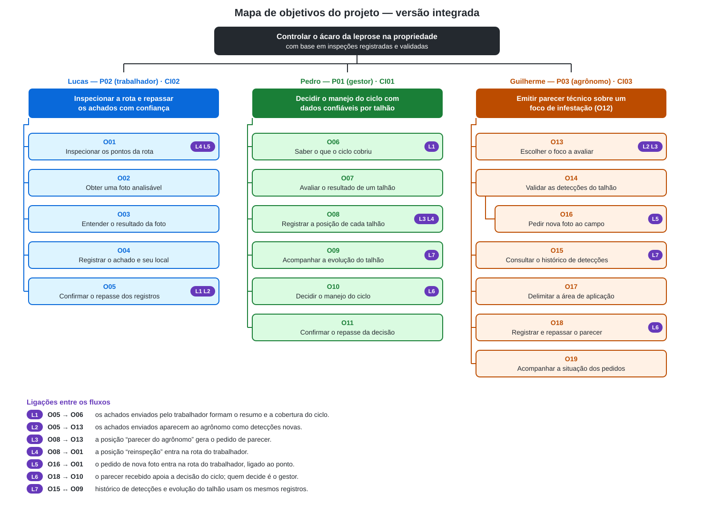

# Entrega 9 — Modelo conceitual e design centrado na comunicação

**Data:** 01/11/2026 
**Status:** 🟩 concluído — partes individuais e consolidação (mapa integrado, tabela única de signos e vocabulário) prontas; aguardando validação por entrevista. 
**Responsabilidade:** soluções individuais, com consolidação da equipe para mapa de objetivos e esquema de signos.

## Objetivo da atividade

Passar dos cenários de problema para uma concepção da interação, explicitando objetivos, tópicos de conversa, falas e signos compreensíveis aos usuários.

## Transformando resultados técnicos em conceitos compreensíveis

No fluxo do trabalhador, termos como “inferência”, “metadados EXIF” e “sincronização” serão comunicados como **analisando a foto**, **local do registro** e **situação do envio**. A interface distinguirá um sinal apontado pela IA de uma confirmação humana.

No fluxo do agrônomo, “probabilidade/score do modelo”, “caixa delimitadora (bounding box)”, “rótulo verdadeiro” e “metadados de geolocalização” serão comunicados como **sinal forte ou fraco**, **região indicada no fruto**, **veredito do agrônomo** e **local, data e hora da captura**. O resultado do modelo aparece como indicação automática, e só o veredito humano muda o ponto para “confirmado”.

## 1. Cenários de interação

### CI01 — Revisão do ciclo e decisão do manejo por talhão

**Autor(a):** Pedro — 24.123.048-1 
**Origem:** cenário de problema C01, “Planejamento do manejo sem visão consolidada da propriedade ao longo dos ciclos”.

Jaime é dono de uma fazenda de citros e cuida da parte administrativa e estratégica da propriedade. Ele conhece pouco a praga e depende do pragueiro para saber se há infestação e onde. A propriedade conta com poucos pragueiros, e a inspeção se repete em ciclos de cerca de 14 dias. **Quando o ciclo termina, o sistema avisa Jaime no escritório e mostra um resumo com a data do ciclo, quantos talhões foram inspecionados e quantos têm focos. Ele não precisa esperar o relato do pragueiro.**

Antes, Jaime recebia uma impressão geral (“tem uns focos no fundo da fazenda”), sem um quadro do que aconteceu em cada talhão. **Agora ele abre a cobertura do ciclo, onde os talhões inspecionados, os não inspecionados e os que têm focos aparecem claramente distintos. Um talhão “não inspecionado” nunca é apresentado como “sem focos”; se algum talhão ficou de fora, Jaime pode pedir nova inspeção sem sair da tela.** Se o pragueiro não pôde passar em alguma área, Jaime passa a saber disso na hora, e não depois.

Como não sabe identificar a praga sozinho, Jaime não tem como conferir o que vê. **Ao abrir um talhão com focos, encontra as fotos, o local e um grau de confiança em linguagem simples, sem números técnicos. O sistema não diz se a praga existe: Jaime decide em quem confiar e registra sua posição para o talhão, que pode ser “confiável”, “parecer do agrônomo” ou “reinspeção”. A dúvida não bloqueia a revisão; ele pode encerrá-la a qualquer momento, e as posições já registradas permanecem salvas.**

Jaime não sabia se a infestação estava crescendo, estável ou diminuindo, nem se a última aplicação funcionou. **Pela evolução do talhão, vê os ciclos mais recentes indicados como “avançando”, “estável” ou “recuando”, com a última aplicação marcada. Se algum ciclo comparado teve cobertura incompleta, o sistema avisa, para que ele não conclua que a praga recuou quando, na verdade, ninguém passou.**

No fim, Jaime planejava o manejo com base em impressão. **Agora registra a decisão do ciclo (onde e quando aplicar, e com que urgência) a partir das posições de cada talhão. O sistema ordena os talhões por gravidade e tendência, mas não recomenda produto, dose nem prioridade. A decisão aparece como “registrada” e só passa a “repassada” quando chega a quem aplica o produto; se o repasse falhar, a decisão continua salva e Jaime pode tentar de novo.**

Os trechos em **negrito** descrevem a interação proposta. Eles ainda precisam ser avaliados com usuários; não são observações de uso real. A tela de cada passo corresponde a G01–G08 da Entrega 6, ainda não desenhadas em papel nem simuladas.

### Diferenças relevantes — CI01

| Alteração | Por que foi necessária | Evidência/artefato que justifica |
|---|---|---|
| Aviso e resumo do ciclo concluído. | Jaime não depender do relato do pragueiro para saber que o ciclo acabou. | C01; HTA T04, passo 1.1 (Entrega 5). |
| Cobertura que separa “inspecionado”, “não inspecionado” e “com focos”. | Evitar confundir “sem alerta” com “ninguém passou”. | C01, Q5; CTT T09; hipótese H09. |
| Fotos e confiança em linguagem simples, com saídas “parecer do agrônomo” e “reinspeção”. | Jaime não valida a praga; precisa decidir em quem confiar. | Persona P01; HTA T04, passo 2.3; CTT T09. |
| Evolução por ciclo com última aplicação marcada e aviso de cobertura incompleta. | Responder se a praga avança e se a aplicação funcionou, sem conclusão enganosa. | C01, Q3; GOMS T08 (regra de verificar a cobertura); hipóteses H05 e H09. |
| Ordenação por gravidade apresentada como dado, não como recomendação. | Não invadir o papel do agrônomo (P03). | HTA T04, passo 3.1; fronteira ainda em aberto. |
| Estados distintos para decisão “registrada” e “repassada”. | A decisão precisa chegar a quem aplica, que pode não usar o sistema. | C01; hipótese H02; protótipo G08 (Entrega 6). |

### CI02 — Inspeção dos frutos e repasse dos achados

**Autor(a):** Lucas — 24.123.032-5 
**Origem:** cenário de problema C02, “Inspeção manual de frutos com lupa, sob fadiga e sem registro do percurso”.

Antônio recebe do gestor as áreas que deve percorrer e caminha entre as árvores do pomar. **No celular, abre a rota do dia e vê o próximo ponto planejado e os pontos que já possuem registro.** Em cada árvore, escolhe os frutos para inspeção. **Ao abrir a câmera, recebe uma orientação curta sobre distância, iluminação e foco; se a imagem estiver inadequada, pode ajustá-la antes de fotografar.**

O ácaro é pequeno e pode ser confundido com marcas da casca. **Depois da foto, o aplicativo informa que está analisando a imagem no próprio celular, mesmo sem internet. O resultado aparece como “sinal suspeito”, “nenhum sinal nesta foto” ou “resultado inconclusivo”. Antônio pode ouvir o resultado e refazer a foto quando estiver em dúvida. A mensagem deixa claro que o resultado da IA não equivale à confirmação da praga.**

Quando encontra um sinal suspeito, Antônio precisa avisar quem decide o que fazer. **Ao salvar o achado, o aplicativo associa foto, data, hora e local disponível. Se o GPS não fornecer a posição, Antônio identifica talhão, linha e árvore manualmente; o registro fica marcado como “local manual, sem coordenadas”.** Ele continua a inspeção sem esperar conexão.

Ao final do percurso, Antônio costumava depender da memória para saber se deixou algum ponto passar. **Agora confere os pontos planejados com e sem registro. Se encerrar com pendências, a rota continua identificada como incompleta. Os achados ficam “salvos no celular” até que haja conexão; depois o aplicativo mostra “enviando” e “enviado ao gestor”, ou permite tentar novamente em caso de falha. “Enviado” não significa que o gestor já leu o registro.**

Os trechos em **negrito** descrevem a interação proposta. Eles ainda precisam ser avaliados com usuários; não são observações de uso real.

### Diferenças relevantes — CI02

| Alteração | Por que foi necessária | Evidência/artefato que justifica |
|---|---|---|
| Rota com pontos planejados e registrados. | Reduzir a dúvida sobre locais esquecidos. | C02; HTA T01 e CTT T03 da Entrega 5. |
| Orientação de foco e possibilidade de refazer a foto. | Prevenir resultado baseado em imagem inadequada. | C02; GOMS T02; análise de interfaces da Entrega 2. |
| Resultado em linguagem curta, com alternativa inconclusiva. | Evitar que uma indicação da IA seja entendida como diagnóstico definitivo. | Dúvida do trabalhador em C02; GOMS T02. |
| Local automático ou identificação manual. | Evitar repasse baseado apenas na memória quando não houver GPS. | C02; HTA T01, etapa de comunicar o achado. |
| Estados distintos para salvo, enviando e enviado. | Permitir trabalhar offline e verificar se o repasse ocorreu. | Jornada de P02 da Entrega 3; CTT T03. |

### CI03 — Emitir parecer técnico sobre um foco de infestação

**Autor(a):** Guilherme Morais Escudeiro — 24.123.005-1 
**Origem:** cenário de problema C03, “Parecer técnico remoto sem contexto suficiente sobre o foco de infestação”. 
**Atores:** Marcelo (agrônomo consultor, P03), Jaime (dono e gestor da Fazenda Boa Vista, P01) e o trabalhador de campo (P02).

Marcelo é o agrônomo consultor de uma propriedade de citros. Ele atende a mais de uma propriedade e costuma revisar relatos de campo pelo menos algumas vezes por mês, geralmente quando o dono percebe algo fora do padrão durante a rotina da fazenda. ~~Certa manhã, o dono da fazenda liga para ele preocupado, dizendo que um dos trabalhadores encontrou "alguns frutos estranhos" durante a inspeção da plantação. Pouco depois, Marcelo recebe pelo celular algumas fotos soltas enviadas por mensagem, tiradas por diferentes trabalhadores em momentos diferentes do dia.~~ **[ALTERADO] Certa manhã, ao abrir o sistema no computador do escritório, Marcelo vê na lista de pedidos que Jaime, o dono da Fazenda Boa Vista, pediu um parecer sobre o talhão T12, com 5 pontos pendentes de validação. A mesma lista mostra outras detecções novas, separadas por propriedade e talhão, que ainda não têm pedido de parecer.**

~~Para emitir um parecer em que confia, Marcelo precisaria minimamente saber onde cada foto foi tirada dentro da propriedade, em que data e horário, e se os frutos fotografados pertencem à mesma árvore ou a árvores distintas (nenhuma dessas informações acompanha as fotos que recebe). Ele tenta reconstruir o cenário por telefone, perguntando ao dono onde exatamente cada trabalhador estava, mas as respostas são baseadas na memória de quem estava em campo horas antes, e nem sempre são precisas.~~ **[ALTERADO] Ao abrir o pedido, o sistema leva Marcelo direto ao mapa do talhão T12, com os pontos marcados pela situação de cada um: 5 pendentes, 1 confirmado e 1 rejeitado. Os pontos que já tiveram detecção em ciclos anteriores aparecem destacados. Ele abre o ponto 4 e vê a foto original, que pode ampliar, com a data e hora da captura, a árvore (L3-27) e a localização registradas automaticamente quando o trabalhador fotografou. Não precisa mais ligar para ninguém para saber onde a foto foi tirada.**

~~Ele também não tem como comparar essas fotos com inspeções de semanas anteriores, porque não existe um registro histórico organizado, apenas mensagens soltas que se perdem na conversa.~~ **[ALTERADO] Na mesma tela, abaixo da foto, aparecem as inspeções anteriores daquele ponto: em 18/09 houve sinal, validado por ele mesmo, e em 04/09 não houve sinal. Quando quer ver mais, Marcelo pede o histórico daquele ponto e o sistema mostra as detecções já filtradas pelo ponto, nas últimas 8 semanas; ele amplia o período sem perder a seleção do local. A avaliação da IA não aparece de início: Marcelo examina a foto primeiro e só depois consulta a avaliação, que informa que o sinal é forte e qual região do fruto motivou a detecção.**

**[ALTERADO] Para cada ponto, Marcelo escolhe entre confirmar, rejeitar ou pedir nova foto. Ele confirma o ponto 4, que passa a aparecer como "validado por humano", e o sistema indica o próximo ponto pendente. No ponto 6, conclui que a marca na casca não é do ácaro e rejeita a detecção. No ponto 2, a foto está desfocada:** ~~quando a resposta não é suficiente, ele chega a pedir que um trabalhador volte ao local para tirar novas fotos, ou, em casos mais sérios, agenda uma visita presencial extra à propriedade, o que pode levar mais de um dia para acontecer.~~ **em vez de decidir sem certeza, Marcelo pede uma nova foto sem sair da detecção: o pedido, já ligado ao ponto e à árvore, entra na rota do trabalhador no celular. O ponto continua "pendente" até a nova foto chegar e ser avaliada, e por isso não entra na área de aplicação. A visita presencial continua possível, mas deixa de ser o único recurso.**

~~Sem saber com certeza a extensão da área afetada, nem se o problema já havia aparecido antes naquele ponto da propriedade, Marcelo precisa decidir se recomenda a aplicação de um produto de controle, e onde.~~ **[ALTERADO] Com os pontos validados e o histórico consultado, Marcelo passa à delimitação da área de aplicação. O mapa mostra apenas os pontos confirmados, e o sistema avisa que ainda há 3 pontos pendentes. Marcelo decide seguir assim mesmo, delimita a área em torno dos pontos confirmados (0,8 ha do talhão T12) e preenche produto, dose e período, que o sistema apenas registra. O parecer é montado com a área e os pontos vinculados listados automaticamente; ele escreve a justificativa técnica e envia para Jaime.** Ele sabe que recomendar a aplicação em uma área maior do que o necessário gera custo e impacto ambiental evitáveis, mas que recomendar pouco, ou no lugar errado, corre o risco de deixar a praga se espalhar sem controle. **[ALTERADO] Por isso, a área desenhada sobre os pontos confirmados substitui a estimativa feita de memória que, numa ocasião anterior, levou a uma aplicação maior do que a necessária.**

**[ALTERADO] Ao enviar, Marcelo volta à lista de pedidos, onde o pedido da Fazenda Boa Vista aparece como "concluído". Na primeira tentativa a conexão falha; o sistema avisa, mantém o texto do parecer e Marcelo envia de novo. Quando a nova foto do ponto 2 chegar, o ponto aparece de novo para avaliação, ligado ao mesmo talhão.**

Os trechos marcados como **[ALTERADO]** descrevem a interação proposta e substituem os trechos riscados do cenário de problema C03. Eles ainda precisam ser avaliados com usuários; não são observações de uso real. Os passos correspondem às telas A01–A07 do protótipo em papel (Entrega 6), revisadas para o Figma (Entrega 11).

### Diferenças relevantes — CI03

| Alteração | Por que foi necessária | Evidência/artefato que justifica |
|---|---|---|
| O pedido de parecer chega como item no sistema, agrupado por propriedade e talhão, em vez de ligação e fotos soltas. | Marcelo atende várias propriedades e hoje recebe relatos informais sem contexto. | C03 (cenário inicial e Q1); HTA T05, passo 1; P03 (dores). |
| Entrada direta no mapa do talhão com a situação de cada ponto. | Do geral para o específico: primeiro onde está o foco, sem procurar o talhão. | HTA T05, plano 2 (2.1 > 2.2 > 2.3); protótipo A02. |
| Local, data, hora e árvore gravados automaticamente com a foto. | Hoje o local depende da memória de quem estava em campo. | C03 refinado (Q2); HTA T05, 2.1 e 2.2; síntese de P03 (Entrega 5). |
| Histórico do ponto na mesma tela da detecção e atalho para o histórico filtrado. | Comparar com inspeções anteriores era impossível; M3 é o método mais curto e mais frequente. | GOMS T06 (M3, SR1); CTT T07 (concorrência em *Analisar evidências*); H22. |
| Avaliação da IA recolhida até o agrônomo abrir. | Reduzir o possível viés de confirmação; decisão ainda a testar. | CTT T07 (leitura do modelo); pergunta 15 da entrevista I02 (Entrega 7). |
| Três saídas para cada ponto: confirmar, rejeitar ou pedir nova foto. | Quando a foto não basta, o agrônomo não é forçado a decidir; o pedido substitui a ligação ou a visita extra. | CTT T07 (escolha com três saídas); C03 refinado (Q3). |
| Pedido de nova foto feito sem sair da detecção, já ligado ao ponto e à árvore; o ponto continua "pendente". | Ligar P03 a P02 sem conversa solta e sem perder o ponto; um formulário de motivo e prazo foi considerado redundante no protótipo em papel. | CTT T07 (*Solicitar nova foto ao campo*); protótipo A03 e P01 (Entrega 6). |
| Delimitação da área apenas com pontos confirmados e aviso de pendências. | O erro relatado no C03 ocorre na delimitação da área; só focos validados por humano devem entrar [H07]. | C03 (Q5); HTA T05, 3 e 4.1; protótipo A06. |
| Parecer com pontos vinculados automaticamente e repasse ao gestor, com o pedido marcado como "concluído" na lista. | O parecer hoje se perde em mensagens; quem decide a execução é P01. | HTA T05, passo 5; síntese da Entrega 3; [F24]; H21. |
| Produto, dose e período como campos livres. | O sistema registra o julgamento técnico, não recomenda; o parecer não substitui o receituário agronômico. | HTA T05, 4.2; Entrega 8 (princípios). |

## 2. Design centrado na comunicação

**Design centrado na comunicação — Lucas**

**Nome do cenário:** CI02 — inspeção dos frutos e repasse dos achados.

| Tópico > subtópico | Falas e signos envolvidos | Intenção/efeito esperado |
|---|---|---|
| Iniciar a inspeção > escolher o próximo ponto | `U: Qual ponto devo inspecionar agora?` / `D: Próximo ponto: talhão, linha e árvore; estes pontos já têm registro e estes estão pendentes.` | Orientar a continuidade sem afirmar que todas as árvores do talhão foram examinadas. |
| Capturar o fruto > ajustar a imagem | `U: A foto está boa para analisar?` / `D: Ajuste a distância e o foco antes de fotografar.` | Prevenir captura inadequada. |
| Analisar a foto > aguardar | `U: O que está acontecendo?` / `D: Analisando a foto no celular.` | Informar o estado da tarefa sem depender da internet. |
| Entender o resultado > sinal suspeito | `U: É a praga?` / `D: Sinal suspeito nesta foto; precisa de confirmação.` | Comunicar a indicação da IA e seu limite. |
| > nenhum sinal na foto | `U: Posso considerar a árvore livre da praga?` / `D: Nenhum sinal nesta foto; isso não garante que toda a árvore esteja livre.` | Evitar uma conclusão além da imagem analisada. |
| > resultado inconclusivo | `U: E se eu não tiver certeza?` / `D: Não foi possível concluir. Refaça a foto ou salve para conferir depois.` | Permitir recuperação sem forçar uma decisão. |
| Registrar o achado > identificar o local | `U: Onde este fruto foi encontrado?` / `D: Local obtido por GPS; se não estiver disponível, informe talhão, linha e árvore.` | Manter o contexto do achado e indicar quando o local foi informado manualmente. |
| Repassar os achados > conferir o envio | `U: O gestor já recebeu?` / `D: Salvo no celular; aguardando conexão / enviando / enviado ao gestor / falha no envio.` | Diferenciar armazenamento local, envio e falha. |

**Convenção:** `U` = usuário; `D` = preposto do designer/sistema.

**Design centrado na comunicação — Pedro**

**Nome do cenário:** CI01 — revisão do ciclo e decisão do manejo por talhão.

| Tópico > subtópico | Falas e signos envolvidos | Intenção/efeito esperado |
|---|---|---|
| Saber do ciclo > aviso e resumo | `U: O ciclo terminou?` / `D: Ciclo concluído em [data]: X talhões inspecionados, Y com focos.` | Dispensar o relato do pragueiro e informar o alcance do ciclo. |
| Conferir a cobertura > talhão não inspecionado | `U: Todos os talhões foram vistos?` / `D: Não inspecionado: talhão [nome]. Isso não significa que esteja livre da praga.` | Impedir que “não inspecionado” seja lido como “sem focos”. |
| > pedir nova inspeção | `U: E o que falta?` / `D: Pedir nova inspeção deste talhão?` | Dar uma saída sem sair da tela de cobertura. |
| Avaliar o talhão > evidência e confiança | `U: Posso confiar neste resultado?` / `D: Confiança [alta/média/baixa]. Veja as fotos e o local; o sistema não confirma a praga.` | Mostrar a evidência e o limite da indicação, em linguagem simples. |
| Registrar a posição > escolher a saída | `U: Eu não sei se é a praga.` / `D: Aceitar como confiável, pedir parecer do agrônomo ou pedir nova inspeção.` | Permitir a dúvida sem bloquear a revisão. |
| Acompanhar a evolução > ler a tendência | `U: A praga está se espalhando?` / `D: Neste talhão: avançando / estável / recuando. Última aplicação marcada no ciclo [data].` | Responder à pergunta do gestor com o histórico, sem exigir memória. |
| > cobertura incompleta | `U: Posso concluir que recuou?` / `D: Atenção: o ciclo [data] não cobriu todo o talhão. A comparação pode não ser confiável.` | Evitar conclusão enganosa na comparação. |
| Decidir o manejo > registrar a decisão | `U: Onde e quando aplico?` / `D: Talhões em ordem de gravidade. Escolha onde, quando e com que urgência aplicar.` | Apresentar dados sem recomendar produto, dose nem prioridade. |
| Repassar a decisão > conferir o repasse | `U: Quem vai aplicar já sabe?` / `D: Decisão registrada / repassada a [quem aplica] / falha no repasse: tentar novamente.` | Diferenciar registro, repasse e falha, mantendo a decisão salva. |

Os rótulos de confiança (“alta”, “média” e “baixa”) são uma proposta inicial, a testar com usuários.

**Design centrado na comunicação — Guilherme**

**Nome do cenário:** CI03 — Emitir parecer técnico sobre um foco de infestação.

| Tópico > subtópico | Falas e signos envolvidos | Intenção/efeito esperado |
|---|---|---|
| Emitir parecer técnico sobre um foco (O12) | `U: O que tenho para analisar?` / `D: Estes são os pedidos de parecer e as detecções novas das propriedades que você atende.` Signos: *pedido de parecer*, *propriedade*, *talhão*, *solicitante*, *pontos pendentes* | Marcelo sabe por onde começar e distingue pedido do gestor de detecção sem pedido. |
| > Escolher o foco a avaliar (O13) | `U: Quero ver o pedido do talhão T12.` / `D: Aqui está o talhão T12. Estes pontos têm detecção; 5 estão pendentes, 1 confirmado e 1 rejeitado. Os pontos destacados já tiveram detecção antes.` Signos: *mapa do talhão*, *ponto*, *situação da validação*, *detecção anterior* | Entrada direta no foco (HTA T05, 1 e 2.1); a contagem por situação mostra quanto falta. |
| Validar as detecções do talhão (O14) | `U: Quero examinar o ponto 4.` / `D: Esta é a foto original do ponto 4, árvore L3-27, tirada em 02/10 às 09:14, com a localização registrada. Antes, neste ponto, houve sinal validado em 18/09 e nenhum sinal em 04/09.` Signos: *foto do fruto (original)*, *data e hora da captura*, *árvore*, *local do achado*, *detecções anteriores do ponto* | Reúne na mesma conversa as evidências que o CTT T07 indica como concorrentes. |
| > Examinar a foto | `U: Quero ampliar a foto.` / `D: (foto ampliada, com a mesma identificação do ponto)` | Julgamento técnico sem sair do contexto. |
| > Consultar a avaliação da IA | `U: Quero ver o que a IA avaliou.` / `D: A IA detectou sinal forte de ácaro nesta região do fruto. Esta é uma indicação automática; a validação é sua.` Signos: *avaliação da IA*, *intensidade do sinal*, *região indicada* | Separa "detectado pela IA" de "validado por humano"; a fala é de triagem, não de diagnóstico. |
| > Registrar o veredito | `U: Confirmo que há sinal da praga neste ponto.` / `D: Ponto 4 validado por você. O próximo pendente é o ponto 6.` ou `U: Não há sinal da praga no ponto 6.` / `D: Ponto 6 rejeitado por você. Restam 3 pontos pendentes.` Signos: *veredito*, *validado por*, *observação técnica* | Feedback imediato do registro, com autoria; progresso salvo ponto a ponto. |
| > Pedir nova foto ao campo (O16) | `U: A foto não é suficiente; quero outra.` / `D: Pedido de nova foto do ponto 2, árvore L3-15, enviado à rota do campo. O ponto continua pendente.` Signos: *pedido de nova foto* | Substitui a ligação ou a visita extra do C03; o ponto não se perde e não entra na área antes de ser avaliado. |
| > Encerrar a revisão sem concluir | `U: Vou parar por agora.` / `D: Os vereditos registrados foram mantidos. Restam 3 pontos pendentes no talhão T12.` | Desabilitação do CTT T07 sem perda de trabalho. |
| Consultar o histórico de um ponto ou talhão (O15) | `U: Quero ver o histórico deste ponto.` / `D: Detecções do ponto 4 nas últimas 8 semanas.` / `U: Quero ampliar para 6 meses.` / `D: Detecções do ponto 4 nos últimos 6 meses.` ou `D: Não há detecções neste período para o ponto 4.` Signos: *histórico de detecções*, *período*, *local do filtro* | GOMS T06: a mesma lista é aberta de A01, A02 ou A03, com o filtro coerente com a origem; o resultado vazio é comunicado. |
| Delimitar a área de aplicação (O17) | `U: Quero definir a área de aplicação.` / `D: Estes são os pontos confirmados do talhão T12. Atenção: 3 pontos ainda estão pendentes; eles não entram na área.` / `U: Esta é a área; produto, dose e período são estes.` / `D: Área de 0,8 ha registrada.` Signos: *área de aplicação*, *pontos confirmados*, *produto*, *dose*, *período de aplicação* | Evita a área maior que a necessária (C03 Q5); as pendências são avisadas sem bloquear (Entrega 6). |
| > Talhão sem ponto confirmado | `U: Quero definir a área de aplicação.` / `D: Ainda não há pontos confirmados no talhão T12. Valide ao menos um ponto antes de delimitar a área.` | Impede uma área sem base em validação humana [H07]; leva Marcelo de volta à validação. |
| Registrar e repassar o parecer (O18) | `D: Este é o parecer: área de 0,8 ha, pontos 4 e 7 vinculados, destinatário Jaime (gestor). Escreva a justificativa técnica.` / `U: (texto) Enviar.` / `D: Parecer enviado a Jaime. O pedido do talhão T12 está concluído.` Signos: *parecer técnico*, *pontos vinculados*, *destinatário do parecer*, *situação do pedido* | O parecer fica ligado aos pontos e o repasse é explícito. |
| > Campos obrigatórios vazios | `U: Quero enviar o parecer.` / `D: Para enviar, informe produto, dose e a justificativa técnica.` | O envio só fica disponível com os campos preenchidos; o parecer não segue incompleto. |
| > Acompanhar a situação do pedido (O19) | `D: Não foi possível enviar o parecer. O texto foi mantido.` / `U: Enviar.` / `D: Parecer enviado. Pedido concluído.` | A situação aparece na lista de pedidos (pendente ou concluído), sem tela própria; a falha tem recuperação. |

## 3. Mapa de objetivos

### Mapa individual — Lucas

**Objetivo principal:** inspecionar a rota e repassar os achados com confiança.

- **O01 — Inspecionar os pontos da rota**
  - Identificar o próximo ponto planejado.
  - Distinguir pontos com registro de pontos pendentes.
- **O02 — Obter uma foto analisável**
  - Ajustar enquadramento e foco.
  - Fotografar ou refazer a captura.
- **O03 — Entender o resultado da foto**
  - Distinguir suspeita, ausência de sinal na foto e resultado inconclusivo.
  - Decidir entre seguir, refazer ou guardar para conferência.
- **O04 — Registrar o achado e seu local**
  - Salvar foto, resultado, data e hora.
  - Usar o local obtido ou identificar o ponto manualmente.
- **O05 — Confirmar o repasse dos registros**
  - Verificar pendências da rota.
  - Distinguir registro salvo de registro enviado.
  - Recuperar-se de falha no envio.

### Mapa individual — Pedro

**Objetivo principal:** decidir o manejo do ciclo com base em dados confiáveis sobre cada talhão.

- **O06 — Saber o que o ciclo cobriu**
  - Receber o aviso e o resumo do ciclo.
  - Distinguir talhão sem focos de talhão não inspecionado.
  - Pedir nova inspeção dos talhões não cobertos.
- **O07 — Avaliar o resultado de um talhão**
  - Ver fotos, local e confiança.
  - Decidir em quem confiar, sem validar a praga.
- **O08 — Registrar a posição de cada talhão**
  - Aceitar como confiável.
  - Pedir parecer do agrônomo ou reinspeção.
- **O09 — Acompanhar a evolução do talhão**
  - Ler a tendência entre ciclos.
  - Ver a última aplicação e o aviso de cobertura incompleta.
- **O10 — Decidir o manejo do ciclo**
  - Escolher onde, quando e com que urgência aplicar.
  - Usar a ordem por gravidade como dado, não como recomendação.
- **O11 — Confirmar o repasse da decisão**
  - Distinguir decisão registrada de repassada.
  - Recuperar-se de falha no repasse.

### Mapa individual — Guilherme

**Objetivo principal (O12):** emitir parecer técnico sobre um foco de infestação.

- **O12 — Emitir parecer técnico sobre um foco de infestação**
  - **O13 — Escolher o foco a avaliar** (pedidos de parecer e detecções novas).
  - **O14 — Validar as detecções do talhão** (confirmar ou rejeitar cada ponto).
    - **O16 — Pedir nova foto de um ponto ao campo**, quando a foto não basta.
  - **O15 — Consultar o histórico de detecções** de um ponto ou talhão.
  - **O17 — Delimitar a área de aplicação** com os pontos confirmados.
  - **O18 — Registrar e repassar o parecer ao gestor.**
  - **O19 — Acompanhar a situação dos pedidos de parecer.**

### Mapa de objetivos do projeto (integrado)

Os três mapas individuais foram integrados sob um objetivo comum: **controlar o ácaro da leprose na propriedade com base em inspeções registradas e validadas**. Cada persona mantém seu objetivo principal, e as ligações L1–L7 mostram onde o objetivo de um fluxo depende do resultado de outro.

| Ligação | De → para | O que passa de um fluxo ao outro | Signo envolvido |
|---|---|---|---|
| L1 | O05 → O06 | Os achados enviados pelo trabalhador formam o resumo e a cobertura do ciclo. | situação do envio → cobertura do talhão |
| L2 | O05 → O13 | Os achados enviados aparecem ao agrônomo como detecções novas. | situação do envio → detecção |
| L3 | O08 → O13 | A posição “parecer do agrônomo” gera o pedido de parecer. | posição do talhão → pedido de parecer |
| L4 | O08 → O01 | A posição “reinspeção” entra na rota do trabalhador. | posição do talhão → ponto planejado |
| L5 | O16 → O01 | O pedido de nova foto entra na rota do trabalhador, ligado ao ponto. | pedido de nova foto → ponto planejado |
| L6 | O18 → O10 | O parecer recebido apoia a decisão do ciclo; quem decide é o gestor. | parecer técnico → decisão do ciclo |
| L7 | O15 ↔ O09 | Histórico de detecções e evolução do talhão usam os mesmos registros. | histórico de detecções ↔ tendência do talhão |

**Pontos em aberto:** L4 e L5 chegam à rota de P02, mas o CI02 ainda não mostra como um pedido de reinspeção ou de nova foto aparece para o trabalhador; o MoLIC M02 deve representar essa entrada. A hipótese H04 (quem decide a aplicação) pode mudar o destino de L6.

Os mapas individuais lado a lado continuam disponíveis em [mapa_objetivos.svg](../assets/09_modelo_conceitual/mapa_objetivos.svg).

### Dicionário de objetivos

| ID | Objetivo | Persona(s) | Cenário(s) | Prioridade |
|---|---|---|---|---|
| O01 | Inspecionar os pontos da rota. | P02 | CI02 | Alta |
| O02 | Obter uma foto analisável. | P02 | CI02 | Alta |
| O03 | Entender o resultado da foto. | P02 | CI02 | Alta |
| O04 | Registrar o achado e seu local. | P02 | CI02 | Alta |
| O05 | Confirmar o repasse dos registros. | P02 | CI02 | Alta |
| O06 | Saber o que o ciclo cobriu. | P01 | CI01 | Alta |
| O07 | Avaliar o resultado de um talhão. | P01 | CI01 | Alta |
| O08 | Registrar a posição de cada talhão. | P01 | CI01 | Alta |
| O09 | Acompanhar a evolução do talhão. | P01 | CI01 | Alta |
| O10 | Decidir o manejo do ciclo. | P01 | CI01 | Alta |
| O11 | Confirmar o repasse da decisão. | P01 | CI01 | Alta |
| O12 | Emitir parecer técnico sobre um foco de infestação. | P03 | CI03 | Alta |
| O13 | Escolher o foco a avaliar a partir dos pedidos de parecer e das detecções novas. | P03 | CI03 | Alta |
| O14 | Validar (confirmar ou rejeitar) as detecções do talhão. | P03 | CI03 | Alta |
| O15 | Consultar o histórico de detecções de um ponto ou talhão. | P03 | CI03 | Alta |
| O16 | Pedir nova foto de um ponto ao campo. | P03 | CI03 | Média |
| O17 | Delimitar a área de aplicação com os pontos confirmados. | P03 | CI03 | Alta |
| O18 | Registrar e repassar o parecer ao gestor. | P03 | CI03 | Alta |
| O19 | Acompanhar a situação dos pedidos de parecer. | P03 | CI03 | Média |

**Numeração:** O01–O05 identificam o mapa de Lucas; O06–O11, o de Pedro; e O12–O19, o de Guilherme. Os objetivos de Guilherme, antes numerados O01–O08, foram renumerados para não colidir com os demais; as Entregas 10 e 11 e a rastreabilidade já usam os novos IDs.

## 4. Esquema conceitual de signos

Tabela única da equipe, organizada por entidade do domínio e não por autor. A coluna **Fluxo** indica em que fluxo cada signo aparece: P02 (trabalhador, Lucas), P01 (gestor, Pedro) e P03 (agrônomo, Guilherme). Conceitos que se repetiam em mais de um fluxo foram unificados em uma só linha; signos de mesmo nome e significado diferente foram renomeados (ver **Vocabulário fixado**).

| Grupo | Signo | Fluxo | Origem | Observações/semântica | Tipo de conteúdo | Restrição | Valor padrão | Prevenção | Recuperação |
|---|---|---|---|---|---|---|---|---|---|
| Propriedade | propriedade | P03 | domínio | Fazenda atendida pelo agrônomo; agrupa pedidos e detecções. Fornecida pelo sistema. | texto | só propriedades atendidas pelo agrônomo | — | PA: propriedades não atendidas não aparecem | — |
| Propriedade | + talhão | P01, P02, P03 | domínio | Subdivisão da propriedade, com rótulo e limites visíveis no mapa (GOMS T06, M1). Unidade da rota, da cobertura do ciclo e do parecer. | texto (nome/código) + área no mapa | não nulo | — | PP: rótulo visível no mapa sem zoom | — |
| Ponto | + ponto | P02, P03 | domínio | Local amostrado na inspeção (talhão, linha e árvore), identificado por número no mapa. Um ponto planejado passa a ter registro quando é inspecionado. | identificador + local | não nulo | — | PP: identificador do ponto sempre visível | — |
| Ponto | árvore | P02, P03 | domínio | Árvore fotografada (ex.: L3-27, linha e posição). | texto | não nulo | — | PP: indicação “informado manualmente” quando não veio do GPS (P04, Entrega 6) | RA: corrigir talhão, linha e árvore antes de salvar |
| Rota | ponto planejado | P02 | domínio | Ponto indicado para inspeção na rota; não significa que foi visitado. | talhão, linha e árvore | deve identificar o ponto na rota | próximo pendente | PP: mostrar o identificador do ponto | RA: voltar à rota e selecionar outro ponto |
| Rota | situação do ponto na rota | P02 | aplicação | “Com registro” ou “pendente”; não indica ausência de praga. Diferente da *situação da validação* (P03). | estado | não confundir com o resultado da foto | pendente | PP: texto e símbolo além de cor | RA: abrir o ponto e conferir os registros |
| Captura | foto do fruto | P02, P03 | domínio | Imagem obtida em campo e analisada; para o agrônomo, é a foto original, completa e ampliável. | imagem | qualidade suficiente para análise | nenhuma | PP: orientar foco, distância e iluminação | RA: ajustar ou refazer a foto (P02); pedir nova foto (P03, O16) |
| Captura | qualidade da foto | P02 | aplicação | Indica possível problema de foco ou enquadramento. | estado/mensagem | não equivale ao resultado da análise | aguardando captura | PP: avisar antes de fotografar | RA: reposicionar e tentar novamente |
| Análise | situação da análise | P02 | aplicação | “Analisando”, “concluída” ou “falhou”. | estado/mensagem | informar quando não houver conclusão | aguardando foto | PP: progresso em texto | RA: cancelar ou tentar novamente |
| Análise | resultado da foto | P02, P01 | aplicação | “Sinal suspeito”, “nenhum sinal nesta foto” ou “inconclusivo”. É indicação da IA, não validação humana. | texto e símbolo | vinculado à foto analisada | nenhum | PP: explicar o alcance de cada mensagem | RA: refazer a foto ou guardar para conferência |
| Análise | avaliação da IA | P03 | aplicação | Intensidade do sinal em faixas com texto (“sinal forte”, “sinal fraco”) e região do fruto indicada. A probabilidade numérica não é exibida; é triagem, não diagnóstico. | texto + destaque na imagem | — | não exibida até ser consultada | PP: exibida só depois da foto, com o texto “indicação automática; a validação é sua” (a testar) | — |
| Análise | confiança do resultado | P01 | aplicação | Indicação em linguagem simples de quão confiável é a detecção; não é validação humana. | texto (alta/média/baixa, proposta) | sem números técnicos; vinculada às fotos | nenhum | PP: mostrar com as fotos e o local | RA: marcar para parecer do agrônomo ou pedir reinspeção |
| Registro | data e hora da captura | P02, P03 | domínio | Momento em que a foto foi obtida, gravado automaticamente no celular; distinto do horário de envio e de sincronização. | data e hora | não nula | captura atual | PP: mostrar no resumo do registro e na detecção | RA: nova captura se o registro estiver incorreto |
| Registro | local do achado | P02, P03 | domínio | Posição obtida por GPS ou identificação manual do ponto; para o agrônomo, com a precisão indicada. | coordenada ou talhão/linha/árvore | indicar a origem do local | tentar GPS | PP: mostrar se o local foi obtido e avisar baixa precisão | RA: informar o local manualmente se faltar GPS |
| Registro | situação do registro | P02 | aplicação | “Salvo no celular”; ainda não significa que o gestor recebeu. | estado/mensagem | registro deve permanecer acessível | não salvo | PP: confirmar o salvamento | RA: tentar salvar de novo sem descartar a foto |
| Repasse dos achados | destinatário dos achados | P02 | domínio | Papel que recebe os achados do trabalhador (gestor da propriedade). | função | deve estar definido para o repasse | gestor da rota, se previamente definido | PP: mostrar a função no resumo | RA: corrigir o destinatário antes do envio |
| Repasse dos achados | situação do envio | P02 | aplicação | “Aguardando conexão”, “enviando”, “enviado” ou “falha”; enviado não significa lido. | estado/mensagem | separada da situação do registro | aguardando, se offline | PP: texto e quantidade pendente | RA: tentar de novo mantendo os dados salvos |
| Ciclo | aviso de ciclo concluído | P01 | aplicação | Informa que a inspeção terminou, com data; não garante que todos os talhões foram inspecionados. | estado/mensagem e data | associado ao ciclo | nenhum | PP: exibir junto ao resumo da cobertura | RA: reabrir o resumo do ciclo |
| Ciclo | cobertura do talhão | P01 | domínio | “Inspecionado”, “não inspecionado” ou “cobertura incompleta”; não indica ausência de praga. | estado | não confundir com “sem focos” | não inspecionado, até haver registro | PP: texto e símbolo além de cor, com frase sobre o limite | RA: pedir nova inspeção do talhão |
| Ciclo | situação do talhão no ciclo | P01 | aplicação | “Com focos”, “sem focos nesta inspeção” ou “não inspecionado”. | estado | “sem focos” só vale para talhão inspecionado | não inspecionado | PP: separar visualmente os três estados | RA: abrir o talhão e conferir a cobertura |
| Posição do gestor | posição do talhão | P01 | aplicação | Escolha do gestor: “confiável”, “parecer do agrônomo” ou “reinspeção”; não valida a praga. “Parecer do agrônomo” gera um *pedido de parecer*; “reinspeção” entra na rota de P02. | estado escolhido | uma posição por talhão e ciclo | sem posição | PP: as três saídas com texto claro | RA: alterar a posição antes de registrar a decisão |
| Evolução | tendência do talhão | P01 | aplicação | “Avançando”, “estável” ou “recuando” entre ciclos; usa os mesmos registros do *histórico de detecções*. | estado e ciclos comparados | avisar se algum ciclo comparado teve cobertura incompleta | sem comparação, se faltar ciclo | PP: texto e símbolo além de cor; AL: aviso de cobertura incompleta na comparação | RA: ver a cobertura dos ciclos comparados |
| Evolução | última aplicação | P01 | domínio | Marca no histórico o ciclo em que houve aplicação. | data/ciclo | não indica produto nem dose | nenhuma | PP: marca na própria linha do tempo | RA: corrigir o registro |
| Pedido de parecer | + pedido de parecer | P01, P03 | aplicação | Solicitação do gestor para avaliar um talhão, criada pela posição “parecer do agrônomo”; diferente de *detecção nova*, que não tem pedido. | registro composto | ligado a 1 talhão | — | — | — |
| Pedido de parecer | solicitante | P03 | domínio | Função e nome de quem pediu o parecer (gestor). | texto | — | — | — | — |
| Pedido de parecer | pontos pendentes | P03 | aplicação | Quantidade de pontos do talhão com detecção ainda sem veredito. | número inteiro | ≥ 0 | — | — | — |
| Pedido de parecer | situação do pedido | P03 | aplicação | Pendente ou concluído (parecer enviado ao gestor), mostrada na lista de pedidos. | estado | — | pendente | PP: texto além de cor na lista | RA: falha no envio mantém o pedido “pendente” e o texto do parecer para reenviar |
| Validação | situação da validação | P03 | aplicação | Pendente (○), confirmado — validado por humano (●) ou rejeitado (×), com cor e símbolo juntos. Após um pedido de nova foto, o ponto continua pendente. Diferente da *situação do ponto na rota* (P02). | estado (lista fechada) | um estado por vez | pendente | PP: legenda fixa no mapa; símbolo e texto além de cor | RA: veredito pode ser alterado até o parecer ser enviado |
| Validação | veredito | P03 | domínio | Decisão do agrônomo: confirmar, rejeitar ou pedir nova foto (esta mantém o ponto pendente). | escolha (3 opções) | confirmar ou rejeitar tira o ponto de “pendente” | nenhum | PP: as três opções sempre visíveis, com o efeito de cada uma | RA: alterar o veredito até enviar o parecer |
| Validação | validado por | P03 | aplicação | Nome e função de quem registrou o veredito, com data e hora. | texto + data/hora | automático | usuário conectado | — | — |
| Validação | observação técnica | P03 | domínio | Nota opcional do agrônomo sobre o ponto. | texto livre | até 500 caracteres | vazio | PA: limite de 500 caracteres com contador | RA: editar a observação |
| Validação | pedido de nova foto | P03, P02 | aplicação | Solicitação ao campo para fotografar de novo um ponto, ligada ao ponto e à árvore e enviada à rota do trabalhador, sem motivo nem prazo. | registro | ligado a 1 ponto | — | PP: mensagem de que o ponto continua pendente | RA: o ponto continua pendente até a nova foto ser avaliada |
| Histórico | detecção anterior | P03 | aplicação | Indica no mapa que o ponto já teve detecção em inspeções anteriores. | indicador visual | — | — | — | — |
| Histórico | detecções anteriores do ponto | P03 | aplicação | Resumo das últimas inspeções do ponto na mesma tela da foto (data, resultado, situação). | lista | até 3 itens; o restante no histórico | últimas 3 | — | — |
| Histórico | histórico de detecções | P03 | aplicação | Lista única de detecções, igual por qualquer caminho de acesso (GOMS T06); mesma base da *tendência do talhão* (P01). | lista | ordenada da mais recente | — | — | RA: sem resultados, mensagem “nenhuma detecção no período” e sugestão de ampliar o período |
| Histórico | período | P03 | domínio | Intervalo de datas do filtro. | intervalo de datas | início ≤ fim | últimas 8 semanas | PA: fim anterior ao início indisponível | RA: alterar o período |
| Histórico | local do filtro | P03 | domínio | Propriedade, talhão ou ponto do filtro, preenchido conforme a origem (ponto a partir de A03, talhão a partir de A02). | seleção | — | conforme a origem | PP: filtro ativo sempre visível | RA: remover o filtro |
| Parecer | área de aplicação | P03 | domínio | Região do talhão onde o manejo será aplicado, delimitada pelo agrônomo sobre o mapa. | polígono + área em ha | ao menos 1 ponto confirmado | — | PA: só pontos confirmados aparecem como base; AL: aviso de pontos pendentes antes de continuar | RA: redesenhar a área |
| Parecer | produto | P03 | domínio | Produto indicado pelo agrônomo; o sistema só registra. | texto livre | obrigatório para enviar | vazio | PP: nota “o parecer não substitui o receituário agronômico”; PA: envio desabilitado sem produto | RA: editar antes de enviar |
| Parecer | dose | P03 | domínio | Dose indicada pelo agrônomo. | texto livre | obrigatório para enviar | vazio | PA: envio desabilitado sem dose | RA: editar antes de enviar |
| Parecer | período de aplicação | P03 | domínio | Quando aplicar, indicado pelo agrônomo. | data ou intervalo | início ≥ hoje | — | PA: datas passadas indisponíveis | RA: editar antes de enviar |
| Parecer | parecer técnico | P03, P01 | domínio | Texto da recomendação com justificativa técnica; chega ao gestor como entrada da decisão do ciclo. | texto livre | não vazio para enviar | vazio | PA: envio desabilitado sem texto; AL: confirmação com destinatário e área antes de enviar | RA: editar antes de enviar |
| Parecer | pontos vinculados | P03 | aplicação | Pontos confirmados usados na área, listados automaticamente no parecer. | lista | gerada pelo sistema | pontos confirmados da área | — | — |
| Parecer | destinatário do parecer | P03 | domínio | Gestor que pediu o parecer (ou o gestor da propriedade, se não houve pedido). | texto | não nulo | solicitante | PP: destinatário visível antes de enviar | RA: alterar o destinatário |
| Decisão do ciclo | decisão do ciclo | P01 | domínio | Onde, quando e com que urgência aplicar; não é recomendação do sistema. | talhões, data e urgência | só o gestor a registra; mostrar autoria e data | nenhuma | PP: ordem por gravidade apresentada como dado, sem sugerir ação | RA: voltar e alterar antes de repassar |
| Decisão do ciclo | destinatário da decisão | P01 | domínio | Quem aplica o produto; pode não usar o sistema. | função/nome | deve estar definido para o repasse | — | PP: mostrar o destinatário antes de repassar | RA: corrigir o destinatário |
| Decisão do ciclo | situação do repasse | P01 | aplicação | “Registrada”, “repassada” ou “falha”; repassada não significa que foi aplicada. | estado/mensagem | separada do registro da decisão | registrada | PP: mostrar o estado e o destinatário | RA: tentar de novo mantendo a decisão salva |

**Legenda:** `+` marca o signo que identifica a entidade. **Origem** segue Barbosa e Silva (2010): *domínio*, conceito que existe no trabalho independentemente do sistema; *aplicação*, conceito introduzido pelo sistema. Prevenção e recuperação de rupturas comunicativas: **PP** prevenção passiva, **PA** prevenção ativa, **AL** prevenção apoiada (alerta), **RA** recuperação apoiada, **CE** captura de erro. Nenhum signo exigiu captura de erro nesta versão.

**GPS:** sistema de posicionamento utilizado quando há localização disponível. Um local informado manualmente não será apresentado como coordenada obtida automaticamente.

### Vocabulário fixado para a Entrega 10

| Termo | Significado na equipe | Não usar como |
|---|---|---|
| achado | Registro feito pelo trabalhador (foto, resultado da IA, data, hora e local) de um ponto inspecionado. | Sinônimo de praga confirmada. |
| detecção | Achado com sinal da IA, como chega ao gestor e ao agrônomo; ainda sem veredito humano. | Diagnóstico. |
| foco | Talhão ou região com pontos confirmados pelo agrônomo, ou com detecções que o gestor está avaliando. | Ponto isolado sem validação. |
| ponto | Local amostrado (talhão, linha e árvore). | Talhão. |
| situação do ponto na rota | “Com registro” ou “pendente” na rota do trabalhador (P02). | Situação da validação. |
| situação da validação | “Pendente”, “confirmado” ou “rejeitado” pelo agrônomo (P03). | Situação do ponto na rota. |
| envio | Passagem dos achados do celular do trabalhador ao sistema (P02 → P01, P03). | Repasse ou parecer. |
| parecer | Recomendação técnica do agrônomo enviada ao gestor (P03 → P01). | Decisão do ciclo. |
| repasse | Passagem da decisão do ciclo do gestor a quem aplica (P01 → quem aplica). | Envio dos achados. |
| pedido de parecer / reinspeção / nova foto | Pedidos que ligam os fluxos: gestor → agrônomo, gestor → trabalhador e agrônomo → trabalhador. | — |

## Síntese

**Lucas:** os diagramas MoLIC deverão contemplar O01–O05 e as conversas sobre selecionar ponto, ajustar e capturar a foto, aguardar a análise, interpretar cada tipo de resultado, registrar o local e verificar o envio. Devem incluir os retornos para foto inadequada, resultado inconclusivo, GPS indisponível e falha no envio.

**Pedro:** os diagramas MoLIC deverão contemplar O06–O11 e as conversas sobre receber o resumo do ciclo, conferir a cobertura, avaliar evidência e confiança, registrar a posição do talhão, ler a evolução, registrar a decisão do ciclo e conferir o repasse. Devem incluir os retornos para talhão não inspecionado (pedir nova inspeção), dúvida sobre o resultado (parecer do agrônomo ou reinspeção), cobertura incompleta na comparação e falha no repasse. Os signos “cobertura do talhão”, “confiança do resultado”, “posição do talhão”, “tendência do talhão”, “destinatário da decisão” e “situação do repasse” devem manter os mesmos nomes.

**Guilherme:** os diagramas MoLIC deverão contemplar O12–O19 do fluxo do agrônomo (M01): escolher o foco, validar cada ponto, consultar o histórico, pedir nova foto, delimitar a área, redigir e enviar o parecer e acompanhar o pedido. Devem incluir os retornos para foto insuficiente, revisão interrompida, histórico sem resultados, área sem ponto confirmado ou campos vazios e falha no envio do parecer. Na consolidação, “situação do ponto” passou a “situação da validação”, “localização” foi unificada com “local do achado” e “destinatário” passou a “destinatário do parecer”.

**Lucas:** “situação do ponto” passou a “situação do ponto na rota” e “destinatário” a “destinatário dos achados”. O M02 deve representar também a chegada de pedidos de reinspeção e de nova foto à rota (L4 e L5).

**Equipe:** os IDs O01–O19, os nomes da tabela única de signos e o vocabulário fixado na seção 4 devem ser reutilizados sem alteração na Entrega 10.

## Checklist

- [x] O cenário CI02 mostra alterações em relação ao cenário de problema C02.
- [x] Cada solução individual identifica autor e cenário de origem.
- [x] Tópicos, falas e signos das partes de Lucas e de Pedro são coerentes com seus objetivos.
- [x] Mapas individuais foram consolidados em um mapa de objetivos integrado, com as ligações entre os fluxos.
- [x] O esquema de signos da equipe está completo em uma tabela única e sem duplicações.
- [x] Nomes de objetivos e signos foram fixados pela equipe para a Entrega 10.
- [x] O cenário CI01 mostra alterações em relação ao cenário de problema C01.
- [x] Os signos de Pedro representam conceitos compreensíveis ao gestor, que não conhece a praga.
- [x] A interface comunica ao gestor que “não inspecionado” não é “sem focos” e que a confiança não é validação humana.
- [x] Os signos de Lucas representam conceitos compreensíveis ao trabalhador, e não apenas estruturas internas do código.
- [x] As telas propostas para Lucas correspondem a objetivos e signos identificados.
- [x] A interface comunica o significado e os limites do resultado técnico para a tarefa de Lucas.
- [x] O cenário CI03 mostra alterações em relação ao cenário de problema C03, sem detalhes de widgets ou rótulos.
- [x] Tópicos, falas e signos da parte de Guilherme são coerentes com O12–O19 do fluxo do agrônomo, incluindo as rupturas previstas.
- [x] Os signos de Guilherme indicam origem, conteúdo, restrição, valor padrão, prevenção e recuperação.
- [x] A interface comunica que a avaliação da IA é indicação automática e que a validação é do agrônomo.
