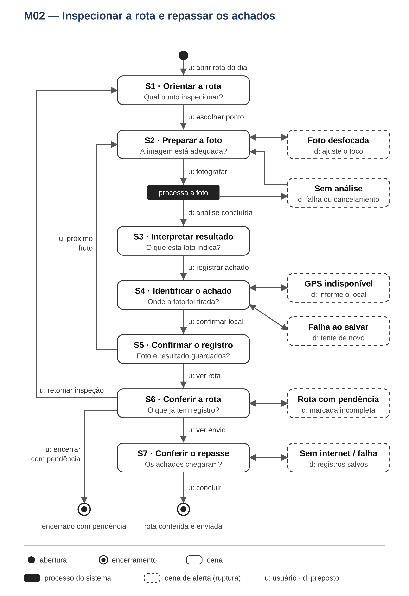

# Entrega 10 — MoLIC

**Data:** 14/11/2026 
**Status:** 🟨 em andamento — conversas M01, M02 e M03 especificadas e diagramas inseridos; consolidação feita; ajustes AJ1–AJ3 em M02 e M03 e itens de checklist pendentes. 
**Responsabilidade:** 1 solução completa por integrante.

## Objetivo da atividade

Modelar a interação como conversa entre usuário e preposto do designer, incluindo caminhos principais, alternativas, rupturas e formas de recuperação.

## M01 — Emitir parecer técnico sobre um foco de infestação

**Autor(a):** Guilherme Morais Escudeiro — 24.123.005-1 
**Cenário de interação de origem:** CI03 
**Objetivo(s):** O12 — emitir parecer técnico sobre um foco de infestação; O13 — escolher o foco a avaliar; O14 — validar as detecções do talhão; O15 — consultar o histórico de detecções; O16 — pedir nova foto de um ponto ao campo; O17 — delimitar a área de aplicação; O18 — registrar e repassar o parecer ao gestor; O19 — acompanhar a situação dos pedidos de parecer. 
**Tarefa(s) relacionada(s):** T05, T06 (método M3) e T07 
**Signos relevantes:** pedido de parecer, propriedade, talhão, solicitante, pontos pendentes, situação do pedido, ponto, situação da validação, detecção anterior, foto original, data e hora da captura, árvore, local do achado, detecções anteriores do ponto, detectado pela IA, avaliação da IA, veredito, validado por, observação técnica, pedido de nova foto, histórico de detecções, período, local do filtro, área de aplicação, produto, dose, período de aplicação, parecer técnico, pontos vinculados, destinatário do parecer

### Diagrama

**Fonte editável:** [`molic_m01.svg`](../assets/10_molic/molic_m01.svg) — SVG com texto e formas editáveis (abre no draw.io, Inkscape ou em editor de texto).

### Leitura do diagrama

O diagrama tem as cenas S1, S2, S3, S5, S6 e S7 e os processamentos P1 a P5. Não existe S4: a cena “pedir nova foto” foi retirada, assim como a tela A04 do protótipo em papel (Entrega 6), e o pedido virou uma fala de S3 tratada pelo processamento P2. A numeração das demais cenas foi mantida para não quebrar as referências da Entrega 11 e da matriz de rastreabilidade.

**Hipóteses de que a conversa depende.** Marcelo (P03) é proto-persona, e nenhuma fala deste diagrama foi simulada com um agrônomo. A conversa supõe que:

- o agrônomo recomenda e o gestor decide a execução, por isso o parecer vai ao gestor em P5 [H04];
- foto original, data, hora, árvore, local e detecções anteriores bastam para validar a distância em S3 [H07; C03, Q2];
- o histórico do ponto ou do talhão é usado para comparar ciclos em S5 [H22];
- o parecer inclui produto, dose e período em S6, embora o que o agrônomo precisa entregar ainda esteja em aberto [C03, Q7];
- o agrônomo atende várias propriedades, o que justifica a lista de pedidos em S1 e o acesso ubíquo a ela [C03, Q4 e Q6].

Se a coleta da Entrega 7 refutar H04 ou Q7, mudam o destinatário em P5 e o conteúdo de S6. São decisões de design ainda não testadas: a avaliação da IA recolhida até o agrônomo pedir, os símbolos ○/●/× da situação da validação, o aviso sobre o receituário agronômico e a situação "concluído" em S1 como único retorno do envio.

#### Caminho principal

1. **Ponto de abertura → S1 (Escolher o foco a avaliar):** o preposto apresenta os pedidos de parecer e as detecções novas das propriedades atendidas, com propriedade, talhão, solicitante, pontos pendentes e situação do pedido (pendente ou concluído).
2. **S1 → S2 (Examinar o talhão):** `u: abrir pedido` leva direto ao talhão do foco; o preposto mostra o mapa com a situação de cada ponto, a marca de detecção anterior e a contagem por situação.
3. **S2 → S3 (Validar a detecção):** `u: selecionar ponto`; o preposto mostra a foto original, data e hora da captura, árvore, local do achado e as detecções anteriores do ponto. Marcelo pode ampliar a foto, abrir a avaliação da IA (recolhida até ele pedir) e anotar uma observação técnica, em qualquer ordem, na mesma cena (concorrência do CTT T07).
4. **S3 → P1 → S2:** `u: confirmar | rejeitar`; o sistema registra o veredito e responde `d: ponto validado por você; próximo pendente em destaque`. Os passos 3 e 4 se repetem para cada ponto pendente.
5. **S2 → S6 (Delimitar a área de aplicação):** `u: emitir parecer`; o preposto mostra apenas os pontos confirmados e avisa se ainda há pontos pendentes. Marcelo delimita a área e informa produto, dose e período.
6. **S6 → P4 → S7 (Redigir o parecer):** `u: continuar`; o sistema registra a área e apresenta o parecer com área, pontos vinculados e destinatário do parecer, além do aviso de que o parecer não substitui o receituário agronômico. Marcelo escreve o parecer técnico.
7. **S7 → P5 → ponto de encerramento:** `u: enviar`; o sistema envia o parecer ao gestor e responde `d: parecer enviado ao gestor; pedido concluído em S1`. O objetivo está concluído, e a situação do parecer passa a aparecer na própria lista de pedidos (S1), sem cena própria.

#### Alternativas e rupturas

| Situação | Onde ocorre | Como o usuário percebe | Caminho de recuperação/saída |
|---|---|---|---|
| Foto insuficiente para decidir | S3 | `d:` foto original e detecções anteriores não bastam para o julgamento de Marcelo | `u: pedir nova foto` → P2 → S2 com `d: pedido enviado ao campo; ponto continua pendente`; o pedido entra na rota de P02, sem formulário de motivo ou prazo. O ponto só sai de "pendente" quando a nova foto for avaliada. |
| Revisão interrompida antes de validar todos os pontos | S2 | `d: vereditos registrados mantidos` | `u: encerrar revisão` → ponto de encerramento; ao voltar, S1 mostra os pontos ainda pendentes do talhão. |
| Marcelo quer trocar de foco no meio da revisão | Qualquer cena | Lista de pedidos sempre acessível | Acesso ubíquo `u: ir para pedidos de parecer` → S1. Os vereditos já registrados em P1 ficam mantidos, e o pedido aberto continua com seus pontos pendentes. O acesso existe porque Marcelo atende várias propriedades e pode precisar priorizar outro pedido. |
| Necessidade de comparar com inspeções anteriores além das três exibidas | S3, S2 ou qualquer cena | Detecções anteriores resumidas em S3 | `u: ver histórico deste ponto [filtro: ponto]` (M3) ou `u: ver histórico do talhão [filtro: talhão]` (M1) → S5; acesso ubíquo `u: buscar no histórico [sem filtro]` (M2). `u: abrir detecção` volta a S3. |
| Filtro do histórico sem resultados | S5 → P3 | `d: nenhuma detecção no período; sugere ampliar o período` | Volta a S5 com os filtros mantidos para Marcelo ampliar o período ou trocar o local. |
| Pontos pendentes ao delimitar a área | S6 | `d:` aviso de pontos pendentes (não bloqueia) | `u: voltar e validar o restante` → S2, ou seguir com os pontos já confirmados. |
| Área sem nenhum ponto confirmado ou produto, dose ou período vazios | S6 → P4 | `d: nenhum ponto confirmado na área ou produto/dose/período vazios` | Volta a S6 com o que já foi preenchido mantido, para corrigir a área ou completar os campos. |
| Marcelo quer rever a área antes de enviar | S7 | Resumo da área e dos pontos vinculados no parecer | `u: voltar` → S6, sem perder o texto do parecer. |
| Falha no envio do parecer ao gestor | S7 → P5 | `d: falha no envio; parecer mantido para reenviar` | Volta a S7 com o texto mantido; `u: enviar` → P5 de novo. O pedido continua "pendente" em S1 até o envio dar certo. |

### Checklist específico de modelagem

- [x] Existe **ponto de abertura** coerente com o início do objetivo.
- [x] As **cenas de conversa** representam tópicos/assuntos, não nomes de páginas apenas.
- [x] As transições/falas deixam claro o que o usuário ou o sistema comunica.
- [x] Há **ponto(s) de encerramento** para objetivos concluídos/abandonados quando aplicável.
- [x] Processamentos do sistema estão representados conforme a notação adotada em aula, sem “inventar” fala do usuário.
- [x] Rupturas (breakdowns) relevantes têm feedback e caminho de recuperação, não becos sem saída.
- [x] Acessos ubíquos/atalhos só aparecem quando semanticamente justificáveis.
- [x] O diagrama cobre caminhos alternativos importantes, e não apenas o “happy path”.
- [x] Nomes de objetivos, tópicos e signos são coerentes com a Entrega 9.
- [ ] O diagrama é legível em tamanho normal no GitHub.
- [x] O MoLIC representa a conversa usuário–sistema, não o fluxo interno do algoritmo.
- [x] Processamento, filtros, administração, relatórios e históricos incluem retornos/rupturas quando relevantes.

## M02 — Inspecionar a rota e repassar os achados

**Autor(a):** Lucas — 24.123.032-5 
**Cenário de interação de origem:** CI02 — inspeção dos frutos e repasse dos achados. 
**Objetivo(s):** O01 — inspecionar os pontos da rota; O02 — obter uma foto analisável; O03 — entender o resultado da foto; O04 — registrar o achado e seu local; O05 — confirmar o repasse dos registros. 
**Tarefa(s) relacionada(s):** T01 — inspecionar a rota e repassar achados; T02 — verificar um fruto e encaminhar o resultado; T03 — relação temporal da inspeção e do repasse. 
**Signos relevantes:** ponto planejado, situação do ponto na rota, foto do fruto, qualidade da foto, situação da análise, resultado da foto, data e hora da captura, local do achado, situação do registro, destinatário dos achados e situação do envio.

### Diagrama

Diagrama desenhado com a notação MoLIC e a legenda apresentadas na aula, a partir da especificação das cenas e transições abaixo.

**Fonte editável:** {{inserir link do arquivo .drawio ou .svg editável de M02}}

### Cenas, processamento e encerramentos desenhados

| Elemento | Tópico ou função na conversa | Conteúdo que precisa aparecer |
|---|---|---|
| Ponto de abertura | Início da inspeção | Antônio abre a rota que recebeu para o dia. |
| S1 — Orientar a rota | “Qual ponto devo inspecionar?” | Talhão, linha e árvore do próximo ponto; distinção entre pontos planejados, com registro e pendentes. |
| S2 — Preparar a foto | “A imagem está adequada?” | Orientações de distância, foco e iluminação; possibilidade de fotografar, ajustar ou voltar à rota. |
| Processamento do sistema | Analisar a foto capturada | Indicação de que a análise está ocorrendo no celular; possibilidade de cancelar. Representar conforme a notação de processamento ensinada na aula. |
| S3 — Interpretar o resultado | “O que esta foto indica?” | Uma das mensagens: “sinal suspeito”, “nenhum sinal nesta foto” ou “resultado inconclusivo”. Explicitar que a IA não confirmou a infestação. |
| S4 — Identificar o achado | “Onde esta foto foi tirada?” | Local obtido por GPS ou identificação manual por talhão, linha e árvore; indicação da origem do local. |
| S5 — Confirmar o registro | “A foto e o resultado foram guardados?” | Confirmação de que foto, resultado, data, hora e local foram salvos no celular. |
| S6 — Conferir a rota | “O que já tem registro e o que falta?” | Pontos planejados com registro e pendentes; opção de continuar ou encerrar com pendência explicitada. |
| S7 — Conferir o repasse | “Os achados chegaram ao gestor?” | Estados “aguardando conexão”, “enviando”, “enviado” e “falha no envio”. “Enviado” não significa “lido”. |
| Encerramento com objetivo concluído | Rota conferida e registros enviados | O usuário sabe quais pontos têm registro e que os achados foram disponibilizados ao gestor. |
| Encerramento com pendência | Inspeção interrompida ou rota incompleta | Registros locais preservados e pontos não cobertos identificados; o usuário pode retomar depois. |

As cenas representam **assuntos da conversa**. P01–P07, da Entrega 6, podem ajudar a implementar essas cenas no Figma, mas não são os nomes das cenas no MoLIC.

### Leitura do diagrama

#### Caminho principal

1. Antônio abre a inspeção. Em **S1**, pergunta implicitamente qual ponto deve visitar; o sistema informa o próximo ponto planejado e o que já possui registro.
2. Ele escolhe o ponto e entra em **S2**. O sistema orienta o enquadramento. Antônio ajusta a imagem e comunica a decisão de fotografar.
3. O sistema **processa a foto** e comunica que a análise está em andamento. Quando termina, inicia-se **S3**.
4. Em **S3**, Antônio interpreta a indicação da foto. Diante de “sinal suspeito”, entende que o resultado precisa de confirmação e escolhe registrar o achado.
5. Em **S4**, confere o local obtido. O sistema salva foto, resultado, data, hora e local e confirma em **S5** que o registro está no celular.
6. Antônio pode voltar a **S2** para outro fruto ou consultar **S6** para verificar a rota. Ao encerrar, o sistema informa os pontos que permaneceram pendentes.
7. Em **S7**, Antônio verifica se os registros estão aguardando conexão, em envio ou enviados. O caminho termina quando ele compreende a cobertura da rota e a situação do repasse.

#### Alternativas e rupturas

| Situação | Onde ocorre | Como o usuário percebe | Caminho de recuperação/saída |
|---|---|---|---|
| Foto desfocada ou mal enquadrada. | S2 — preparar a foto. | `D: Ajuste o foco ou a distância antes de fotografar.` | Antônio reposiciona o celular e permanece em S2; também pode voltar a S1. |
| Antônio cancela a análise. | Processamento após S2. | `D: Análise cancelada. A foto ainda não gerou resultado.` | Volta a S2 para fotografar novamente ou a S1 para abandonar aquele ponto. |
| Análise falha. | Processamento após S2. | `D: Não foi possível analisar esta foto.` | Tenta novamente ou refaz a foto em S2, sem marcar o ponto como analisado. |
| Nenhum sinal na foto. | S3 — interpretar o resultado. | `D: Nenhum sinal nesta foto; isso não garante que a árvore esteja livre.` | Salva o resultado, se fizer parte do registro da inspeção, ou segue para outro fruto sem registrar ausência de praga em toda a árvore. |
| Resultado inconclusivo. | S3 — interpretar o resultado. | `D: Não foi possível concluir. Refaça a foto ou guarde para conferir.` | Volta a S2 ou segue a S4 mantendo o resultado identificado como inconclusivo. |
| GPS indisponível. | S4 — identificar o achado. | `D: Local não obtido. Informe talhão, linha e árvore.` | Antônio fornece esses campos; o sistema marca “local manual, sem coordenadas”. |
| Identificação manual incompleta. | S4 — identificar o achado. | `D: Informe o campo que falta para salvar o local.` | Corrige o campo indicado e permanece em S4; a foto e o resultado são preservados. |
| Falha ao salvar no celular. | Transição de S4 para S5. | `D: Registro não salvo. Tente novamente.` | Nova tentativa sem descartar foto e resultado; se desistir, o ponto permanece pendente. |
| Rota encerrada com pontos pendentes. | S6 — conferir a rota. | `D: Há pontos sem registro. A rota será marcada como incompleta.` | Retoma a inspeção em S1 ou encerra mantendo a pendência visível. |
| Sem internet. | S7 — conferir o repasse. | `D: Salvo no celular; aguardando conexão para enviar.` | Antônio pode encerrar o uso; os registros permanecem locais para envio posterior. |
| Falha no envio. | S7 — conferir o repasse. | `D: Não foi possível enviar. Seus registros continuam salvos.` | Tenta novamente quando houver conexão, sem repetir registros já enviados. |

**Acesso à rota durante a inspeção:** se representado como acesso ubíquo no diagrama, ele deverá retornar a **S1/S6** preservando a foto ou o registro já salvo. Sua finalidade é permitir conferir o ponto atual e as pendências, não abrir uma navegação genérica.

### Checklist específico de modelagem — M02

- [x] Existe ponto de abertura coerente com o início do objetivo.
- [x] As cenas especificadas representam tópicos da conversa.
- [x] As falas e transições foram descritas como comunicação entre usuário e sistema.
- [x] Há encerramento para conclusão e para interrupção com pendências.
- [ ] O processamento foi desenhado com a notação MoLIC adotada em aula.
- [x] As rupturas especificadas possuem feedback e recuperação.
- [x] O possível acesso à rota possui justificativa semântica.
- [x] Estão descritos caminhos alternativos além do principal.
- [x] Objetivos, tópicos e signos seguem a parte de Lucas da Entrega 9.
- [ ] O diagrama foi produzido e verificado em tamanho normal no GitHub.
- [x] A especificação modela a conversa com o usuário, não o interior do algoritmo.
- [x] Processamento, registro e envio incluem retornos e falhas relevantes.

**Situação de M02:** a especificação textual está pronta e o diagrama foi inserido como imagem (`molic_m02.png`); permanecem abertos o link da fonte editável e a conferência final do diagrama em tamanho normal no GitHub.

## M03 — Revisar o ciclo e decidir o manejo por talhão

**Autor(a):** Pedro — 24.123.048-1 
**Cenário de interação de origem:** CI01 — revisão do ciclo e decisão do manejo por talhão. 
**Objetivo(s):** O06 — saber o que o ciclo cobriu; O07 — avaliar o resultado de um talhão; O08 — registrar a posição de cada talhão; O09 — acompanhar a evolução do talhão; O10 — decidir o manejo do ciclo; O11 — confirmar o repasse da decisão. 
**Tarefa(s) relacionada(s):** T04 — planejar o manejo do ciclo; T08 — avaliar a evolução de um talhão entre ciclos; T09 — revisar o resultado do ciclo e decidir se confia nele. 
**Signos relevantes:** aviso de ciclo concluído, cobertura do talhão, situação do talhão no ciclo, confiança do resultado, posição do talhão, tendência do talhão, última aplicação, decisão do ciclo e situação do repasse.

### Diagrama

Diagrama desenhado com a notação MoLIC apresentada na aula (Barbosa e Silva, 2010), a partir da especificação das cenas e transições abaixo, com legenda no próprio desenho.

**Fonte editável:** [`molic_m03.dot`](../assets/10_molic/molic_m03.dot) (Graphviz).

### Cenas, processamento e encerramentos desenhados

| Elemento | Tópico ou função na conversa | Conteúdo que precisa aparecer |
|---|---|---|
| Ponto de abertura | Início da revisão | Jaime abre o aviso de ciclo concluído. |
| S1 — Conhecer o ciclo | “O que o ciclo encontrou?” | Data do ciclo, quantos talhões foram inspecionados e quantos têm focos. |
| S2 — Conferir a cobertura | “Todos os talhões foram vistos?” | Talhões inspecionados, não inspecionados e com cobertura incompleta; aviso de que “não inspecionado” não significa “sem focos”; opção de pedir nova inspeção. |
| Processamento do sistema | Registrar o pedido de nova inspeção | Confirmação de que o pedido foi registrado, ou falha com nova tentativa. |
| S3 — Escolher o talhão | “Onde estão os focos?” | Talhões com focos em ordem de gravidade e tendência, apresentada como dado e não como recomendação; posição já registrada em cada talhão. |
| S4 — Avaliar o talhão | “Posso confiar neste resultado?” | Fotos, local e confiança em linguagem simples; aviso de que o sistema não confirma a praga; aviso se a cobertura do talhão foi incompleta. |
| S5 — Acompanhar a evolução | “A praga está avançando?” | Tendência entre ciclos (avançando, estável ou recuando), última aplicação marcada e aviso quando um ciclo comparado teve cobertura incompleta. |
| Processamento do sistema | Registrar a posição do talhão | Salvar a posição escolhida; quando for o caso, registrar o pedido de parecer ao agrônomo ou de reinspeção. |
| S6 — Confirmar a posição | “Minha posição ficou registrada?” | Posição do talhão: “confiável”, “parecer do agrônomo pedido” ou “reinspeção pedida”. |
| S7 — Decidir o manejo do ciclo | “Onde e quando aplico?” | Talhões com suas posições e talhões ainda sem posição; escolha de onde, quando e com que urgência aplicar. O sistema não sugere produto, dose nem prioridade. |
| Processamento do sistema | Registrar a decisão do ciclo | Salvar a decisão com autoria e data. |
| S8 — Conferir o repasse | “Quem aplica já sabe?” | Estados “registrada”, “repassada” e “falha no repasse”; destinatário. “Repassada” não significa “aplicada”. |
| Processamento do sistema | Repassar a decisão a quem aplica | Confirmação do repasse, ou falha mantendo a decisão registrada. |
| Encerramento com objetivo concluído | Decisão registrada e repassada | Jaime sabe o que o ciclo cobriu, qual a posição de cada talhão revisado e que a decisão chegou a quem aplica. |
| Encerramento com pendência | Revisão interrompida ou decisão não repassada | Posições e decisão já registradas permanecem salvas; Jaime pode retomar depois. |

As cenas representam **assuntos da conversa**. G01–G08, da Entrega 6, podem ajudar a implementar essas cenas no Figma, mas não são os nomes das cenas no MoLIC.

### Leitura do diagrama

#### Caminho principal

1. Jaime abre o aviso de ciclo concluído. Em **S1**, o sistema informa a data do ciclo, quantos talhões foram inspecionados e quantos têm focos.
2. Ele pede para conferir a cobertura e entra em **S2**. O sistema mostra o que foi e o que não foi inspecionado e deixa claro que talhão não inspecionado não é talhão sem focos.
3. Em **S3**, Jaime vê os talhões com focos em ordem de gravidade e tendência e abre um deles.
4. Em **S4**, avalia as fotos, o local e a confiança do resultado. Como não valida a praga, decide em quem confiar e comunica sua posição: “confiável”, “parecer do agrônomo” ou “reinspeção”.
5. O sistema **registra a posição** e a confirma em **S6**. Jaime volta a **S3** para o próximo talhão ou encerra a revisão.
6. Em **S7**, vê as posições de cada talhão e informa onde, quando e com que urgência aplicar. O sistema **registra a decisão**.
7. Em **S8**, Jaime confere que a decisão está registrada e pede o repasse a quem aplica. O sistema **repassa a decisão**, e o caminho termina quando ela aparece como “repassada”.

#### Alternativas e rupturas

| Situação | Onde ocorre | Como o usuário percebe | Caminho de recuperação/saída |
|---|---|---|---|
| Talhão não inspecionado no ciclo. | S2 — conferir a cobertura. | `D: Não inspecionado: talhão [nome]. Isso não significa que esteja livre da praga.` | Jaime pede nova inspeção e permanece em S2, ou segue para S3 com o talhão identificado como não inspecionado. |
| Falha ao registrar o pedido de nova inspeção. | Processamento após S2. | `D: Pedido não registrado. Tente novamente.` | Volta a S2 e tenta de novo; o talhão continua marcado como não inspecionado. |
| Jaime quer saber se a praga avança antes de se posicionar. | S4 — avaliar o talhão. | `D: Neste talhão: avançando / estável / recuando. Última aplicação marcada.` | Vai a S5 e volta a S4 para registrar a posição. |
| Dúvida sobre o resultado. | S4 — avaliar o talhão. | `D: Aceitar como confiável, pedir parecer do agrônomo ou pedir nova inspeção.` | Escolhe “parecer do agrônomo” ou “reinspeção”; a dúvida não bloqueia a revisão. |
| Cobertura incompleta do talhão. | S4 — avaliar o talhão. | `D: Atenção: este talhão não foi totalmente coberto neste ciclo.` | Pede reinspeção ou registra a posição ciente do limite; pode abrir a cobertura (S2). |
| Ciclo comparado com cobertura incompleta. | S5 — acompanhar a evolução. | `D: Atenção: o ciclo [data] não cobriu todo o talhão. A comparação pode não ser confiável.` | Abre a cobertura do ciclo (S2) ou volta a S4 sem concluir que a praga recuou. |
| Falha ao salvar a posição. | Processamento após S4. | `D: Posição não salva. Tente novamente.` | Volta a S4 e tenta de novo; o talhão continua sem posição. |
| Revisão encerrada com talhões sem posição. | S7 — decidir o manejo. | `D: Há talhões com focos sem posição registrada.` | Volta a S3 para revisá-los ou decide mesmo assim, com a pendência visível. |
| Falha ao registrar a decisão. | Processamento após S7. | `D: Decisão não registrada. Tente novamente.` | Volta a S7 com as escolhas preservadas. |
| Jaime quer mudar a decisão. | S8 — conferir o repasse. | `D: Decisão registrada, ainda não repassada.` | Volta a S7 e altera a decisão antes de repassar. |
| Falha no repasse. | Processamento após S8. | `D: Não foi possível repassar. Sua decisão continua registrada.` | Tenta novamente em S8 ou sai; a decisão fica como “registrada”, não “repassada”. |
| Jaime interrompe a revisão. | S2 a S7. | `D: O que você já registrou fica salvo.` | Encerramento com pendência; retoma depois a partir do que foi registrado. |

**Acesso à cobertura durante a revisão:** representado como acesso ubíquo a **S2**, usado a partir das cenas S3 a S7. O segundo acesso ubíquo do diagrama representa a interrupção da revisão, possível de S2 a S7. Sua finalidade é permitir conferir o que foi inspecionado antes de confiar em um resultado ou em uma comparação, não abrir uma navegação genérica. As posições já registradas são preservadas.

### Checklist específico de modelagem — M03

- [x] Ponto de abertura, cenas e encerramento identificados.
- [x] Falas, processamento e rupturas seguem a notação da aula.
- [x] Objetivos e signos são coerentes com a Entrega 9.
- [ ] Diagrama e fonte editável foram inseridos e conferidos — falta verificar em tamanho normal no GitHub.

**Situação de M03:** especificação textual e diagrama prontos. As falas e os estados são propostas a avaliar com usuários; G01–G08 ainda não foram desenhadas em papel nem simuladas.

## Consolidação da equipe

A consolidação compara os três diagramas entre si e com as ligações L1–L7 e o vocabulário fixado na Entrega 9 (seção 4). Quando a Entrega 9 já resolvia a dúvida, a decisão a reaproveita; quando a consolidação exige mudar um diagrama, o ajuste fica registrado para o autor em “Ajustes pendentes nos diagramas”.

### Cobertura dos objetivos

| Objetivo | MoLIC que cobre | Lacunas/duplicidades | Decisão |
|---|---|---|---|
| O01 — inspecionar pontos da rota | M02 (S1) | Os pedidos de reinspeção (M03) e de nova foto (M01) devem chegar à rota (L4, L5), mas o S1 de M02 não os mostra. | Os dois pedidos entram na rota como *ponto planejado* com a origem indicada (“reinspeção pedida pelo gestor” ou “nova foto pedida pelo agrônomo”). Ajuste AJ1 em M02. |
| O02 — obter foto analisável | M02 (S2) | Nenhuma. | Manter. |
| O03 — entender resultado da foto | M02 (S3) | Três nomes para indicações diferentes: “resultado da foto” (M02), “avaliação da IA” (M01) e “veredito” (M01). | Resolvido pela Entrega 9: *resultado da foto* e *avaliação da IA* são indicações da IA; só o *veredito* é validação humana. Os diagramas já seguem essa separação. |
| O04 — registrar achado e local | M02 (S4, S5) | Quais dados do registro M01 e M03 recebem. | Foto, resultado da foto, data e hora da captura e local do achado (com a origem do local). M01 os mostra em S3; M03, em S4. Nenhum ajuste. |
| O05 — confirmar repasse | M02 (S7) | “Enviado” (M02) parecido com “repassada” (M03) e “parecer enviado” (M01). | Resolvido pelo vocabulário da Entrega 9: *envio* (trabalhador → sistema), *parecer* (agrônomo → gestor) e *repasse* (gestor → quem aplica). Os diagramas já usam os três termos assim. |
| O06 — saber o que o ciclo cobriu | M03 (S2) | “Pendente” (M02) e “não inspecionado” (M03) parecem a mesma situação. | Não são: *pendente* é a situação de um **ponto** na rota; *não inspecionado* é a cobertura de um **talhão**. Proposta: o talhão fica “não inspecionado” se nenhum ponto teve registro e “cobertura incompleta” se parte dos pontos ficou pendente. Nenhum ajuste de diagrama. |
| O07 — avaliar o resultado de um talhão | M03 (S4) | “Confiança do resultado” (M03) e “avaliação da IA” (M01) descrevem a indicação da IA para perfis diferentes. | Manter os dois nomes, como na Entrega 9: o gestor vê a confiança em linguagem simples; o agrônomo vê a intensidade do sinal e a região do fruto. Nenhum dos dois é validação. |
| O08 — registrar a posição de cada talhão | M03 (S4, S6) | “Parecer do agrônomo” chega a M01 como *pedido de parecer* (S1, com solicitante) — coberto. “Reinspeção” não aparece em M02 (ver O01). M03 usa “nova inspeção” em S2 e “reinspeção” em S4 para o mesmo pedido. | Usar só “reinspeção”, como no vocabulário da Entrega 9. Ajuste AJ3 em M03; chegada à rota pelo ajuste AJ1. |
| O09 — acompanhar a evolução do talhão | M03 (S5) | Sobreposição com o histórico de M01 (L7). | Mesma base de registros, duas apresentações: M03 mostra a *tendência do talhão* entre ciclos; M01 mostra a lista do *histórico de detecções* por ponto ou talhão. Nenhum ajuste. |
| O10 — decidir o manejo do ciclo | M03 (S7) | O parecer enviado por M01 (P5) deveria apoiar a decisão (L6), mas nenhuma cena de M03 mostra o parecer recebido. | Em M03, o talhão com posição “parecer do agrônomo pedido” mostra “aguardando parecer” ou o parecer recebido (área, produto, dose, período e texto), e S7 o apresenta como entrada da decisão, sem decidir pelo gestor. Ajuste AJ2 em M03. Depende de H04. |
| O11 — confirmar o repasse da decisão | M03 (S8) | Nome próximo de “situação do envio” (M02). | Resolvido pelo vocabulário (ver O05). |
| O12 — emitir parecer técnico sobre um foco | M01 | Objetivo de topo; cobre S1 a S7. | Manter. |
| O13 — escolher o foco a avaliar | M01 (S1 → S2) | Origem do item em S1: pedido de parecer do gestor (L3) ou detecção nova enviada pelo trabalhador (L2). | Nome “pedido de parecer” já unificado na Entrega 9 e usado por M01 e M03. Nenhum ajuste. |
| O14 — validar as detecções do talhão | M01 (S2 ↔ S3, P1) | — | Manter. |
| O15 — consultar o histórico de detecções | M01 (S5, P3) | Ver O09. | Ver O09. |
| O16 — pedir nova foto ao campo | M01 (S3 → P2) | Parecido com a reinspeção pedida pelo gestor. | São pedidos diferentes (Entrega 9): nova foto é de um **ponto**, pedida pelo agrônomo; reinspeção é de um **talhão**, pedida pelo gestor. Na rota aparecem do mesmo modo, com a origem indicada (ajuste AJ1). |
| O17 — delimitar a área de aplicação | M01 (S6, P4) | Produto, dose e período dependem de Q7 do C03. | Manter, como hipótese registrada em M01. |
| O18 — registrar e repassar o parecer ao gestor | M01 (S7, P5) | Ver O10. | Ver O10 (ajuste AJ2). |
| O19 — acompanhar a situação dos pedidos | M01 (S1, P5) | A situação do parecer aparece na lista de pedidos (S1), não em cena própria. | Manter, como no protótipo em papel (Entrega 6), e verificar no teste se “concluído” basta para saber que o parecer chegou ao gestor. |

### Ligações entre os fluxos

| Ligação (Entrega 9) | Saída | Chegada | Situação |
|---|---|---|---|
| L1 — achados enviados formam a cobertura do ciclo | M02, S7 | M03, S1 e S2 | Representada. |
| L2 — achados enviados chegam ao agrônomo como detecções novas | M02, S7 | M01, S1 | Representada. |
| L3 — posição “parecer do agrônomo” gera o pedido de parecer | M03, S4 → S6 | M01, S1 | Representada. |
| L4 — posição “reinspeção” entra na rota | M03, S4 → S6 | M02, S1 | **Só a saída.** Ajuste AJ1. |
| L5 — pedido de nova foto entra na rota | M01, S3 → P2 | M02, S1 | **Só a saída.** Ajuste AJ1. |
| L6 — parecer apoia a decisão do ciclo | M01, S7 → P5 | M03, S7 | **Só a saída.** Ajuste AJ2. |
| L7 — histórico e evolução usam os mesmos registros | M01, S5 | M03, S5 | Representada (ver O09). |

### Ajustes pendentes nos diagramas

| ID | MoLIC | Ajuste | Responsável |
|---|---|---|---|
| AJ1 | M02 | Em S1, mostrar os pedidos de reinspeção e de nova foto como pontos planejados com a origem indicada (L4, L5). | Lucas |
| AJ2 | M03 | Mostrar “aguardando parecer” ou o parecer recebido nos talhões com essa posição e apresentar o parecer em S7 como entrada da decisão (L6). | Pedro |
| AJ3 | M03 | Trocar “nova inspeção” por “reinspeção” em S2 e no processamento após S2. | Pedro |

Além desses ajustes, ainda faltam itens dos checklists individuais: a fonte editável e a notação de processamento de M02 e a conferência dos três diagramas em tamanho normal no GitHub. A consolidação estará fechada quando AJ1–AJ3 forem feitos e esses itens marcados.

### Preparação para o Figma

**Estados necessários para o fluxo de Lucas, derivados das conversas M02:**

- Rota com próximo ponto e pontos pendentes — S1.
- Câmera com orientação de foco — S2.
- Foto inadequada e ajuste — ruptura em S2.
- Análise em andamento, cancelada ou com falha — processamento.
- Resultado suspeito, sem sinal na foto ou inconclusivo — S3.
- Local obtido por GPS ou identificação manual incompleta/completa — S4.
- Confirmação de registro salvo ou falha ao salvar — S5.
- Revisão da rota completa ou com pendências — S6.
- Registro aguardando conexão, em envio, enviado ou com falha — S7.

**Estados de Guilherme, derivados de M01 (fluxo do agrônomo):**

- **S1:** lista de pedidos de parecer e detecções novas, com a situação de cada pedido (pendente ou concluído); estado vazio (nenhum pedido ou detecção nova).
- **S2:** mapa do talhão com legenda das situações; estado após veredito (ponto validado e próximo pendente em destaque); estado após pedido de nova foto (pedido enviado; ponto continua pendente); confirmação de encerramento da revisão.
- **S3:** detecção com foto, metadados e detecções anteriores; foto ampliada; avaliação da IA recolhida e aberta.
- **S5:** histórico filtrado por ponto, por talhão e sem filtro; estado sem resultados com sugestão de ampliar o período.
- **S6:** delimitação da área com aviso de pendências; erro de área sem ponto confirmado ou campos vazios.
- **S7:** parecer com área, pontos vinculados, destinatário do parecer e aviso sobre o receituário agronômico; falha no envio com o texto mantido para reenviar.
- **Após P5:** confirmação de envio e pedido marcado como concluído em S1.

**Estados necessários para o fluxo de Pedro, derivados das conversas M03:**

- Resumo do ciclo concluído — S1.
- Cobertura com talhões inspecionados, não inspecionados e com cobertura incompleta — S2.
- Pedido de nova inspeção registrado ou com falha — processamento após S2.
- Talhões com focos em ordem de gravidade, com e sem posição registrada — S3.
- Detalhe do talhão com fotos, local e confiança, com e sem aviso de cobertura incompleta — S4.
- Evolução avançando, estável ou recuando, com e sem aviso de ciclo incompleto — S5.
- Posição registrada (confiável, parecer pedido ou reinspeção pedida) ou falha ao salvar — S6.
- Decisão do ciclo com todos os talhões posicionados ou com pendências — S7.
- Decisão registrada, repassada ou com falha no repasse — S8.

Antes de produzir o Figma, conferir se cada estado possui uma conversa ou ruptura correspondente no MoLIC. A equipe não produziu Figma (ver Entrega 11): os estados de M02 e M03 devem ser conferidos no aplicativo, e os de M01, nas telas FA01–FA07. Os ajustes AJ1 e AJ2 acrescentam estados: ponto planejado com origem do pedido (M02, S1) e talhão aguardando parecer ou com parecer recebido (M03).

## Erros frequentes a evitar

- Desenhar apenas caixas com nomes de telas e setas de navegação.
- Omitir falhas, cancelamento, volta ou recuperação.
- Usar rótulos genéricos sem tópico de conversa.
- Criar no Figma caminhos ausentes do MoLIC.
- Entregar diagrama sem legenda, fonte editável ou texto legível.
