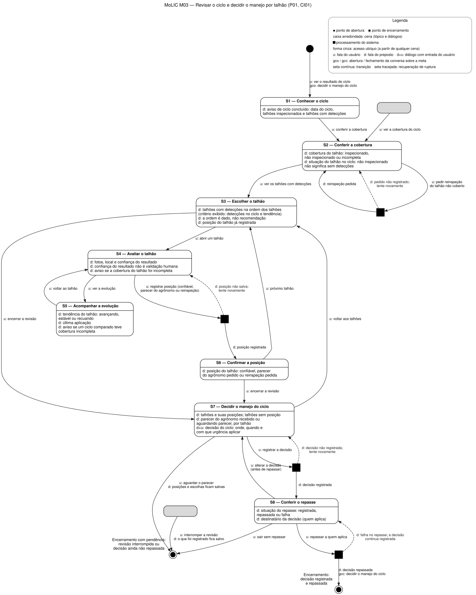

# Entrega 10 — MoLIC

**Data:** 14/11/2026  
**Revisão:** 22/11/2026  
**Status:** 🟩 concluída  
**Responsabilidade:** 1 solução completa por integrante.

## Objetivo da atividade

Modelar a interação como conversa entre usuário e preposto do designer, incluindo caminhos principais, alternativas, rupturas e recuperação.

O MoLIC representa as conversas necessárias aos objetivos dos usuários, não o funcionamento interno do algoritmo.

## M01 — Emitir parecer técnico sobre um foco de infestação

**Autor:** Guilherme Morais Escudeiro — 24.123.005-1  
**Cenário de origem:** CI03  
**Objetivos (revisados na Entrega 9):** O12 — emitir parecer técnico fundamentado sobre um foco de infestação (final); O14 — distinguir, em cada ponto, a indicação automática da presença confirmada da praga, O15 — compreender a recorrência da praga no ponto ou no talhão entre inspeções, O17 — definir a extensão do foco que o parecer deve abranger e O18 — assegurar que o parecer chegue ao responsável pela decisão, associado às evidências (instrumentais diretos); O13 — saber quais solicitações e detecções aguardam sua avaliação, O16 — dispor de evidência suficiente quando a foto não permite julgar e O19 — manter conhecimento dos pedidos atendidos e pendentes (instrumentais indiretos).  
**Tarefas relacionadas:** T05, T06 (método M3) e T07  
**Signos relevantes (nomes da Entrega 9):** pedido de parecer, propriedade, talhão, solicitante, pontos pendentes, situação do pedido, detecção, ponto, situação da validação, detecção anterior, foto do fruto, data e hora da captura, árvore, local do achado, detecções anteriores do ponto, avaliação da IA, veredito, validado por, observação técnica, pedido de nova foto, histórico de detecções, período, local do filtro, área de aplicação, produto, dose, período de aplicação, parecer técnico, pontos vinculados e destinatário do parecer.

**Condição do modelo:** M01 é um modelo de interação proposto. P03 continua proto-persona, a entrevista I02 não foi aplicada e H04, H07 e Q7 do C03 seguem abertas; a forma correta do diagrama não confirma que o trabalho do agrônomo ocorre dessa maneira.

### Diagrama

**Fonte editável:** [molic_m01.svg](../assets/10_molic/molic_m01.svg) — SVG com formas e texto editáveis.

### Correções aplicadas ao M01

- S1 passou a “Saber o que aguarda avaliação” (O13). Pela revisão do vocabulário na Entrega 9, “foco” designa só região com pontos confirmados pelo agrônomo; em S1 ainda há pedidos e detecções sem veredito.
- As cenas usam os nomes exatos dos signos da Entrega 9: situação da validação, foto do fruto, local do achado, local do filtro, data e hora da captura, avaliação da IA e destinatário do parecer.
- “Ampliar foto” saiu de S3: é ação do usuário, não signo. Dentro das cenas, `u:` indica apenas valores fornecidos pelo usuário.
- Os objetivos seguem a classificação revisada de O12–O19 na Entrega 9.
- Regras do parecer que dependem de hipóteses de P03 estão marcadas como decisões provisórias.

### Leitura do diagrama

O diagrama apresenta as cenas S1, S2, S3, S5, S6 e S7 e os processamentos P1–P5. A antiga cena S4 de pedir nova foto foi incorporada como ação em S3, acompanhada do processamento P2. A numeração restante foi mantida para preservar as referências.

**Hipóteses ainda não validadas:** Marcelo é uma proto-persona. A conversa supõe que o agrônomo recomenda e o gestor decide a execução (H04); que foto, local do achado e histórico bastam para parte da análise a distância (H07/H22); que o agrônomo valida ponto a ponto e delimita a área; e que o parecer inclui produto, dose e período (Q7 do C03).

A entrevista I02 da Entrega 7 não foi realizada. Portanto, essas conversas permanecem hipóteses de design, e não regras do trabalho do agrônomo.

**Decisões provisórias assumidas por M01 (Entrega 9):** avaliação da IA recolhida até consulta (S3); veredito alterável até o envio do parecer (P1); período padrão do histórico (S5); área com ao menos um ponto confirmado e produto, dose e período obrigatórios para seguir (P4); parecer técnico não vazio para enviar (P5).

#### Caminho principal

1. **Abertura → S1 — Saber o que aguarda avaliação:** Marcelo abre pedidos de parecer (`gco: Emitir parecer técnico`). O sistema mostra os pedidos de parecer — propriedade, talhão, solicitante, pontos pendentes e situação do pedido — separados das detecções novas sem pedido.
2. **S1 → S2 — Examinar o talhão:** ao abrir um pedido ou uma detecção nova, encontra o mapa dos pontos e a situação da validação de cada um.
3. **S2 → S3 — Validar a detecção:** seleciona um ponto e examina foto do fruto, data e hora da captura, árvore, local do achado e detecções anteriores do ponto. Pode ampliar a foto, consultar a avaliação da IA e anotar observação técnica.
4. **S3 → P1 → S2:** confirma ou rejeita. O sistema registra o veredito e destaca o próximo ponto pendente.
5. **S2 → S6 — Delimitar a área:** seleciona emitir parecer, examina pontos confirmados, delimita a área e informa produto, dose e período.
6. **S6 → P4 → S7 — Redigir o parecer:** o sistema registra a área e apresenta pontos vinculados, destinatário e aviso sobre o receituário agronômico. Marcelo escreve a justificativa.
7. **S7 → P5 → encerramento:** envia ao gestor (`gcc: Emitir parecer técnico`); o pedido passa a concluído na lista S1. Enviado não significa lido nem executado.

#### Alternativas e rupturas

| Situação | Onde ocorre | Feedback | Recuperação/saída |
|---|---|---|---|
| Foto insuficiente. | S3 | A evidência não permite decidir. | Pedir nova foto → P2 → S2. O ponto permanece pendente até nova avaliação. |
| Falha ao enviar pedido de foto. | P2 | Pedido não enviado. | Voltar a S3 e tentar novamente, preservando a detecção. |
| Falha ao registrar veredito. | P1 | Veredito não registrado. | Voltar a S3 mantendo a observação. |
| Revisão interrompida. | S2 | Pontos já avaliados permanecem registrados. | Encerrar com pendências; retomar por S1. |
| Troca de pedido. | Qualquer cena | Lista de pedidos acessível. | Acesso ubíquo a S1 sem apagar vereditos registrados. |
| Consulta de histórico. | S2/S3 | Histórico por ponto, talhão ou sem filtro. | Ir a S5; abrir detecção ou voltar. |
| Histórico sem resultados. | S5/P3 | Nenhum registro no período. | Manter filtros e permitir ampliar período ou trocar local. |
| Pontos ainda pendentes. | S6 | Aviso antes da delimitação. | Voltar a S2 ou continuar apenas com pontos confirmados. |
| Área sem ponto confirmado ou campos incompletos (decisão provisória). | S6/P4 | Campo ou condição inválida identificada. | Corrigir em S6 sem perder os demais dados. |
| Revisão da área. | S7 | Resumo da área e pontos vinculados. | Voltar a S6 mantendo o texto do parecer. |
| Falha no envio do parecer. | S7/P5 | Parecer não enviado. | Permanecer em S7 com texto salvo e tentar novamente. |

### Checklist específico — M01

- [x] Ponto de abertura e encerramentos identificados.
- [x] Cenas representam assuntos da conversa.
- [x] Transições identificam falas do usuário e do preposto.
- [x] Processamentos são representados separadamente.
- [x] Rupturas têm feedback e recuperação.
- [x] Atalhos têm justificativa na tarefa.
- [x] Há caminhos alternativos além do principal.
- [x] Objetivos e signos seguem a Entrega 9.
- [x] Diagrama e fonte editável estão identificados.
- [x] O modelo descreve interação, não o interior do algoritmo.
- [x] Nomes dos signos padronizados conforme a Entrega 9 no texto e no SVG; “foco” não designa detecções sem veredito.
- [x] Dentro das cenas, `u:` representa signos fornecidos pelo usuário; ações ficam nas transições.
- [x] Hipóteses de P03 e decisões provisórias mantidas explícitas.

## M02 — Inspecionar a rota e repassar os achados

**Autor:** Lucas Tonoli Cabral Duarte — 24.123.032-5  
**Cenário de origem:** CI02 — inspeção dos frutos e repasse dos achados.

**Objetivo final:**

- **O01:** concluir a inspeção dos locais atribuídos com os achados documentados e disponíveis ao responsável.

**Objetivos instrumentais:**

- **O02 — indireto:** dispor de evidência visual adequada do fruto inspecionado.
- **O03 — direto:** compreender o significado e os limites da indicação automática.
- **O04 — indireto:** preservar um achado identificável pelo conteúdo, momento e local.
- **O05 — direto:** assegurar a comunicação dos registros ao responsável pela continuidade.

**Tarefas relacionadas:** T01 — inspecionar a rota e repassar achados; T02 — verificar um fruto e encaminhar o resultado; T03 — relação temporal entre inspeção e repasse.

**Signos relevantes:** ponto planejado, situação do ponto na rota, pedido de reinspeção, pedido de nova foto, origem do pedido, foto do fruto, qualidade da foto, situação da análise, resultado da foto, data e hora da captura, local do achado, situação do registro, destinatário dos achados e situação do envio.

### Diagrama

**Fonte editável:** [molic_m02.svg](../assets/10_molic/molic_m02.svg) — SVG com formas e texto editáveis.

### Correções aplicadas ao M02

- A notação própria `gc:` foi substituída por `gco:` e `gcc:`.
- P1, P2 e P3 passaram a pequenos elementos pretos de processamento.
- As saídas dos processamentos identificam a comunicação do sistema com `d:`.
- Falha e ação de recuperação foram separadas: o sistema informa a condição e o usuário decide como continuar.
- A legenda utiliza texto escuro sobre fundo claro.
- Os signos seguem a nomenclatura consolidada da Entrega 9.
- As informações fornecidas nas cenas foram separadas das falas de transição.
- Os objetivos O01–O05 seguem a revisão da Entrega 9.
- Pedidos de reinspeção e de nova foto permanecem em S1, com origem identificada.

### Escopo conceitual e versão disponível

M02 representa a conversa proposta para o trabalhador. Rota completa, integração de pedidos, resultados alternativos e envio entre papéis não são declarados implementados apenas por aparecerem no diagrama.

As diferenças entre o modelo e o aplicativo devem permanecer identificadas nas Entregas 11 e 12.

O modelo também não afirma que a posição do telefone identifique com certeza uma árvore nem comprova funcionamento integral sem conexão.

### Cenas, processamentos e encerramentos

| Elemento | Tópico da conversa | Conteúdo e relação com os objetivos |
|---|---|---|
| Abertura | Iniciar a inspeção. | `u: iniciar inspeção` e `gco: inspecionar a rota e repassar os achados`. Abertura da conversa relacionada a O01. |
| S1 — Orientar a inspeção | Compreender o trabalho atribuído. | Ponto planejado, situação do ponto na rota, pedidos de reinspeção e nova foto, origem do pedido e referência do local. |
| S2 — Preparar a evidência visual | Obter evidência adequada. | Qualidade da foto, orientações de distância e foco e foto do fruto fornecida pelo usuário. Relacionada a O02. |
| P1 | Analisar a foto. | Processamento interno compacto, seguido de fala `d:` de conclusão ou ruptura. |
| S3 — Compreender a indicação automática | Entender resultado e limites. | Situação da análise, resultado da foto e distinção entre indicação automática e confirmação humana. Relacionada a O03. |
| S4 — Identificar o achado | Preservar o contexto espacial. | Local do achado, origem da referência e identificação manual quando necessária. Relacionada a O04. |
| P2 | Salvar o registro. | Processamento interno compacto; comunica salvamento ou impossibilidade de concluir. |
| S5 — Conferir a preservação do registro | Conhecer o que foi salvo. | Foto, resultado, data e hora da captura, local e situação do registro. Salvo não significa enviado. Relacionada a O04. |
| S6 — Compreender o alcance da inspeção | Reconhecer registros e pendências. | Situação do ponto na rota e alcance do trabalho atribuído. Relacionada a O01. |
| S7 — Conferir a comunicação dos registros | Conhecer o alcance do envio. | Destinatário dos achados e situação do envio. Enviado não significa lido. Relacionada a O05. |
| P3 | Enviar registros. | Processamento interno compacto; comunica confirmação ou falha, preservando os registros. |
| Encerramento concluído | Fechar a conversa após conclusão. | Envio confirmado para o trabalho concluído, com `gcc:` e ponto de encerramento. |
| Encerramento com pendência | Fechar a conversa sem declarar sucesso completo. | Inspeção incompleta ou comunicação pendente, com `gcc:` e encerramento distinto. |

Os códigos P01–P07 da Entrega 6 são referências a estados de interface, não nomes de cenas MoLIC.

### Leitura do diagrama

#### Caminho principal

1. Antônio inicia a inspeção. A transição abre a conversa com `gco: inspecionar a rota e repassar os achados`.
2. Em **S1**, compreende o trabalho atribuído, a situação do ponto na rota e a origem de eventuais pedidos recebidos.
3. Ao comunicar que deseja inspecionar o ponto, passa a **S2** e obtém uma foto do fruto orientado pelas informações de captura.
4. Solicita a análise. **P1** executa o processamento e comunica `d: análise concluída`, retomando a conversa em **S3**.
5. Em **S3**, interpreta a indicação e seus limites. Se decidir preservar o achado, segue para **S4**.
6. Em **S4**, confere o local do achado e fornece uma referência manual quando necessária. A referência não é tratada como identificação garantida da árvore por GPS.
7. Ao solicitar salvamento, **P2** processa e comunica `d: registro salvo no celular`. Em **S5**, Antônio compreende o que foi preservado.
8. Pode examinar outro fruto ou seguir para **S6**, reconhecendo registros e pendências.
9. Em **S7**, confere destinatário dos achados e situação do envio. Pode solicitar envio ou nova tentativa.
10. **P3** comunica o resultado. A confirmação para o trabalho concluído leva a `gcc: inspecionar a rota e repassar os achados` e ao encerramento concluído.
11. Se encerrar com inspeção incompleta ou comunicação pendente, a conversa é fechada por uma saída distinta, sem afirmar que todo o objetivo foi alcançado.

#### Alternativas e rupturas

| Situação | Onde ocorre | Comunicação do sistema | Reação do usuário e recuperação |
|---|---|---|---|
| Captura inadequada. | S2 | `d:` orientação sobre qualidade da foto e condições necessárias à captura. | Ajustar a imagem antes de solicitar análise ou voltar à organização da inspeção. |
| Análise não concluída. | P1 → S2 | `[RA] d: não foi possível concluir a análise; ainda não há resultado.` | Em S2, obter outra imagem e solicitar nova análise. |
| Nenhum sinal na foto. | S3 | `d: ausência de sinal não garante árvore livre.` | Preservar a indicação correspondente ou obter outra imagem. |
| Resultado inconclusivo. | S3 | `d:` resultado da foto identificado como inconclusivo. | `[RA] u: obter outra foto após indicação inconclusiva`, retornando a S2. |
| Localização automática indisponível. | S4 | `d:` indisponibilidade e origem da referência explicitadas. | Informar referência manual quando necessária e disponível no fluxo proposto. |
| Referência obrigatória incompleta. | P2 → S4 | `[RA] d: referência obrigatória incompleta; dados preservados.` | Corrigir a referência em S4 e solicitar salvamento novamente. |
| Falha ao salvar. | P2 → S4 | `[RA] d: registro não salvo; dados preservados.` | Conferir os dados e comunicar `u: salvar o registro` para nova tentativa. |
| Trabalho com pendências. | S6 | `d:` situação dos registros e alcance incompleto. | Retomar um ponto em S1 ou encerrar com pendência explícita. |
| Comunicação aguardando conexão. | S7 | `d:` situação do envio identificada como aguardando. | Encerrar com comunicação pendente, sem afirmar recebimento. |
| Envio não confirmado. | P3 → S7 | `[RA] d: envio não confirmado; registros preservados.` | Em S7, comunicar `u: enviar ou tentar novamente` ou encerrar com pendência. |

As setas tracejadas representam rupturas ou recuperação apoiada. Não combinam uma mensagem do sistema e uma decisão do usuário como se fossem uma única fala.

### Acesso ubíquo

O acesso cinza **“Inspeção em andamento”** permite:

- Rever o ponto da inspeção em S1.
- Conferir pendências em S6.

Sua existência é justificada pela necessidade de retomar o contexto durante uma tarefa de campo. Não representa uma etapa obrigatória da sequência principal.

### Legenda e consistência

- Ponto preto: abertura.
- Ponto de encerramento: fechamento da conversa.
- Cena arredondada e compartimentada: tópico e diálogos/signos.
- Pequeno elemento preto: processamento interno.
- Caixa cinza: acesso ubíquo.
- Linha contínua: fala de transição.
- Linha tracejada com `[RA]`: ruptura ou recuperação apoiada.
- `u:`: usuário.
- `d:`: preposto do designer.
- `d+u:`: conteúdo compartilhado.
- `gco:`: abertura da conversa relacionada ao objetivo.
- `gcc:`: fechamento da conversa relacionada ao objetivo.

Dentro das cenas aparecem informações e signos. As falas que mudam o assunto da conversa aparecem nas transições.

### Checklist específico — M02

- [x] Há ponto de abertura coerente com o objetivo.
- [x] A abertura utiliza explicitamente `gco:`.
- [x] Os encerramentos utilizam explicitamente `gcc:`.
- [x] A notação própria `gc:` foi retirada.
- [x] As cenas representam assuntos da conversa.
- [x] Os diálogos e signos estão separados das falas de transição.
- [x] P1, P2 e P3 são pequenos elementos pretos de processamento.
- [x] As saídas principais dos processamentos usam `d:`.
- [x] As comunicações de ruptura do sistema usam `d:`.
- [x] A reação do usuário está separada da mensagem de erro.
- [x] Rupturas têm caminho de recuperação.
- [x] O acesso ubíquo tem justificativa na tarefa.
- [x] Há caminhos alternativos e encerramento com pendência.
- [x] Objetivos e signos foram alinhados à revisão da Entrega 9.
- [x] A legenda foi redesenhada com contraste legível.
- [x] SVG revisado conferido visualmente.
- [x] O modelo descreve a conversa, não o interior do algoritmo.

## M03 — Revisar o ciclo e decidir o manejo por talhão

**Autor:** Pedro — 24.123.048-1  
**Cenário de origem:** CI01 — revisão do ciclo e decisão do manejo por talhão.  
**Objetivos (revisados na Entrega 9):** O10 — decidir o manejo do ciclo com base no que se sabe sobre cada talhão (final); O07 — formar um julgamento sobre cada talhão, O09 — compreender a evolução do talhão e O11 — assegurar que a decisão chegue a quem aplica (instrumentais diretos); O06 — conhecer o alcance do ciclo e O08 — manter registrado o julgamento de cada talhão (instrumentais indiretos).  
**Tarefas relacionadas:** T04, T08 e T09.  
**Signos relevantes (nomes da Entrega 9):** aviso de ciclo concluído, cobertura do talhão, situação do talhão no ciclo, ordem dos talhões, confiança do resultado, posição do talhão, tendência do talhão, última aplicação, decisão do ciclo, destinatário da decisão e situação do repasse.

**Condição do modelo:** M03 é um modelo de interação proposto. P01 continua proto-persona e a hipótese H21 (o gestor decide e repassa o manejo) segue aberta; a forma correta do diagrama não confirma que o trabalho do gestor ocorre dessa maneira.

### Diagrama

**Fonte editável:** [molic_m03.dot](../assets/10_molic/molic_m03.dot), em Graphviz.

### Correções aplicadas ao M03

- “Gravidade” foi retirada. S3 apresenta a **ordem dos talhões**, signo definido na Entrega 9: quantidade de detecções no ciclo e tendência, com o critério exibido ao gestor.
- S3 declara que a ordem é um dado, não uma recomendação. Quem define onde, quando e com que urgência aplicar é o gestor, em S7.
- As cenas usam os nomes exatos dos signos da Entrega 9: cobertura do talhão, situação do talhão no ciclo, posição do talhão, tendência do talhão, decisão do ciclo, destinatário da decisão e situação do repasse.
- S4 explicita que a confiança do resultado não é validação humana.
- Os objetivos seguem a classificação revisada de O06–O11 na Entrega 9.
- Revisão da equipe (22/11/2026): “talhões com focos” passou a “talhões com detecções” em S1, S2, S3 e na transição S2 → S3, conforme o vocabulário da Entrega 9 (“foco” só com pontos confirmados pelo agrônomo); S4 usa “confiança do resultado”.

### Cenas, processamento e encerramentos

| Elemento | Tópico da conversa | Conteúdo |
|---|---|---|
| Abertura | Iniciar revisão. | Jaime abre o resultado do ciclo. |
| S1 — Conhecer o ciclo | “O que foi encontrado?” | Data, talhões inspecionados e talhões com detecções. |
| S2 — Conferir a cobertura | “Todos os talhões foram vistos?” | Inspecionado, não inspecionado e cobertura incompleta. Para o talhão não coberto, o gestor pode pedir reinspeção. |
| Processamento | Registrar o pedido de reinspeção. | “Reinspeção pedida” ou falha com nova tentativa. |
| S3 — Escolher o talhão | “Onde estão as detecções?” | Ordem dos talhões com o critério exibido (detecções no ciclo e tendência), apresentada como dado, não como recomendação. |
| S4 — Avaliar o talhão | “Posso confiar?” | Fotos, local, confiança do resultado (não é validação humana) e aviso de cobertura incompleta. |
| S5 — Acompanhar evolução | “Está avançando?” | Tendência, última aplicação e limite de ciclos incompletos. |
| Processamento | Registrar posição. | Salvar posição ou preservar escolha após falha. |
| S6 — Confirmar posição | “Minha posição foi registrada?” | Confiável, parecer solicitado ou reinspeção solicitada. |
| S7 — Decidir manejo | “Onde e quando agir?” | Talhões e posições; para os talhões em que foi pedido parecer, mostra “parecer do agrônomo recebido” ou “aguardando parecer”. O parecer informa a decisão, mas quem decide é o gestor. |
| Processamento | Registrar decisão. | Salvar autoria e data ou comunicar falha. |
| S8 — Conferir repasse | “Quem aplica recebeu?” | Registrada, repassada ou falha; repassada não significa aplicada. |
| Processamento | Repassar decisão. | Confirmar repasse ou preservar decisão para nova tentativa. |
| Encerramento concluído | Decisão registrada e repassada. | Gestor compreende a situação final. |
| Encerramento com pendência | Revisão interrompida ou decisão não repassada. | Escolhas já salvas permanecem disponíveis. |

As cenas representam assuntos da conversa. G01–G08 identificam estados planejados e parcialmente fotografados na Entrega 6; não são nomes das cenas MoLIC nem prova de que todos os desenhos em papel foram produzidos.

A Entrega 11 usa o aplicativo para o gestor, com diferenças registradas na Entrega 12.

### Leitura do diagrama

#### Caminho principal

1. Jaime abre o ciclo em **S1** e consulta os números gerais.
2. Em **S2**, confere o que foi e não foi inspecionado.
3. Em **S3**, vê os talhões na ordem calculada, com o critério exibido, e escolhe um talhão com detecções. A escolha é dele; a ordem não recomenda prioridade.
4. Em **S4**, examina fotos, local e limites da evidência. Pode ir a **S5** para consultar evolução.
5. Registra sua posição e recebe a confirmação em **S6**; pode revisar outro talhão.
6. Em **S7**, decide onde e quando agir. O sistema registra a decisão.
7. Em **S8**, confere se ela foi apenas registrada ou já repassada. O encerramento concluído ocorre após o repasse.

#### Alternativas e rupturas

| Situação | Onde ocorre | Feedback | Recuperação/saída |
|---|---|---|---|
| Talhão não inspecionado. | S2 | Não inspecionado não significa livre da praga. | Pedir reinspeção ou seguir com limite visível. |
| Falha no registro do pedido. | Após S2 | Pedido não registrado. | Tentar novamente em S2. |
| Dúvida sobre resultado. | S4 | Evidência não basta. | Pedir parecer ou reinspeção. |
| Cobertura incompleta. | S4/S5 | Aviso sobre limite do resultado ou comparação. | Conferir cobertura, pedir reinspeção ou voltar sem tirar conclusão indevida. |
| Falha ao salvar posição. | Após S4 | Posição não salva. | Voltar a S4 com escolha preservada. |
| Talhões sem posição. | S7 | Pendências identificadas. | Revisar talhões ou prosseguir ciente delas. |
| Parecer ainda não recebido. | S7 | “Aguardando parecer” no talhão em que o parecer foi pedido. | Decidir os demais talhões ou encerrar com pendência e retomar quando o parecer chegar; posições e escolhas ficam salvas. |
| Falha ao registrar decisão. | Após S7 | Decisão não registrada. | Voltar a S7 mantendo escolhas. |
| Alteração antes do repasse. | S8 | Decisão registrada, ainda não repassada. | Voltar a S7. |
| Falha no repasse. | Após S8 | Decisão continua registrada. | Repetir envio ou encerrar com pendência. |
| Interrupção da revisão. | S2–S7 | Registros existentes preservados. | Retomar posteriormente. |

**Acesso à cobertura:** o diagrama permite voltar a S2 durante a revisão. Outro acesso permite interromper a tarefa com dados já registrados preservados.

### Checklist específico — M03

- [x] Ponto de abertura, cenas e encerramentos identificados.
- [x] Falas, processamento e rupturas representados no diagrama existente.
- [x] Objetivos e signos vinculados à Entrega 9.
- [x] Diagrama conferido em tamanho normal no GitHub.
- [x] Terminologia “reinspeção” uniformizada em S2 e no SVG/DOT.
- [x] Parecer recebido incorporado à decisão em S7 no SVG/DOT.

O texto e o diagrama existentes registram os ajustes anteriores: “reinspeção” em S2 e no processamento seguinte e parecer recebido ou aguardando em S7.

- [x] “Gravidade” substituída pelo signo “ordem dos talhões”, definido na Entrega 9, e diferença entre dado e recomendação explícita em S3.
- [x] Nomes dos signos padronizados conforme a Entrega 9 no texto e no SVG/DOT.

## Consolidação da equipe

### Cobertura dos objetivos

| Objetivo | MoLIC | Lacuna ou relação entre fluxos | Decisão e situação |
|---|---|---|---|
| O01 — concluir a inspeção com achados documentados e disponíveis | M02/S1–S7 | Pedidos de reinspeção de M03 e nova foto de M01 chegam ao campo. | Ambos são contextualizados em S1; conclusão e pendência possuem encerramentos distintos. |
| O02 — dispor de evidência visual adequada | M02/S2 | Captura inadequada ou análise não concluída. | Orientação de captura e nova tentativa. |
| O03 — compreender a indicação e seus limites | M02/S3 | Resultado automático pode ser confundido com confirmação. | Resultado da foto não equivale a veredito humano. |
| O04 — preservar um achado identificável | M02/S4–S5 | Contexto utilizado pelos demais perfis. | Preservar foto, resultado, momento e referência espacial, explicitando sua origem. |
| O05 — assegurar comunicação dos registros | M02/S7 | Enviado não equivale a lido ou decidido. | Destinatário dos achados e situação do envio separados da situação do registro. |
| O06 — conhecer o alcance do ciclo | M03/S2 | Ponto pendente e talhão não inspecionado são níveis diferentes. | Distinguir situação do ponto de cobertura do talhão. |
| O07 — formar um julgamento sobre cada talhão | M03/S4 | Confiança apresentada ao gestor não é validação humana. | Usar linguagem compreensível sem declarar confirmação técnica. |
| O08 — manter registrado o julgamento de cada talhão | M03/S4/S6 | M03 usava “nova inspeção” e “reinspeção” para a mesma ação. | Ajuste anterior aplicado: “reinspeção” em todo o diagrama. A chegada ao trabalhador está em M02. |
| O09 — compreender a evolução do talhão | M03/S5 | M01 também consulta histórico. | M03 apresenta tendência do talhão; M01 apresenta registros de pontos/talhões. |
| O10 — decidir o manejo do ciclo | M03/S3/S7 | O parecer enviado por M01 precisava entrar na decisão; a ordem dos talhões em S3 poderia ser lida como recomendação. | S7 mostra parecer recebido ou aguardando parecer, sem decidir pelo gestor; S3 exibe o critério da ordem como dado. |
| O11 — assegurar que a decisão chegue a quem aplica | M03/S8 | Repasse não significa aplicação realizada. | Manter estados separados. |
| O12 — emitir parecer técnico fundamentado sobre um foco | M01/S1–S7 | O parecer alimenta a decisão de M03/S7 (L6). | Proposta; depende de H04 e da confirmação do papel de P03 (I02 não aplicada). |
| O13 — saber o que aguarda avaliação | M01/S1 | Pedido de parecer de M03 e detecções novas de M02 chegam ao agrônomo (L2, L3). | Pedido de parecer separado de detecção nova sem pedido. |
| O14 — distinguir indicação automática de presença confirmada | M01/S2–S3/P1 | Avaliação da IA pode ser lida como veredito. | Avaliação da IA não altera a situação da validação; só o veredito humano a altera. |
| O15 — compreender a recorrência da praga | M01/S3/S5 | M03 também consulta a evolução (L7). | Histórico de detecções e tendência do talhão usam os mesmos registros; resultado vazio comunicado. H22 parcialmente investigada. |
| O16 — dispor de evidência suficiente | M01/S3/P2 | O pedido de nova foto chega ao trabalhador em M02/S1 (L5). | Ponto continua pendente até nova avaliação. |
| O17 — definir a extensão do foco | M01/S6/P4 | Só pontos confirmados compõem a área. | Decisão provisória; H07 e Q7 abertas. |
| O18 — assegurar que o parecer chegue ao responsável | M01/S7/P5 | Enviado não equivale a lido nem executado. | Destinatário do parecer condicionado a H04. |
| O19 — manter conhecimento dos pedidos | M01/S1 | Retomada após revisão interrompida. | Situação do pedido em S1; pontos aguardando nova foto visíveis. |

Os IDs e objetivos revisados de Lucas, Pedro e Guilherme foram incorporados a esta tabela.

### Preparação das interfaces a partir das conversas

**Lucas — M02:**

- Trabalho atribuído, situação do ponto na rota e pedidos recebidos com origem — S1.
- Qualidade da foto e orientação de captura — S2.
- Andamento e resultado do processamento da análise — P1/S3.
- Indicação automática e seus limites — S3.
- Local do achado e origem da referência — S4.
- Registro salvo ou falha ao salvar — P2/S5.
- Alcance da inspeção e pendências — S6.
- Destinatário dos achados e situação do envio — S7.
- Confirmação ou falha de comunicação — P3/S7.
- Encerramento concluído ou com pendência explícita.

**Guilherme — M01:**

- Pedidos de parecer, detecções novas sem pedido e estado vazio — S1.
- Talhão, pontos e situação da validação após veredito ou nova foto — S2.
- Foto do fruto, contexto, avaliação da IA recolhida/aberta e falhas — S3.
- Histórico filtrado e estado sem resultados — S5.
- Área delimitada, pendências e entradas inválidas — S6.
- Parecer, destinatário, confirmação e falha de envio — S7/P5.

**Pedro — M03:**

- Resumo e cobertura do ciclo — S1/S2.
- Talhão inspecionado, não inspecionado ou parcialmente coberto — S2.
- Pedido de reinspeção confirmado ou com falha — processamento após S2.
- Ordem dos talhões com o critério exibido e posição do talhão — S3.
- Fotos, local, confiança e aviso de cobertura incompleta — S4.
- Evolução e última aplicação com limites da comparação — S5.
- Posição registrada ou falha — S6.
- Decisão com pendências, parecer recebido ou aguardando parecer — S7.
- Decisão registrada, repassada ou com falha — S8.

Esses estados derivam dos modelos. Não representam uma declaração de que todos aparecem no aplicativo atual.

A Entrega 12 documenta as diferenças entre os modelos e a versão avaliável.

## Pendências para conclusão geral

| Responsável | Correção ou cuidado |
|---|---|
| Pedro | Concluído na revisão de 20/11/2026: “gravidade” substituída pelo signo “ordem dos talhões” (Entrega 9), diferença entre dado e recomendação explícita em S3 e signos padronizados no M03. |
| Guilherme | Concluído na revisão de 22/11/2026: objetivos O12–O19 classificados conforme a Entrega 9; signos de M01 padronizados no texto e no SVG; S1 renomeada para não usar “foco” antes da validação; ações retiradas de dentro das cenas; hipóteses de P03 e decisões provisórias explicitadas. |
| Equipe | Concluído em 22/11/2026: nomenclatura dos signos e objetivos dos três fluxos consolidada após as revisões individuais; “foco” não designa detecções sem veredito em M01 e M03; distinção entre informação automática, julgamento humano e decisão preservada. |

## Erros frequentes a evitar

- Reduzir MoLIC a caixas com nomes de telas.
- Omitir falhas, retorno ou recuperação.
- Usar `gc:` em lugar de `gco:` e `gcc:`.
- Representar processamento como caixa de atividade de fluxograma.
- Confundir comunicação de erro do sistema com decisão de recuperação do usuário.
- Misturar signos dentro das cenas com falas de transição.
- Declarar como implementado um estado que existe apenas no modelo.
- Tratar uma hipótese profissional como fato confirmado.
- Publicar diagrama sem legenda legível ou fonte editável.
