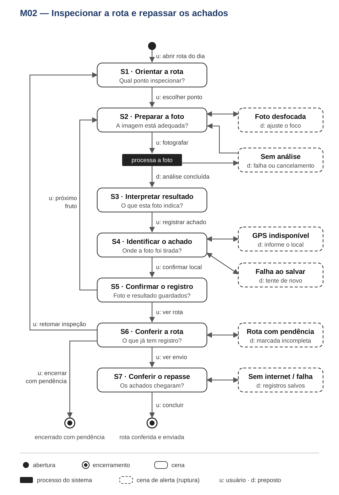

# Entrega 10 — MoLIC

**Data:** 01/11/2026 
**Status:** 🟨 em andamento — conversas M02 e M03 especificadas e diagramas inseridos; M01 e consolidação pendentes. 
**Responsabilidade:** 1 solução completa por integrante.

## Objetivo da atividade

Modelar a interação como conversa entre usuário e preposto do designer, incluindo caminhos principais, alternativas, rupturas e formas de recuperação.

## M01 — {{objetivo do agrônomo}}

**Autor(a):** Guilherme — {{matrícula}} 
**Cenário de interação de origem:** CI03 
**Objetivo(s):** {{IDs fixados na Entrega 9}} 
**Tarefa(s) relacionada(s):** {{...}} 
**Signos relevantes:** {{...}}

### Diagrama

**Fonte editável:** {{inserir link}}

### Leitura do diagrama

#### Caminho principal

1. {{...}}
2. {{...}}

#### Alternativas e rupturas

| Situação | Onde ocorre | Como o usuário percebe | Caminho de recuperação/saída |
|---|---|---|---|
| {{...}} | {{...}} | {{...}} | {{...}} |

### Checklist específico de modelagem

- [ ] Ponto de abertura, cenas e encerramento identificados.
- [ ] Falas, processamento e rupturas seguem a notação da aula.
- [ ] Objetivos e signos são coerentes com a Entrega 9.
- [ ] Diagrama e fonte editável foram inseridos e conferidos.

## M02 — Inspecionar a rota e repassar os achados

**Autor(a):** Lucas — 24.123.032-5 
**Cenário de interação de origem:** CI02 — inspeção dos frutos e repasse dos achados. 
**Objetivo(s):** O01 — inspecionar os pontos da rota; O02 — obter uma foto analisável; O03 — entender o resultado da foto; O04 — registrar o achado e seu local; O05 — confirmar o repasse dos registros. 
**Tarefa(s) relacionada(s):** T01 — inspecionar a rota e repassar achados; T02 — verificar um fruto e encaminhar o resultado; T03 — relação temporal da inspeção e do repasse. 
**Signos relevantes:** ponto planejado, situação do ponto, foto do fruto, qualidade da foto, situação da análise, resultado da foto, data e hora, local do achado, situação do registro, destinatário e situação do envio.

### Diagrama

Diagrama desenhado com a notação MoLIC e a legenda apresentadas na aula, a partir da especificação das cenas e transições abaixo.

**Fonte editável:** {{inserir link do arquivo .drawio ou .svg editável de M02}}

### Cenas, processamento e encerramentos desenhados

| Elemento | Tópico ou função na conversa | Conteúdo que precisa aparecer |
|---|---|---|
| Ponto de abertura | Início da inspeção | Antônio abre a rota que recebeu para o dia. |
| S1 — Orientar a rota | “Qual ponto devo inspecionar?” | Talhão, linha e árvore do próximo ponto; distinção entre pontos planejados, com registro e pendentes. |
| S2 — Preparar a foto | “A imagem está adequada?” | Orientações de distância, foco e iluminação; possibilidade de fotografar, ajustar ou voltar à rota. |
| Processamento do sistema | Analisar a foto capturada | Indicação de que a análise está ocorrendo no celular; possibilidade de cancelar. Representar conforme a notação de processamento ensinada na aula. |
| S3 — Interpretar o resultado | “O que esta foto indica?” | Uma das mensagens: “sinal suspeito”, “nenhum sinal nesta foto” ou “resultado inconclusivo”. Explicitar que a IA não confirmou a infestação. |
| S4 — Identificar o achado | “Onde esta foto foi tirada?” | Local obtido por GPS ou identificação manual por talhão, linha e árvore; indicação da origem do local. |
| S5 — Confirmar o registro | “A foto e o resultado foram guardados?” | Confirmação de que foto, resultado, data, hora e local foram salvos no celular. |
| S6 — Conferir a rota | “O que já tem registro e o que falta?” | Pontos planejados com registro e pendentes; opção de continuar ou encerrar com pendência explicitada. |
| S7 — Conferir o repasse | “Os achados chegaram ao gestor?” | Estados “aguardando conexão”, “enviando”, “enviado” e “falha no envio”. “Enviado” não significa “lido”. |
| Encerramento com objetivo concluído | Rota conferida e registros enviados | O usuário sabe quais pontos têm registro e que os achados foram disponibilizados ao gestor. |
| Encerramento com pendência | Inspeção interrompida ou rota incompleta | Registros locais preservados e pontos não cobertos identificados; o usuário pode retomar depois. |

As cenas representam **assuntos da conversa**. P01–P07, da Entrega 6, podem ajudar a implementar essas cenas no Figma, mas não são os nomes das cenas no MoLIC.

### Leitura do diagrama

#### Caminho principal

1. Antônio abre a inspeção. Em **S1**, pergunta implicitamente qual ponto deve visitar; o sistema informa o próximo ponto planejado e o que já possui registro.
2. Ele escolhe o ponto e entra em **S2**. O sistema orienta o enquadramento. Antônio ajusta a imagem e comunica a decisão de fotografar.
3. O sistema **processa a foto** e comunica que a análise está em andamento. Quando termina, inicia-se **S3**.
4. Em **S3**, Antônio interpreta a indicação da foto. Diante de “sinal suspeito”, entende que o resultado precisa de confirmação e escolhe registrar o achado.
5. Em **S4**, confere o local obtido. O sistema salva foto, resultado, data, hora e local e confirma em **S5** que o registro está no celular.
6. Antônio pode voltar a **S2** para outro fruto ou consultar **S6** para verificar a rota. Ao encerrar, o sistema informa os pontos que permaneceram pendentes.
7. Em **S7**, Antônio verifica se os registros estão aguardando conexão, em envio ou enviados. O caminho termina quando ele compreende a cobertura da rota e a situação do repasse.

#### Alternativas e rupturas

| Situação | Onde ocorre | Como o usuário percebe | Caminho de recuperação/saída |
|---|---|---|---|
| Foto desfocada ou mal enquadrada. | S2 — preparar a foto. | `D: Ajuste o foco ou a distância antes de fotografar.` | Antônio reposiciona o celular e permanece em S2; também pode voltar a S1. |
| Antônio cancela a análise. | Processamento após S2. | `D: Análise cancelada. A foto ainda não gerou resultado.` | Volta a S2 para fotografar novamente ou a S1 para abandonar aquele ponto. |
| Análise falha. | Processamento após S2. | `D: Não foi possível analisar esta foto.` | Tenta novamente ou refaz a foto em S2, sem marcar o ponto como analisado. |
| Nenhum sinal na foto. | S3 — interpretar o resultado. | `D: Nenhum sinal nesta foto; isso não garante que a árvore esteja livre.` | Salva o resultado, se fizer parte do registro da inspeção, ou segue para outro fruto sem registrar ausência de praga em toda a árvore. |
| Resultado inconclusivo. | S3 — interpretar o resultado. | `D: Não foi possível concluir. Refaça a foto ou guarde para conferir.` | Volta a S2 ou segue a S4 mantendo o resultado identificado como inconclusivo. |
| GPS indisponível. | S4 — identificar o achado. | `D: Local não obtido. Informe talhão, linha e árvore.` | Antônio fornece esses campos; o sistema marca “local manual, sem coordenadas”. |
| Identificação manual incompleta. | S4 — identificar o achado. | `D: Informe o campo que falta para salvar o local.` | Corrige o campo indicado e permanece em S4; a foto e o resultado são preservados. |
| Falha ao salvar no celular. | Transição de S4 para S5. | `D: Registro não salvo. Tente novamente.` | Nova tentativa sem descartar foto e resultado; se desistir, o ponto permanece pendente. |
| Rota encerrada com pontos pendentes. | S6 — conferir a rota. | `D: Há pontos sem registro. A rota será marcada como incompleta.` | Retoma a inspeção em S1 ou encerra mantendo a pendência visível. |
| Sem internet. | S7 — conferir o repasse. | `D: Salvo no celular; aguardando conexão para enviar.` | Antônio pode encerrar o uso; os registros permanecem locais para envio posterior. |
| Falha no envio. | S7 — conferir o repasse. | `D: Não foi possível enviar. Seus registros continuam salvos.` | Tenta novamente quando houver conexão, sem repetir registros já enviados. |

**Acesso à rota durante a inspeção:** se representado como acesso ubíquo no diagrama, ele deverá retornar a **S1/S6** preservando a foto ou o registro já salvo. Sua finalidade é permitir conferir o ponto atual e as pendências, não abrir uma navegação genérica.

### Checklist específico de modelagem — M02

- [x] Existe ponto de abertura coerente com o início do objetivo.
- [x] As cenas especificadas representam tópicos da conversa.
- [x] As falas e transições foram descritas como comunicação entre usuário e sistema.
- [x] Há encerramento para conclusão e para interrupção com pendências.
- [ ] O processamento foi desenhado com a notação MoLIC adotada em aula.
- [x] As rupturas especificadas possuem feedback e recuperação.
- [x] O possível acesso à rota possui justificativa semântica.
- [x] Estão descritos caminhos alternativos além do principal.
- [x] Objetivos, tópicos e signos seguem a parte de Lucas da Entrega 9.
- [ ] O diagrama foi produzido e verificado em tamanho normal no GitHub.
- [x] A especificação modela a conversa com o usuário, não o interior do algoritmo.
- [x] Processamento, registro e envio incluem retornos e falhas relevantes.

**Situação de M02:** a especificação textual está pronta e o diagrama foi inserido como imagem (`molic_m02.png`); permanecem abertos o link da fonte editável e a conferência final do diagrama em tamanho normal no GitHub.

## M03 — Revisar o ciclo e decidir o manejo por talhão

**Autor(a):** Pedro — 24.123.048-1 
**Cenário de interação de origem:** CI01 — revisão do ciclo e decisão do manejo por talhão. 
**Objetivo(s):** O06 — saber o que o ciclo cobriu; O07 — avaliar o resultado de um talhão; O08 — registrar a posição de cada talhão; O09 — acompanhar a evolução do talhão; O10 — decidir o manejo do ciclo; O11 — confirmar o repasse da decisão. 
**Tarefa(s) relacionada(s):** T04 — planejar o manejo do ciclo; T08 — avaliar a evolução de um talhão entre ciclos; T09 — revisar o resultado do ciclo e decidir se confia nele. 
**Signos relevantes:** aviso de ciclo concluído, cobertura do talhão, situação do talhão no ciclo, confiança do resultado, posição do talhão, tendência do talhão, última aplicação, decisão do ciclo e situação do repasse.

### Diagrama

Diagrama desenhado com a notação MoLIC apresentada na aula (Barbosa e Silva, 2010), a partir da especificação das cenas e transições abaixo, com legenda no próprio desenho.

**Fonte editável:** [`molic_m03.dot`](../assets/10_molic/molic_m03.dot) (Graphviz).

### Cenas, processamento e encerramentos desenhados

| Elemento | Tópico ou função na conversa | Conteúdo que precisa aparecer |
|---|---|---|
| Ponto de abertura | Início da revisão | Jaime abre o aviso de ciclo concluído. |
| S1 — Conhecer o ciclo | “O que o ciclo encontrou?” | Data do ciclo, quantos talhões foram inspecionados e quantos têm focos. |
| S2 — Conferir a cobertura | “Todos os talhões foram vistos?” | Talhões inspecionados, não inspecionados e com cobertura incompleta; aviso de que “não inspecionado” não significa “sem focos”; opção de pedir nova inspeção. |
| Processamento do sistema | Registrar o pedido de nova inspeção | Confirmação de que o pedido foi registrado, ou falha com nova tentativa. |
| S3 — Escolher o talhão | “Onde estão os focos?” | Talhões com focos em ordem de gravidade e tendência, apresentada como dado e não como recomendação; posição já registrada em cada talhão. |
| S4 — Avaliar o talhão | “Posso confiar neste resultado?” | Fotos, local e confiança em linguagem simples; aviso de que o sistema não confirma a praga; aviso se a cobertura do talhão foi incompleta. |
| S5 — Acompanhar a evolução | “A praga está avançando?” | Tendência entre ciclos (avançando, estável ou recuando), última aplicação marcada e aviso quando um ciclo comparado teve cobertura incompleta. |
| Processamento do sistema | Registrar a posição do talhão | Salvar a posição escolhida; quando for o caso, registrar o pedido de parecer ao agrônomo ou de reinspeção. |
| S6 — Confirmar a posição | “Minha posição ficou registrada?” | Posição do talhão: “confiável”, “parecer do agrônomo pedido” ou “reinspeção pedida”. |
| S7 — Decidir o manejo do ciclo | “Onde e quando aplico?” | Talhões com suas posições e talhões ainda sem posição; escolha de onde, quando e com que urgência aplicar. O sistema não sugere produto, dose nem prioridade. |
| Processamento do sistema | Registrar a decisão do ciclo | Salvar a decisão com autoria e data. |
| S8 — Conferir o repasse | “Quem aplica já sabe?” | Estados “registrada”, “repassada” e “falha no repasse”; destinatário. “Repassada” não significa “aplicada”. |
| Processamento do sistema | Repassar a decisão a quem aplica | Confirmação do repasse, ou falha mantendo a decisão registrada. |
| Encerramento com objetivo concluído | Decisão registrada e repassada | Jaime sabe o que o ciclo cobriu, qual a posição de cada talhão revisado e que a decisão chegou a quem aplica. |
| Encerramento com pendência | Revisão interrompida ou decisão não repassada | Posições e decisão já registradas permanecem salvas; Jaime pode retomar depois. |

As cenas representam **assuntos da conversa**. G01–G08, da Entrega 6, podem ajudar a implementar essas cenas no Figma, mas não são os nomes das cenas no MoLIC.

### Leitura do diagrama

#### Caminho principal

1. Jaime abre o aviso de ciclo concluído. Em **S1**, o sistema informa a data do ciclo, quantos talhões foram inspecionados e quantos têm focos.
2. Ele pede para conferir a cobertura e entra em **S2**. O sistema mostra o que foi e o que não foi inspecionado e deixa claro que talhão não inspecionado não é talhão sem focos.
3. Em **S3**, Jaime vê os talhões com focos em ordem de gravidade e tendência e abre um deles.
4. Em **S4**, avalia as fotos, o local e a confiança do resultado. Como não valida a praga, decide em quem confiar e comunica sua posição: “confiável”, “parecer do agrônomo” ou “reinspeção”.
5. O sistema **registra a posição** e a confirma em **S6**. Jaime volta a **S3** para o próximo talhão ou encerra a revisão.
6. Em **S7**, vê as posições de cada talhão e informa onde, quando e com que urgência aplicar. O sistema **registra a decisão**.
7. Em **S8**, Jaime confere que a decisão está registrada e pede o repasse a quem aplica. O sistema **repassa a decisão**, e o caminho termina quando ela aparece como “repassada”.

#### Alternativas e rupturas

| Situação | Onde ocorre | Como o usuário percebe | Caminho de recuperação/saída |
|---|---|---|---|
| Talhão não inspecionado no ciclo. | S2 — conferir a cobertura. | `D: Não inspecionado: talhão [nome]. Isso não significa que esteja livre da praga.` | Jaime pede nova inspeção e permanece em S2, ou segue para S3 com o talhão identificado como não inspecionado. |
| Falha ao registrar o pedido de nova inspeção. | Processamento após S2. | `D: Pedido não registrado. Tente novamente.` | Volta a S2 e tenta de novo; o talhão continua marcado como não inspecionado. |
| Jaime quer saber se a praga avança antes de se posicionar. | S4 — avaliar o talhão. | `D: Neste talhão: avançando / estável / recuando. Última aplicação marcada.` | Vai a S5 e volta a S4 para registrar a posição. |
| Dúvida sobre o resultado. | S4 — avaliar o talhão. | `D: Aceitar como confiável, pedir parecer do agrônomo ou pedir nova inspeção.` | Escolhe “parecer do agrônomo” ou “reinspeção”; a dúvida não bloqueia a revisão. |
| Cobertura incompleta do talhão. | S4 — avaliar o talhão. | `D: Atenção: este talhão não foi totalmente coberto neste ciclo.` | Pede reinspeção ou registra a posição ciente do limite; pode abrir a cobertura (S2). |
| Ciclo comparado com cobertura incompleta. | S5 — acompanhar a evolução. | `D: Atenção: o ciclo [data] não cobriu todo o talhão. A comparação pode não ser confiável.` | Abre a cobertura do ciclo (S2) ou volta a S4 sem concluir que a praga recuou. |
| Falha ao salvar a posição. | Processamento após S4. | `D: Posição não salva. Tente novamente.` | Volta a S4 e tenta de novo; o talhão continua sem posição. |
| Revisão encerrada com talhões sem posição. | S7 — decidir o manejo. | `D: Há talhões com focos sem posição registrada.` | Volta a S3 para revisá-los ou decide mesmo assim, com a pendência visível. |
| Falha ao registrar a decisão. | Processamento após S7. | `D: Decisão não registrada. Tente novamente.` | Volta a S7 com as escolhas preservadas. |
| Jaime quer mudar a decisão. | S8 — conferir o repasse. | `D: Decisão registrada, ainda não repassada.` | Volta a S7 e altera a decisão antes de repassar. |
| Falha no repasse. | Processamento após S8. | `D: Não foi possível repassar. Sua decisão continua registrada.` | Tenta novamente em S8 ou sai; a decisão fica como “registrada”, não “repassada”. |
| Jaime interrompe a revisão. | S2 a S7. | `D: O que você já registrou fica salvo.` | Encerramento com pendência; retoma depois a partir do que foi registrado. |

**Acesso à cobertura durante a revisão:** representado como acesso ubíquo a **S2**, usado a partir das cenas S3 a S7. O segundo acesso ubíquo do diagrama representa a interrupção da revisão, possível de S2 a S7. Sua finalidade é permitir conferir o que foi inspecionado antes de confiar em um resultado ou em uma comparação, não abrir uma navegação genérica. As posições já registradas são preservadas.

### Checklist específico de modelagem — M03

- [x] Ponto de abertura, cenas e encerramento identificados.
- [x] Falas, processamento e rupturas seguem a notação da aula.
- [x] Objetivos e signos são coerentes com a Entrega 9.
- [ ] Diagrama e fonte editável foram inseridos e conferidos — falta verificar em tamanho normal no GitHub.

**Situação de M03:** especificação textual e diagrama prontos. As falas e os estados são propostas a avaliar com usuários; G01–G08 ainda não foram desenhadas em papel nem simuladas.

## Consolidação da equipe

### Cobertura dos objetivos

| Objetivo | MoLIC que cobre | Lacunas/duplicidades | Decisão |
|---|---|---|---|
| O01 — inspecionar pontos da rota | M02 | Conferir a ligação com a rota orientada pelo gestor em M03. | Manter em M02 a conversa de inspeção de P02. |
| O02 — obter foto analisável | M02 | Nenhuma identificada na especificação de Lucas. | Representar preparação, ajuste e nova captura. |
| O03 — entender resultado da foto | M02 | Conferir nomenclatura com a validação humana de M01. | Separar “resultado da IA” de “veredito do agrônomo”. |
| O04 — registrar achado e local | M02 | Conferir quais dados M01 e M03 recebem do registro. | Reutilizar os mesmos signos de foto, data, hora e local. |
| O05 — confirmar repasse | M02 | Conferir a passagem do registro ao gestor em M03. | Distinguir “enviado” de “lido” ou “avaliado”. |
| {{objetivos de Guilherme}} | M01 | {{...}} | {{...}} |
| O06 — saber o que o ciclo cobriu | M03 | Depende de M02 registrar os pontos visitados; conferir se “pendente” (M02) e “não inspecionado” (M03) descrevem a mesma situação. | Manter em M03 a leitura da cobertura por talhão, sem mostrar o percurso individual do trabalhador. |
| O07 — avaliar o resultado de um talhão | M03 | Conferir nomenclatura com o “resultado da foto” de M02 e o veredito de M01. | Separar “confiança do resultado” (IA) de validação humana. |
| O08 — registrar a posição de cada talhão | M03 | “Parecer do agrônomo” abre a conversa de M01 e “reinspeção” leva a M02; conferir como cada pedido chega. | A posição é do gestor e não valida a praga. |
| O09 — acompanhar a evolução do talhão | M03 | Conferir sobreposição com o histórico do ponto em M01. | M03 mostra a tendência por talhão; M01, o histórico por ponto. |
| O10 — decidir o manejo do ciclo | M03 | Conferir a relação com o parecer que M01 envia ao gestor. | O sistema registra a decisão e não sugere produto, dose nem prioridade. |
| O11 — confirmar o repasse da decisão | M03 | Nome próximo de “situação do envio” de M02. | Distinguir “registrada” de “repassada”; repassada não significa aplicada. |

A consolidação final depende dos diagramas dos três integrantes e da fixação dos IDs de objetivos na Entrega 9.

### Preparação para o Figma

**Estados necessários para o fluxo de Lucas, derivados das conversas M02:**

- Rota com próximo ponto e pontos pendentes — S1.
- Câmera com orientação de foco — S2.
- Foto inadequada e ajuste — ruptura em S2.
- Análise em andamento, cancelada ou com falha — processamento.
- Resultado suspeito, sem sinal na foto ou inconclusivo — S3.
- Local obtido por GPS ou identificação manual incompleta/completa — S4.
- Confirmação de registro salvo ou falha ao salvar — S5.
- Revisão da rota completa ou com pendências — S6.
- Registro aguardando conexão, em envio, enviado ou com falha — S7.

**Estados de Guilherme:** {{derivar de M01}}.

**Estados necessários para o fluxo de Pedro, derivados das conversas M03:**

- Resumo do ciclo concluído — S1.
- Cobertura com talhões inspecionados, não inspecionados e com cobertura incompleta — S2.
- Pedido de nova inspeção registrado ou com falha — processamento após S2.
- Talhões com focos em ordem de gravidade, com e sem posição registrada — S3.
- Detalhe do talhão com fotos, local e confiança, com e sem aviso de cobertura incompleta — S4.
- Evolução avançando, estável ou recuando, com e sem aviso de ciclo incompleto — S5.
- Posição registrada (confiável, parecer pedido ou reinspeção pedida) ou falha ao salvar — S6.
- Decisão do ciclo com todos os talhões posicionados ou com pendências — S7.
- Decisão registrada, repassada ou com falha no repasse — S8.

Antes de produzir o Figma, conferir se cada estado possui uma conversa ou ruptura correspondente no MoLIC.

## Erros frequentes a evitar

- Desenhar apenas caixas com nomes de telas e setas de navegação.
- Omitir falhas, cancelamento, volta ou recuperação.
- Usar rótulos genéricos sem tópico de conversa.
- Criar no Figma caminhos ausentes do MoLIC.
- Entregar diagrama sem legenda, fonte editável ou texto legível.
