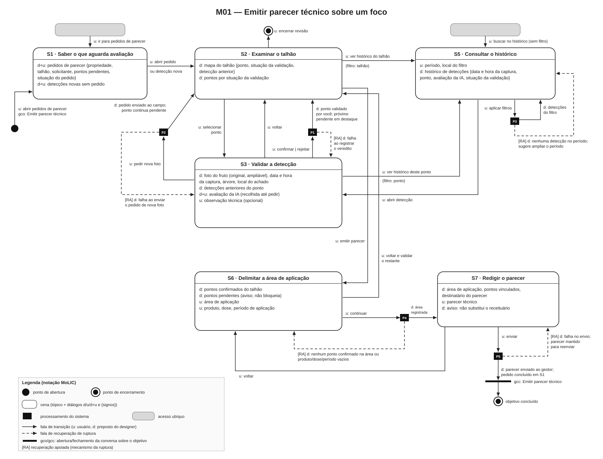
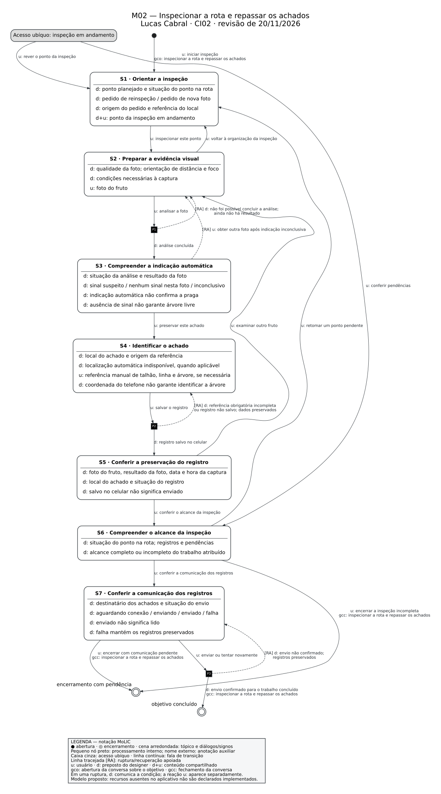

# Entrega 10 — MoLIC

**Data:** 14/11/2026  
**Revisão:** 16/11/2026  
**Status:** 🟨 em andamento — M02 de Lucas revisado e fonte editável produzida; faltam a inclusão dos arquivos no repositório, a conferência no GitHub e os ajustes de M03 por Pedro.  
**Responsabilidade:** 1 solução completa por integrante.

## Objetivo da atividade

Modelar a interação como conversa entre usuário e preposto do designer, incluindo caminhos principais, alternativas, rupturas e recuperação. O MoLIC representa as conversas necessárias aos objetivos dos usuários, não o funcionamento interno do algoritmo.

## M01 — Emitir parecer técnico sobre um foco de infestação

**Autor:** Guilherme Morais Escudeiro — 24.123.005-1  
**Cenário de origem:** CI03  
**Objetivos:** O12–O19  
**Tarefas relacionadas:** T05, T06 (método M3) e T07  
**Signos relevantes:** pedido de parecer, propriedade, talhão, solicitante, pontos pendentes, situação do pedido, ponto, situação da validação, detecção anterior, foto original, data e hora da captura, árvore, local do achado, avaliação da IA, veredito, histórico, área de aplicação, produto, dose, período de aplicação, parecer técnico, pontos vinculados e destinatário.

### Diagrama

**Fonte editável:** [`molic_m01.svg`](../assets/10_molic/molic_m01.svg) — SVG com formas e texto editáveis.

### Leitura do diagrama

O diagrama apresenta as cenas S1, S2, S3, S5, S6 e S7 e os processamentos P1–P5. A antiga cena S4 de pedir nova foto foi incorporada como ação em S3, acompanhada do processamento P2. A numeração restante foi mantida para preservar as referências.

**Hipóteses ainda não validadas:** Marcelo é uma proto-persona. A conversa supõe que o agrônomo recomenda e o gestor decide a execução (H04); que foto, localização e histórico bastam para parte da análise a distância (H07/H22); e que o parecer precisa de produto, dose e período. A entrevista I02 da Entrega 7 não foi realizada. Portanto, essas decisões permanecem hipóteses de design.

#### Caminho principal

1. **Abertura → S1 — Escolher o foco:** Marcelo abre pedidos de parecer. O sistema mostra propriedade, talhão, solicitante, pontos pendentes e situação do pedido.
2. **S1 → S2 — Examinar o talhão:** ao abrir um pedido, encontra o mapa dos pontos e suas situações.
3. **S2 → S3 — Validar a detecção:** seleciona um ponto e examina foto, data, hora, árvore, local e registros anteriores. Pode ampliar a foto, consultar a indicação da IA e anotar observação.
4. **S3 → P1 → S2:** confirma ou rejeita. O sistema registra o veredito e destaca o próximo ponto pendente.
5. **S2 → S6 — Delimitar a área:** seleciona emitir parecer, examina pontos confirmados, delimita a área e informa produto, dose e período.
6. **S6 → P4 → S7 — Redigir o parecer:** o sistema registra a área e apresenta pontos vinculados, destinatário e aviso sobre o receituário agronômico. Marcelo escreve a justificativa.
7. **S7 → P5 → encerramento:** envia ao gestor; o pedido passa a concluído na lista S1.

#### Alternativas e rupturas

| Situação | Onde ocorre | Feedback | Recuperação/saída |
|---|---|---|---|
| Foto insuficiente. | S3 | A evidência não permite decidir. | Pedir nova foto → P2 → S2. O ponto permanece pendente até nova avaliação. |
| Falha ao enviar pedido de foto. | P2 | Pedido não enviado. | Voltar a S3 e tentar novamente, preservando a detecção. |
| Falha ao registrar veredito. | P1 | Veredito não registrado. | Voltar a S3 mantendo a observação. |
| Revisão interrompida. | S2 | Pontos já avaliados permanecem registrados. | Encerrar com pendências; retomar por S1. |
| Troca de foco. | Qualquer cena | Lista de pedidos acessível. | Acesso ubíquo a S1 sem apagar vereditos registrados. |
| Consulta de histórico. | S2/S3 | Histórico por ponto, talhão ou sem filtro. | Ir a S5; abrir detecção ou voltar. |
| Histórico sem resultados. | S5/P3 | Nenhum registro no período. | Manter filtros e permitir ampliar período ou trocar local. |
| Pontos ainda pendentes. | S6 | Aviso antes da delimitação. | Voltar a S2 ou continuar apenas com pontos confirmados. |
| Área sem ponto confirmado ou campos incompletos. | S6/P4 | Campo ou condição inválida identificada. | Corrigir em S6 sem perder os demais dados. |
| Revisão da área. | S7 | Resumo da área e pontos vinculados. | Voltar a S6 mantendo o texto do parecer. |
| Falha no envio do parecer. | S7/P5 | Parecer não enviado. | Permanecer em S7 com texto salvo e tentar novamente. |

### Checklist específico — M01

- [x] Ponto de abertura e encerramentos identificados.
- [x] Cenas representam assuntos da conversa.
- [x] Transições identificam falas do usuário e do preposto.
- [x] Processamentos são representados separadamente.
- [x] Rupturas têm feedback e recuperação.
- [x] Atalhos têm justificativa na tarefa.
- [x] Há caminhos alternativos além do principal.
- [x] Objetivos e signos seguem a Entrega 9.
- [x] Diagrama e fonte editável estão identificados.
- [x] O modelo descreve interação, não o interior do algoritmo.

## M02 — Inspecionar a rota e repassar os achados

**Autor:** Lucas Tonoli Cabral Duarte — 24.123.032-5  
**Cenário de origem:** CI02 — inspeção dos frutos e repasse dos achados.  
**Objetivos:** O01 — inspecionar os pontos da rota; O02 — obter uma foto analisável; O03 — entender o resultado da foto; O04 — registrar o achado e seu local; O05 — confirmar o repasse.  
**Tarefas relacionadas:** T01 — inspecionar a rota e repassar achados; T02 — verificar um fruto e encaminhar o resultado; T03 — relação temporal entre inspeção e repasse.  
**Signos relevantes:** ponto planejado, situação do ponto, pedido de reinspeção, pedido de nova foto, origem do pedido, foto do fruto, qualidade da foto, situação da análise, resultado da foto, data e hora, local, situação do registro, destinatário e situação do envio.

### Diagrama

O diagrama revisado contém cenas S1–S7, processamentos em caixas pretas, caminhos alternativos, encerramento com objetivo concluído e encerramento com pendência. **S1 inclui pedidos de reinspeção enviados pelo gestor e pedidos de nova foto enviados pelo agrônomo**, identificando a origem de cada um.

**Fonte editável:** [`molic_m02.dot`](../assets/10_molic/molic_m02.dot), em Graphviz. Para gerar novamente o SVG: `dot -Tsvg molic_m02.dot -o molic_m02.svg`.

> Copiar `molic_m02.dot` e `molic_m02.svg` para `assets/10_molic/` antes de publicar este documento. O antigo `molic_m02.png` pode permanecer como registro da versão anterior.

### Cenas, processamento e encerramentos

| Elemento | Tópico da conversa | Conteúdo |
|---|---|---|
| Abertura | Iniciar inspeção. | Antônio abre a rota do dia. |
| S1 — Orientar a rota | “Qual ponto devo inspecionar?” | Próximo ponto por talhão, linha e árvore; pontos planejados, registrados e pendentes. Reinspeção pedida pelo gestor e nova foto pedida pelo agrônomo entram como pontos planejados, com origem indicada. |
| S2 — Preparar a foto | “A imagem está adequada?” | Orientação de foco, distância e iluminação; fotografar, ajustar ou voltar. |
| Processamento P1 | Analisar a foto. | Indicar andamento; permitir cancelamento e recuperação após falha. |
| S3 — Interpretar o resultado | “O que esta foto indica?” | Sinal suspeito, nenhum sinal nesta foto ou resultado inconclusivo; indicação automática não é confirmação humana. |
| S4 — Identificar o achado | “Onde foi tirada?” | Local por GPS ou identificação manual de talhão, linha e árvore; mostrar a origem do local. |
| Processamento P2 | Salvar registro. | Preservar foto, resultado e local em caso de falha. |
| S5 — Confirmar o registro | “Ficou salvo?” | Foto, resultado, data, hora e local salvos no celular; ainda não significa envio. |
| S6 — Conferir a rota | “O que falta?” | Pontos com registro e pendentes; rota completa ou incompleta. |
| S7 — Conferir o repasse | “Chegou ao gestor?” | Aguardando conexão, enviando, enviado ou falha. “Enviado” não significa “lido”. |
| Processamento P3 | Enviar registros. | Confirmar envio ou preservar registros para nova tentativa. |
| Encerramento concluído | Rota conferida e registros enviados. | O usuário conhece cobertura e situação do repasse. |
| Encerramento com pendência | Rota interrompida, incompleta ou aguardando conexão. | Dados locais preservados para retomada. |

Os códigos P01–P07 da Entrega 6 são referências a estados de interface, não nomes das cenas MoLIC. Nem todos esses estados foram fotografados em papel ou implementados no aplicativo, conforme as Entregas 6, 11 e 12.

### Leitura do diagrama

#### Caminho principal

1. Antônio abre a rota. Em **S1**, vê o próximo ponto e os registros existentes. Se houver pedido do gestor ou agrônomo, ele aparece com sua origem.
2. Seleciona o ponto e vai a **S2**. O sistema orienta a captura; Antônio ajusta a imagem e fotografa.
3. O sistema processa a foto em **P1**. Ao terminar, apresenta **S3** com a indicação do resultado e seu limite.
4. Antônio decide guardar a indicação. Em **S4**, confere o local automático ou o informa manualmente.
5. O sistema salva em **P2** e comunica em **S5** que o registro está no celular.
6. Antônio fotografa outro fruto ou vai a **S6** conferir os pontos registrados e pendentes.
7. Ao encerrar, consulta **S7**. O sistema envia em **P3** quando possível; a conversa termina com envio confirmado ou com pendência explicitada e dados preservados.

#### Alternativas e rupturas

| Situação | Onde ocorre | Como o usuário percebe | Recuperação/saída |
|---|---|---|---|
| Foto inadequada. | S2 | `D: Ajuste o foco ou a distância.` | Reposicionar a câmera em S2 ou voltar à rota. |
| Cancelamento da análise. | P1 | `D: Análise cancelada; ainda não há resultado.` | Voltar a S2 ou abandonar o ponto mantendo-o pendente. |
| Falha na análise. | P1 | `D: Não foi possível analisar esta foto.` | Tentar novamente ou refazer a foto. |
| Nenhum sinal na foto. | S3 | `D: Nenhum sinal nesta foto; isso não garante árvore livre.` | Registrar corretamente a indicação ou seguir para outro fruto. |
| Resultado inconclusivo. | S3 | `D: Não foi possível concluir.` | Refazer foto ou guardar como inconclusivo. |
| GPS indisponível. | S4 | `D: Informe talhão, linha e árvore.` | Identificar o local manualmente e sinalizar sua origem. |
| Local manual incompleto. | S4 | Campo faltante identificado. | Corrigir sem perder foto e resultado. |
| Falha ao salvar. | P2 | `D: Registro não salvo; tente novamente.` | Repetir salvamento; ponto continua pendente até confirmação. |
| Rota com pontos pendentes. | S6 | `D: Há pontos sem registro.` | Retomar em S1 ou encerrar com rota incompleta. |
| Sem internet. | S7 | `D: Salvo no celular; aguardando conexão.` | Encerrar com dados locais preservados. |
| Falha no envio. | P3/S7 | `D: Não foi possível enviar; seus registros continuam salvos.` | Tentar novamente sem duplicar os enviados. |

**Acesso à rota durante a inspeção:** o atalho cinza do diagrama permite rever o ponto atual em S1 ou as pendências em S6. Sua finalidade é apoiar a inspeção em andamento; os registros já salvos permanecem preservados.

### Checklist específico — M02

- [x] Há ponto de abertura coerente com o objetivo.
- [x] As cenas representam assuntos da conversa.
- [x] Falas e transições indicam o que usuário e sistema comunicam.
- [x] Há encerramento para conclusão e para interrupção com pendência.
- [x] O processamento está desenhado como caixa preta, separado das falas do usuário.
- [x] Rupturas têm feedback e recuperação.
- [x] O acesso à rota tem justificativa na tarefa.
- [x] Há caminhos alternativos além do caminho principal.
- [x] Objetivos, tópicos e signos seguem a Entrega 9.
- [ ] O SVG revisado e o DOT foram publicados e conferidos em tamanho normal no GitHub.
- [x] O modelo descreve a conversa, não o interior do algoritmo.
- [x] Análise, registro e envio incluem falhas e retornos relevantes.

**Situação de M02:** especificação textual, SVG revisado e fonte editável DOT preparados. O ajuste de S1 solicitado na consolidação foi aplicado. A verificação no GitHub só poderá ser marcada após a inclusão dos dois arquivos no repositório.

## M03 — Revisar o ciclo e decidir o manejo por talhão

**Autor:** Pedro — 24.123.048-1  
**Cenário de origem:** CI01 — revisão do ciclo e decisão do manejo por talhão.  
**Objetivos:** O06 — saber o que o ciclo cobriu; O07 — avaliar o resultado; O08 — registrar a posição de cada talhão; O09 — acompanhar evolução; O10 — decidir manejo; O11 — confirmar repasse.  
**Tarefas relacionadas:** T04, T08 e T09.  
**Signos relevantes:** aviso de ciclo concluído, cobertura, situação do talhão, confiança do resultado, posição, tendência, última aplicação, decisão e situação do repasse.

### Diagrama

**Fonte editável:** [`molic_m03.dot`](../assets/10_molic/molic_m03.dot), em Graphviz.

### Cenas, processamento e encerramentos

| Elemento | Tópico da conversa | Conteúdo |
|---|---|---|
| Abertura | Iniciar revisão. | Jaime abre o resultado do ciclo. |
| S1 — Conhecer o ciclo | “O que foi encontrado?” | Data, talhões inspecionados e talhões com focos. |
| S2 — Conferir a cobertura | “Todos os talhões foram vistos?” | Inspecionado, não inspecionado e cobertura incompleta. O desenho atual ainda usa “nova inspeção” em parte desse fluxo; deve ser uniformizado para “reinspeção”. |
| Processamento | Registrar pedido. | Confirmação ou falha com nova tentativa. |
| S3 — Escolher o talhão | “Onde estão os focos?” | Lista por gravidade e tendência, apresentada como dado. |
| S4 — Avaliar o talhão | “Posso confiar?” | Fotos, local, indicação do resultado e aviso de cobertura incompleta. |
| S5 — Acompanhar evolução | “Está avançando?” | Tendência, última aplicação e limite de ciclos incompletos. |
| Processamento | Registrar posição. | Salvar posição ou preservar escolha após falha. |
| S6 — Confirmar posição | “Minha posição foi registrada?” | Confiável, parecer solicitado ou reinspeção solicitada. |
| S7 — Decidir manejo | “Onde e quando agir?” | Talhões e posições; o parecer recebido deveria entrar aqui, mas o ajuste ainda não foi aplicado ao diagrama. |
| Processamento | Registrar decisão. | Salvar autoria e data ou comunicar falha. |
| S8 — Conferir repasse | “Quem aplica recebeu?” | Registrada, repassada ou falha; repassada não significa aplicada. |
| Processamento | Repassar decisão. | Confirmar repasse ou preservar decisão para nova tentativa. |
| Encerramento concluído | Decisão registrada e repassada. | Gestor compreende a situação final. |
| Encerramento com pendência | Revisão interrompida ou decisão não repassada. | Escolhas já salvas permanecem disponíveis. |

As cenas representam assuntos da conversa. G01–G08 identificam estados planejados e parcialmente fotografados na Entrega 6; não são nomes das cenas MoLIC nem prova de que todos os desenhos em papel foram produzidos. A Entrega 11 usa o aplicativo para o gestor, com diferenças registradas na Entrega 12.

### Leitura do diagrama

#### Caminho principal

1. Jaime abre o ciclo em **S1** e consulta os números gerais.
2. Em **S2**, confere o que foi e não foi inspecionado.
3. Em **S3**, escolhe um talhão com foco.
4. Em **S4**, examina fotos, local e limites da evidência. Pode ir a **S5** para consultar evolução.
5. Registra sua posição e recebe a confirmação em **S6**; pode revisar outro talhão.
6. Em **S7**, decide onde e quando agir. O sistema registra a decisão.
7. Em **S8**, confere se ela foi apenas registrada ou já repassada. O encerramento concluído ocorre após o repasse.

#### Alternativas e rupturas

| Situação | Onde ocorre | Feedback | Recuperação/saída |
|---|---|---|---|
| Talhão não inspecionado. | S2 | Não inspecionado não significa livre da praga. | Solicitar inspeção/reinspeção ou seguir com limite visível. |
| Falha no registro do pedido. | Após S2 | Pedido não registrado. | Tentar novamente em S2. |
| Dúvida sobre resultado. | S4 | Evidência não basta. | Pedir parecer ou reinspeção. |
| Cobertura incompleta. | S4/S5 | Aviso sobre limite do resultado ou comparação. | Conferir cobertura, pedir reinspeção ou voltar sem tirar conclusão indevida. |
| Falha ao salvar posição. | Após S4 | Posição não salva. | Voltar a S4 com escolha preservada. |
| Talhões sem posição. | S7 | Pendências identificadas. | Revisar talhões ou prosseguir ciente delas. |
| Falha ao registrar decisão. | Após S7 | Decisão não registrada. | Voltar a S7 mantendo escolhas. |
| Alteração antes do repasse. | S8 | Decisão registrada, ainda não repassada. | Voltar a S7. |
| Falha no repasse. | Após S8 | Decisão continua registrada. | Repetir envio ou encerrar com pendência. |
| Interrupção da revisão. | S2–S7 | Registros existentes preservados. | Retomar posteriormente. |

**Acesso à cobertura:** o diagrama permite voltar a S2 durante a revisão. Outro acesso permite interromper a tarefa com dados já registrados preservados.

### Checklist específico — M03

- [x] Ponto de abertura, cenas e encerramentos identificados.
- [x] Falas, processamento e rupturas representados no diagrama existente.
- [x] Objetivos e signos vinculados à Entrega 9.
- [ ] Diagrama conferido em tamanho normal no GitHub.
- [ ] Terminologia “reinspeção” uniformizada em S2 e no SVG/DOT.
- [ ] Parecer recebido incorporado à decisão em S7 no SVG/DOT.

**Situação de M03:** texto e diagrama existentes. A Entrega 6 fotografa somente parte dos estados G01–G08 e registra avaliação formativa; não há fotografia de todos os estados em papel. Os dois ajustes acima continuam com Pedro e não são declarados como aplicados.

## Consolidação da equipe

### Cobertura dos objetivos

| Objetivo | MoLIC | Lacuna ou relação entre fluxos | Decisão e situação |
|---|---|---|---|
| O01 — inspecionar a rota | M02/S1 | Pedidos de reinspeção de M03 e nova foto de M01 chegam ao campo. | **Aplicado no M02 revisado:** ambos entram como ponto planejado, com origem identificada. |
| O02 — obter foto analisável | M02/S2 | Foto inadequada. | Manter ajuste e nova tentativa. |
| O03 — entender resultado | M02/S3 | Indicação automática pode ser confundida com veredito. | Resultado da foto/avaliação da IA são automáticos; veredito é humano. |
| O04 — registrar achado e local | M02/S4–S5 | Dados usados pelos outros perfis. | Foto, resultado, data, hora e local seguem para as conversas que precisam deles. |
| O05 — confirmar repasse | M02/S7 | “Enviado” não equivale a “lido” ou “decidido”. | Distinguir envio do trabalhador, parecer do agrônomo e repasse do gestor. |
| O06 — saber cobertura | M03/S2 | Ponto pendente e talhão não inspecionado são níveis diferentes. | Distinguir situação do ponto de cobertura do talhão. |
| O07 — avaliar talhão | M03/S4 | Confiança apresentada ao gestor não é validação humana. | Usar linguagem compreensível sem declarar confirmação técnica. |
| O08 — registrar posição | M03/S4/S6 | M03 usa “nova inspeção” e “reinspeção” para a mesma ação. | **Pendente com Pedro:** uniformizar “reinspeção” no diagrama. A chegada à rota já está em M02. |
| O09 — acompanhar evolução | M03/S5 | M01 também consulta histórico. | M03 apresenta tendência do talhão; M01 apresenta registros de pontos/talhões. |
| O10 — decidir manejo | M03/S7 | Falta mostrar o parecer enviado por M01 como entrada da decisão. | **Pendente com Pedro:** incluir estado “aguardando parecer” ou parecer recebido em S7, sem decidir pelo gestor. |
| O11 — confirmar repasse | M03/S8 | Repasse não significa aplicação realizada. | Manter estados separados. |
| O12–O19 — análise e parecer | M01 | Pedido, validação, histórico, nova foto, área, parecer e situação de envio. | Manter; hipóteses do agrônomo seguem abertas porque I02 não foi aplicado. |

### Preparação das interfaces a partir das conversas

**Lucas — M02:**

- Rota com próximo ponto, pendências e pedidos recebidos com origem — S1.
- Orientação e ajuste da câmera — S2.
- Processamento, cancelamento e falha de análise — P1.
- Sinal suspeito, ausência de sinal nesta foto e inconclusivo — S3.
- Local por GPS ou identificação manual, inclusive campo incompleto — S4.
- Registro salvo ou falha ao salvar — P2/S5.
- Rota completa ou incompleta — S6.
- Aguardando conexão, enviando, enviado e falha — P3/S7.

**Guilherme — M01:**

- Lista de pedidos e estado vazio — S1.
- Talhão, pontos e estados após veredito ou nova foto — S2.
- Foto, contexto, IA recolhida/aberta e falhas — S3.
- Histórico filtrado e estado sem resultados — S5.
- Área delimitada, pendências e entradas inválidas — S6.
- Parecer, destinatário, confirmação e falha de envio — S7/P5.

**Pedro — M03:**

- Resumo e cobertura do ciclo — S1/S2.
- Talhão inspecionado, não inspecionado ou parcialmente coberto — S2.
- Pedido de reinspeção confirmado ou com falha — processamento após S2, **após uniformização pendente**.
- Talhões com foco e posição — S3.
- Fotos, local, confiança e aviso de cobertura incompleta — S4.
- Evolução e última aplicação com limites da comparação — S5.
- Posição registrada ou falha — S6.
- Decisão com pendências e parecer recebido — S7, **parecer ainda pendente no diagrama**.
- Decisão registrada, repassada ou com falha — S8.

Esses são estados derivados dos modelos, **não uma declaração de que todos aparecem no aplicativo atual**. A Entrega 12 documenta as diferenças entre os modelos e a versão avaliável.

## Erros frequentes a evitar

- Reduzir o MoLIC a caixas com nomes de telas e setas.
- Omitir falha, cancelamento, volta e recuperação.
- Confundir processamento interno com fala do usuário.
- Usar rótulos sem tópico de conversa.
- Declarar como implementado um estado que existe apenas no modelo.
- Publicar o diagrama sem legenda, fonte editável ou conferência de legibilidade.
