# Entrega 11 — Protótipo no Figma

**Data:** 15/11/2026  
**Revisão:** 20/11/2026 (parte de Pedro, após o feedback); 22/11/2026 (parte de Guilherme, após o feedback)  
**Status:** 🟩 concluído  
**Responsabilidade:** 1 protótipo integrado por equipe cobrindo os fluxos MoLIC. Se a turma exigir divisão individual, identifique o responsável por cada fluxo/tela.

## Objetivo da atividade

Materializar o modelo de interação em um protótipo navegável, preservando a lógica dos objetivos, tópicos, signos, feedbacks, alternativas e recuperações definidos anteriormente.

## Protótipo adotado

Os perfis de inspeção e de administrador não têm protótipo no Figma: a interação foi materializada diretamente no aplicativo funcional **CYF — Clean Your Farm** para iPhone, que já existia quando esta entrega foi iniciada. As telas abaixo são capturas do aplicativo em execução, e é essa versão que será usada na inspeção e nos testes das Entregas 12 a 14. O fluxo do agrônomo (M01), que o aplicativo não tem, foi prototipado no Figma (telas FA).

## Link do Figma

**Protótipo (aplicativo):** não há protótipo no Figma; o protótipo é o aplicativo funcional.  
**Arquivo editável:** código-fonte em <https://github.com/Cabral100/App_Orange_Box>, pasta `ios-native/`.  
**Última verificação de permissão:** 14/11/2026 (repositório público).

**Protótipo do fluxo do agrônomo (M01, telas FA):** <https://www.figma.com/proto/gvxtwmmYvnJVONwUOHOMVD/Orange-Box>  
**Arquivo editável (FA):** <https://www.figma.com/design/gvxtwmmYvnJVONwUOHOMVD/Orange-Box>  
**Última verificação de permissão (FA):** 15/11/2026

> Teste o link em janela anônima. O avaliador deve conseguir abrir o protótipo sem solicitar permissão.

## Cobertura MoLIC → Figma

Para M02 e M03, a tabela relaciona o MoLIC às telas do aplicativo; as telas F01 a F06 têm captura nesta entrega. Para M01, a tabela relaciona o MoLIC às telas FA do Figma.

| MoLIC | Objetivo | Fluxo/telas no aplicativo | Estados de erro/recuperação | Responsável |
|---|---|---|---|---|
| M02 — Inspecionar a rota e repassar os achados | O01–O05 | **Cobertura parcial.** `F01 → F02 → F03`, com consulta a `F04` e `F05`. S2 está coberta e S5 parcialmente; S1, S3, S4, S6, S7, P2, P3 e os encerramentos não aparecem nas capturas (ver “Cobertura do M02 cena por cena”). | Na câmera: confiança baixa, localização desativada e falha ao salvar a imagem, com mensagem e nova tentativa. Sem captura nesta entrega; não há estados de envio no aplicativo. | Lucas Cabral |
| M03 — Revisar o ciclo e decidir o manejo por talhão | O06–O11 | **Cobertura parcial.** `F01 → F06 → F04 → F03`. A aba Relatórios (F06) só aparece no perfil administrador. S1, S3, S4 e S5 estão parcialmente materializadas; S2, S6, S7, S8, os processamentos e as rupturas não aparecem nas telas (ver “Cobertura do M03 cena por cena”). | Não há estados de falha específicos do gestor no aplicativo. As diferenças em relação ao M03 estão registradas na Entrega 12. | Pedro |
| M01 — Emitir parecer técnico sobre um foco de infestação | O12–O19 | O aplicativo não tem perfil de agrônomo; telas web no Figma (ver “Fluxo do agrônomo”): `FA01 → FA02 → FA03 → FA02V (por ponto) → FA06 → FA07 → FA01C`; desvios `FA03 → FA05 → FA03` e `FA02 → FA05 → FA02`; pedir nova foto em `FA03` volta a `FA02N`; encerrar revisão em `FA02` volta a `FA01`; acesso a `FA01` e `FA05` em qualquer tela. | `FA01V, FA02R, FA02N, FA03E, FA05V, FA06E, FA07E`. FA07E está desenhado, mas fora do caminho navegável: a recuperação da falha no envio não é testável no protótipo. | Guilherme Morais Escudeiro |

### Cobertura do M02 cena por cena — Lucas

Revisão de 22/11/2026, feita a partir das capturas F01–F05 e da tabela “Planejado para P02 / No aplicativo” da Entrega 12. Uma cena só é considerada coberta quando a tela mostra os signos, o feedback e as alternativas daquela conversa, não apenas um assunto parecido. A base são as capturas desta entrega (aplicativo iOS, perfil Inspeção).

| Elemento do M02 | Tela/estado no aplicativo | Situação | O que falta |
|---|---|---|---|
| Abertura (`u: iniciar inspeção`, `gco`) | F01 (perfil Inspeção) | Parcial | F01 é a escolha do perfil e a entrada na conta, não o início de uma inspeção. |
| S1 — Orientar a inspeção | Nenhuma | Não coberta | Não há ponto planejado, situação do ponto na rota, pedidos de reinspeção ou de nova foto, nem origem do pedido. F04 mostra os talhões, mas não uma rota (Entrega 12: não há roteiro nem lista de pontos pendentes). |
| S2 — Preparar a evidência visual | F02 (orientação “Aponte e aproxime-se da praga”, moldura, captura, galeria, flash) | Coberta | O significado da porcentagem em “Buscando 0%” não é explicado na tela (ver Pontos observados). |
| P1 — Analisar a foto (e ruptura “análise não concluída”) | F02 (“Buscando”, situação do modelo) | Parcial | Há indicação de análise em andamento; não há captura da conclusão nem da falha. Pela Entrega 12, abaixo de 85% a interface orienta ajustar a distância, mas esse estado não foi capturado. |
| S3 — Compreender a indicação automática | Nenhuma | Não coberta | Não há captura do resultado da foto, de “nenhum sinal” ou “inconclusivo”, nem da distinção entre indicação automática e confirmação humana. O detalhe do registro no Histórico (foto, contagem, confiança) não foi capturado nesta entrega. |
| S4 — Identificar o achado | Nenhuma | Não coberta | Não há captura do local do achado, da origem da referência nem do pedido de localização. O marcador em F03 indica que o registro tem local, sem mostrá-lo. |
| P2 — Salvar o registro (e rupturas de referência incompleta e falha ao salvar) | Nenhuma | Não coberto | Não há captura da mensagem de registro salvo nem da falha ao salvar. |
| S5 — Conferir a preservação do registro | F03 (foto, talhão, contagem, data e hora, marcador de local) | Parcial | A lista mostra registros guardados, mas não a situação do registro nem que “salvo” não significa “enviado”. |
| S6 — Compreender o alcance da inspeção | Nenhuma | Não coberta | F03 e F04 não mostram pontos planejados, registrados e pendentes. |
| S7 — Conferir a comunicação / P3 — Enviar registros | Nenhuma | Não coberta | O aplicativo guarda os registros no aparelho; não há destinatário dos achados, situação do envio, confirmação nem falha de envio (Entrega 12). |
| Encerramentos (concluído e com pendência) | Nenhuma | Não cobertos | O usuário apenas sai da tela; não há estado final nem `gcc` perceptível. |
| Acesso ubíquo “Inspeção em andamento” | Barra inferior (Mapa, Histórico, Câmera, Conta) | Parcial | A barra dá acesso permanente à câmera e aos registros, mas não ao ponto da inspeção (S1) nem às pendências (S6). |

**Conclusão:** o M02 está **parcialmente coberto**. As capturas materializam a preparação da foto (S2) e a lista de registros guardados (parte de S5). Resultado da análise, local do achado, confirmação de salvamento, alcance da rota, repasse e as rupturas correspondentes não têm captura nesta entrega; parte deles não existe no aplicativo (rota, pedidos recebidos e envio, conforme a Entrega 12), e parte existe, mas não foi capturada (resultado no detalhe do Histórico, orientação abaixo do limiar e pedido de localização).

### Cobertura do M03 cena por cena — Pedro

Revisão de 20/11/2026. Uma cena só é considerada coberta quando a tela mostra os signos, o feedback e as alternativas daquela conversa, não apenas um assunto parecido. A base são as capturas F01–F06 desta entrega (aplicativo iOS, perfil Administrador).

| Elemento do M03 | Tela/estado no aplicativo | Situação | O que falta |
|---|---|---|---|
| Abertura (`u: ver o resultado do ciclo`, `gco`) | F01 (perfil Administrador) → F06 | Coberta | — |
| S1 — Conhecer o ciclo | F06: período, detecções com variação em relação ao período anterior, talhões críticos | Parcial | Não há aviso de ciclo concluído nem número de talhões inspecionados; o recorte é um período de dias, não o ciclo. |
| S2 — Conferir a cobertura | Nenhuma | Não coberta | Nenhuma captura distingue talhão “não inspecionado no período” de talhão “sem ocorrência”. Não há como pedir reinspeção; F06 apenas conta “reinspeções vencidas”. |
| Processamento — registrar pedido de reinspeção (e falha) | Nenhuma | Não coberto | Ação inexistente no aplicativo. |
| S3 — Escolher o talhão | F04 (mapa com cor por nível e “Total de pragas”) e lista de talhões em F06 | Parcial | Não há ordem dos talhões com critério exibido nem posição do talhão. O estado no mapa depende só da cor. |
| S4 — Avaliar o talhão | F03 (foto, talhão, quantidade, data) | Parcial | Não aparecem a confiança do resultado nem o aviso de cobertura incompleta. O detalhe de um registro ao tocá-lo não foi capturado nesta entrega. |
| S5 — Acompanhar a evolução | F06 (variação em relação ao período anterior) | Parcial | A comparação é da fazenda ou do filtro, não do talhão por ciclo. A última aplicação (registro de pulverização no mapa) não tem captura. |
| Processamento — registrar posição / S6 — Confirmar a posição | Nenhuma | Não coberta | Posição do talhão não existe no aplicativo. |
| S7 — Decidir o manejo / processamento — registrar decisão | Nenhuma | Não coberta | Não há decisão do ciclo nem parecer recebido. O registro de pulverização informa uma aplicação feita; não é a decisão do ciclo. |
| S8 — Conferir o repasse / processamento — repassar | Nenhuma | Não coberta | Não há destinatário nem situação do repasse. |
| Encerramentos (concluído e com pendência) | Nenhuma | Não cobertos | O usuário apenas sai da tela; não há estado final nem `gcc` perceptível. |
| Rupturas (pedido, posição, decisão e repasse não registrados) | Nenhuma | Não cobertas | Sem estados de falha do gestor. |
| Acesso ubíquo à cobertura e interrupção | Barra inferior (Mapa, Histórico, Relatórios) | Parcial | A barra dá acesso permanente a S1/S3/S4, mas não a uma visão de cobertura. |

**Conclusão:** o M03 está **parcialmente coberto**. As telas apoiam a leitura gerencial (resumo, mapa, histórico), mas a conversa central do M03 — cobertura, posição, decisão, repasse e suas recuperações — não está materializada. Essas cenas existem apenas no modelo (M03) e no planejamento da Entrega 6, em que G02 e G05–G08 não têm desenho. Esta entrega não acrescenta telas novas para elas; isso fica para a próxima iteração do protótipo do gestor.

**F04 no fluxo do gestor:** “Desenhar” e “GeoJSON” servem ao cadastro de talhões, função administrativa transversal do mesmo perfil. Para a tarefa de revisar o ciclo, competem visualmente com a informação principal; a próxima versão deve avaliar ocultá-los fora do modo de cadastro.

## Catálogo de telas/estados

### F01 — Acesso ao campo

**Objetivo do usuário:** entrar no aplicativo escolhendo como vai usá-lo: “Inspeção” (câmera, mapa e histórico) ou “Administrador” (acesso completo e relatórios).  
**Signos principais:** função escolhida, usuário e senha da conta de teste, aviso “Conta de teste pronta para entrar” e aviso de demonstração offline.  
**Origem no MoLIC:** ponto de abertura de M02 (perfil de inspeção) e de M03 (perfil administrador).

### F02 — Câmera

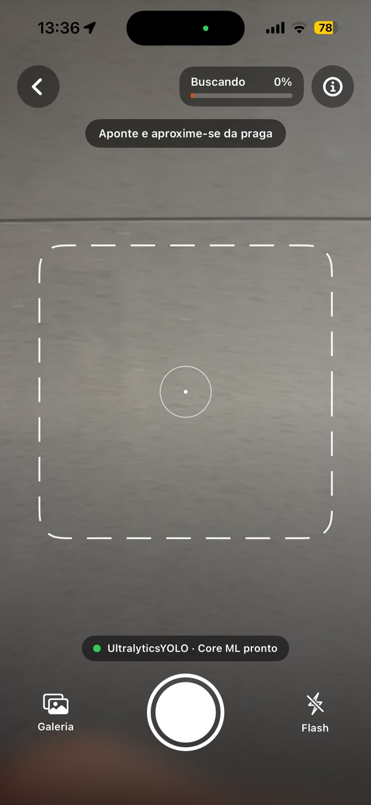

**Objetivo do usuário:** enquadrar o fruto e obter uma foto analisável.  
**Signos principais:** orientação “Aponte e aproxime-se da praga”, moldura de enquadramento, barra de confiança (“Buscando 0%”), situação do modelo (“Core ML pronto”), botão de captura, galeria e flash.  
**Origem no MoLIC:** M02, cena S2 (preparar a evidência visual) e início do processamento P1; O02. O resultado da análise (S3, O03) não aparece nesta captura.

### F03 — Histórico

**Objetivo do usuário:** conferir as inspeções já registradas, por dia e por talhão.  
**Signos principais:** período do filtro (“Últimos 14 dias”), quantidade de registros, talhão, número de ácaros detectados, data e hora, etiqueta “EXEMPLO” nos dados de demonstração e marcador de localização.  
**Origem no MoLIC:** M02, cena S5 (conferir a preservação do registro) — cobertura parcial; M03, cena S4 (avaliar o talhão pelas fotos) — cobertura parcial no M03.

### F04 — Mapa

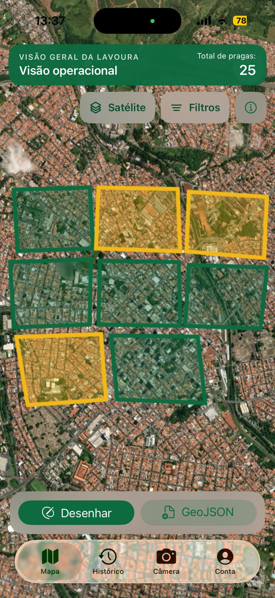

**Objetivo do usuário:** ver a situação dos talhões na fazenda.  
**Signos principais:** “Total de pragas”, talhões desenhados sobre a imagem de satélite com cor por nível (verde e amarelo nesta captura), filtros, camada de satélite, ajuda e os botões “Desenhar” e “GeoJSON” para cadastrar talhões.  
**Origem no MoLIC:** M02 sem cena correspondente nesta captura (não mostra pontos planejados nem pendentes, que seriam S1 e S6); M03, cena S3 (escolher o talhão) — cobertura parcial no M03; “Desenhar” e “GeoJSON” pertencem ao cadastro de talhões, não à revisão do ciclo.

### F05 — Conta

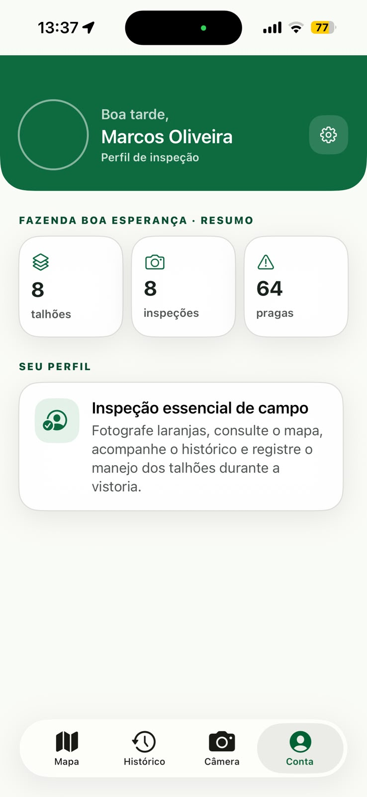

**Objetivo do usuário:** conferir com qual perfil está usando o aplicativo e ver o resumo da fazenda.  
**Signos principais:** nome do usuário, “Perfil de inspeção”, resumo da fazenda (8 talhões, 8 inspeções e 64 pragas) e descrição do que o perfil permite fazer.  
**Origem no MoLIC:** apoio a M02 e M03; não corresponde a uma cena específica.

### F06 — Relatórios (perfil administrador)

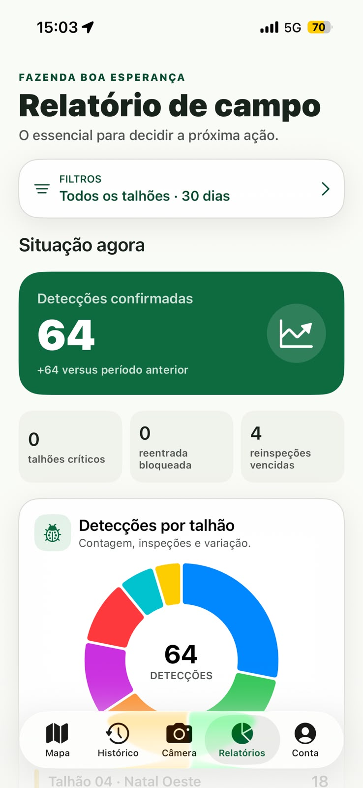

**Objetivo do usuário:** entender a situação da fazenda no período e decidir a próxima ação.  
**Signos principais:** filtro de talhões e período (“Todos os talhões · 30 dias”), “Detecções confirmadas” com a variação em relação ao período anterior, indicadores de talhões críticos, reentrada bloqueada e reinspeções vencidas, e o gráfico “Detecções por talhão”, seguido da lista de talhões com contagem.  
**Origem no MoLIC:** M03, cenas S1 (conhecer o ciclo), S3 (escolher o talhão) e S5 (acompanhar a evolução), todas com cobertura parcial; O07 e O09. O06 (alcance do ciclo) não é atendido, porque a tela não mostra talhões não inspecionados.

## Fluxo do agrônomo (M01) — telas FA

O aplicativo não tem perfil de agrônomo. O fluxo de M01 é proposto como aplicação web acessada pelo computador (ver Registro de mudanças de escopo, 22/10/2026), por dois motivos: o CTT T07 (Entrega 5) indica que foto, zoom e histórico precisam estar acessíveis na mesma tela, o que a tela de celular do protótipo em papel não permitia; e a hipótese de que P03 analisa os pedidos no escritório (Entrega 3; ainda não confirmada, pois P03 é proto-persona). O uso em celular durante visitas à propriedade continua como hipótese (Entrega 8). Para não colidir com as telas do aplicativo (F01–F06), as telas do agrônomo usam o prefixo **FA**, e os estados recebem uma letra após o número.

As telas FA foram produzidas no Figma a partir do MoLIC M01 e do protótipo em papel da Entrega 6 (A01 → FA01, A02 → FA02, A03 → FA03, A05 → FA05, A06 → FA06, A07 → FA07). Na passagem do papel (formato de celular) para o Figma (layout de computador), a navegação foi para um menu lateral fixo com “Pedidos de parecer” e “Histórico”, e FA03 passou a mostrar, junto da foto ampliável, as detecções anteriores do ponto, sem obrigar a trocar de tela para consultar o histórico. Os dados das telas são fictícios, e nenhuma funcionalidade técnica está integrada: o veredito, o pedido de nova foto, a delimitação da área e o envio do parecer são simulados por links entre quadros. A foto original é representada por uma ilustração no lugar da foto real, e as telas usam a fonte Inter. O fluxo depende das hipóteses H04, H07 e H22 e da questão Q7 do C03 (ver MoLIC M01); P03 é proto-persona.

### FA01 — Pedidos de parecer

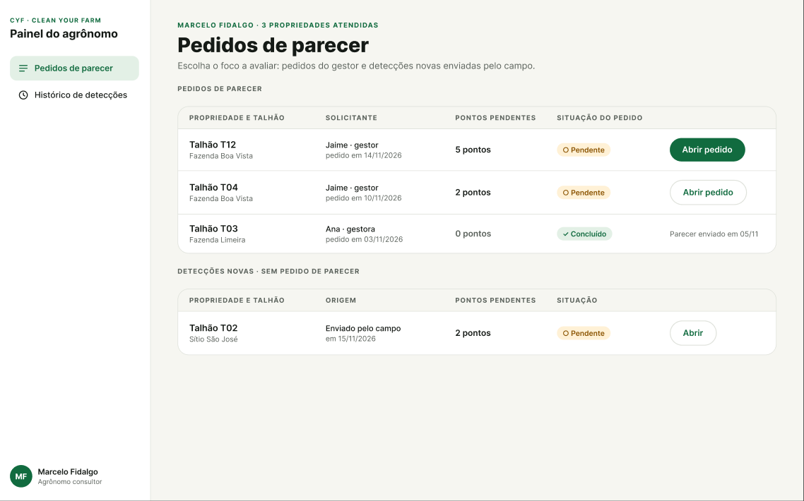

**Objetivo do usuário:** saber o que aguarda avaliação: pedidos de parecer do gestor e detecções novas sem pedido, enviadas pelo campo (O13).  
**Signos principais:** pedido de parecer, propriedade, talhão, solicitante, pontos pendentes, situação do pedido (pendente ou concluído); detecções novas sem pedido, em lista separada, com a origem.  
**Origem no MoLIC:** M01/S1 (Saber o que aguarda avaliação), ponto de abertura e retorno de P5.  
**Divergência de vocabulário:** o subtítulo da tela diz “Escolha o foco a avaliar”. Pela Entrega 9, “foco” designa só região com pontos confirmados pelo agrônomo; em FA01 ainda não há veredito. A captura é a versão avaliada nas Entregas 13 e 14 e não foi alterada; na próxima versão, o subtítulo deve falar em pedidos e detecções a avaliar.

#### FA01V — Nenhum pedido

Estado vazio de S1: nenhum pedido de parecer nem detecção nova nas propriedades atendidas.

#### FA01C — Parecer enviado

Retorno de P5: mensagem “parecer enviado ao gestor” e o pedido marcado como “concluído” na lista (O19).

### FA02 — Mapa do talhão

**Objetivo do usuário:** ver onde estão os pontos com detecção e quantos faltam validar (O13, O14).  
**Signos principais:** talhão, ponto, situação da validação (○ pendente, ● confirmado, × rejeitado, com legenda fixa), detecção anterior, contagem por situação; ações “emitir parecer”, “ver histórico do talhão” e “encerrar revisão”.  
**Origem no MoLIC:** M01/S2 (Examinar o talhão).

#### FA02V — Ponto validado

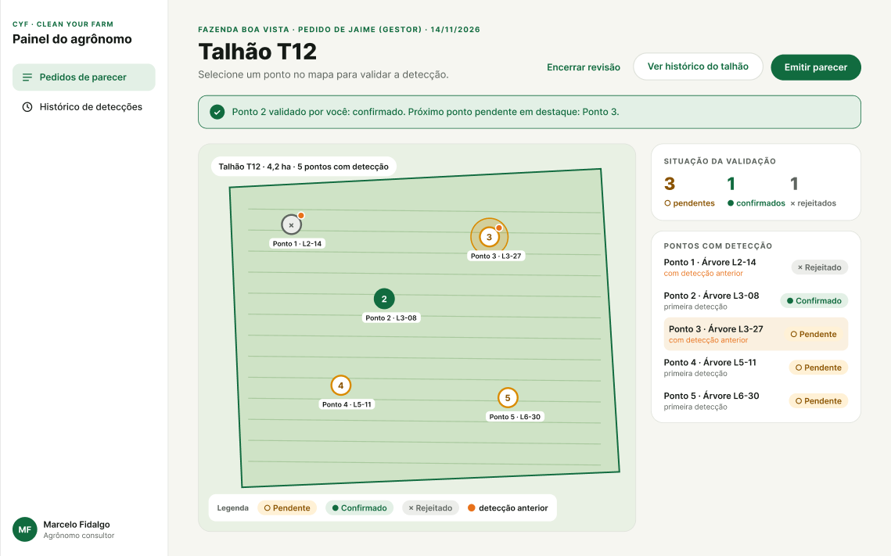

Retorno de P1: mensagem “ponto validado por você” e o próximo ponto pendente em destaque.

#### FA02R — Retorno à revisão

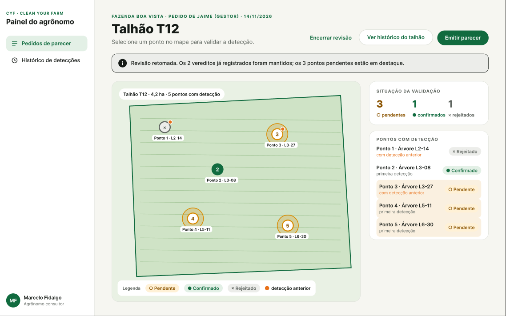

Revisão retomada depois de encerrada ou de troca de pedido: vereditos já registrados mantidos e pontos ainda pendentes em destaque.

#### FA02N — Pedido de nova foto enviado

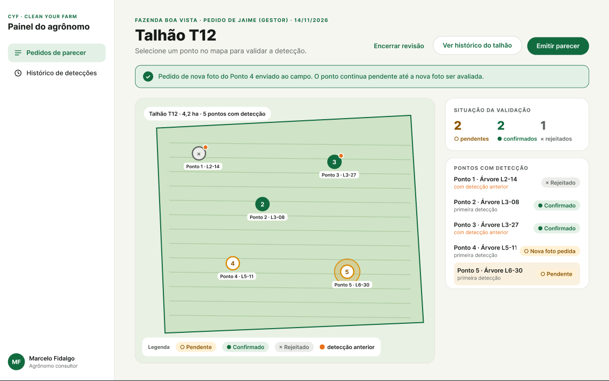

Retorno de P2: mensagem “pedido de nova foto enviado ao campo; o ponto continua pendente” (O16).

### FA03 — Detecção do ponto

**Objetivo do usuário:** decidir se confirma, rejeita ou pede nova foto (O14).  
**Signos principais:** foto do fruto (rótulo na tela: “Foto original”; no protótipo, ilustração no lugar da foto), data e hora da captura, árvore, local do achado, detecções anteriores do ponto (até 3) com “ver histórico deste ponto”, detectado pela IA, avaliação da IA (recolhida), veredito (confirmar, rejeitar ou pedir nova foto), validado por, observação técnica (até 500 caracteres, com contador). Ação: “Ampliar foto” (leva a FA03A).  
**Origem no MoLIC:** M01/S3 (Validar a detecção).  
**Autoria do veredito (registro histórico):** “validado por” aparece nos dados da captura e no histórico (FA05), mas a lista “detecções anteriores do ponto” mostra só “Confirmado” ou “Rejeitado”, sem autor. No teste da Entrega 14, U03 não soube dizer se o veredito era da IA ou do agrônomo (AU01). Esta é a versão anterior à correção e foi mantida como avaliada; a próxima versão deve indicar, em cada veredito, quem validou, quando e que se trata de validação humana, separada da avaliação da IA.

#### FA03A — Foto ampliada e avaliação da IA aberta

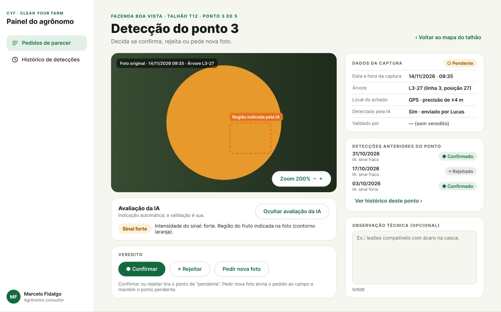

Foto ampliada com a avaliação da IA aberta: intensidade do sinal em texto (“sinal forte” ou “sinal fraco”), região do fruto indicada e o aviso “indicação automática; a validação é sua”.

#### FA03E — Falha ao registrar

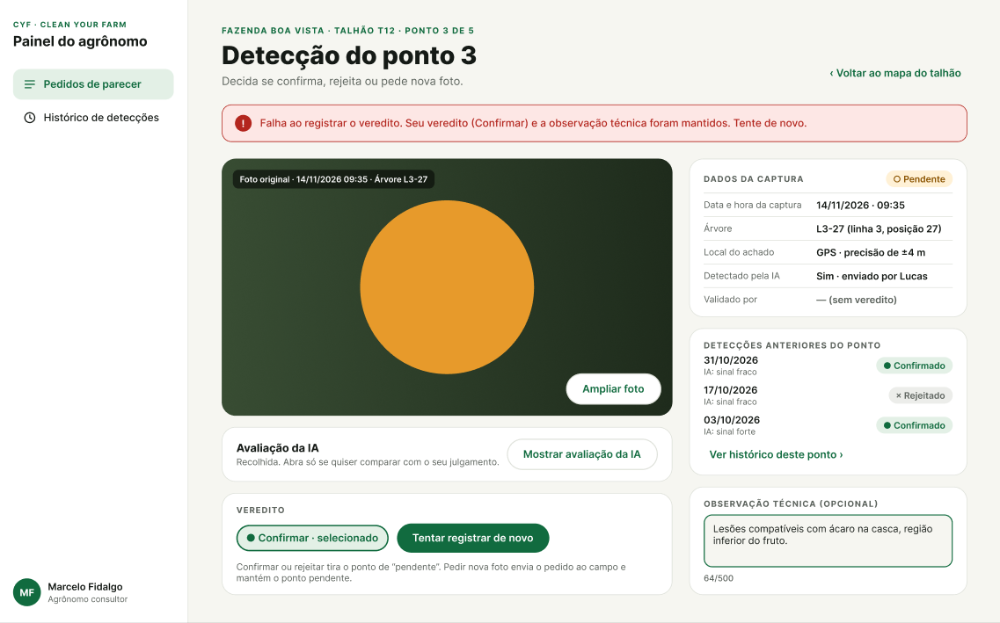

Falha em P1 ou P2: “falha ao registrar o veredito” ou “falha ao enviar o pedido de nova foto”, com o veredito e a observação técnica mantidos para tentar de novo.

### FA05 — Histórico de detecções

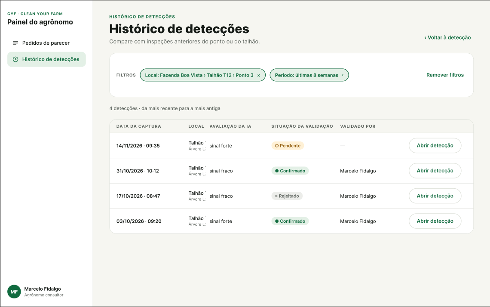

**Objetivo do usuário:** comparar com inspeções anteriores do ponto ou do talhão (O15).  
**Signos principais:** histórico de detecções, período (padrão: últimas 8 semanas, decisão provisória), local do filtro (ponto, talhão ou sem filtro, conforme a origem, sempre visível e removível), avaliação da IA, situação da validação e validado por em cada linha, “abrir detecção”. Na tela, a coluna “Local” da tabela aparece cortada; o local completo fica visível no filtro ativo.  
**Origem no MoLIC:** M01/S5 (histórico de detecções) e P3.

#### FA05V — Nenhuma detecção no período

Retorno de P3 sem resultados: “nenhuma detecção no período”, com sugestão de ampliar o período e os filtros mantidos.

### FA06 — Área de aplicação

**Objetivo do usuário:** delimitar a área com os pontos confirmados e informar produto, dose e período (O17).  
**Signos principais:** pontos confirmados (só eles aparecem como base), aviso de pontos pendentes (não bloqueia), lista dos pontos confirmados na área (marcável, alternativa ao desenho), área de aplicação (em ha, calculada pelo desenho), produto, dose, período de aplicação; “‹ Voltar” e “Voltar ao mapa do talhão” levam a FA02 para validar o restante, e “Continuar” leva a FA07.  
**Origem no MoLIC:** M01/S6 e P4.  
**Decisão provisória:** exigir ao menos um ponto confirmado e produto, dose e período preenchidos depende de H07 e da Q7 do C03, ainda abertas (ver M01).

#### FA06E — Área ou campos inválidos

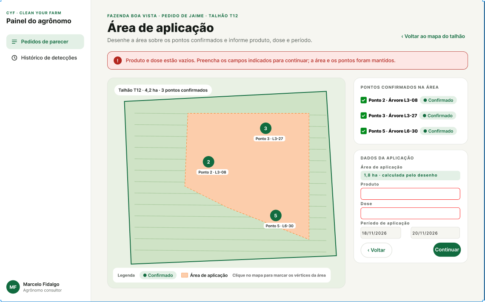

Retorno de P4: “nenhum ponto confirmado na área” ou “produto, dose ou período vazios”, com o que já foi preenchido mantido. Na tela, o aviso diz em texto quais campos estão vazios (produto e dose), e esses campos aparecem com borda vermelha.

### FA07 — Parecer técnico

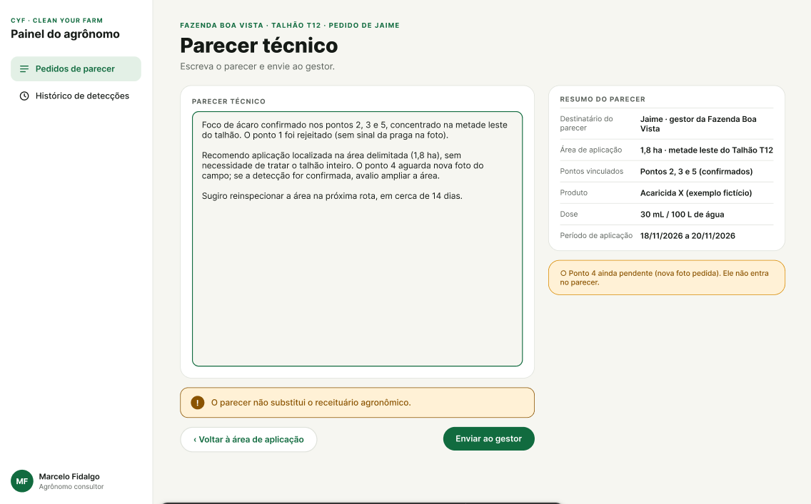

**Objetivo do usuário:** escrever e enviar o parecer ao gestor (O18).  
**Signos principais:** parecer técnico, área de aplicação, pontos vinculados, destinatário do parecer, aviso “o parecer não substitui o receituário agronômico”, “voltar” (para FA06, sem perder o texto) e “enviar”.  
**Origem no MoLIC:** M01/S7 e P5. O destinatário do parecer (o gestor) depende de H04, ainda aberta.

#### FA07E — Falha no envio

Falha em P5: “falha no envio; parecer mantido para reenviar”. O pedido continua “pendente” em FA01 até o envio dar certo. Este estado foi desenhado, mas não está ligado ao caminho navegável do protótipo: “Enviar ao gestor” leva direto a FA01C (ver Entrega 12, seção “Diferenças entre o planejado e o protótipo FA”). Portanto, a recuperação da falha no envio foi prototipada só visualmente e não é testável; na Entrega 14, a compreensão após falha não foi avaliada (MU08 adaptada). O estado não foi ligado agora para manter o protótipo igual à versão inspecionada e testada.

> FA04 (pedir nova foto) e FA08 (situação do parecer) foram retiradas, assim como A04 e A08 no protótipo em papel (Entrega 6): o pedido de nova foto é um botão em FA03, e a situação do parecer aparece em FA01.

## Sistema visual e consistência

| Elemento | Regra adotada | Justificativa |
|---|---|---|
| Tipografia | Fonte do sistema do iPhone, com títulos grandes e em peso forte e rótulos de seção pequenos, em maiúsculas. | Leitura rápida em campo, sob luz forte, e hierarquia clara entre título e conteúdo. |
| Cores | Verde escuro como cor principal, fundo claro, laranja para detecções e ações de destaque; verde, amarelo e vermelho para o nível de cada talhão. | Contraste alto sobre fundo claro e semântica de nível igual no mapa e nos relatórios. |
| Componentes | Cartões brancos com cantos arredondados, botões em formato de pílula e barra inferior com as mesmas abas em todas as telas. | Consistência: o mesmo componente se comporta do mesmo modo em qualquer tela. |
| Feedback | Barra de confiança e mensagem de orientação na câmera, aviso de conta pronta no acesso e etiqueta “EXEMPLO” nos dados de demonstração. | Manter visível o estado do sistema e separar dado de demonstração de dado real. |
| Telas FA (web) | Mesmas cores e cartões do aplicativo, em layout de computador e fonte Inter; menu lateral fixo com “Pedidos de parecer” e “Histórico”; situação da validação sempre com símbolo, texto e cor (○ pendente, ● confirmado, × rejeitado). | Acesso ubíquo de M01 a S1 e S5; mesma semântica de cor dos outros fluxos; situação legível sem depender da cor. |
| Feedback (FA) | Mensagem no topo após cada processamento (P1 a P5), em verde para sucesso e vermelho para falha, sempre com texto; em falha, os dados digitados permanecem na tela. | Cada retorno e ruptura de M01 tem feedback e recuperação, sem perder o trabalho feito. |

## Verificação de acessibilidade básica

Verificação feita apenas pelas capturas, sem teste com tecnologias assistivas.

- **Tamanho de alvo:** o botão de captura, os botões de entrada e as abas inferiores são grandes e ficam na área do polegar.
- **Contraste:** texto escuro sobre fundo claro nas telas de acesso, histórico e conta. Os rótulos sobre a imagem da câmera e do mapa usam fundo escuro ou verde próprio.
- **Informação além da cor:** no Histórico, a contagem aparece em texto. No Mapa, o nível dos talhões aparece nesta captura só pela cor da borda e do preenchimento, sem número nem rótulo visível em cada talhão. É um ponto a conferir na inspeção heurística.
- **A verificar:** leitor de tela (VoiceOver), ampliação de texto e uso sob sol forte.

**Telas FA (web, WCAG 2.2).** Verificação feita no Figma, sem teste com tecnologias assistivas.

- **Contraste (1.4.3):** textos e botões ficam entre 5,1:1 e 6,6:1 (cinza sobre fundo claro, verde, âmbar, vermelho e branco sobre verde). Exceção: o laranja das detecções (“com detecção anterior”, “Região indicada pela IA” e o rótulo da área de aplicação) tem 3,1:1 com o branco e não atinge 4,5:1. É um ponto a corrigir na próxima versão; foi mantido na versão usada no teste da Entrega 14, que é a mesma inspecionada na Entrega 13 (decisão de 15/11/2026, registrada em `RASTREABILIDADE.md`).
- **Uso da cor (1.4.1):** a situação da validação e a situação do pedido aparecem com símbolo e texto, além da cor.
- **Texto alternativo (1.1.1):** a foto traz uma legenda com data, hora e árvore (“Foto original · 14/11/2026 09:35 · Árvore L3-27”), que serve de base para o texto alternativo na implementação.
- **Teclado e foco (2.1.1, 2.4.7):** veredito, enviar e os filtros do histórico têm ordem de foco definida e foco visível. A delimitação da área sobre o mapa depende do mouse; a alternativa por teclado é marcar os pontos confirmados na lista de FA06. Os controles seguem a ordem de leitura da tela; o estado de foco visível não foi desenhado no Figma e fica para a próxima versão, pois o teste da Entrega 14 é feito com mouse.
- **Tamanho de alvo (2.5.8):** botões e pontos do mapa com pelo menos 24 × 24 px.
- **Identificação de erros (3.3.1):** FA03E, FA06E e FA07E dizem em texto o que falhou; em FA06E, o aviso nomeia os campos vazios, e eles aparecem com borda vermelha.

## Pontos observados nas capturas

- O Mapa mostra “Total de pragas: 25”, enquanto a Conta mostra “64 pragas” e a aba Relatórios mostra “64 detecções confirmadas” para a mesma fazenda. Pela leitura do código, o Mapa conta apenas as detecções posteriores à última pulverização de cada talhão. A diferença deve ser avaliada na inspeção heurística (Entrega 12, QA17).
- A foto do perfil não aparece na tela Conta (círculo vazio).
- Na Câmera, “Buscando 0%” não diz o que a porcentagem mede: pode ser lida como confiança da detecção, progresso da análise, qualidade do enquadramento ou chance de haver praga. Pela Entrega 12, a captura exige confiança maior ou igual a 85%, mas a tela não mostra esse limite nem o que acontece abaixo dele. Registrado em 22/11/2026 para a próxima versão e para a avaliação (se o usuário entende o valor); a captura desta entrega não foi alterada.
- Nas telas usadas pelo gestor, “Total de pragas”, “pragas”, “ácaros detectados” e “Detecções confirmadas” não seguem o vocabulário da Entrega 9, em que **detecção** é a indicação automática ainda sem veredito humano. “Confirmadas” pode ser lido como validação humana. Se os números medem coisas diferentes (25 e 64), os rótulos precisam dizer o período e o critério de cada um. Registrado em 20/11/2026 para a próxima versão; as capturas desta entrega não foram alteradas.
- Na aba Relatórios, as cores do gráfico “Detecções por talhão” (azul, verde, vermelho, roxo e outras) identificam talhões, e não o nível de cada um. O vermelho do gráfico pode ser lido como talhão crítico, embora o indicador mostre zero talhões críticos.

## Pendências após o feedback

| Responsável | Pendência |
|---|---|
| Pedro | Concluído na revisão de 20/11/2026: cobertura do M03 cena por cena, situação parcial declarada na tabela e no checklist, origem das telas F03, F04 e F06 ajustada e divergência de vocabulário registrada. As telas que faltam (S2, S6–S8) ficam para a próxima iteração do protótipo. |
| Lucas | Concluído na revisão de 22/11/2026: cobertura do M02 cena por cena, situação parcial declarada na tabela e no checklist, origem das telas F02, F03 e F04 ajustada e significado da porcentagem da câmera registrado em Pontos observados. Os estados de resultado, localização, salvamento e erro da câmera ficam para a próxima iteração do protótipo. |
| Guilherme | Concluído na revisão de 22/11/2026: nome do M01 corrigido na tabela; FA01 e FA02R sem “foco” antes do veredito (divergência do subtítulo de FA01 registrada); signos e cenas conferidos com o M01 revisado; decisões provisórias de P03 marcadas em FA05, FA06 e FA07; FA07E declarado fora do caminho navegável, com a recuperação da falha no envio não testável; ambiguidade de autoria do veredito (AU01) registrada em FA03 para a próxima versão. |
| Equipe | Preservar no repositório da disciplina a referência à versão avaliada do aplicativo (commit), sem depender só do link externo; padronizar praga/detecção/detecção confirmada nas telas. |

## Checklist

- [x] Link do Figma está acessível. — protótipo do agrônomo (telas FA) no Figma; telas do aplicativo no repositório público.
- [x] Há screenshots representativos no repositório.
- [ ] Todos os MoLIC relevantes estão cobertos. — M01: cobertura muito alta pelas telas FA01–FA07 e seus estados; a recuperação da falha no envio (FA07E) só existe como tela desenhada. M03: cobertura parcial (S2, S6, S7, S8, processamentos e rupturas sem tela; ver seção cena por cena). M02: cobertura parcial (só S2 coberta e S5 parcial; ver seção cena por cena).
- [x] A cobertura do M02 e do M03 foi verificada cena por cena, com lacunas declaradas.
- [x] Estados de erro, feedback e recuperação foram prototipados. — no aplicativo e nas telas FA (FA02V, FA02N, FA03E, FA05V, FA06E, FA07E); FA07E só no sentido visual, fora do caminho navegável.
- [ ] Terminologia/signos são consistentes com Entrega 9. — não nas telas do gestor: “pragas” e “detecções confirmadas” divergem do vocabulário (ver Pontos observados). Nas telas FA, os signos seguem a Entrega 9, exceto o subtítulo de FA01 (“foco” antes do veredito) e o rótulo “Foto original” para o signo foto do fruto.
- [x] Componentes equivalentes se comportam de forma consistente.
- [x] Fluxos críticos são clicáveis do início ao fim. — aplicativo funcional, mas só nas partes que existem nele: o repasse de M02 e a posição, a decisão e o repasse de M03 não existem e não podem ser percorridos; caminho principal das telas FA ligado no protótipo do Figma; o estado de falha no envio (FA07E) está desenhado, mas fora do caminho navegável, e a recuperação dessa falha não é testável.
- [x] O protótipo está pronto para inspeção e testes, sem “links mortos” nas tarefas avaliadas.
- [x] Dashboards, relatórios, históricos, filtros, administração e CRUDs presentes possuem justificativa rastreável.
- [x] Estados de vazio, processamento, erro e recuperação foram considerados quando pertinentes.
- [x] Resultados técnicos são apresentados de forma interpretável para o perfil de usuário.
- [x] A equipe distingue no protótipo o que é interação simulada e o que é funcionalidade técnica realmente integrada, quando necessário. — conta de teste e dados marcados como “EXEMPLO” no aplicativo; nas telas FA, dados fictícios e interações simuladas por links entre quadros.
