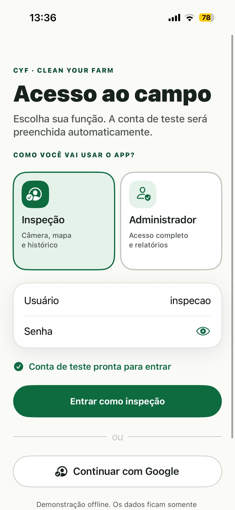
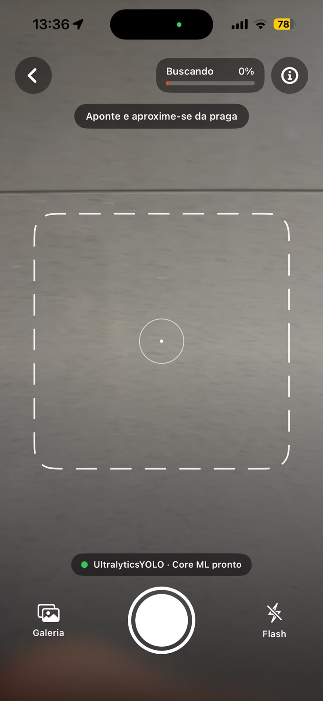
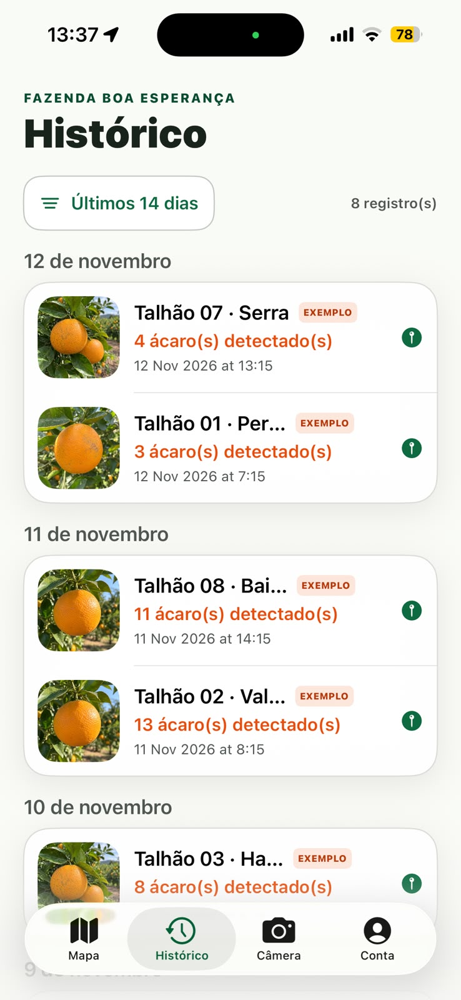
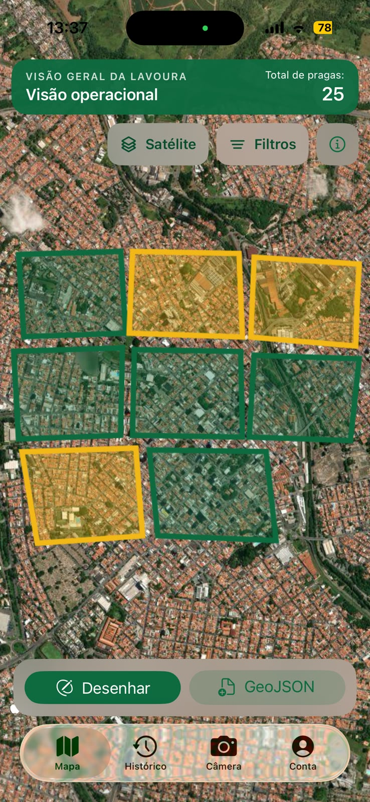
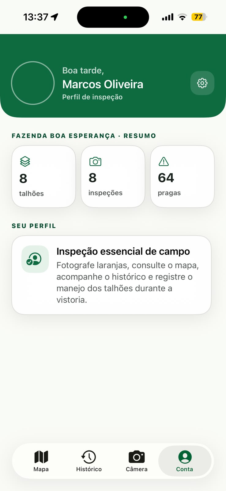
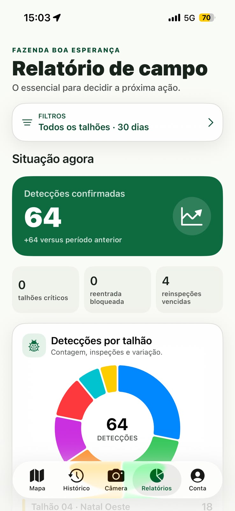

# Entrega 11 — Protótipo no Figma

**Data:** 14/11/2026  
**Status:** 🟨 em andamento — telas principais dos dois perfis documentadas; faltam capturas de detalhes e estados e a revisão da equipe.  
**Responsabilidade:** 1 protótipo integrado por equipe cobrindo os fluxos MoLIC. Se a turma exigir divisão individual, identifique o responsável por cada fluxo/tela.

## Objetivo da atividade

Materializar o modelo de interação em um protótipo navegável, preservando a lógica dos objetivos, tópicos, signos, feedbacks, alternativas e recuperações definidos anteriormente.

## Protótipo adotado

A equipe não produziu um protótipo no Figma. A interação foi materializada diretamente no aplicativo funcional **CYF — Clean Your Farm** para iPhone, que já existia quando esta entrega foi iniciada. As telas abaixo são capturas do aplicativo em execução, e é essa versão que será usada na inspeção e nos testes das Entregas 12 a 14.

## Link do Figma

**Protótipo:** não há protótipo no Figma; o protótipo é o aplicativo funcional.  
**Arquivo editável:** código-fonte em <https://github.com/Cabral100/App_Orange_Box>, pasta `ios-native/`.  
**Última verificação de permissão:** 14/11/2026 (repositório público).

## Cobertura MoLIC → Figma

Como não há Figma, a tabela relaciona cada MoLIC às telas do aplicativo. As telas F01 a F06 têm captura nesta entrega; as demais estão listadas em “Capturas que faltam”.

| MoLIC | Objetivo | Fluxo/telas no aplicativo | Estados de erro/recuperação | Responsável |
|---|---|---|---|---|
| M02 — Inspecionar a rota e repassar os achados | O01–O05 | `F01 → F02 → F03`, com consulta a `F04` e `F05` | Na câmera: confiança baixa, localização desativada e falha ao salvar a imagem, com mensagem e nova tentativa. Sem captura nesta entrega. | {{Lucas}} |
| M03 — Revisar o ciclo e decidir o manejo por talhão | O06–O11 | `F01 → F06 → F04 → F03`. A aba Relatórios (F06) só aparece no perfil administrador. | Não há estados de falha específicos do gestor no aplicativo. As diferenças em relação ao M03 estão registradas na Entrega 12. | Pedro |
| M01 — {{objetivo do agrônomo}} | {{IDs}} | O aplicativo não tem perfil de agrônomo. | {{...}} | {{Guilherme}} |

## Catálogo de telas/estados

### F01 — Acesso ao campo

**Objetivo do usuário:** entrar no aplicativo escolhendo como vai usá-lo: “Inspeção” (câmera, mapa e histórico) ou “Administrador” (acesso completo e relatórios).  
**Signos principais:** função escolhida, usuário e senha da conta de teste, aviso “Conta de teste pronta para entrar” e aviso de demonstração offline.  
**Origem no MoLIC:** ponto de abertura de M02 (perfil de inspeção) e de M03 (perfil administrador).

### F02 — Câmera

**Objetivo do usuário:** enquadrar o fruto e obter uma foto analisável.  
**Signos principais:** orientação “Aponte e aproxime-se da praga”, moldura de enquadramento, barra de confiança (“Buscando 0%”), situação do modelo (“Core ML pronto”), botão de captura, galeria e flash.  
**Origem no MoLIC:** M02, cena S2 (preparar a foto) e processamento da análise; O02 e O03.

### F03 — Histórico

**Objetivo do usuário:** conferir as inspeções já registradas, por dia e por talhão.  
**Signos principais:** período do filtro (“Últimos 14 dias”), quantidade de registros, talhão, número de ácaros detectados, data e hora, etiqueta “EXEMPLO” nos dados de demonstração e marcador de localização.  
**Origem no MoLIC:** M02, cenas S5 e S6 (confirmar o registro e conferir a rota); M03, cena S4 (avaliar o talhão pelas fotos).

### F04 — Mapa

**Objetivo do usuário:** ver a situação dos talhões na fazenda.  
**Signos principais:** “Total de pragas”, talhões desenhados sobre a imagem de satélite com cor por nível (verde e amarelo nesta captura), filtros, camada de satélite, ajuda e os botões “Desenhar” e “GeoJSON” para cadastrar talhões.  
**Origem no MoLIC:** M02, cena S6 (conferir a rota); M03, cena S3 (escolher o talhão).

### F05 — Conta

**Objetivo do usuário:** conferir com qual perfil está usando o aplicativo e ver o resumo da fazenda.  
**Signos principais:** nome do usuário, “Perfil de inspeção”, resumo da fazenda (8 talhões, 8 inspeções e 64 pragas) e descrição do que o perfil permite fazer.  
**Origem no MoLIC:** apoio a M02 e M03; não corresponde a uma cena específica.

### F06 — Relatórios (perfil administrador)

**Objetivo do usuário:** entender a situação da fazenda no período e decidir a próxima ação.  
**Signos principais:** filtro de talhões e período (“Todos os talhões · 30 dias”), “Detecções confirmadas” com a variação em relação ao período anterior, indicadores de talhões críticos, reentrada bloqueada e reinspeções vencidas, e o gráfico “Detecções por talhão”, seguido da lista de talhões com contagem.  
**Origem no MoLIC:** M03, cenas S1 (conhecer o ciclo), S3 (escolher o talhão) e S5 (acompanhar a evolução); O06, O07 e O09.

### Capturas que faltam

- **Restante da aba Relatórios:** lista completa de talhões, seção de pulverização e carência, armadilhas e o botão de exportar o relatório em PDF.
- **Detalhe do talhão no mapa:** resumo do talhão e registro de pulverização.
- **Detalhe da inspeção:** foto ampliada e talhão associado.
- **Estados da câmera:** detecção com confiança, “Imagem capturada” e as mensagens de confiança baixa e de localização desativada.
- **Filtros** do Histórico e do Mapa, incluindo período sem registros.

> Documente também estados que muitas equipes esquecem: carregamento, vazio, confirmação, sucesso, erro, permissão negada, cancelamento, desfazer/voltar quando aplicável.

## Sistema visual e consistência

| Elemento | Regra adotada | Justificativa |
|---|---|---|
| Tipografia | Fonte do sistema do iPhone, com títulos grandes e em peso forte e rótulos de seção pequenos, em maiúsculas. | Leitura rápida em campo, sob luz forte, e hierarquia clara entre título e conteúdo. |
| Cores | Verde escuro como cor principal, fundo claro, laranja para detecções e ações de destaque; verde, amarelo e vermelho para o nível de cada talhão. | Contraste alto sobre fundo claro e semântica de nível igual no mapa e nos relatórios. |
| Componentes | Cartões brancos com cantos arredondados, botões em formato de pílula e barra inferior com as mesmas abas em todas as telas. | Consistência: o mesmo componente se comporta do mesmo modo em qualquer tela. |
| Feedback | Barra de confiança e mensagem de orientação na câmera, aviso de conta pronta no acesso e etiqueta “EXEMPLO” nos dados de demonstração. | Manter visível o estado do sistema e separar dado de demonstração de dado real. |

## Verificação de acessibilidade básica

Verificação feita apenas pelas capturas, sem teste com tecnologias assistivas.

- **Tamanho de alvo:** o botão de captura, os botões de entrada e as abas inferiores são grandes e ficam na área do polegar.
- **Contraste:** texto escuro sobre fundo claro nas telas de acesso, histórico e conta. Os rótulos sobre a imagem da câmera e do mapa usam fundo escuro ou verde próprio.
- **Informação além da cor:** no Histórico, a contagem aparece em texto. No Mapa, o nível dos talhões aparece nesta captura só pela cor da borda e do preenchimento, sem número nem rótulo visível em cada talhão. É um ponto a conferir na inspeção heurística.
- **A verificar:** leitor de tela (VoiceOver), ampliação de texto e uso sob sol forte.

## Pontos observados nas capturas

- O Mapa mostra “Total de pragas: 25”, enquanto a Conta mostra “64 pragas” e a aba Relatórios mostra “64 detecções confirmadas” para a mesma fazenda. Pela leitura do código, o Mapa conta apenas as detecções posteriores à última pulverização de cada talhão. A diferença deve ser avaliada na inspeção heurística (Entrega 12, QA17).
- A foto do perfil não aparece na tela Conta (círculo vazio).
- Na aba Relatórios, as cores do gráfico “Detecções por talhão” (azul, verde, vermelho, roxo e outras) identificam talhões, e não o nível de cada um. O vermelho do gráfico pode ser lido como talhão crítico, embora o indicador mostre zero talhões críticos.

## Checklist

- [ ] Link do Figma está acessível. — não se aplica: o protótipo é o aplicativo; o repositório é público.
- [x] Há screenshots representativos no repositório.
- [ ] Todos os MoLIC relevantes estão cobertos. — M02 e M03 cobertos pelas telas principais; M01 sem perfil no aplicativo.
- [ ] Estados de erro, feedback e recuperação foram prototipados. — existem no aplicativo, mas ainda sem captura.
- [ ] Terminologia/signos são consistentes com Entrega 9. — a conferir pela equipe.
- [x] Componentes equivalentes se comportam de forma consistente.
- [ ] Fluxos críticos são clicáveis do início ao fim. — a conferir no aparelho.
- [ ] O protótipo está pronto para inspeção e testes, sem “links mortos” nas tarefas avaliadas. — a conferir no piloto da Entrega 12.
- [ ] Dashboards, relatórios, históricos, filtros, administração e CRUDs presentes possuem justificativa rastreável. — faltam as capturas de filtros, exportação e detalhe do talhão.
- [ ] Estados de vazio, processamento, erro e recuperação foram considerados quando pertinentes.
- [x] Resultados técnicos são apresentados de forma interpretável para o perfil de usuário.
- [x] A equipe distingue no protótipo o que é interação simulada e o que é funcionalidade técnica realmente integrada, quando necessário. — conta de teste e dados marcados como “EXEMPLO”.
