# Entrega 13 — Avaliação de IHC por inspeção heurística

**Data:** 16/11/2026  
**Revisão documental:** 18/11/2026  
**Situação de Lucas:** ✅ inspeção e complementação documental concluídas para o aplicativo e os estados examinados.  
**Revisão após o feedback (A03 — Pedro):** 20/11/2026.  
**Status geral:** 🟨 em revisão após o feedback — parte de A03 revisada (achados só de código separados, V02, V06 e V16 revistos, contagem recalculada e checklist corrigido). Permanecem pendentes da equipe a cobertura cruzada do escopo por avaliador e a reavaliação coletiva das severidades.  
**Responsabilidade:** uma avaliação completa por integrante, sobre todas as telas e estados relevantes do projeto.

## Objetivo da atividade

Encontrar problemas de usabilidade por inspeção sistemática da interface com as **10 heurísticas de Nielsen**.

Cada avaliador realiza a inspeção individualmente. Depois, a equipe compara os registros, consolida duplicidades e define prioridades.

Somente problemas sustentados por evidência são registrados como violações. As matrizes de cobertura apresentam também heurísticas sem violação observada.

## 1. Heurísticas adotadas

1. Visibilidade do status do sistema.
2. Compatibilidade entre o sistema e o mundo real.
3. Controle e liberdade do usuário.
4. Consistência e padrões.
5. Prevenção de erros.
6. Reconhecimento em vez de memorização.
7. Flexibilidade e eficiência de uso.
8. Estética e design minimalista.
9. Ajudar usuários a reconhecer, diagnosticar e recuperar-se de erros.
10. Ajuda e documentação.

### Cobertura especial

Quando existentes, considerar:

- estados normais, vazios, de carregamento e de erro;
- filtros combinados e sem resultados;
- relatórios e exportação;
- Histórico e listas;
- edição, exclusão e validação;
- Acesso, Conta e permissões;
- confirmação de ações com consequências;
- mensagens, termos técnicos e ajuda;
- recuperação após falhas.

A inspeção avalia a comunicação da interface, não a precisão científica do modelo.

## 2. Escopo da inspeção

| Item | Definição |
|---|---|
| Versão de referência | Aplicativo CYF para iPhone, pasta `ios-native/` de <https://github.com/Cabral100/App_Orange_Box>, commit `a36785f`, de 12/11/2026. |
| Versão de Lucas | Aplicativo disponível durante a inspeção. Lucas confirmou Acesso, Conta, filtro do Histórico e comportamento sem GPS em 14/11/2026, na mesma versão que examinou. O registro anterior citava aproximadamente 15/11/2026, às 15h; essa data era uma estimativa. O hash exato da versão adicional não foi anotado. |
| Capturas adicionais | Documentam os estados enviados posteriormente. A data de envio das imagens não é tratada como data da inspeção. |
| Telas do aplicativo | Acesso F01, Câmera F02, Histórico F03, Mapa F04, Conta F05 e Relatórios F06. |
| Estados considerados | Ajuda da câmera, confirmação de captura, detalhe da inspeção, associação ao talhão, filtros, desenho manual, ausência de localização, relatório PDF e ações sobre registros, conforme cobertura individual. |
| Protótipo do agrônomo | Telas FA01–FA03 e FA05–FA07, incluindo estados alternativos. |
| Fluxos | M02 e M03 no aplicativo; M01 no Figma, pois o aplicativo não possui perfil de agrônomo. |
| Dispositivos | Aplicativo em iPhone; protótipo FA em computador. |
| Avaliadores | A01: Lucas Tonoli Cabral Duarte; A02: Guilherme Morais Escudeiro; A03: Pedro Henrique Ferreira Valim. |
| Limitações | Capturas não comprovam todos os comportamentos dinâmicos. Alguns achados de Pedro vieram do código; na revisão de 20/11/2026 eles foram separados como problemas potenciais pendentes de reprodução. A inspeção de Guilherme concentrou-se no protótipo FA. A03 (Pedro) não inspecionou as telas FA. Não há comprovação de que cada avaliador tenha inspecionado individualmente todos os produtos e estados do projeto; o requisito de inspeção completa por integrante **não foi atendido**. |

## 3. Procedimento individual

1. Percorrer os fluxos para conhecer a interface.
2. Examinar telas e estados aplicando H1–H10.
3. Registrar localização, condição, problema e evidência.
4. Justificar severidade pela frequência, impacto e persistência.
5. Formular recomendação relacionada à causa.
6. Explicitar estados não reproduzidos e limites da evidência.

### Severidade

| Grau | Interpretação |
|---:|---|
| 0 | Não constitui problema de usabilidade. |
| 1 | Problema cosmético. |
| 2 | Problema menor. |
| 3 | Problema maior, de alta prioridade. |
| 4 | Catástrofe de usabilidade; correção imperativa. |

## Avaliador A01 — Lucas

**Autor:** Lucas Tonoli Cabral Duarte — 24.123.032-5.  
**Situação:** ✅ parte individual concluída para as seis telas do aplicativo e os estados descritos.

### Procedimento e cobertura

Lucas examinou:

- Acesso e seus controles disponíveis;
- Conta e suas ações disponíveis;
- câmera antes e depois da captura;
- orientação e ajuda da câmera;
- detalhe da inspeção;
- associação da foto ao talhão;
- filtros do Mapa e do Histórico;
- consulta e ações do Histórico: refazer foto, editar informações e excluir imagem;
- desenho manual de talhão;
- montagem, exportação, abertura e compartilhamento do PDF;
- mensagem apresentada quando a localização está indisponível.

A verificação complementar foi confirmada por Lucas como realizada em **14/11/2026**, na mesma versão do aplicativo.

Acesso e Conta foram examinados sem identificação de novas violações. Isso registra o resultado individual de Lucas e não invalida problemas encontrados por outros avaliadores nessas telas.

O PDF foi compartilhado com um funcionário de uma fazenda parceira, que gostou do relatório. O retorno foi informal e não substitui uma sessão sistemática com usuário.

### 4. Matriz de cobertura H1–H10

| Heurística | Telas/estados examinados | Violação? | IDs | Resultado |
|---|---|---|---|---|
| H1 — Status | Acesso, Conta, câmera, confirmação, Histórico, filtros e exportação | Não nos estados observados | — | Porcentagem e orientação visíveis; confirmação de captura; filtro informa quantidade de registros; PDF gerado e aberto. |
| H2 — Mundo real | Acesso, Conta, câmera, ajuda, detalhe e associação | Sim | A01-V01, A01-V02, A01-V04 | Termos de implementação, data em inglês e sigla EXIF sem explicação. |
| H3 — Controle | Acesso, Conta, câmera, associação, Histórico e desenho | Não nos estados observados | — | Retorno, opção “Depois”, ações sobre registros e controles “Desfazer”, “Cancelar” e “Concluir” no desenho. |
| H4 — Consistência | Acesso, Conta, filtros do Mapa/Histórico e relatório | Sim | A01-V03 | Filtros usam cores em vez de nomenclatura única para as situações. |
| H5 — Prevenção | Acesso, Conta, câmera e desenho | Não nos estados observados | — | Captura bloqueada abaixo de 85%; desenho orienta usar pelo menos três pontos. |
| H6 — Reconhecimento | Acesso, Conta, Mapa e Histórico | Não nos estados observados | — | Busca por nome, lista de talhões, períodos visíveis e registros disponíveis para consulta. |
| H7 — Eficiência | Acesso, Conta, câmera, filtros, Histórico e PDF | Não nos estados observados | — | Galeria, ações sobre registros, filtros por período/talhão e exportação. |
| H8 — Minimalismo | Acesso, Conta, câmera, filtros, Histórico e relatório | Não nos estados observados | — | Lucas não identificou excesso impeditivo; câmera mantém área central para enquadramento. |
| H9 — Recuperação | Acesso, Conta, orientação da câmera e ausência de GPS | Não nos estados observados | — | A câmera orienta ajuste da distância; sem localização, mensagem explica a necessidade de ativá-la. |
| H10 — Ajuda | Acesso, Conta, ajuda da câmera e desenho | Não nos estados observados | — | Ajuda explica captura e limiar; desenho informa como marcar os vértices. |

**Limite da matriz:** “nenhuma violação observada” se refere aos estados examinados e não comprova ausência de todas as falhas possíveis.

### 5. Declaração de violações ativas

| ID | H | Tela/estado | Problema | Evidência | Severidade | Justificativa | Recomendação |
|---|---|---|---|---|---:|---|---|
| A01-V01 | H2 | Câmera | “UltralyticsYOLO · Core ML pronto” comunica a implementação, sem traduzir o significado para a tarefa. | Figura 1 | 2 | Aparece na captura frequente; não impede a ação, mas pode ser incompreensível ao trabalhador. | Usar “Pronto para analisar” ou mensagem equivalente. |
| A01-V02 | H2 | Detalhe da inspeção | Data em inglês em interface portuguesa. | Figura 3 | 1 | Mudança de idioma dificulta leitura do registro. | Usar data e hora no padrão local. |
| A01-V03 | H4 | Filtros do Mapa e Histórico | “Verde”, “Amarelo” e “Vermelho” nomeiam situações, enquanto outras telas usam nomes de níveis. | Figuras 4 e 10 | 2 | Exige relacionar cores e significados e conciliar rótulos diferentes. | Adotar nomenclatura única e manter cores como apoio. |
| A01-V04 | H2 | Associação da foto à área | Mensagem usa “coordenadas GPS/EXIF” sem explicar EXIF ou a ação necessária. | Figura 6 | 2 | Termo técnico aparece durante associação do registro ao local. | Explicar que a localização da foto posicionou o mapa e orientar seleção da área. |

### Revisão de A01-V05

**Situação:** reclassificado; não contabilizado como violação ativa.

O registro anterior afirmava ausência de orientação ou recuperação sem GPS. A nova evidência mostra a mensagem:

> “Localização necessária. Ative a localização precisa para salvar a inspeção no ponto correto do mapa.”

Portanto, a alegação de ausência de orientação não se sustenta. A mensagem identifica a condição e informa uma ação de recuperação.

A captura do desenho manual comprova que é possível desenhar um talhão. Ela **não comprova que seja possível salvar uma inspeção sem GPS**.

A01-V05 é preservado neste histórico para documentar a revisão, sem renumerar os demais achados.

### Evidências fotográficas

#### Figura 1 — Câmera com detecção

Estado anterior à captura, com 57% e orientação de distância. Não representa inspeção salva abaixo de 85%.

#### Figura 2 — Confirmação de captura

Feedback de captura permitida e armazenamento no aparelho.

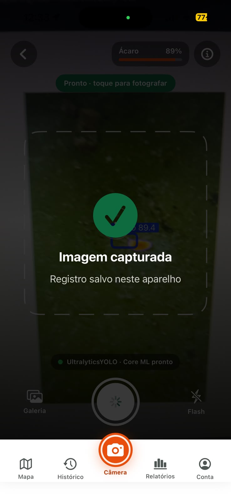

#### Figura 3 — Detalhe da inspeção

A data em inglês fundamenta A01-V02.

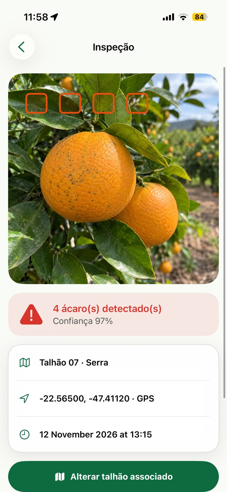

#### Figura 4 — Filtros do Mapa

O campo “Situação” apresenta “Todas”, “Verde”, “Amarelo” e “Vermelho”.

#### Figura 5 — Configuração do relatório

Lucas gerou, abriu e compartilhou o PDF. A imagem documenta a configuração, não o conteúdo integral do arquivo exportado.

#### Figura 6 — Associação da foto à área

A mensagem apresenta a sigla EXIF sem explicação.

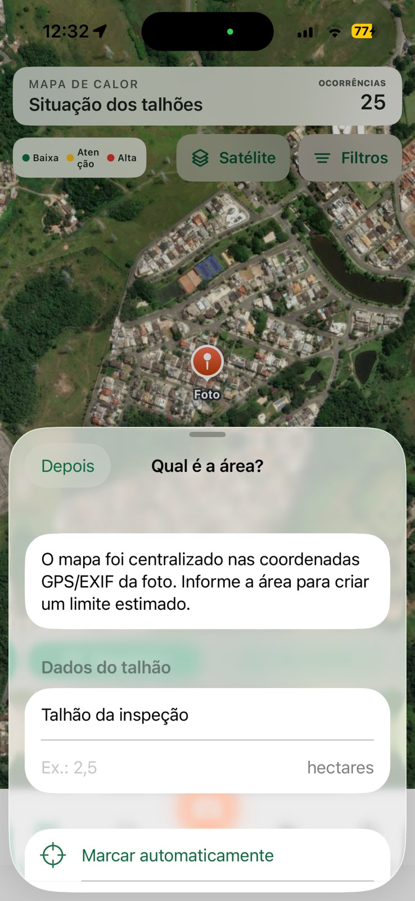

#### Figura 7 — Resultado e alteração do talhão

Controles permitem alterar a associação ou marcar o talhão no mapa.

#### Figura 8 — Localização desligada

A câmera informa que a localização precisa deve ser ativada para salvar a inspeção no ponto correto do mapa.

A imagem sustenta a revisão de A01-V05 e o registro de orientação de recuperação em H9. Não demonstra o comportamento de uma falha da imagem com GPS funcionando.

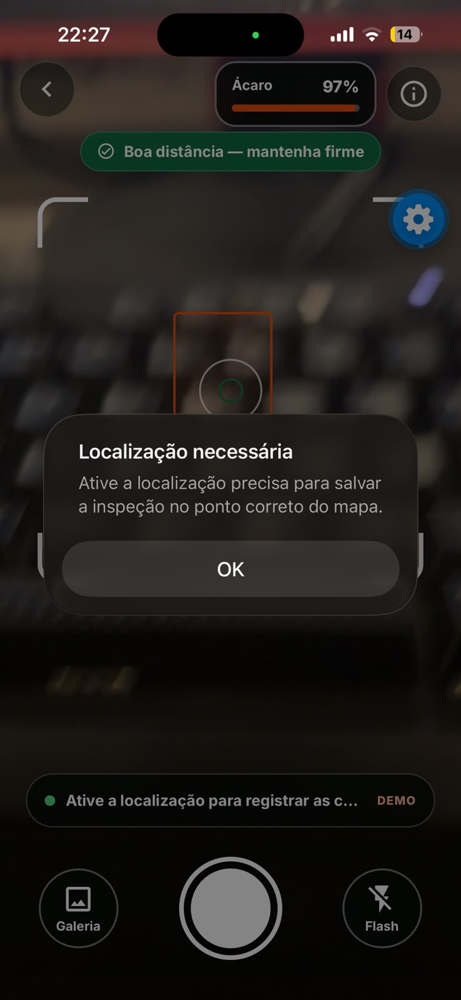

#### Figura 9 — Desenho manual de talhão

O aplicativo apresenta vértices, quantidade de pontos e controles “Desfazer”, “Cancelar” e “Concluir”. A instrução solicita pelo menos três pontos.

Esta evidência comprova o desenho manual do talhão, não o salvamento de inspeção sem localização.

#### Figura 10 — Filtro do Histórico

A tela “Refinar registros” apresenta:

- períodos Hoje, 7 dias, 14 dias e 30 dias;
- busca e seleção de talhão;
- situação Todas, Verde, Amarelo e Vermelho;
- ação “Limpar filtros”;
- quantidade de registros no controle “Ver 13”.

A imagem confirma o escopo de A01-V03 e HC02 no Histórico.

### Captura e estados de recuperação

Não foi possível salvar captura abaixo de 85%, pois o aplicativo bloqueia essa ação e informa o limiar.

As orientações de aproximação e afastamento ajudam a ajustar a captura. Lucas não reproduziu falha depois de seguir essas orientações.

Nos exemplos examinados, Lucas não identificou indicação maior ou igual a 85% que reconhecesse como algo diferente de ácaro. Isso não demonstra ausência de falsos positivos nem valida a precisão do detector.

Sem localização, a mensagem informa que é necessário ativar a localização precisa. O desenho manual do talhão é uma função separada e não elimina essa exigência para salvar a inspeção.

### 6. Boas práticas

| H | Exemplo | Evidência | Justificativa |
|---|---|---|---|
| H1 | Confirmação de captura e armazenamento. | Figura 2 | Comunica conclusão da ação. |
| H3 | Refazer foto, editar informações e excluir imagem; desfazer/cancelar desenho. | Inspeção relatada e Figura 9 | Permite rever registros e corrigir desenho. |
| H5 | Bloqueio abaixo de 85%; desenho exige pelo menos três pontos. | Figura 1, ajuda examinada e Figura 9 | Previne ações fora dos requisitos definidos. |
| H6 | Busca, períodos e lista de talhões. | Figuras 4 e 10 | Permite reconhecer opções sem memorizar códigos. |
| H7 | Galeria, filtros e configuração/exportação de PDF. | Figuras 1, 5 e 10 | Oferece alternativas de entrada, consulta e compartilhamento. |
| H8 | Área central dedicada ao enquadramento. | Figura 1 | Mantém foco na captura. |
| H9 | Mensagem solicita ativar localização precisa. | Figura 8 | Explica a condição e uma ação para prosseguir. |
| H10 | Ajuda explica uso e limiar; desenho orienta marcação. | Inspeção da ajuda e Figura 9 | Orientação contextual para a tarefa. |

### Síntese individual — Lucas

- **Parte individual concluída para o aplicativo e os estados descritos.**
- Quatro violações ativas: três de severidade 2 e uma de severidade 1.
- Três violações de H2 e uma de H4.
- A01-V05 reclassificado após evidência da orientação para ativar localização.
- Acesso e Conta examinados sem novas violações observadas por Lucas.
- Filtro do Histórico confirmado por relato e captura.
- HC01 e HC02 aprovados por Lucas e Pedro com severidade 2.
- PDF gerado e examinado; retorno do funcionário mantido como informal.
- Commit da versão adicional não anotado.
- Não há inspeção individual de Lucas das telas FA registrada neste documento.

## Avaliador A02 — Guilherme

**Autor:** Guilherme Morais Escudeiro — 24.123.005-1.

### Procedimento

Inspeção das telas FA01, FA01V, FA01C, FA02, FA02V, FA02R, FA02N, FA03, FA03A, FA03E, FA05, FA05V, FA06, FA06E, FA07 e FA07E.

O fluxo principal foi percorrido, incluindo Histórico, estados vazios e falhas. Depois, cada tela foi examinada com H1–H10.

Os dados e interações são simulados. Os pontos QA21 da Entrega 12 foram considerados. Os IDs V01–V13 desta seção pertencem a A02.

### 4. Matriz de cobertura

| H | Telas/estados | Violação? | IDs |
|---|---|---|---|
| H1 | FA01, FA01C, FA02, FA02V, FA02N | Sim | V01 |
| H2 | FA01, FA03, FA06, FA07 | Não | — |
| H3 | FA01C, FA02V, FA02R, FA03E, FA06, FA07E | Sim | V02, V03, V13 |
| H4 | FA02, FA02N, FA03, FA03E, FA05, FA06, FA07 | Sim | V04–V07 |
| H5 | FA02, FA06, FA07 | Sim | V08 |
| H6 | FA02, FA03, FA05, FA06 | Sim | V09 |
| H7 | FA02, FA03, FA05, FA06 | Sim | V10 |
| H8 | Todas as telas FA | Não | — |
| H9 | FA03E, FA05V, FA06E, FA07E | Sim | V11 |
| H10 | Todas as telas FA | Sim | V12 |

### 5. Declaração de violações

| ID | H | Tela/estado | Problema | Evidência | Severidade | Justificativa | Recomendação |
|---|---|---|---|---|---:|---|---|
| V01 | H1 | FA01C | Pedido aparece concluído com ponto aguardando nova foto, sem ação para reabrir. |  | 3 | Ponto pode permanecer sem avaliação após envio do parecer. | Separar situação do parecer e do pedido; manter acesso e aviso da nova foto. |
| V02 | H3 | FA01C | Parecer enviado não pode ser aberto, revisto ou complementado. |  | 2 | Correções precisam ocorrer fora do sistema. | Permitir consulta e envio de correção ou complemento. |
| V03 | H3 | FA06 | Desenho sem desfazer vértice, mover ponto ou limpar área. | 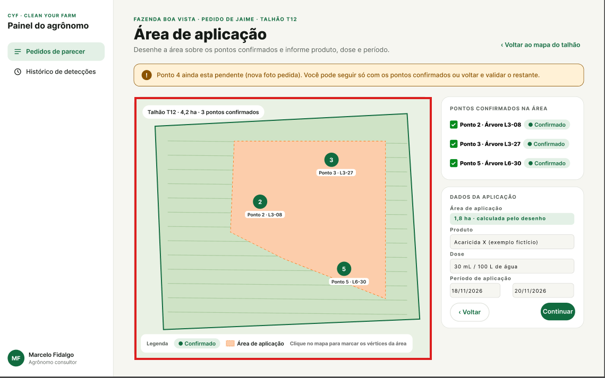 | 2 | Clique errado dificulta corrigir área calculada. | Incluir desfazer, limpar e ajuste de vértices. |
| V04 | H4 | FA03/FA03E | “Confirmar” recebe destaque antes da seleção; estilo selecionado fica mais claro. | 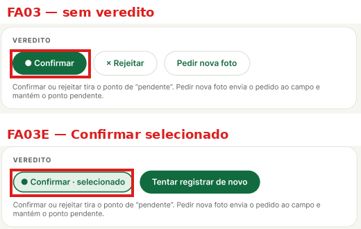 | 2 | Pode confundir seleção e influenciar confirmação. | Mesmo peso inicial e estilo único de seleção. |
| V05 | H4 | FA03/FA05 | Avaliação da IA recolhida no ponto atual, mas aberta no Histórico. |  | 2 | Regra de apresentação inconsistente. | Adotar regra única conforme estado da validação. |
| V06 | H4 | FA02N | Nova foto pedida usa símbolo de pendência e não aparece separada no contador. | 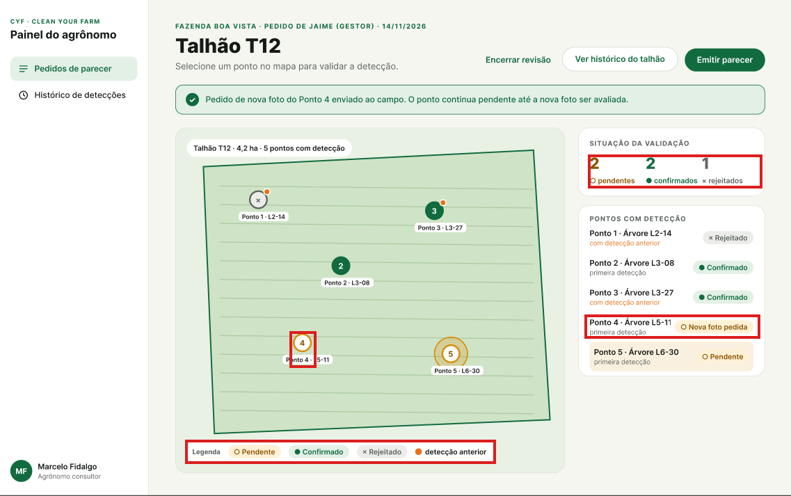 | 2 | Usuário pode tentar avaliar ponto sem foto disponível. | Símbolo, legenda e contador próprios. |
| V07 | H4 | FA06 | Dois retornos ao mesmo local usam rótulos diferentes. | 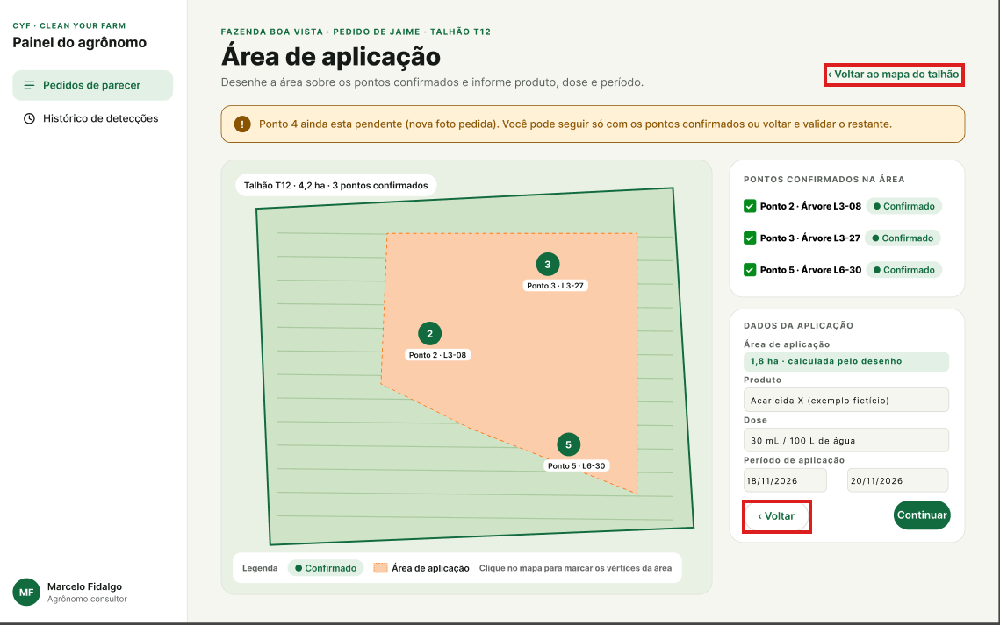 | 1 | Destino do retorno pode ser interpretado incorretamente. | Padronizar rótulo ou manter um controle. |
| V08 | H5 | FA02 | “Emitir parecer” ativo sem ponto confirmado, levando ao erro posterior. |  | 2 | Destaca caminho ainda inviável. | Desativar e explicar necessidade de confirmar um ponto. |
| V09 | H6 | FA05 | Coluna de local cortada. |  | 2 | Sem filtro, registros não se distinguem adequadamente. | Ampliar coluna ou quebrar texto em linhas. |
| V10 | H7 | FA03 | Sequência “Ponto 3 de 5” sem próximo/anterior. | 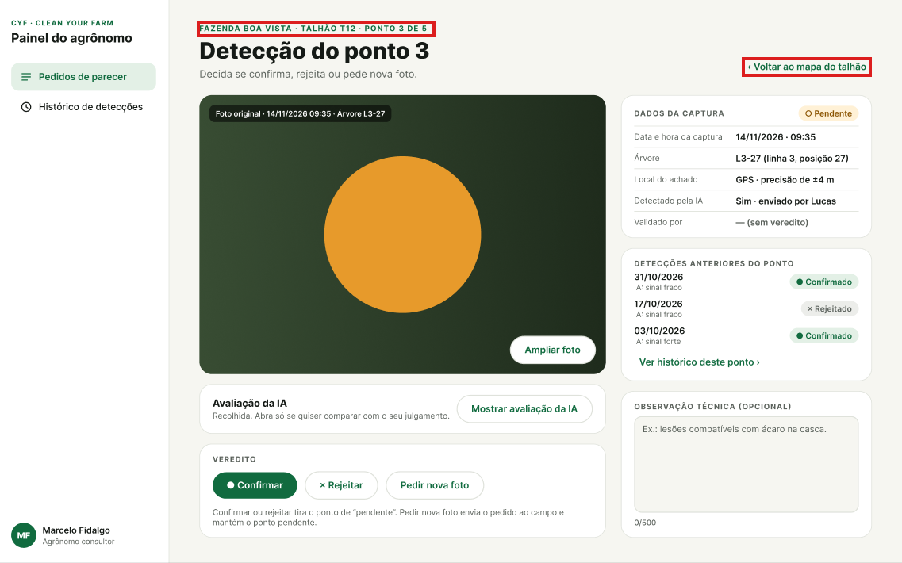 | 2 | Requer voltar ao mapa a cada ponto. | Oferecer próximo pendente e anterior. |
| V11 | H9 | FA03E/FA07E | Falhas pedem nova tentativa, sem causa ou alternativa persistente. | 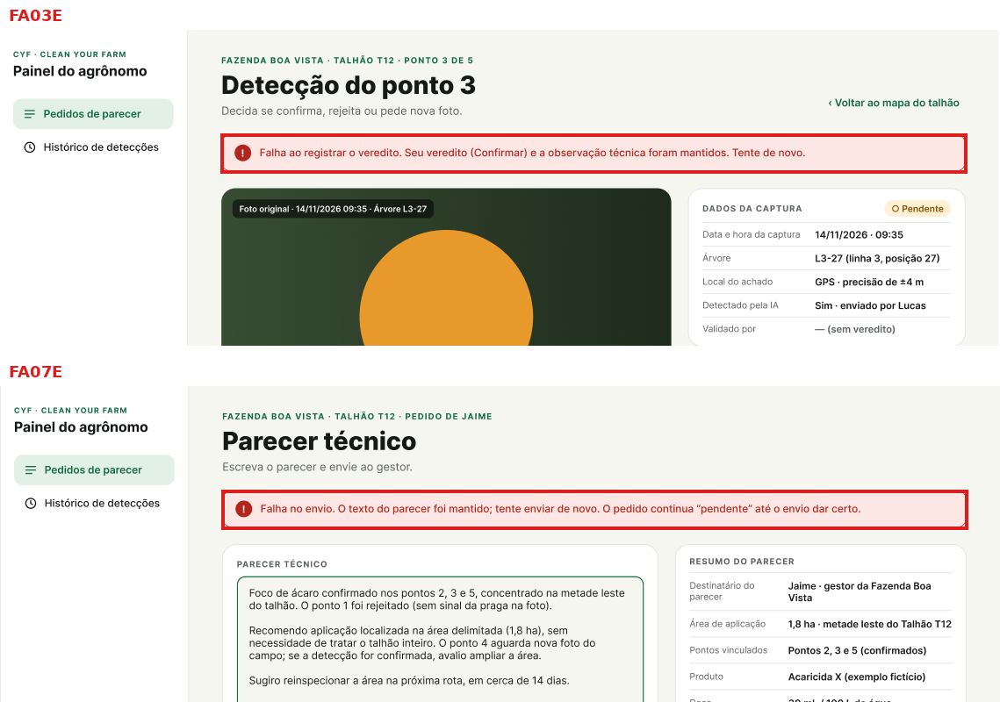 | 2 | Repetir ação pode não resolver. | Explicar causa e recuperação, preservando dados. |
| V12 | H10 | FA03A/FA03/FA05 | “Sinal forte/fraco” sem explicação. |  | 2 | Pode atribuir peso indevido ao modelo. | Explicar termos e responsabilidade da validação humana. |
| V13 | H3 | FA02V/FA02 | Veredito não pode ser desfeito ou alterado. |  | 3 | Erro de confirmação ou rejeição altera área e não tem correção. | Desfazer e reabrir ponto até envio, com autoria registrada. |

### 6. Boas práticas

| H | Exemplo | Evidência | Justificativa |
|---|---|---|---|
| H2 | Identificação de árvore, dose e aviso sobre receituário em linguagem do domínio. |   | Relaciona informações à atividade do agrônomo. |
| H8 | Pedidos mostram informações necessárias à escolha, com uma ação por linha. |  | Detalhes ficam para etapas posteriores. |

### Síntese individual — Guilherme

- Treze problemas: dois de severidade 3, dez de severidade 2 e um de severidade 1.
- H4: quatro; H3: três; H1, H5, H6, H7, H9 e H10: um cada.
- H2 e H8 sem violação observada.
- Prioridades: V01, V13, V04 e V05.
- Estados intermediários e avaliação automática não seguem a mesma regra em todo o fluxo.
- QA21: aviso de pendentes aparece em FA06/FA07; situação do parecer gerou V01/V02; avaliação recolhida gerou V05; foco por teclado não conferido nas capturas.
- Inspeção baseada nas telas FA, com conferência no Figma da impossibilidade de reabrir ponto validado.
- O desenho manual mostrado na Figura 9 pertence ao aplicativo e não elimina V03 do protótipo FA.

## Avaliador A03 — Pedro

**Autor:** Pedro Henrique Ferreira Valim — 24.123.048-1.

### Procedimento

Inspeção das seis capturas da Entrega 11, das capturas adicionais de Lucas e leitura do código, aplicando H1–H10.

**Escopo de A03:** aplicativo iOS (perfis Administrador e Inspeção). As telas FA do protótipo do agrônomo não foram inspecionadas por A03; esta não é uma inspeção completa do escopo do projeto.

**Revisão de 20/11/2026:** somente problemas visíveis na interface ficam como violações. Os registros vistos apenas no código (V03, V10, V11 e V14) foram movidos para “Problemas potenciais pendentes de reprodução”: mantêm o ID para rastreabilidade, mas não entram na contagem de violações até haver captura do estado. V16 passou a ser observação sobre os dados de demonstração. V06 foi reclassificado de H2 para H4 e V02 teve a severidade revista para 2. Essas revisões são individuais de A03; a severidade final coletiva continua pendente.

V09 foi confirmado visualmente no Mapa e no Histórico pelas capturas de Lucas. V12 tem confirmação parcial.

### 4. Matriz de cobertura

| H | Telas/fluxos | Violação? | IDs |
|---|---|---|---|
| H1 | Relatórios, detalhe do talhão, câmera | Sim | V04 (hipóteses V03 e V11 pendentes de reprodução) |
| H2 | Acesso, câmera, relatórios | Sim | V05, V07 |
| H3 | Câmera, desenho, exclusões | Sim | V13 |
| H4 | Acesso, Mapa, Conta, relatórios, filtros | Sim | V01, V06, V08, V09 |
| H5 | Talhão, exclusões, Acesso | Não nos estados observados | — (hipótese V10 pendente de reprodução) |
| H6 | Mapa, Histórico, relatórios | Sim, condicional ao zoom | V02 |
| H7 | Câmera, associação e filtros | Sim, confirmação parcial | V12 |
| H8 | Todas as capturas | Não nos estados observados | — |
| H9 | Câmera, Acesso, Mapa | Não nos estados observados | — (hipótese V14 pendente de reprodução) |
| H10 | Câmera, Mapa, relatórios | Sim | V15 |

A matriz descreve o escopo observado por A03 nas capturas do aplicativo iOS. “Não nos estados observados” não significa que a heurística é atendida pelo sistema inteiro.

### 5. Declaração de violações

| ID | H | Tela/estado | Problema | Evidência | Severidade | Justificativa | Recomendação |
|---|---|---|---|---|---:|---|---|
| V01 | H4 | Mapa, Conta e Relatórios | Contagens diferentes sem explicar que Mapa considera detecções posteriores à última pulverização. |  | 3 | Gestor recebe números distintos sem conhecer a regra. | Unificar contagem ou explicitar período e critério. |
| V02 | H6 | Mapa | Polígonos sem nome/contagem visíveis no zoom capturado. **Confirmação parcial:** a Figura 9 mostra nomes e contagens em outro zoom. |  | 2 | Revisão de 20/11/2026 (antes 3): o problema depende do nível de zoom e não há evidência de que impeça abrir o talhão. Não foram verificados o zoom em que os rótulos somem nem se o polígono é tocável. | Manter identificação visível em todos os níveis de zoom e permitir tocar no polígono; verificar os pontos acima antes de nova revisão da severidade. |
| V04 | H1 | Relatórios | Variação positiva exibida sem dados no período anterior. |  | 2 | Pode sugerir crescimento sem base comparativa. | Mostrar “Sem dados no período anterior”. |
| V05 | H2 | Relatórios e ajuda | “Detecções confirmadas” nomeia saída do modelo com confiança alta. |  | 3 | Pode ser confundida com confirmação profissional. | Identificar resultado do modelo e separar validação humana. |
| V06 | H4 | Acesso | “Continuar com Google” entra em conta de teste, sem autenticação Google real. | 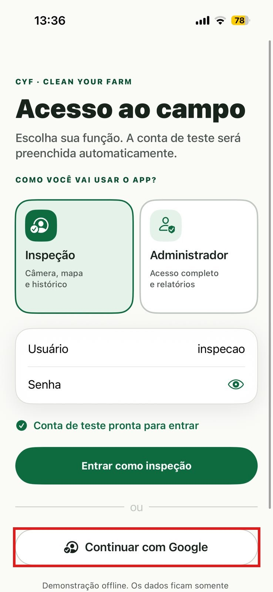 | 2 | Reclassificado de H2 para H4 em 20/11/2026: “Continuar com Google” é um padrão conhecido de login, e o botão não segue o comportamento que esse padrão promete. | Rotular como demonstração ou implementar autenticação real. |
| V07 | H2 | Câmera | “UltralyticsYOLO · Core ML pronto” usa termos de implementação. |  | 2 | Usuário pode não compreender se deve agir. | Usar “Pronto para analisar”. |
| V08 | H4 | Gráfico do relatório | Cores identificam talhões, mas também significam severidade em outras telas; gráfico sem legenda. |  | 2 | Vermelho pode ser interpretado como crítico. | Usar paleta adequada e legenda. |
| V09 | H4 | Filtros do Mapa e Histórico | Cores no filtro diferem dos nomes usados nos relatórios e na legenda do Mapa. |   | 2 | Exige traduzir cores para situações. | Padronizar rótulos, mantendo cor como apoio. |
| V12 | H7 | Após foto [código] | Saída da câmera para associação de área pode interromper capturas sucessivas. |  Pergunta confirmada fora de talhão; caso dentro de talhão não confirmado. | 3 | Pode adicionar passos repetidos à inspeção. | Associar quando possível e perguntar apenas quando necessário; confirmar comportamento no aparelho. |
| V13 | H3 | Câmera | Retorno leva ao Histórico, independentemente da origem, segundo código. |  | 1 | Impõe navegação adicional, sem perda de dados. | Voltar à origem ou manter navegação disponível. |
| V15 | H10 | Relatórios | Sem ajuda para indicadores e limites. | 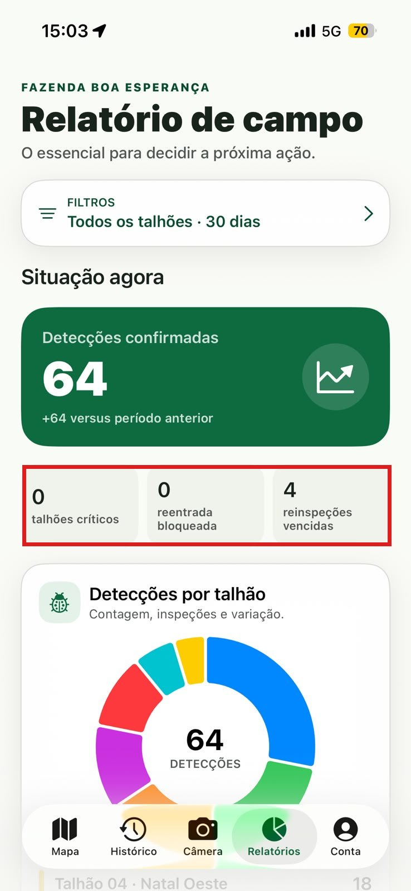 | 2 | Indicadores podem não ser compreendidos. | Ajuda contextual com definições e limites. |

### Problemas potenciais encontrados na inspeção do código — pendentes de reprodução

Possíveis violações identificadas por inspeção de implementação. **Requerem reprodução na interface.** Não fazem parte da contagem de violações nem da priorização do plano de melhoria até serem reproduzidos. Para cada um, falta: reproduzir o estado no aparelho, fazer a captura, confirmar a heurística e revisar a severidade.

| ID | H provisória | Tela/estado | Comportamento esperado pela leitura do código | Evidência | Severidade provisória do autor | O que falta para confirmar |
|---|---|---|---|---|---:|---|
| V03 | H1 | Relatórios | Talhão não inspecionado recebe indicação semelhante a talhão inspecionado sem ocorrência; lista inicial limitada. | `DashboardView.swift`. | 3 | Captura no iPhone de um talhão sem inspeção no período ao lado de um inspecionado sem ocorrência. |
| V10 | H5 | Registrar pulverização | Um toque registra aplicação, muda contagem e datas sem confirmação ou desfazer. | `MapView.swift`. | 3 | Captura antes e depois do toque, mostrando ausência de confirmação e de desfazer. |
| V11 | H1 | Salvar nome/leitura/pulverização | Gravações sem mensagem de confirmação. | `MapView.swift`. | 2 | Captura imediatamente após cada gravação. |
| V14 | H9 | Falha de captura | Mensagem de localização também usada quando falha a captura da imagem. | `CameraView.swift`; a Figura 8 confirma só o caso sem localização. | 2 | Provocar falha da imagem com localização ativa e capturar a mensagem. |

**Evidência posterior, de outra versão:** na versão web, U02 não identificou o talhão sem inspeção (AU04, Entrega 14, 17/11/2026). Isso não reproduz V03 no aplicativo iOS inspecionado e não é usado aqui como confirmação; serve apenas para a comparação entre as Entregas 13 e 14.

### Observação sobre os dados de demonstração (fora da contagem heurística)

| ID | Tela | Observação | Evidência | Tratamento |
|---|---|---|---|---|
| V16 | Mapa demonstrativo | Talhões de exemplo desenhados sobre área urbana. |  | Retirado das violações em 20/11/2026: é limitação dos dados de demonstração e da preparação da avaliação, não da interface que um usuário real veria com seus próprios talhões. Recomenda-se reposicionar os exemplos em área agrícola antes de novos testes. |

### Observações sobre as novas evidências

A Figura 9 mostra nomes e contagens no zoom apresentado. Isso delimita V02: a ausência de rótulos não pode ser generalizada para todos os níveis de zoom, e por isso V02 passou a confirmação parcial, com severidade 2.

A Figura 8 confirma a mensagem quando falta localização. Não confirma que a mesma mensagem apareça em uma falha da imagem com localização disponível; por isso V14 está entre os problemas pendentes de reprodução.

A ausência de violação identificada por Lucas em Acesso e Conta não apaga automaticamente V06 ou V01 de Pedro. São resultados individuais, com métodos e evidências diferentes.

### 6. Boas práticas

| H | Exemplo | Evidência | Justificativa |
|---|---|---|---|
| H8 | Câmera concentra enquadramento, orientação, confiança e controles; indicadores ficam no relatório. |  | Mantém informações relacionadas à tarefa atual. |

### Síntese individual — Pedro

Revisada em 20/11/2026.

- Onze violações com evidência visual, uma delas (V12) com confirmação parcial e outra (V02) condicional ao zoom: três de severidade 3, sete de severidade 2 e uma de severidade 1.
- H4: quatro; H2: duas; H1, H3, H6, H7 e H10: uma cada.
- Quatro problemas potenciais pendentes de reprodução (V03, V10, V11 e V14), fora da contagem.
- Uma observação sobre os dados de demonstração (V16), fora da contagem heurística.
- Prioridades entre as violações confirmadas: V01, V05 e V12.
- Padrões principais: números e estados sem critério explicado e saída automática apresentada como confirmação.
- Escopo limitado ao aplicativo iOS; telas FA não inspecionadas por A03.

## 7. Consolidação

### 7.1 Critério de consolidação

Foram comparados localização, causa, consequência e recomendação dos registros.

Foram unificados somente os pares que descrevem o mesmo problema na mesma interface. Problemas relacionados, mas com causas ou ações de correção diferentes, permanecem separados.

A revisão documental não é apresentada como uma nova inspeção realizada pelos integrantes nem como uma reunião não registrada.

### 7.2 Duplicidades consolidadas

Lucas confirmou que ele e Pedro concordaram com a unificação dos dois pares, mantendo severidade 2 para ambos.

| ID | Registros individuais | H | Problema consolidado | Escopo | Severidade | Decisão | Responsáveis |
|---|---|---|---|---|---:|---|---|
| HC01 | A01-V01 + V07/A03 | H2 | Câmera comunica prontidão com nomes técnicos da implementação. | Câmera do aplicativo. | 2 | Usar mensagens relacionadas à tarefa, como “Pronto para analisar”. | Lucas e Pedro. |
| HC02 | A01-V03 + V09/A03 | H4 | Filtros nomeiam situações pelas cores, divergindo dos demais rótulos do aplicativo. | Mapa e Histórico. | 2 | Padronizar nomes em filtros, Mapa e relatórios, mantendo cores como apoio. | Lucas e Pedro. |

### 7.3 Registro reclassificado

| Registro | Situação anterior | Evidência adicional | Decisão |
|---|---|---|---|
| A01-V05 | Ausência de orientação de recuperação sem GPS. | Figura 8 informa a necessidade de ativar localização precisa. | Retirado das violações ativas; mantido no histórico e registrado como boa prática de H9. |

O desenho manual da Figura 9 é registrado separadamente. Não comprova salvamento da inspeção sem GPS.

### 7.4 Relação consolidada

Os IDs individuais permanecem como origem. Para os registros sem duplicidade, a severidade é a do autor (com as revisões individuais de A03 de 20/11/2026); a reavaliação coletiva das severidades de HC03 em diante ainda não foi feita e continua pendente da equipe. Os registros de A03 que dependiam só do código e a observação sobre dados de demonstração saíram desta tabela e estão em 7.4.1.

| ID consolidado | Origem | Problema | Severidade | Situação da evidência |
|---|---|---|---:|---|
| HC01 | A01-V01; A03-V07 | Mensagem técnica na câmera. | 2 | Visual; unificação aprovada por Lucas e Pedro. |
| HC02 | A01-V03; A03-V09 | Situações nomeadas por cores nos filtros. | 2 | Visual no Mapa e Histórico; unificação aprovada por Lucas e Pedro. |
| HC03 | A01-V02 | Data em inglês. | 1 | Visual. |
| HC04 | A01-V04 | Sigla EXIF sem explicação. | 2 | Visual. |
| HC05 | A02-V01 | Pedido concluído com ponto pendente de nova foto. | 3 | Protótipo FA. |
| HC06 | A02-V02 | Parecer enviado sem consulta ou complemento. | 2 | Protótipo FA. |
| HC07 | A02-V03 | Desenho de área sem correção de vértices. | 2 | Protótipo FA. |
| HC08 | A02-V04 | Destaque e seleção inconsistentes no veredito. | 2 | Protótipo FA. |
| HC09 | A02-V05 | Exibição inconsistente da avaliação automática. | 2 | Protótipo FA. |
| HC10 | A02-V06 | Nova foto pedida sem representação própria no mapa. | 2 | Protótipo FA. |
| HC11 | A02-V07 | Retornos ao mesmo destino com rótulos diferentes. | 1 | Protótipo FA. |
| HC12 | A02-V08 | Avanço para parecer sem ponto confirmado. | 2 | Protótipo FA. |
| HC13 | A02-V09 | Local cortado no Histórico. | 2 | Protótipo FA. |
| HC14 | A02-V10 | Falta de navegação entre pontos. | 2 | Protótipo FA. |
| HC15 | A02-V11 | Falha sem causa ou recuperação alternativa. | 2 | Protótipo FA. |
| HC16 | A02-V12 | Sinal forte/fraco sem explicação. | 2 | Protótipo FA. |
| HC17 | A02-V13 | Veredito sem possibilidade de correção. | 3 | Protótipo FA e conferência de navegação. |
| HC18 | A03-V01 | Contagens divergentes entre telas. | 3 | Captura e regra identificada no código. |
| HC19 | A03-V02 | Identificação de talhões ausente em determinado zoom. | 2 | **Parcial** — captura; condicional ao zoom (revisão individual de A03, antes 3). |
| HC21 | A03-V04 | Variação sem base no período anterior. | 2 | Visual. |
| HC22 | A03-V05 | Detecção automática apresentada como confirmada. | 3 | Captura e descrição da regra no código. |
| HC23 | A03-V06 | Botão Google com comportamento demonstrativo (H4). | 2 | Captura e código. |
| HC24 | A03-V08 | Cores do gráfico conflitantes e sem legenda. | 2 | Visual. |
| HC27 | A03-V12 | Associação após foto pode interromper sequência. | 3 | **Parcial** — captura fora de talhão e código; condição dentro de talhão não confirmada. |
| HC28 | A03-V13 | Retorno da câmera não preserva origem. | 1 | Captura e código. |
| HC30 | A03-V15 | Indicadores sem ajuda contextual. | 2 | Visual. |

#### 7.4.1 Registros fora da contagem de violações

Os IDs foram mantidos para preservar a rastreabilidade.

| ID consolidado | Origem | Problema | Estado |
|---|---|---|---|
| HC20 | A03-V03 | Não inspecionado confundido com sem ocorrência. | Pendente de reprodução no aplicativo iOS (só código). Problema equivalente observado depois na versão web (AU04, Entrega 14). |
| HC25 | A03-V10 | Pulverização sem confirmação ou desfazer. | Pendente de reprodução (só código). |
| HC26 | A03-V11 | Gravações sem feedback. | Pendente de reprodução (só código). |
| HC29 | A03-V14 | Mensagem de localização reutilizada em falha de imagem. | Pendente de reprodução (só código). |
| HC31 | A03-V16 | Talhões demonstrativos em área urbana. | Fora da heurística: limitação dos dados de demonstração. |

### 7.5 Relações preservadas sem unificação

- **HC04 e HC27:** tratam da associação da foto, mas HC04 é linguagem e HC27 é interrupção de fluxo.
- **HC05 e HC10:** tratam de pendências, mas um afeta situação do pedido e outro representação do ponto.
- **HC06 e HC17:** consulta/correção de parecer enviado e correção de veredito são ações diferentes.
- **HC09, HC16 e HC22:** consistência da apresentação, explicação da avaliação e uso do termo “confirmado” exigem correções distintas.
- **HC18 e HC21:** divergência de contagens e comparação sem base temporal têm causas diferentes.
- **A01-V05 e HC29:** a orientação correta quando falta GPS não comprova o tratamento correto de uma falha da imagem.

### 7.6 Contagem final documental

Recalculada em 20/11/2026, separando violações confirmadas de registros pendentes.

| Categoria | Quantidade |
|---|---:|
| Violações ativas de Lucas | 4 |
| Violações de Guilherme | 13 |
| Violações de Pedro com evidência visual | 11 |
| Total bruto ativo | 28 |
| Redução por dois pares duplicados | 2 |
| **Total consolidado de violações** | **26** |
| — aplicativo, evidência visual | 11 |
| — protótipo FA, evidência visual | 13 |
| — confirmação parcial (HC19, HC27) | 2 |
| Severidade 3 | 5 |
| Severidade 2 | 18 |
| Severidade 1 | 3 |
| Severidade 4 | 0 |
| Problemas potenciais pendentes de reprodução (fora do total) | 4 |
| Observação sobre dados de demonstração (fora do total) | 1 |

A01-V05 fica fora da contagem ativa. As severidades são as dos autores, ainda sem reavaliação coletiva. A quantidade de registros não é um indicador da qualidade da interface: ela mistura protótipo e aplicativo e depende do escopo examinado por cada avaliador.

## 8. Síntese e plano de melhoria

### Prioridades

| Prioridade | Problemas | Ação | Responsável pelo acompanhamento |
|---|---|---|---|
| Alta | HC18 e HC22 | Esclarecer contagens e resultado automático. | Pedro/equipe. |
| A reproduzir antes de priorizar | HC20, HC25, HC26 e HC29 | Reproduzir no aparelho e capturar; só então confirmar heurística e severidade. HC20 tem problema equivalente observado na versão web (AU04), o que justifica reproduzi-lo primeiro. | Pedro. |
| Alta | HC05 e HC17 | Manter acesso a pendências e permitir corrigir veredito. | Guilherme/equipe. |
| Alta (confirmação parcial) | HC27 | Conferir interrupções nas capturas dentro de talhão. | Pedro/equipe. |
| Média | HC19 | Verificar em que zoom os rótulos somem e se o polígono é tocável. | Pedro/equipe. |
| Média | HC01 | Traduzir mensagem técnica da câmera. | Lucas e Pedro. |
| Média | HC02 | Padronizar nomes nos filtros, Mapa e relatórios. | Lucas e Pedro. |
| Média | HC04 | Explicar associação da foto sem a sigla EXIF. | Lucas/equipe. |
| Média | HC06–HC10, HC12–HC16, HC21, HC23, HC24 e HC30 | Melhorar controle, consistência, ajuda e feedback conforme recomendações individuais. | Equipe. |
| Menor | HC03, HC11 e HC28 | Ajustar idioma, rótulos e retorno. | Equipe. |
| Preparação de testes | HC31 | Reposicionar os talhões demonstrativos em área agrícola. | Equipe. |

A severidade não indica que a correção já foi implementada.

### Critérios para verificar as melhorias

| Grupo | Como verificar |
|---|---|
| Linguagem e datas | Conferir mensagens em português e termos relacionados à tarefa. |
| Filtros e gráficos | Usar a mesma nomenclatura e separar identificação de talhão de nível de atenção. |
| Contagens e períodos | Conferir regras iguais ou diferenças explicitadas; ausência de dados não deve aparecer como zero ou crescimento. |
| Validação e parecer | Permitir consultar, corrigir e reconhecer pendências sem perder os registros. |
| Ações com impacto | Confirmar consequências e permitir recuperação quando aplicável. |
| Falhas | Reproduzir cada causa separadamente e conferir mensagem e recuperação correspondentes. |
| Fluxo de captura | Conferir comportamento dentro e fora de talhões conhecidos e retorno à captura. |

### Conclusão

A revisão de 20/11/2026 deixou **26 violações consolidadas** (11 do aplicativo com evidência visual, 13 do protótipo FA e 2 com confirmação parcial), além de **4 problemas potenciais pendentes de reprodução** e **1 observação sobre os dados de demonstração**, preservando os achados individuais, as evidências e as limitações.

As principais prioridades são comunicar corretamente os dados usados nas decisões de manejo, distinguir saída automática de validação humana e permitir correção de ações relevantes.

A parte de Lucas está concluída para as telas e estados do aplicativo examinados. HC01 e HC02 foram consolidados com Pedro, e A01-V05 foi reclassificado após a nova evidência.

A conclusão documental não equivale à implementação das recomendações nem comprova cobertura individual de todo o projeto. Os achados baseados somente no código e os estados não reproduzidos permanecem explicitados para verificação posterior.

## Checklist — equipe

- [ ] Cada integrante realizou inspeção completa de todo o escopo exigido — não atendido: A01 e A03 cobriram principalmente o aplicativo e A02 o protótipo FA.
- [ ] Todas as telas e estados relevantes possuem cobertura individual demonstrada.
- [ ] Cobertura integral de estados dinâmicos e de falha confirmada — V03, V10, V11 e V14 não foram reproduzidos.
- [x] A inspeção avalia a interface, não o mérito científico do algoritmo.
- [x] H1–H10 aparecem nas matrizes individuais.
- [x] Não foi criada uma violação obrigatória para cada heurística.
- [x] Violações confirmadas possuem localização, contexto e evidência visual; achados só de código estão separados como pendentes de reprodução.
- [ ] Todos os comportamentos registrados no código foram confirmados no aparelho — não; ver problemas pendentes de reprodução.
- [x] Severidades individuais possuem justificativas.
- [x] Recomendações indicam correção ou redução do impacto.
- [x] HC01 e HC02 consolidados e aprovados por Lucas e Pedro.
- [ ] Severidades de HC03 em diante reavaliadas coletivamente pela equipe.
- [x] Demais registros comparados documentalmente, com duplicidades e diferenças explicitadas.
- [x] Tabela consolidada, contagem e plano de melhoria preenchidos e recalculados, separando confirmados, parciais e pendentes.
- [x] Parte de Lucas concluída para o escopo documentado.
- [x] Parte de A03 revisada após o feedback (20/11/2026).
- [ ] Documentação da Entrega 13 concluída — pendem cobertura cruzada e consolidação coletiva das severidades.
