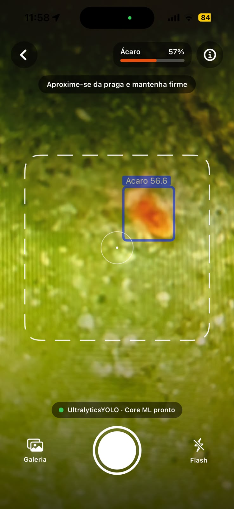
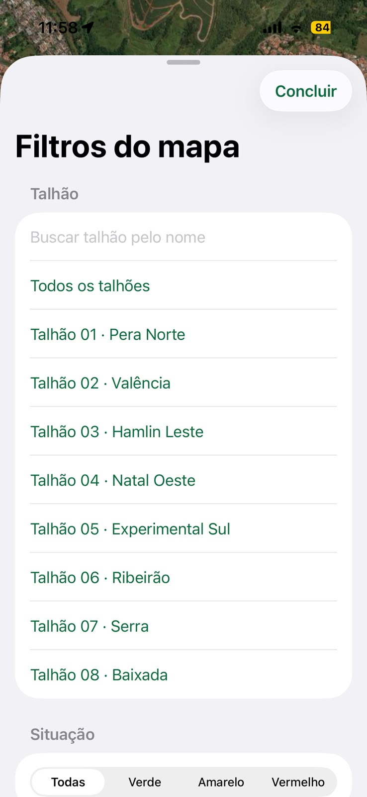
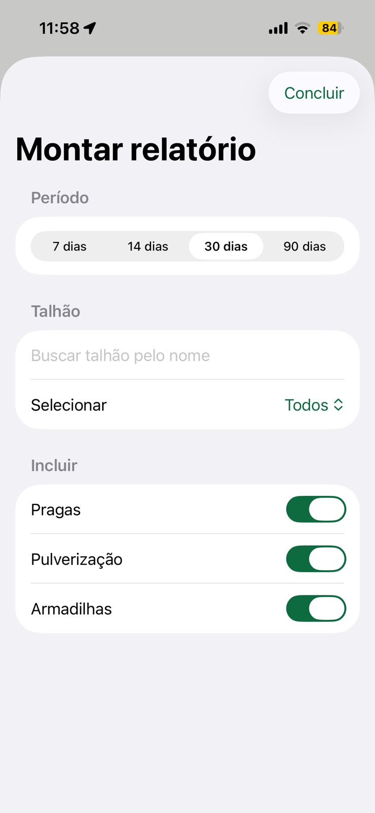
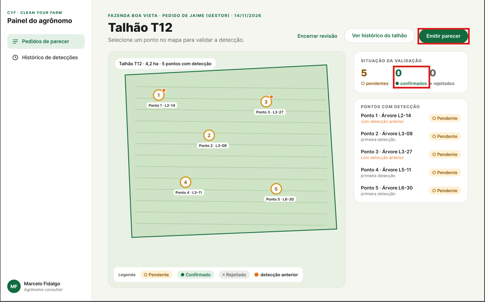
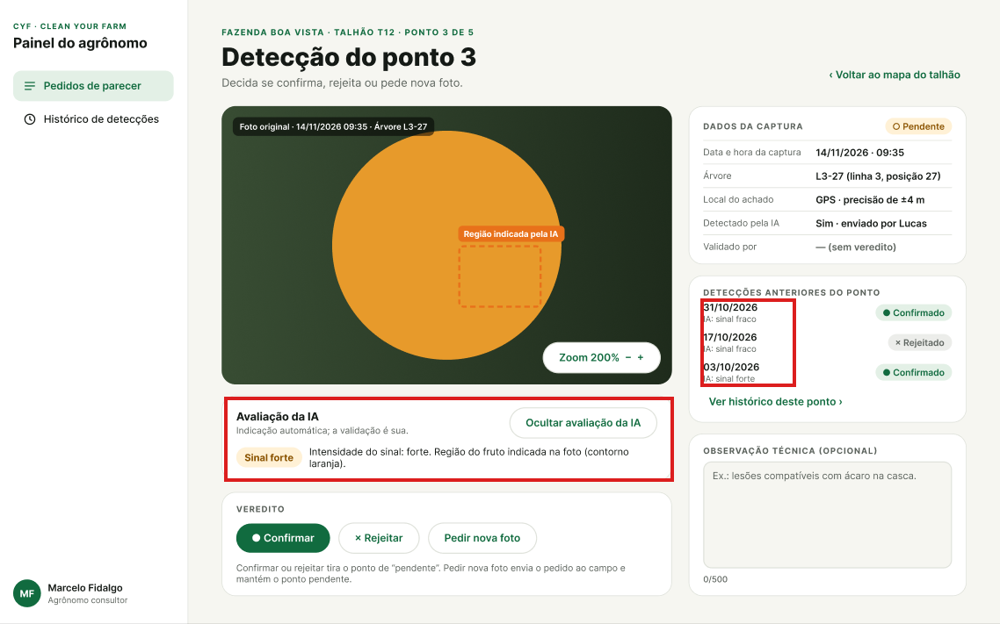
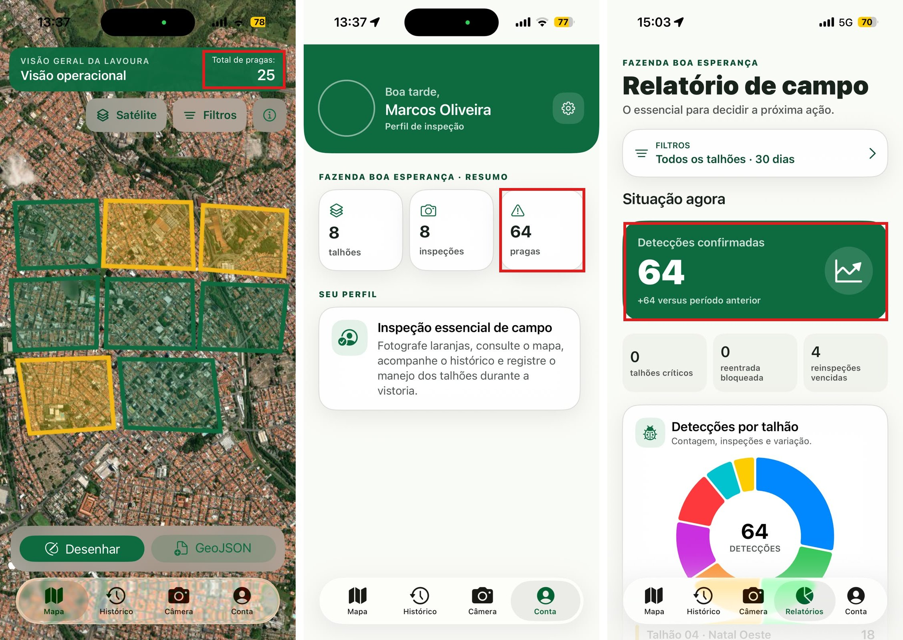
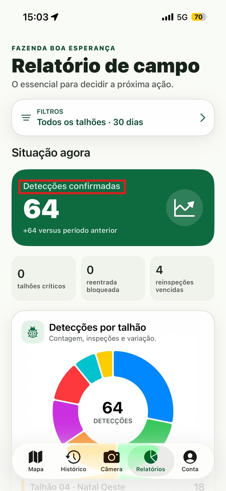
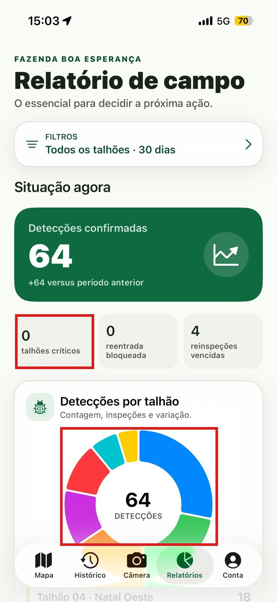
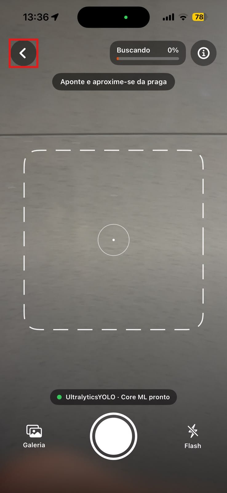
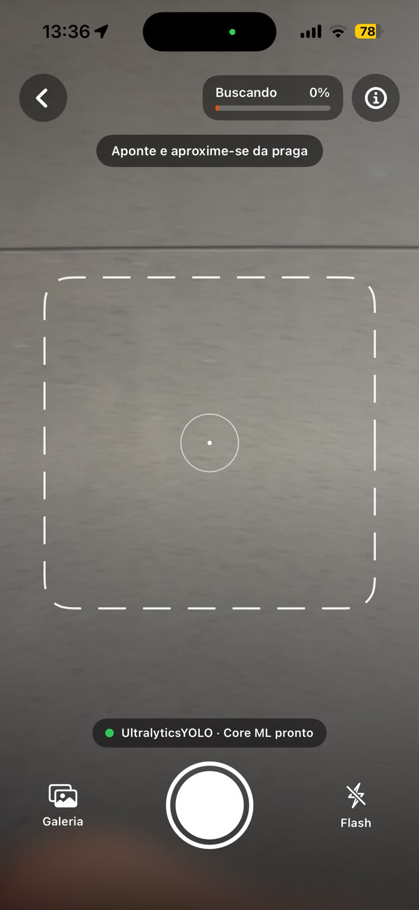

# Entrega 13 — Avaliação de IHC por inspeção heurística

**Data:** 16/11/2026  
**Revisão de A01 — Lucas:** inspeção adicional realizada em versão do aplicativo de aproximadamente 15/11/2026, às 15h  
**Status:** 🟨 em andamento — inspeções individuais registradas, com a situação dos achados de Pedro marcados `[código]` documentada; consolidação final da equipe pendente.  
**Responsabilidade:** 1 avaliação completa por integrante, sobre todas as telas/estados relevantes do projeto.

## Objetivo da atividade

Encontrar problemas de usabilidade por inspeção sistemática da interface com as **10 heurísticas de Nielsen**. Cada avaliador trabalha individualmente primeiro; depois a equipe consolida problemas duplicados e prioridades.

> **Parte de violações:** registre somente problemas reais. Não invente uma violação para “preencher” cada heurística. Para mostrar quais heurísticas foram examinadas, use a **matriz de cobertura H1–H10**. Para heurísticas sem violação, registre exemplo de boa prática quando houver evidência.

## 1. Heurísticas adotadas

1. Visibilidade do status do sistema
2. Compatibilidade entre o sistema e o mundo real
3. Controle e liberdade do usuário
4. Consistência e padrões
5. Prevenção de erros
6. Reconhecimento em vez de memorização
7. Flexibilidade e eficiência de uso
8. Estética e design minimalista
9. Ajudar usuários a reconhecer, diagnosticar e recuperar-se de erros
10. Ajuda e documentação

## Cobertura especial para interfaces administrativas e analíticas

Quando existirem, não limite a avaliação às telas principais. Inspecione também:

- dashboard em estados normal, vazio e erro;
- filtros sem resultado e filtros combinados;
- relatórios e exportação;
- histórico e listas longas;
- formulários de criação, edição, exclusão e validação;
- alteração de perfil e permissão;
- confirmações de ações destrutivas;
- processamento, carregamento e progresso;
- falha e recuperação;
- comparação de resultados;
- mensagens de termos técnicos, métricas e recomendações;
- ajuda e documentação contextual.

Em TCCs técnicos, observe especialmente se a interface comunica o estado do processamento e traduz informações técnicas para o vocabulário do usuário escolhido.

## 2. Escopo da inspeção

| Item | Definição |
|---|---|
| Versão avaliada | Aplicativo CYF (Clean Your Farm) para iPhone, pasta `ios-native/` de <https://github.com/Cabral100/App_Orange_Box>, commit `a36785f`, de 12/11/2026. As capturas adicionais da inspeção de Lucas mostram estados apresentados até 16/11/2026; o commit exato correspondente não foi identificado. Lucas estima que a versão adicional foi examinada por volta de 15/11/2026, às 15h. |
| Telas/estados | Acesso (F01), Câmera (F02), Histórico (F03), Mapa (F04), Conta (F05) e Relatórios (F06), da Entrega 11. Foram considerados também ajuda da câmera, confirmação “Imagem capturada”, associação da foto ao talhão, detalhe da inspeção, detalhe do talhão, filtros, exportação em PDF e exclusões, conforme a cobertura descrita por cada avaliador. Telas FA do fluxo do agrônomo no Figma: FA01–FA03 e FA05–FA07, incluindo estados alternativos. |
| Fluxos | M02 (perfil de inspeção) e M03 (perfil administrador). O aplicativo não tem perfil de agrônomo; M01 foi inspecionado nas telas FA do Figma. |
| Dispositivo/viewport | Aplicativo em iPhone; telas FA em layout de computador. |
| Avaliadores | Lucas Tonoli Cabral Duarte (A01); Guilherme Morais Escudeiro (A02); Pedro Henrique Ferreira Valim (A03). |
| Limite da evidência | Capturas documentam os estados mostrados, mas não comprovam, por si sós, todos os comportamentos dinâmicos, estados vazios, erros e caminhos de recuperação. Achados de Pedro identificados apenas no código estão marcados expressamente. Acesso e Conta não foram examinados por Lucas. |

## 3. Procedimento individual

Cada avaliador deve:

1. percorrer os fluxos e as telas para se familiarizar com a interface;
2. examinar os estados aplicando H1–H10;
3. registrar cada problema com localização, contexto e evidência;
4. atribuir severidade após examinar a consequência do problema;
5. registrar os limites do que não pôde ser observado.

### Escala de severidade (0–4)

| Grau | Interpretação |
|---:|---|
| 0 | Não é considerado problema de usabilidade |
| 1 | Problema cosmético; corrigir se houver tempo |
| 2 | Problema menor; baixa prioridade |
| 3 | Problema maior; alta prioridade |
| 4 | Catástrofe de usabilidade; correção imperativa antes de disponibilizar |

Ao justificar, considere **frequência, impacto e persistência** do problema no contexto real de uso.

---

## Avaliador A01 — Lucas

**Autor(a):** Lucas Tonoli Cabral Duarte — 24.123.032-5

**Situação da inspeção individual:** encerrada para os estados dos fluxos de inspeção examinados e descritos nesta seção. As telas Acesso e Conta não foram examinadas. O commit exato da versão adicional não foi identificado.

**Como a inspeção foi feita:** Lucas examinou a câmera antes e depois da captura, a ajuda da câmera, o detalhe da inspeção, a associação da foto ao talhão, o filtro do mapa, o Histórico — incluindo consulta e ações de refazer foto, editar informações e excluir imagem — e a montagem, exportação e compartilhamento do relatório PDF. O PDF foi examinado e compartilhado com um funcionário de uma fazenda parceira, que gostou do relatório. Esse comentário é registrado como retorno informal, sem identificação do funcionário e sem ser tratado como uma sessão formal de avaliação com usuário.

Lucas também examinou os estados de ausência de GPS e de indicação abaixo de 85%. Aplicou H1–H10 aos estados observados e registrou as capturas correspondentes. A avaliação trata da comunicação e do controle oferecidos pela interface, não da acurácia científica do detector.

**Versão examinada:** aplicativo CYF para iPhone, conforme as capturas desta seção e a inspeção adicional feita por volta de **15/11/2026, às 15h**. O commit exato correspondente não foi identificado.

### 4. Matriz de cobertura das 10 heurísticas

| Heurística | Telas/estados examinados | Violação observada? | Achados | Resultado da inspeção |
|---|---|---|---|---|
| H1 — Visibilidade do status | Câmera, orientação de enquadramento, confirmação da captura, Histórico e exportação do relatório | não | — | A câmera informa a porcentagem e orienta a ajustar a distância do celular. Após uma captura permitida, informa “Imagem capturada — Registro salvo neste aparelho”. O PDF foi gerado e aberto. |
| H2 — Compatibilidade com o mundo real | Câmera, ajuda, detalhe da inspeção e associação ao talhão | sim | A01-V01, A01-V02, A01-V04 | Foram observados nomes técnicos da implementação, data em inglês e a sigla EXIF sem explicação. |
| H3 — Controle e liberdade | Câmera, detalhe, associação ao talhão e Histórico | não nos estados observados | — | Há retorno na câmera, opção “Depois” na associação e, no Histórico, ações para refazer foto, editar informações e excluir a imagem. |
| H4 — Consistência e padrões | Filtros do Mapa e montagem de relatório | sim | A01-V03 | O filtro nomeia situações pelas cores, enquanto outras partes do aplicativo usam termos para os níveis dos talhões. |
| H5 — Prevenção de erros | Câmera antes da captura | não no comportamento observado | — | O aplicativo bloqueia a captura quando a indicação está abaixo de 85% e informa que é necessário alcançar pelo menos 85%. |
| H6 — Reconhecimento em vez de memorização | Filtros do Mapa e Histórico | não nos estados observados | — | A lista e a busca permitem localizar talhões pelo nome; as inspeções também ficam consultáveis no Histórico. |
| H7 — Flexibilidade e eficiência | Câmera, filtros, Histórico e relatório | não nos estados observados | — | A câmera oferece acesso à galeria; o Histórico oferece ações sobre a foto; o relatório permite selecionar período, talhão e conteúdo e exportar o PDF. |
| H8 — Design minimalista | Câmera, filtros, Histórico e relatório | não nos estados observados | — | A área central da câmera permanece dedicada ao enquadramento; Lucas não identificou excesso de informação que impedisse as tarefas examinadas. |
| H9 — Reconhecimento e recuperação de erros | Câmera com indicação abaixo de 85% e estado sem GPS | sim | A01-V05 | A orientação para alcançar 85% ajuda a recuperar a captura. Sem GPS, no estado examinado, não foi possível associar a inspeção a um talhão. |
| H10 — Ajuda e documentação | Ajuda da câmera | não | — | A ajuda explica como usar a câmera e informa a porcentagem mínima necessária para tirar a foto. |

**Limite da matriz:** a avaliação cobre os estados listados e não as telas Acesso e Conta, que Lucas não examinou. “Nenhuma violação observada” não significa que todas as falhas possíveis do aplicativo tenham sido reproduzidas.

### 5. Declaração de violações

| ID | Heurística | Tela/estado | Problema observado | Evidência | Severidade | Justificativa | Recomendação |
|---|---|---|---|---|---:|---|---|
| A01-V01 | H2 | Câmera durante a inspeção | A mensagem “UltralyticsYOLO · Core ML pronto” apresenta nomes da implementação ao trabalhador, sem explicar o que ele precisa fazer. | [Figura 1](#figura-1--camera-com-deteccao) | 2 | Aparece durante a tarefa frequente de fotografar frutos. Não impede a captura, mas não comunica o estado do aplicativo no vocabulário do usuário. É semelhante a V07 de Pedro. | Substituir por uma mensagem ligada à tarefa, como “Pronto para analisar”. |
| A01-V02 | H2 | Detalhe da inspeção | A data é apresentada em inglês, como “12 November 2026 at 13:15”, embora a interface esteja em português. | [Figura 3](#figura-3--detalhe-da-inspecao) | 1 | A informação ainda pode ser interpretada, mas a troca de idioma dificulta a leitura do registro. | Apresentar data e hora no padrão local, por exemplo “12/11/2026 às 13h15”. |
| A01-V03 | H4 | Filtros do Mapa, campo “Situação” | As opções “Verde”, “Amarelo” e “Vermelho” nomeiam cores em vez das situações correspondentes aos talhões. | [Figura 4](#figura-4--filtros-do-mapa) | 2 | O usuário precisa associar a cor ao significado e conciliar esses rótulos com os usados nos relatórios. É semelhante a V09 de Pedro. | Usar os mesmos nomes de situação em filtros, mapa e relatórios, mantendo a cor como apoio visual. |
| A01-V04 | H2 | Mapa, etapa “Qual é a área?” após a foto | A orientação menciona “coordenadas GPS/EXIF da foto” sem explicar a sigla EXIF ou sua relação com a escolha da área. | [Figura 6](#figura-6--associacao-da-foto-a-area) | 2 | A mensagem aparece quando o trabalhador precisa associar a inspeção a um local. A sigla pode dificultar a compreensão da ação seguinte. | Informar que a localização da foto posicionou o mapa e explicar diretamente como selecionar ou informar a área. |
| A01-V05 | H9 | Associação da inspeção ao talhão, com GPS indisponível | No estado examinado sem GPS, não foi possível marcar ou associar a inspeção a um talhão. A inspeção não permitiu concluir essa etapa naquele estado. | Relato da inspeção de Lucas; não há captura específica do estado sem GPS. | 2 | A indisponibilidade da localização interrompe a associação ao talhão. Como não foi registrada uma mensagem de recuperação ou uma alternativa manual nesse estado, o usuário pode não saber como prosseguir. | Informar claramente que o GPS está indisponível e oferecer tentativa novamente ou seleção manual do talhão, se essa opção for compatível com o sistema. |

#### Evidências fotográficas de A01

##### Figura 1 — Câmera com detecção

A câmera mostra uma indicação de **57%** e uma orientação para melhorar o enquadramento. A imagem registra o estado **antes da captura**; não é uma inspeção salva abaixo de 85%. Também mostra a mensagem técnica registrada em A01-V01.

##### Figura 2 — Confirmação de captura

Após uma captura permitida, o aplicativo informa “Imagem capturada — Registro salvo neste aparelho”. A foto documenta o feedback de sucesso, sem indicar que seja possível salvar uma captura abaixo de 85%.

##### Figura 3 — Detalhe da inspeção

O detalhe apresenta imagem, contagem, confiança, talhão, localização e data. A data em inglês fundamenta A01-V02.

##### Figura 4 — Filtros do mapa

O campo “Situação” mostra “Todas”, “Verde”, “Amarelo” e “Vermelho”, fundamentando A01-V03.

##### Figura 5 — Montagem e exportação do relatório

Lucas montou o relatório, gerou e abriu o PDF. Examinou o conteúdo e compartilhou o arquivo com um funcionário de uma fazenda parceira, que gostou do relatório. O retorno foi informal e não é tratado como uma sessão de teste com usuário.

##### Figura 6 — Associação da foto à área

Após a foto, o aplicativo pergunta “Qual é a área?” e menciona “coordenadas GPS/EXIF da foto”. A sigla sem explicação fundamenta A01-V04.

##### Figura 7 — Resultado e alteração do talhão

O detalhe mostra uma inspeção registrada e os controles “Alterar talhão associado” e “Marcar talhão no mapa”. Esses controles tornam visível a possibilidade de rever a associação.

**Ajuda da câmera:** Lucas abriu a ajuda e verificou que ela explica como usar a câmera e que a indicação deve chegar a **85% ou mais** para permitir a captura. Não foi fornecida uma captura específica do conteúdo da ajuda; o registro corresponde à inspeção realizada.

#### Limite de captura e estados de erro

No uso examinado por Lucas, **não foi possível registrar uma foto com indicação abaixo de 85%**, porque o aplicativo bloqueia a captura e informa que é necessário chegar a pelo menos 85%. Por isso, não existe uma foto salva abaixo do limite a ser anexada. A Figura 1 mostra a câmera em 57% antes da captura; a Figura 2 mostra a confirmação de uma captura permitida.

Lucas também não identificou, nos exemplos que examinou, uma indicação de **85% ou mais** que reconhecesse como algo diferente de ácaro. Essa observação não comprova a ausência de falsos positivos nem valida a precisão do modelo.

Quando o GPS estava indisponível, não foi possível associar a inspeção a um talhão no estado examinado. Esse bloqueio foi registrado em A01-V05; não se presume que a interface ofereça ou deixe de oferecer uma alternativa em outros estados sem evidência.

As mensagens e os indicadores da câmera orientam a aproximar ou afastar o celular para obter uma indicação de pelo menos 85%. Lucas não reproduziu uma falha de captura depois de seguir essa orientação. O bloqueio abaixo do limiar é prevenção prevista pelo aplicativo; a orientação para ajustar a distância é feedback para continuar a tarefa, não uma mensagem de erro de captura.

### 6. Boas práticas — heurísticas sem violação observada

| Heurística | Exemplo no estado examinado | Evidência | Por que atende |
|---|---|---|---|
| H1 | A captura concluída gera a mensagem “Imagem capturada — Registro salvo neste aparelho”. | [Figura 2](#figura-2--confirmacao-de-captura) | Informa que a ação terminou e onde o registro foi salvo. |
| H3 | O Histórico permite refazer a foto, editar informações associadas e excluir a imagem. | Inspeção do Histórico por Lucas; sem captura específica indicada. | Permite rever e corrigir informações do registro conforme as ações disponíveis. |
| H5 | O aplicativo bloqueia a captura abaixo de 85% e a ajuda explica o limiar mínimo. | [Figura 1](#figura-1--camera-com-deteccao) e ajuda da câmera | Previne uma captura abaixo do limite definido e informa ao usuário o que precisa atingir. |
| H6 | O filtro apresenta busca e lista de talhões; o Histórico lista inspeções para consulta. | [Figura 4](#figura-4--filtros-do-mapa) e inspeção do Histórico | Permite reconhecer os itens por nome e consultar registros existentes. |
| H7 | A câmera oferece acesso à galeria; o relatório pode ser configurado e exportado como PDF. | [Figura 1](#figura-1--camera-com-deteccao) e [Figura 5](#figura-5--montagem-e-exportacao-do-relatorio) | Oferece alternativas para fornecer imagem e para compartilhar o resumo das informações. |
| H8 | A área central da câmera é dedicada ao enquadramento. | [Figura 1](#figura-1--camera-com-deteccao) | Mantém o foco visual na tarefa de fotografar. |
| H10 | A ajuda da câmera explica como usá-la e qual porcentagem permite tirar a foto. | Inspeção direta da ajuda por Lucas; captura específica não fornecida. | Dá instruções contextuais para a tarefa de captura. |

### Síntese individual — Lucas

- **Total:** 5 problemas registrados: três de H2, um de H4 e um de H9; quatro com severidade 2 e um com severidade 1.
- **Prioridades:** traduzir a mensagem técnica da câmera (A01-V01), padronizar os nomes das situações no filtro (A01-V03), explicar a associação da foto à área sem a sigla EXIF (A01-V04) e oferecer orientação ou recuperação quando o GPS não está disponível (A01-V05).
- **Duplicidades candidatas:** A01-V01 é semelhante a V07 de Pedro; A01-V03 é semelhante a V09 de Pedro. A consolidação deve preservar o registro de ambos os avaliadores.
- **Histórico e relatório:** Lucas examinou as ações de refazer foto, editar informações e excluir a imagem no Histórico. Também gerou, abriu e compartilhou o PDF; um funcionário de uma fazenda parceira gostou do relatório. Esse retorno é informal e não substitui avaliação sistemática com participantes.
- **Captura abaixo do limite:** o aplicativo bloqueia o registro abaixo de 85% e informa o limiar. A imagem em 57% é do estado anterior à captura.
- **Limite de GPS:** sem GPS, não foi possível associar a inspeção a um talhão no estado examinado.
- **Limitação da cobertura:** Acesso e Conta não foram examinados por Lucas. O commit da versão usada nas capturas adicionais não foi identificado; a inspeção foi por volta de 15/11/2026, às 15h.

## Avaliador A02 — Guilherme

**Autor(a):** Guilherme Morais Escudeiro — 24.123.005-1

**Como a inspeção foi feita:** sobre as telas FA do fluxo do agrônomo (M01), prototipadas no Figma e registradas na Entrega 11: FA01, FA01V, FA01C, FA02, FA02V, FA02R, FA02N, FA03, FA03A, FA03E, FA05, FA05V, FA06, FA06E, FA07 e FA07E. Primeiro o fluxo `FA01 → FA02 → FA03 → FA02V → FA06 → FA07 → FA01C` foi percorrido inteiro, com os desvios para FA05 e os estados de vazio e de falha; depois cada tela foi inspecionada de novo com H1–H10. Os dados das telas são fictícios e as interações são simuladas por links entre quadros, então a inspeção avaliou a interface proposta, e não o modelo de detecção. Os pontos da Entrega 12 reservados à inspeção de P03 (QA21) foram incluídos. IDs V01–V13 são deste avaliador.

### 4. Matriz de cobertura das 10 heurísticas

| Heurística | Telas/fluxos examinados | Houve violação? | IDs dos achados | Exemplo de boa prática se não violada |
|---|---|---|---|---|
| H1 | FA01, FA01C, FA02, FA02V, FA02N | sim | V01 |  |
| H2 | FA01, FA03, FA06, FA07 | não |  | A árvore aparece como “L3-27 (linha 3, posição 27)” e a dose como “30 mL / 100 L de água”, na forma usada no pomar e na receita (ver seção 6). |
| H3 | FA01C, FA02V, FA02R, FA03E, FA06, FA07E | sim | V02, V03, V13 |  |
| H4 | FA02, FA02N, FA03, FA03E, FA05, FA06, FA07 | sim | V04, V05, V06, V07 |  |
| H5 | FA02, FA06, FA07 | sim | V08 |  |
| H6 | FA02, FA03, FA05, FA06 | sim | V09 |  |
| H7 | FA02, FA03, FA05, FA06 | sim | V10 |  |
| H8 | Todas as telas FA | não |  | FA01 mostra só o que serve para escolher o foco: local, solicitante, pontos pendentes, situação e uma ação por linha (ver seção 6). |
| H9 | FA03E, FA05V, FA06E, FA07E | sim | V11 |  |
| H10 | Todas as telas FA | sim | V12 |  |

### 5. Declaração de violações

| ID | Heurística | Tela/estado | Problema observado | Evidência | Severidade | Justificativa da severidade | Recomendação |
|---|---|---|---|---|---:|---|---|
| V01 | H1 | FA01C, linha do Talhão T12 | Depois do envio, o pedido do T12 aparece como “Concluído”, mas a coluna de pendentes mostra “1 · nova foto pedida”. A linha não tem mais botão para abrir o pedido; só “Parecer enviado em 15/11”. Quando a nova foto do Ponto 4 chegar, a lista não mostra onde ela vai aparecer nem que ainda há algo a avaliar. |  | 3 | Ocorre sempre que o agrônomo envia o parecer com uma nova foto pedida, caso previsto no fluxo (FA06 deixa seguir com pendentes). O ponto pode ficar sem avaliação, e o próprio parecer depende dele (“se a detecção for confirmada, avalio ampliar a área”). | Separar a situação do parecer (“enviado”) da situação do pedido; manter o pedido “aguardando nova foto”, com ação para abrir, e avisar quando a foto chegar. |
| V02 | H3 | FA01C, pedidos concluídos | Depois de enviado, o parecer não pode ser aberto, revisto nem complementado: as linhas concluídas (T12 e T03) mostram só a data do envio. |  | 2 | Afeta todo parecer enviado; um erro de dose ou de área só pode ser corrigido por fora do sistema, e o agrônomo não consegue consultar o que mandou ao gestor. | Tornar a linha concluída clicável, mostrando o parecer enviado, com opção de enviar uma correção ou um complemento ao gestor. |
| V03 | H3 | FA06, desenho da área de aplicação | A área é marcada clicando os vértices no mapa (“Clique no mapa para marcar os vértices da área”), mas não há controle para desfazer o último vértice, mover um vértice ou apagar o desenho. |  | 2 | Ocorre em todo parecer com área; um clique errado obriga a refazer o desenho sem saber como, e a área calculada (1,8 ha) vai para o parecer. | Acrescentar “desfazer vértice” e “limpar desenho” junto ao mapa e permitir arrastar os vértices. |
| V04 | H4 | FA03 e FA03E, veredito | Sem veredito escolhido, “Confirmar” aparece como botão cheio verde-escuro, igual a uma ação principal. Quando o veredito está selecionado (FA03E), “Confirmar · selecionado” aparece mais claro. O estilo de “selecionado” e “não selecionado” fica invertido, e só “Confirmar” recebe destaque entre as três opções. |  | 2 | Aparece em toda validação de ponto; o agrônomo não sabe se já há uma escolha feita, e o destaque pode induzir à confirmação sem análise, o que leva o ponto para a área de aplicação. | Mostrar as três opções do veredito com o mesmo peso visual e usar um único estilo, claramente mais forte, para a opção selecionada. |
| V05 | H4 | FA03 e FA05 | Em FA03 a avaliação da IA do ponto atual fica recolhida (“Abra só se quiser comparar com o seu julgamento”), mas na mesma tela as detecções anteriores mostram “IA: sinal fraco/forte”, e em FA05 a coluna “Avaliação da IA” aparece aberta em todas as linhas, inclusive na do ponto pendente. |  | 2 | Ocorre em todo ponto com histórico; a decisão de recolher a avaliação perde efeito, e o agrônomo não sabe qual é a regra. Não impede a tarefa. | Adotar uma regra única: recolher a avaliação da IA também no histórico enquanto o ponto estiver pendente, ou exibi-la em todos os lugares. |
| V06 | H4 | FA02N, mapa e lista do talhão | Na lista, o Ponto 4 aparece como “Nova foto pedida”; no mapa, ele tem o mesmo símbolo dos pendentes, a legenda não tem esse estado e o contador soma o ponto aos “2 pendentes”. |  | 2 | Ocorre sempre que uma nova foto é pedida; olhando o mapa, o agrônomo tenta validar de novo um ponto que só pode ser avaliado quando a foto chegar. | Dar ao estado “nova foto pedida” símbolo próprio no mapa e na legenda e mostrá-lo separado no contador. |
| V07 | H4 | FA06, ações de voltar | A tela tem “‹ Voltar ao mapa do talhão” no topo e “‹ Voltar” junto de “Continuar”, que levam ao mesmo lugar (FA02) com rótulos diferentes. Em FA07, o botão equivalente diz para onde vai (“Voltar à área de aplicação”). |  | 1 | Não causa perda de dados; o agrônomo pode achar que “‹ Voltar” leva à última detecção aberta. | Usar o mesmo rótulo nos dois botões (“Voltar ao mapa do talhão”), como já ocorre em FA07, ou manter só um. |
| V08 | H5 | FA02, início da revisão | “Emitir parecer” é o botão principal da tela e fica ativo com 5 pendentes e 0 confirmados. Com nenhum ponto confirmado, o avanço só leva ao erro “nenhum ponto confirmado na área” (FA06E). |  | 2 | Ocorre no início de toda revisão; o erro é recuperável, mas o botão de maior destaque leva a um caminho que ainda não pode dar certo. | Desativar “Emitir parecer” enquanto não houver ponto confirmado, explicando o motivo ao lado (“confirme ao menos um ponto”). |
| V09 | H6 | FA05, coluna “Local” | A coluna “Local” aparece cortada (“Talhão ’”, “Árvore L:”). Com o filtro de local ativo, o local aparece no filtro; ao tocar em “Remover filtros” ou abrir o histórico pelo menu, as linhas de talhões e propriedades diferentes não se distinguem. |  | 2 | Ocorre em todo uso do histórico sem filtro de local; o agrônomo precisa abrir cada detecção para saber de onde ela é. | Dar à coluna largura suficiente para propriedade, talhão e árvore, ou quebrar em duas linhas sem cortar. |
| V10 | H7 | FA03, “Ponto 3 de 5” | A tela informa a posição na sequência (“Ponto 3 de 5”), mas não oferece “próximo” nem “anterior”. Para cada ponto, o agrônomo volta ao mapa (FA02V) e clica no ponto seguinte. |  | 2 | Repete-se a cada ponto de cada pedido; em talhões com muitos pontos, o vai e volta ocupa boa parte da tarefa. Para quem prefere ver o mapa, o caminho atual continua útil. | Acrescentar “Próximo pendente ›” e “‹ Anterior” em FA03 e, depois de registrar o veredito, oferecer a opção de seguir direto ao próximo ponto. |
| V11 | H9 | FA03E e FA07E | As mensagens de falha (“Falha ao registrar o veredito…”, “Falha no envio…”) mantêm os dados e pedem nova tentativa, mas não dizem a causa (sem conexão, sessão expirada, erro do servidor) nem o que fazer se a nova tentativa falhar. |  | 2 | Raro, mas quando ocorre o agrônomo só pode repetir a mesma ação; se a falha persistir, não sabe se o problema é dele ou do sistema. | Informar a causa em linguagem simples e uma saída alternativa, como “sem conexão; o veredito fica salvo e será enviado quando a conexão voltar”. |
| V12 | H10 | FA03A, FA03 e FA05, “sinal forte/fraco” | A avaliação da IA usa “sinal forte” e “sinal fraco” sem explicar o que distingue um do outro nem o quanto cada um costuma acertar. Nenhuma tela FA tem ajuda ou explicação desses termos. |  | 2 | Aparece em toda detecção e no histórico; o agrônomo conhece a praga, mas não o modelo, e pode dar à indicação mais ou menos peso do que ela merece. | Acrescentar um ícone de informação junto a “Avaliação da IA”, explicando em uma ou duas frases o que é sinal forte e fraco e lembrando que a validação é do agrônomo. |
| V13 | H3 | FA02V e FA02, pontos já validados | Depois de registrado, o veredito não pode ser desfeito nem alterado: no protótipo, os pontos confirmados ou rejeitados não abrem de novo a tela da detecção, e a mensagem “Ponto 2 validado por você: confirmado” não oferece “desfazer”. |  | 3 | Um clique errado em “Confirmar” põe o ponto na área de aplicação, e um clique errado em “Rejeitar” tira um foco real do parecer; ocorre em toda validação, e o agrônomo não tem como corrigir pela interface. | Oferecer “desfazer” na mensagem após o veredito e permitir reabrir um ponto validado para alterar o veredito até o envio do parecer, registrando quem alterou. |

**Qualidade do relato:** o problema deve ser observável e localizado. Evite “interface confusa” sem dizer **o que**, **onde**, **quando** e **para quem**.

### 6. Boas práticas — heurísticas não violadas (atividade didática)

| Heurística sem violação | Exemplo no sistema | Evidência | Por que atende |
|---|---|---|---|
| H2 | A árvore aparece como “L3-27 (linha 3, posição 27)”, a dose como “30 mL / 100 L de água” e o aviso “o parecer não substitui o receituário agronômico” acompanha o envio. |   | Usa a forma como o agrônomo localiza a planta no pomar e escreve a dose, e não termos do sistema; o aviso segue a regra da profissão. |
| H8 | FA01 mostra, para cada pedido, só propriedade e talhão, solicitante, pontos pendentes e situação, com uma única ação por linha. |  | Nada compete com a escolha do foco; detalhes de cada ponto ficam para FA02 e FA03. |

### Síntese individual — Guilherme

- **Total:** 13 problemas: 2 de severidade 3, 10 de severidade 2 e 1 de severidade 1. Nenhum de severidade 4.
- **Por heurística:** H4 com 4; H3 com 3; H1, H5, H6, H7, H9 e H10 com 1 cada. H2 e H8 sem violação.
- **Padrão recorrente:** os estados intermediários do ponto e do pedido (“nova foto pedida”, parecer enviado com ponto pendente) não aparecem do mesmo modo em todas as telas (V01, V06), e a regra de mostrar a avaliação da IA não é a mesma em todo o fluxo (V04, V05).
- **Prioridade antes do teste com usuários:** V01, por deixar um ponto do foco sem avaliação; V13, por não permitir corrigir um veredito errado; V04 e V05, por influenciarem o veredito, que é o centro de M01.
- **Pontos QA21 da Entrega 12:** o aviso de pontos pendentes em FA06 aparece também em FA07 e não foi registrado como violação; a situação do parecer em FA01 gerou V01 e V02; a avaliação recolhida em FA03 é fácil de achar pelo botão, mas gerou V05; a lista de pontos marcáveis em FA06 existe como alternativa ao desenho, e o foco por teclado não pode ser conferido nas capturas.
- **Limitação:** inspeção feita sobre as capturas das telas FA, com conferência no protótipo do Figma de que um ponto validado não pode ser reaberto (V13).

## Avaliador A03 — Pedro

**Autor(a):** Pedro Henrique Ferreira Valim — 24.123.048-1

**Como a inspeção foi feita:** sobre as seis capturas da Entrega 11 e pela leitura do código da versão avaliada, tela a tela, aplicando H1–H10. Os achados marcados com **[código]** foram identificados na leitura do código. Dois deles foram confirmados, ao menos em parte, pelas capturas que Lucas fez no aparelho: V09 (filtro do Mapa, Figura 4) e V12 (pergunta da área após a foto, Figura 6). Os outros quatro (V03, V10, V11 e V14) não foram confirmados no aparelho até o fechamento desta entrega; a evidência registrada é a localização no código-fonte. V03 foi observado no teste com usuário, na versão web (Entrega 14, AU04). A inspeção avaliou a interface, e não a precisão do modelo de detecção.

### 4. Matriz de cobertura das 10 heurísticas

| Heurística | Telas/fluxos examinados | Houve violação? | IDs dos achados | Exemplo de boa prática se não violada |
|---|---|---|---|---|
| H1 | Relatórios, detalhe do talhão, câmera | sim | V03, V04, V11 |  |
| H2 | Acesso, câmera, relatórios, mapa | sim | V05, V06, V07, V16 |  |
| H3 | Câmera, desenho de talhão, exclusões | sim | V13 |  |
| H4 | Mapa, conta, relatórios, filtros | sim | V01, V08, V09 |  |
| H5 | Detalhe do talhão, exclusões, acesso | sim | V10 |  |
| H6 | Mapa, histórico, relatórios | sim | V02 |  |
| H7 | Câmera e associação ao talhão, filtros | sim | V12 |  |
| H8 | Todas as telas das capturas | não |  | A câmera mostra só o necessário para enquadrar; os indicadores ficam na aba Relatórios (ver seção 6). |
| H9 | Câmera, acesso, mapa | sim | V14 |  |
| H10 | Câmera, mapa, relatórios | sim | V15 |  |

### 5. Declaração de violações

| ID | Heurística | Tela/estado | Problema observado | Evidência | Severidade | Justificativa da severidade | Recomendação |
|---|---|---|---|---|---:|---|---|
| V01 | H4 | Mapa (F04), Conta (F05) e Relatórios (F06) | A mesma fazenda aparece com “Total de pragas: 25” no Mapa e com “64 pragas” na Conta e “64 detecções confirmadas” nos Relatórios. Pelo código, o Mapa conta só as detecções posteriores à última pulverização de cada talhão, e a tela não diz isso. |  | 3 | Ocorre sempre que há pulverização registrada; o gestor decide com números diferentes conforme a aba e não tem como saber qual vale; persiste em todo uso. | Usar a mesma regra de contagem nas três telas ou nomear a diferença (por exemplo, “pragas desde a última aplicação”) e mostrar o período. |
| V02 | H6 | Mapa (F04), visão inicial | Os talhões aparecem só como polígonos verdes e amarelos, sem nome nem contagem visíveis. Pelo código, o nome e o número ficam em um rótulo que não apareceu neste nível de zoom, e é pelo rótulo que se abre o detalhe do talhão. |  | 3 | Afeta a primeira tela do mapa; o usuário precisa lembrar qual polígono é qual talhão, e o nível depende só da cor; sem o rótulo, não há como abrir o talhão. A confirmar em outros níveis de zoom. | Manter nome e contagem sempre visíveis no polígono e permitir tocar no próprio polígono para abrir o detalhe. |
| V03 | H1 | Relatórios, lista “Detecções por talhão” **[código]** | Talhão sem nenhuma inspeção no período recebe o mesmo rótulo de talhão inspecionado sem detecção: “0 inspeção(ões) · Sem ocorrência”, com barra verde. Além disso, a lista mostra só os quatro talhões com mais detecções, e os de contagem zero ficam ocultos até ampliar. | `DashboardView.swift`, rótulo de severidade e lista limitada a quatro linhas; não confirmado no aparelho iOS. Observado no teste com usuário na versão web (Entrega 14, AU04). | 3 | O gestor pode entender que um talhão que ninguém inspecionou está livre da praga e deixar de tratá-lo; é o erro central do cenário C01. A confirmar no aparelho. | Mostrar “Não inspecionado no período” com símbolo próprio, separado de “Sem ocorrência”, e destacar esses talhões no topo da lista. |
| V04 | H1 | Relatórios (F06), cartão “Detecções confirmadas” | O cartão mostra “+64 versus período anterior” e um ícone de tendência de alta, embora os dados de exemplo não tenham registros no período anterior. Falta de dados anteriores aparece como aumento. |  | 2 | Ocorre sempre que o período anterior não tem inspeção, como no início do uso; pode levar o gestor a concluir que a praga cresceu. | Quando não houver base anterior, informar “sem dados no período anterior” em vez de variação. |
| V05 | H2 | Relatórios (F06) e ajuda da câmera | O aplicativo chama de “Detecções confirmadas” o que o modelo detectou com 95% ou mais de confiança, e a ajuda diz que “a detecção é confirmada”. Para o gestor, “confirmada” sugere validação por uma pessoa. |  | 3 | Aparece no principal número da tela do gestor, que não sabe identificar a praga e depende do que lê; contraria o princípio da Entrega 9 de separar indicação da IA de confirmação humana. | Trocar por “detecções do modelo (confiança ≥ 95%)” e avisar que o resultado precisa de confirmação de um profissional. |
| V06 | H2 | Acesso (F01) | O botão “Continuar com Google” não faz login com Google: pelo código, entra direto com a conta de teste do perfil selecionado. |  | 2 | Visível para todo usuário no primeiro contato; promete algo que não acontece, mas não impede a tarefa nesta versão demonstrativa. | Remover o botão enquanto não houver login real ou rotulá-lo como demonstração. |
| V07 | H2 | Câmera (F02) | A situação do modelo aparece como “UltralyticsYOLO · Core ML pronto”, termos técnicos que não fazem parte do vocabulário do trabalhador de campo. |  | 2 | Aparece em toda inspeção; não impede a captura, mas o trabalhador não tem como saber se a mensagem pede alguma ação. | Usar linguagem da tarefa, como “Pronto para analisar” e “Preparando a análise…”. |
| V08 | H4 | Relatórios (F06), gráfico “Detecções por talhão” | As fatias usam cores variadas (azul, verde, vermelho, roxo, amarelo) para identificar talhões, enquanto o restante do aplicativo usa verde, amarelo e vermelho para nível. Há uma fatia vermelha, mas o indicador mostra “0 talhões críticos”. O gráfico não tem legenda. |  | 2 | Visível sempre que há detecção; o gestor pode ler a fatia vermelha como talhão crítico e não sabe qual fatia é qual talhão sem rolar a lista. | Usar no gráfico a cor do nível de cada talhão ou uma paleta neutra, com legenda. |
| V09 | H4 | Filtros do Mapa e do Histórico **[código]** | O filtro “Situação” oferece “Verde”, “Amarelo” e “Vermelho”, enquanto os Relatórios chamam os mesmos níveis de “Sem ocorrência”, “Atenção” e “Crítico”. |  Captura de Lucas (Figura 4): o filtro “Situação” mostra “Verde”, “Amarelo” e “Vermelho”, e a legenda do Mapa usa ainda “Baixa”, “Atenção” e “Alta”. O filtro do Histórico não foi capturado. | 2 | Afeta quem usa filtros; o usuário precisa descobrir que cor e rótulo são a mesma coisa, e o filtro depende só do nome da cor. | Usar os mesmos rótulos em todas as telas, com a cor como apoio. |
| V10 | H5 | Detalhe do talhão, “Registrar pulverização agora” **[código]** | Um toque registra a pulverização com a data e a hora atuais, sem pedir confirmação e sem opção de desfazer. O registro faz o Mapa zerar a contagem do talhão, que passa a verde. | `MapView.swift`, folha de detalhe do talhão; não confirmado no aparelho. | 3 | Um toque acidental apaga do mapa o alerta de um talhão com praga e muda as datas de reentrada e colheita; não há como reverter pela interface. A confirmar no aparelho. | Pedir confirmação com o nome do talhão e a data, permitir informar a data real e oferecer desfazer. |
| V11 | H1 | Detalhe do talhão: “Salvar nome”, “Salvar leitura” e “Registrar pulverização agora” **[código]** | Os três botões gravam a alteração sem nenhuma mensagem de confirmação. | `MapView.swift`, folha de detalhe do talhão; não confirmado no aparelho. | 2 | Ocorre a cada cadastro; o usuário não sabe se a alteração foi salva e pode tocar de novo. | Mostrar confirmação curta após salvar, como já acontece ao desenhar ou importar talhões. |
| V12 | H7 | Câmera, depois de cada foto **[código]** | Após salvar uma foto, o aplicativo sai da câmera, abre o Mapa e pergunta “Qual é a área?”, mesmo quando a foto já está dentro de um talhão conhecido. Para fotografar o próximo fruto, o trabalhador precisa responder e voltar à câmera. |  Captura de Lucas (Figura 6): após a foto, o Mapa abre com “Qual é a área?”. A captura confirma a pergunta, mas mostra uma foto fora dos talhões cadastrados e um botão “Depois”; o caso de foto dentro de um talhão conhecido não foi confirmado. | 3 | Repete-se a cada fruto, em uma tarefa feita dezenas de vezes por dia, sob sol e com pouco tempo por planta. A confirmar no aparelho. | Associar automaticamente quando a posição cair em um talhão e manter o trabalhador na câmera, perguntando a área só quando não houver talhão. |
| V13 | H3 | Câmera (F02) | A câmera oculta a barra de abas, e a única saída é a seta de voltar, que pelo código leva sempre ao Histórico, e não à tela em que o usuário estava. |  | 1 | Custa um toque a mais para quem veio do Mapa; não causa perda de dados. | Voltar para a tela de origem ou manter a barra de abas visível. |
| V14 | H9 | Câmera, falha ao capturar **[código]** | A mensagem “Ative a localização precisa para salvar a inspeção…” aparece tanto quando falta a localização quanto quando a captura da imagem falha. | `CameraView.swift`, função de captura; não confirmado no aparelho. | 2 | Raro, mas quando a falha é da imagem a mensagem indica a causa errada e a recuperação sugerida não resolve. | Separar as duas verificações e dar uma mensagem para cada causa. |
| V15 | H10 | Relatórios (F06) | A aba não tem ajuda nem explicação para “talhões críticos”, “reentrada bloqueada” e “reinspeções vencidas”, nem para os limites de cada nível. A Câmera e o Mapa têm botão de informação. |  | 2 | Afeta o gestor, que tem pouca experiência com tecnologia e não conhece a praga; ele pode ignorar os indicadores por não entendê-los. | Acrescentar o botão de informação já usado nas outras telas, explicando cada indicador e os limites. |
| V16 | H2 | Mapa (F04), dados de exemplo | Os talhões de exemplo da “Fazenda Boa Esperança” estão desenhados sobre uma área urbana, e não sobre um pomar. |  | 1 | Só afeta a demonstração e os testes; pode confundir o participante sobre o que está vendo. | Reposicionar os talhões de exemplo sobre uma área agrícola. |

**Qualidade do relato:** o problema deve ser observável e localizado. Evite “interface confusa” sem dizer **o que**, **onde**, **quando** e **para quem**.

### 6. Boas práticas — heurísticas não violadas (atividade didática)

| Heurística sem violação | Exemplo no sistema | Evidência | Por que atende |
|---|---|---|---|
| H8 | A câmera mostra apenas a moldura, uma orientação curta, a barra de confiança e três controles. Indicadores e gráficos ficam na aba Relatórios. |  | Nada compete com o enquadramento no momento da captura; cada tela traz só a informação da tarefa em curso. |

### Síntese individual — Pedro

- **Total:** 16 problemas: 6 de severidade 3, 8 de severidade 2 e 2 de severidade 1. Nenhum de severidade 4.
- **Por heurística:** H2 com 4; H1 e H4 com 3 cada; H3, H5, H6, H7, H9 e H10 com 1 cada.
- **Padrão recorrente:** o aplicativo não separa “sem dado” de “zero” (V03, V04) e apresenta a saída do modelo como fato confirmado (V05). Os dois afetam diretamente a decisão do gestor.
- **Prioridade antes do teste com usuários:** V01, V03, V05 e V10, por levarem a decisão errada de manejo, e V02 e V12, por dificultarem as tarefas de mapa e de captura.
- **Limitação:** seis achados vieram da leitura do código. V09 e V12 foram confirmados, ao menos em parte, pelas capturas de Lucas; V03, V10, V11 e V14 não foram confirmados no aparelho e ficam registrados com a localização no código-fonte. V03 foi observado no teste com usuário, na versão web (Entrega 14, AU04).

## 7. Consolidação da equipe

A comparação inicial identificou dois pares de achados semelhantes entre Lucas e Pedro. As linhas abaixo são **candidatas à consolidação**; não substituem a decisão conjunta sobre severidade, prioridade e responsável. A avaliação de Guilherme trata das telas FA do agrônomo e deve ser considerada na consolidação do conjunto.

| Candidato | Achados individuais | Heurística | Problema comum | Decisão pendente |
|---|---|---|---|---|
| HC01 | A01-V01 (Lucas), V07/A03 (Pedro) | H2 | Estado da câmera comunicado com nomes técnicos da implementação. | Confirmar uma descrição e severidade finais, preservando os dois avaliadores. |
| HC02 | A01-V03 (Lucas), V09/A03 (Pedro) | H4 | Filtro usa nomes de cores em vez dos nomes das situações dos talhões. | A foto de Lucas documenta o filtro do Mapa; verificar o Histórico antes de fechar o escopo do achado. |

Os demais achados ainda precisam ser comparados pela equipe para eliminar duplicidades e definir os IDs consolidados. Dos seis achados de Pedro marcados `[código]`, V09 e V12 têm confirmação, ao menos parcial, nas capturas de Lucas; V03, V10, V11 e V14 permanecem sem confirmação no aparelho, como registrado na avaliação de Pedro.

## 8. Síntese e plano de melhoria

Nas inspeções individuais registradas, Lucas encontrou **5 problemas**, Guilherme 13 e Pedro 16. **A soma de 34 registros não é o total consolidado**, pois inclui ao menos os dois pares de duplicidades candidatas acima.

As prioridades propostas pelos avaliadores incluem: comunicar corretamente situações e números que afetam decisões de manejo; permitir correção de vereditos e ações com impacto no mapa; esclarecer a diferença entre indicação do modelo e confirmação humana; traduzir os termos técnicos apresentados durante a inspeção; e orientar a recuperação quando a localização não está disponível.

A evidência de Lucas documenta a câmera abaixo do limite de captura, a confirmação de uma captura permitida, detalhes do registro, associação ao talhão, filtros e relatório PDF. **Não há foto salva abaixo de 85% porque o aplicativo bloqueia essa ação e informa o limite mínimo.** A orientação para aproximar ou afastar o aparelho é feedback para atingir o limite. Sem GPS, no estado examinado, Lucas não conseguiu associar a inspeção a um talhão. O PDF foi aberto e compartilhado com um funcionário de uma fazenda parceira, que gostou do documento; esse comentário foi informal e não substitui uma avaliação de usabilidade com participantes.

## Checklist

- [ ] Cada integrante fez uma inspeção completa e identificada. — As três partes estão identificadas. Lucas concluiu os estados do fluxo de inspeção que examinou; Acesso e Conta não foram examinados por ele. A situação dos achados de Pedro marcados `[código]` está registrada: dois confirmados pelas capturas de Lucas e quatro sem confirmação no aparelho.
- [ ] Todas as telas/estados relevantes foram examinados. — Acesso e Conta não foram examinados por Lucas; há estados dinâmicos não demonstrados; os achados de Pedro não confirmados no aparelho estão identificados.
- [ ] Estados administrativos, filtros, relatórios, históricos, processamento e erros foram incluídos quando existentes. — Lucas examinou Histórico, filtros, PDF e os estados de câmera informados nesta seção. A cobertura completa dos estados de erro e processamento ainda não está demonstrada para toda a equipe.
- [x] A inspeção avaliou a interface/protótipo, não o mérito técnico do algoritmo/modelo.
- [x] H1–H10 aparecem na matriz de cobertura de cada avaliador.
- [x] A parte de violações não força um problema para cada heurística.
- [ ] Todo problema tem print/localização e contexto. — Lucas e Guilherme têm imagens para os achados; A01-V05 tem relato sem captura específica. Pedro: V09 e V12 com capturas de Lucas; V03, V10, V11 e V14 com localização no código-fonte, sem captura.
- [x] A severidade dos achados registrados possui justificativa.
- [x] As recomendações individuais indicam como resolver a causa ou reduzir o impacto dos problemas registrados.
- [ ] Achados duplicados foram consolidados ao final. — Dois pares foram identificados; a decisão final e a consolidação dos demais achados dependem da equipe.
