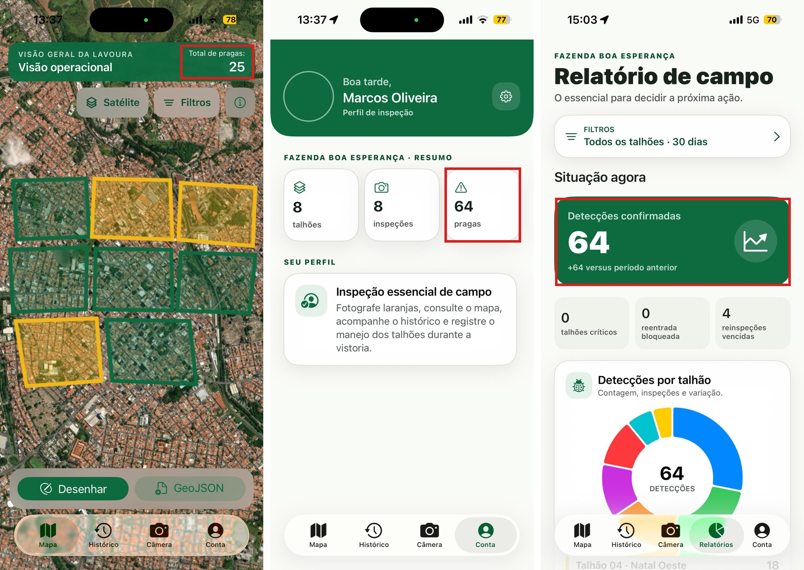
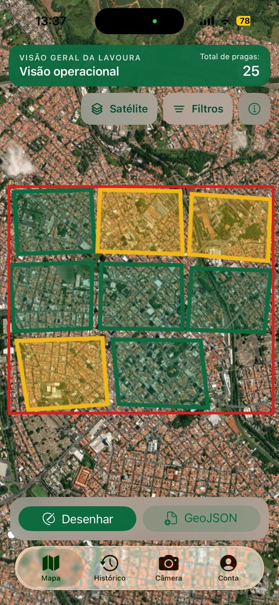
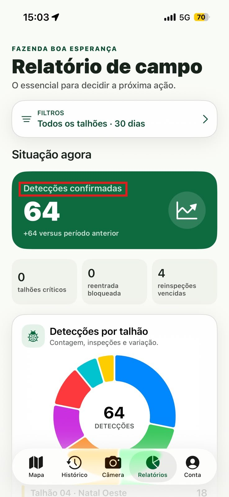
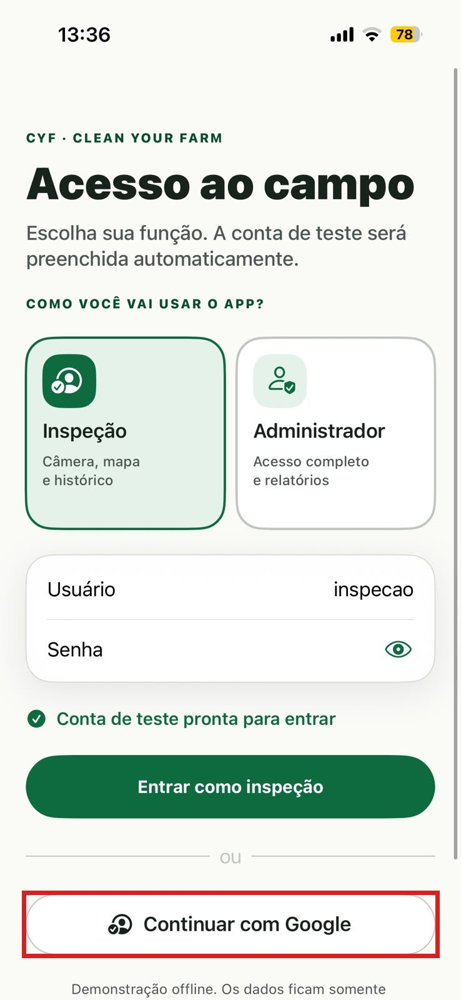
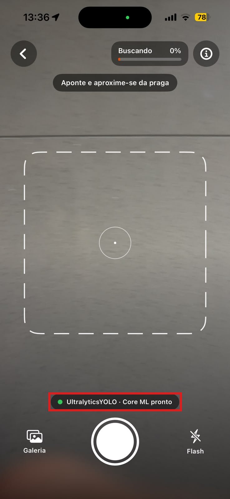
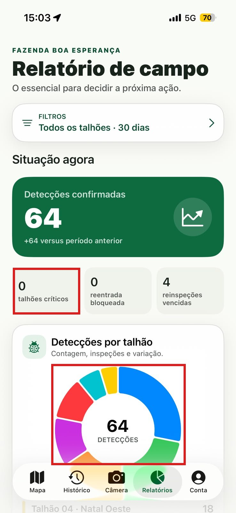
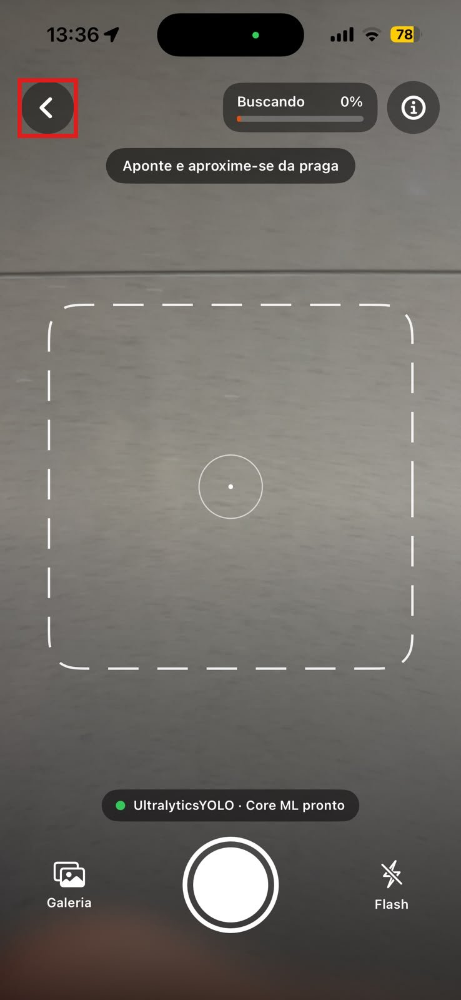
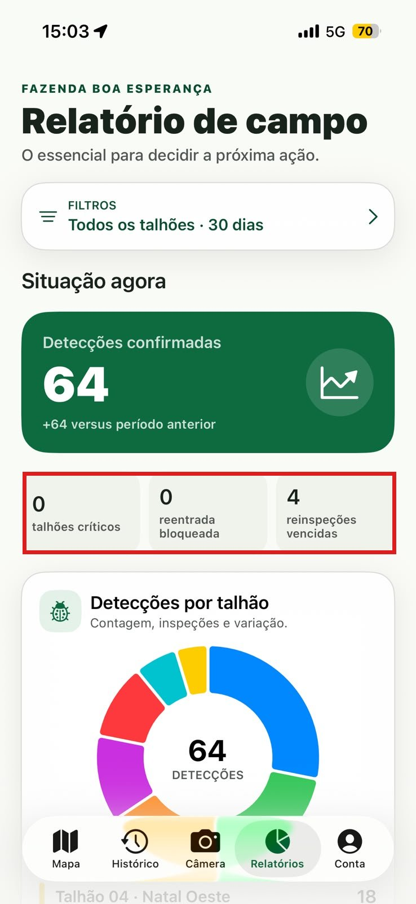
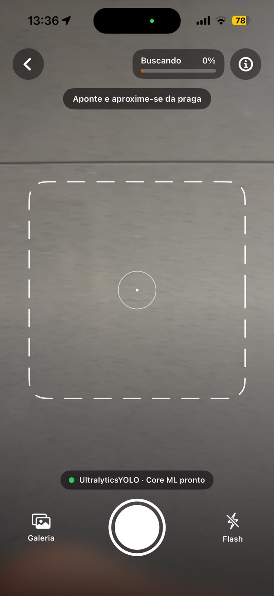

# Entrega 13 — Avaliação de IHC por inspeção heurística

**Data:** 14/11/2026  
**Status:** 🟨 em andamento — inspeção de Pedro registrada; inspeções de Lucas e Guilherme e consolidação da equipe pendentes.  
**Responsabilidade:** 1 avaliação completa por integrante, sobre todas as telas/estados relevantes do projeto.

## Objetivo da atividade

Encontrar problemas de usabilidade por inspeção sistemática da interface com as **10 heurísticas de Nielsen**. Cada avaliador trabalha individualmente primeiro; depois a equipe consolida problemas duplicados e prioridades.

> **Parte de violações:** registre somente problemas reais. Não invente uma violação para “preencher” cada heurística. Para provar que todas foram exercitadas, use a **matriz de cobertura H1–H10**. Para heurísticas sem violação, a disciplina solicita um exemplo didático de boa prática.

## 1. Heurísticas adotadas

1. Visibilidade do status do sistema
2. Compatibilidade entre o sistema e o mundo real
3. Controle e liberdade do usuário
4. Consistência e padrões
5. Prevenção de erros
6. Reconhecimento em vez de memorização
7. Flexibilidade e eficiência de uso
8. Estética e design minimalista
9. Ajudar usuários a reconhecer, diagnosticar e recuperar-se de erros
10. Ajuda e documentação

## Cobertura especial para interfaces administrativas e analíticas

Quando existirem, não limite a avaliação às “telas principais”. Inspecione também:

- dashboard em estados normal, vazio e erro;
- filtros sem resultado e filtros combinados;
- relatórios e exportação;
- histórico/listas longas;
- formulários CRUD (criação, edição, exclusão, validação);
- alteração de perfil/permissão;
- confirmações de ações destrutivas;
- processamento/loading/progresso;
- falha e recuperação;
- comparação de resultados;
- mensagens de termos técnicos, métricas e recomendações;
- ajuda/documentação contextual.

Em TCCs técnicos, observe especialmente se a interface comunica o estado do processamento e traduz informações técnicas para o vocabulário do usuário escolhido.

## 2. Escopo da inspeção

| Item | Definição |
|---|---|
| Versão avaliada | Aplicativo CYF (Clean Your Farm) para iPhone, pasta `ios-native/` de <https://github.com/Cabral100/App_Orange_Box>, commit `a36785f`, de 12/11/2026. |
| Telas/estados | Acesso (F01), Câmera (F02), Histórico (F03), Mapa (F04), Conta (F05) e Relatórios (F06), da Entrega 11. Inspecionados também, pelo código: ajuda da câmera, confirmação “Imagem capturada”, associação da foto ao talhão, detalhe da inspeção, detalhe do talhão (pulverização e armadilha), filtros do Mapa, do Histórico e dos Relatórios, exportação em PDF e exclusões. |
| Fluxos | M02 (perfil de inspeção) e M03 (perfil administrador). O aplicativo não tem perfil de agrônomo (M01). |
| Dispositivo/viewport | iPhone, com capturas de 738 × 1600 px. |
| Avaliadores | Pedro (A03); {{Lucas — A01}}; {{Guilherme — A02}}. |

## 3. Procedimento individual

Cada avaliador deve:

1. percorrer os fluxos/telas ao menos uma vez para familiarização;
2. inspecionar novamente aplicando sistematicamente H1–H10;
3. registrar cada problema com evidência e contexto;
4. atribuir severidade **depois de compreender bem o problema**, justificando a decisão;
5. não discutir achados com os demais antes de terminar a inspeção individual, quando o objetivo for preservar independência.

### Escala de severidade (0–4)

| Grau | Interpretação |
|---:|---|
| 0 | não é considerado problema de usabilidade |
| 1 | problema cosmético; corrigir se houver tempo |
| 2 | problema menor; baixa prioridade |
| 3 | problema maior; alta prioridade |
| 4 | catástrofe de usabilidade; correção imperativa antes de disponibilizar |

Ao justificar, considere **frequência, impacto e persistência** do problema no contexto real de uso.

---

## Avaliador A01 — {{Lucas}}

{{Seções 4, 5 e 6 de Lucas.}}

## Avaliador A02 — {{Guilherme}}

{{Seções 4, 5 e 6 de Guilherme.}}

## Avaliador A03 — Pedro

**Autor(a):** Pedro Henrique Ferreira Valim — 24.123.048-1

**Como a inspeção foi feita:** sobre as seis capturas da Entrega 11 e pela leitura do código da versão avaliada, tela a tela, aplicando H1–H10. Os achados marcados com **[código]** foram identificados no código e ainda precisam ser confirmados no aparelho e receber captura. A inspeção avaliou a interface, e não a precisão do modelo de detecção.

### 4. Matriz de cobertura das 10 heurísticas

| Heurística | Telas/fluxos examinados | Houve violação? | IDs dos achados | Exemplo de boa prática se não violada |
|---|---|---|---|---|
| H1 | Relatórios, detalhe do talhão, câmera | sim | V03, V04, V11 |  |
| H2 | Acesso, câmera, relatórios, mapa | sim | V05, V06, V07, V16 |  |
| H3 | Câmera, desenho de talhão, exclusões | sim | V13 |  |
| H4 | Mapa, conta, relatórios, filtros | sim | V01, V08, V09 |  |
| H5 | Detalhe do talhão, exclusões, acesso | sim | V10 |  |
| H6 | Mapa, histórico, relatórios | sim | V02 |  |
| H7 | Câmera e associação ao talhão, filtros | sim | V12 |  |
| H8 | Todas as telas das capturas | não |  | A câmera mostra só o necessário para enquadrar; os indicadores ficam na aba Relatórios (ver seção 6). |
| H9 | Câmera, acesso, mapa | sim | V14 |  |
| H10 | Câmera, mapa, relatórios | sim | V15 |  |

### 5. Declaração de violações

| ID | Heurística | Tela/estado | Problema observado | Evidência | Severidade | Justificativa da severidade | Recomendação |
|---|---|---|---|---|---:|---|---|
| V01 | H4 | Mapa (F04), Conta (F05) e Relatórios (F06) | A mesma fazenda aparece com “Total de pragas: 25” no Mapa e com “64 pragas” na Conta e “64 detecções confirmadas” nos Relatórios. Pelo código, o Mapa conta só as detecções posteriores à última pulverização de cada talhão, e a tela não diz isso. |  | 3 | Ocorre sempre que há pulverização registrada; o gestor decide com números diferentes conforme a aba e não tem como saber qual vale; persiste em todo uso. | Usar a mesma regra de contagem nas três telas ou nomear a diferença (por exemplo, “pragas desde a última aplicação”) e mostrar o período. |
| V02 | H6 | Mapa (F04), visão inicial | Os talhões aparecem só como polígonos verdes e amarelos, sem nome nem contagem visíveis. Pelo código, o nome e o número ficam em um rótulo que não apareceu neste nível de zoom, e é pelo rótulo que se abre o detalhe do talhão. |  | 3 | Afeta a primeira tela do mapa; o usuário precisa lembrar qual polígono é qual talhão, e o nível depende só da cor; sem o rótulo, não há como abrir o talhão. A confirmar em outros níveis de zoom. | Manter nome e contagem sempre visíveis no polígono e permitir tocar no próprio polígono para abrir o detalhe. |
| V03 | H1 | Relatórios, lista “Detecções por talhão” **[código]** | Talhão sem nenhuma inspeção no período recebe o mesmo rótulo de talhão inspecionado sem detecção: “0 inspeção(ões) · Sem ocorrência”, com barra verde. Além disso, a lista mostra só os quatro talhões com mais detecções, e os de contagem zero ficam ocultos até ampliar. | `DashboardView.swift`, rótulo de severidade e lista limitada a quatro linhas; captura pendente. | 3 | O gestor pode entender que um talhão que ninguém inspecionou está livre da praga e deixar de tratá-lo; é o erro central do cenário C01. A confirmar no aparelho. | Mostrar “Não inspecionado no período” com símbolo próprio, separado de “Sem ocorrência”, e destacar esses talhões no topo da lista. |
| V04 | H1 | Relatórios (F06), cartão “Detecções confirmadas” | O cartão mostra “+64 versus período anterior” e um ícone de tendência de alta, embora os dados de exemplo não tenham registros no período anterior. Falta de dados anteriores aparece como aumento. |  | 2 | Ocorre sempre que o período anterior não tem inspeção, como no início do uso; pode levar o gestor a concluir que a praga cresceu. | Quando não houver base anterior, informar “sem dados no período anterior” em vez de variação. |
| V05 | H2 | Relatórios (F06) e ajuda da câmera | O aplicativo chama de “Detecções confirmadas” o que o modelo detectou com 95% ou mais de confiança, e a ajuda diz que “a detecção é confirmada”. Para o gestor, “confirmada” sugere validação por uma pessoa. |  | 3 | Aparece no principal número da tela do gestor, que não sabe identificar a praga e depende do que lê; contraria o princípio da Entrega 9 de separar indicação da IA de confirmação humana. | Trocar por “detecções do modelo (confiança ≥ 95%)” e avisar que o resultado precisa de confirmação de um profissional. |
| V06 | H2 | Acesso (F01) | O botão “Continuar com Google” não faz login com Google: pelo código, entra direto com a conta de teste do perfil selecionado. |  | 2 | Visível para todo usuário no primeiro contato; promete algo que não acontece, mas não impede a tarefa nesta versão demonstrativa. | Remover o botão enquanto não houver login real ou rotulá-lo como demonstração. |
| V07 | H2 | Câmera (F02) | A situação do modelo aparece como “UltralyticsYOLO · Core ML pronto”, termos técnicos que não fazem parte do vocabulário do trabalhador de campo. |  | 2 | Aparece em toda inspeção; não impede a captura, mas o trabalhador não tem como saber se a mensagem pede alguma ação. | Usar linguagem da tarefa, como “Pronto para analisar” e “Preparando a análise…”. |
| V08 | H4 | Relatórios (F06), gráfico “Detecções por talhão” | As fatias usam cores variadas (azul, verde, vermelho, roxo, amarelo) para identificar talhões, enquanto o restante do aplicativo usa verde, amarelo e vermelho para nível. Há uma fatia vermelha, mas o indicador mostra “0 talhões críticos”. O gráfico não tem legenda. |  | 2 | Visível sempre que há detecção; o gestor pode ler a fatia vermelha como talhão crítico e não sabe qual fatia é qual talhão sem rolar a lista. | Usar no gráfico a cor do nível de cada talhão ou uma paleta neutra, com legenda. |
| V09 | H4 | Filtros do Mapa e do Histórico **[código]** | O filtro “Situação” oferece “Verde”, “Amarelo” e “Vermelho”, enquanto os Relatórios chamam os mesmos níveis de “Sem ocorrência”, “Atenção” e “Crítico”. | `Models.swift` (títulos do nível) e `DashboardView.swift` (rótulos); captura pendente. | 2 | Afeta quem usa filtros; o usuário precisa descobrir que cor e rótulo são a mesma coisa, e o filtro depende só do nome da cor. | Usar os mesmos rótulos em todas as telas, com a cor como apoio. |
| V10 | H5 | Detalhe do talhão, “Registrar pulverização agora” **[código]** | Um toque registra a pulverização com a data e a hora atuais, sem pedir confirmação e sem opção de desfazer. O registro faz o Mapa zerar a contagem do talhão, que passa a verde. | `MapView.swift`, folha de detalhe do talhão; captura pendente. | 3 | Um toque acidental apaga do mapa o alerta de um talhão com praga e muda as datas de reentrada e colheita; não há como reverter pela interface. A confirmar no aparelho. | Pedir confirmação com o nome do talhão e a data, permitir informar a data real e oferecer desfazer. |
| V11 | H1 | Detalhe do talhão: “Salvar nome”, “Salvar leitura” e “Registrar pulverização agora” **[código]** | Os três botões gravam a alteração sem nenhuma mensagem de confirmação. | `MapView.swift`, folha de detalhe do talhão; captura pendente. | 2 | Ocorre a cada cadastro; o usuário não sabe se a alteração foi salva e pode tocar de novo. | Mostrar confirmação curta após salvar, como já acontece ao desenhar ou importar talhões. |
| V12 | H7 | Câmera, depois de cada foto **[código]** | Após salvar uma foto, o aplicativo sai da câmera, abre o Mapa e pergunta “Qual é a área?”, mesmo quando a foto já está dentro de um talhão conhecido. Para fotografar o próximo fruto, o trabalhador precisa responder e voltar à câmera. | `AppStore.swift` (após adicionar a inspeção) e `MapView.swift` (folha da inspeção pendente); captura pendente. | 3 | Repete-se a cada fruto, em uma tarefa feita dezenas de vezes por dia, sob sol e com pouco tempo por planta. A confirmar no aparelho. | Associar automaticamente quando a posição cair em um talhão e manter o trabalhador na câmera, perguntando a área só quando não houver talhão. |
| V13 | H3 | Câmera (F02) | A câmera oculta a barra de abas, e a única saída é a seta de voltar, que pelo código leva sempre ao Histórico, e não à tela em que o usuário estava. |  | 1 | Custa um toque a mais para quem veio do Mapa; não causa perda de dados. | Voltar para a tela de origem ou manter a barra de abas visível. |
| V14 | H9 | Câmera, falha ao capturar **[código]** | A mensagem “Ative a localização precisa para salvar a inspeção…” aparece tanto quando falta a localização quanto quando a captura da imagem falha. | `CameraView.swift`, função de captura; captura pendente. | 2 | Raro, mas quando a falha é da imagem a mensagem indica a causa errada e a recuperação sugerida não resolve. | Separar as duas verificações e dar uma mensagem para cada causa. |
| V15 | H10 | Relatórios (F06) | A aba não tem ajuda nem explicação para “talhões críticos”, “reentrada bloqueada” e “reinspeções vencidas”, nem para os limites de cada nível. A Câmera e o Mapa têm botão de informação. |  | 2 | Afeta o gestor, que tem pouca experiência com tecnologia e não conhece a praga; ele pode ignorar os indicadores por não entendê-los. | Acrescentar o botão de informação já usado nas outras telas, explicando cada indicador e os limites. |
| V16 | H2 | Mapa (F04), dados de exemplo | Os talhões de exemplo da “Fazenda Boa Esperança” estão desenhados sobre uma área urbana, e não sobre um pomar. |  | 1 | Só afeta a demonstração e os testes; pode confundir o participante sobre o que está vendo. | Reposicionar os talhões de exemplo sobre uma área agrícola. |

**Qualidade do relato:** o problema deve ser observável e localizado. Evite “interface confusa” sem dizer **o que**, **onde**, **quando** e **para quem**.

### 6. Boas práticas — heurísticas não violadas (atividade didática)

| Heurística sem violação | Exemplo no sistema | Evidência | Por que atende |
|---|---|---|---|
| H8 | A câmera mostra apenas a moldura, uma orientação curta, a barra de confiança e três controles. Indicadores e gráficos ficam na aba Relatórios. |  | Nada compete com o enquadramento no momento da captura; cada tela traz só a informação da tarefa em curso. |

### Síntese individual — Pedro

- **Total:** 16 problemas: 6 de severidade 3, 8 de severidade 2 e 2 de severidade 1. Nenhum de severidade 4.
- **Por heurística:** H2 com 4; H1 e H4 com 3 cada; H3, H5, H6, H7, H9 e H10 com 1 cada.
- **Padrão recorrente:** o aplicativo não separa “sem dado” de “zero” (V03, V04) e apresenta a saída do modelo como fato confirmado (V05). Os dois afetam diretamente a decisão do gestor.
- **Prioridade antes do teste com usuários:** V01, V03, V05 e V10, por levarem a decisão errada de manejo, e V02 e V12, por dificultarem as tarefas de mapa e de captura.
- **Limitação:** seis achados (V03, V09, V10, V11, V12 e V14) vêm só do código e precisam ser confirmados no aparelho.

## 7. Consolidação da equipe

Problemas iguais ou muito semelhantes encontrados por avaliadores diferentes devem ser consolidados, preservando quem os encontrou.

| ID consolidado | Achados individuais | Heurística | Problema | Severidade final | Prioridade | Responsável pela correção |
|---|---|---|---|---:|---|---|
| HC01 | V01(A01), V04(A02) | H1 | {{...}} | {{...}} | alta | {{...}} |

## 8. Síntese e plano de melhoria

- Quantidade de problemas por heurística e severidade.
- Problemas críticos/graves que bloqueiam teste ou release.
- Padrões recorrentes entre telas.
- Correções que serão feitas antes/para a avaliação com usuários.

## Checklist

- [ ] Cada integrante fez uma inspeção completa e identificada. — feita por Pedro; faltam Lucas e Guilherme.
- [ ] Todas as telas/estados relevantes foram examinados.
- [ ] Estados administrativos, filtros, relatórios, históricos, processamento e erros foram incluídos quando existentes.
- [x] A inspeção avaliou a interface/protótipo, não o mérito técnico do algoritmo/modelo.
- [ ] H1–H10 aparecem na matriz de cobertura de cada avaliador.
- [x] Parte de violações contém apenas violações, sem “forçar” exemplos. — parte de Pedro.
- [ ] Todo problema tem print/localização e contexto. — na parte de Pedro, seis achados ainda sem captura.
- [x] Severidade possui justificativa, não apenas número. — parte de Pedro.
- [ ] Recomendação resolve a causa ou reduz o impacto.
- [ ] Achados duplicados foram consolidados ao final.
