# Entrega 13 — Avaliação de IHC por inspeção heurística

**Data:** 16/11/2026  
**Revisão documental:** 23/11/2026 — estados FA restantes conferidos diretamente no arquivo Figma, relatos complementares de Lucas incorporados e consolidação documental atualizada; registros individuais de A02 e A03 preservados.  
**Revisão após o feedback (A03 — Pedro):** 20/11/2026; inspeção de A03 nas telas FA acrescentada em 22/11/2026.  
**Revisão após o feedback (A02 — Guilherme):** 22/11/2026 — inspeção do aplicativo por A02, só pelas capturas existentes.  
**Status geral:** 🟨 em andamento — parte individual de Lucas finalizada para o escopo documentado; permanecem limitações de cobertura individual e a reavaliação coletiva das severidades não documentadas, conforme checklist.  
**Responsabilidade:** uma avaliação completa por integrante, sobre todas as telas e estados relevantes do projeto.

## Objetivo da atividade

Encontrar problemas de usabilidade por inspeção sistemática da interface com as **10 heurísticas de Nielsen**.

Cada avaliador realiza a inspeção individualmente. Depois, a equipe compara os registros, consolida duplicidades e define prioridades.

Somente problemas sustentados por evidência são registrados como violações. As matrizes de cobertura apresentam também heurísticas sem violação observada.

## 1. Heurísticas adotadas

1. Visibilidade do status do sistema.
2. Compatibilidade entre o sistema e o mundo real.
3. Controle e liberdade do usuário.
4. Consistência e padrões.
5. Prevenção de erros.
6. Reconhecimento em vez de memorização.
7. Flexibilidade e eficiência de uso.
8. Estética e design minimalista.
9. Ajudar usuários a reconhecer, diagnosticar e recuperar-se de erros.
10. Ajuda e documentação.

### Cobertura especial

Quando existentes, considerar:

- estados normais, vazios, de carregamento e de erro;
- filtros combinados e sem resultados;
- relatórios e exportação;
- Histórico e listas;
- edição, exclusão e validação;
- Acesso, Conta e permissões;
- confirmação de ações com consequências;
- mensagens, termos técnicos e ajuda;
- recuperação após falhas.

A inspeção avalia a comunicação da interface, não a precisão científica do modelo.

## 2. Escopo da inspeção

| Item | Definição |
|---|---|
| Versão de referência | Aplicativo CYF para iPhone, pasta `ios-native/` de <https://github.com/Cabral100/App_Orange_Box>, commit `a36785f`, de 12/11/2026. |
| Versão de Lucas | Aplicativo disponível durante a inspeção. Lucas confirmou Acesso, Conta, filtro do Histórico e comportamento sem GPS em 14/11/2026, na mesma versão que examinou. O registro anterior citava aproximadamente 15/11/2026, às 15h; essa data era uma estimativa. O hash exato da instalação examinada por Lucas não foi anotado; não se comprova sua equivalência exata ao commit de referência. |
| Capturas adicionais | Documentam os estados enviados posteriormente. A data de envio das imagens não é tratada como data da inspeção. |
| Telas do aplicativo | Acesso F01, Câmera F02, Histórico F03, Mapa F04, Conta F05 e Relatórios F06. |
| Estados considerados | Ajuda da câmera, confirmação de captura, detalhe da inspeção, associação ao talhão, filtros, desenho manual, ausência de localização, relatório PDF e ações sobre registros, conforme cobertura individual. |
| Protótipo do agrônomo | Telas FA01–FA03 e FA05–FA07, incluindo estados alternativos. |
| Fluxos | M02 e M03 no aplicativo; M01 no Figma, pois o aplicativo não possui perfil de agrônomo. |
| Dispositivos | Aplicativo em iPhone; protótipo FA em computador. |
| Avaliadores | A01: Lucas Tonoli Cabral Duarte; A02: Guilherme Morais Escudeiro; A03: Pedro Henrique Ferreira Valim. |
| Limitações | Capturas não comprovam todos os comportamentos dinâmicos. Alguns achados de Pedro vieram do código; na revisão de 20/11/2026 eles foram separados como problemas potenciais pendentes de reprodução. A02 (Guilherme) inspecionou o protótipo FA em 15/11/2026 e o aplicativo em 22/11/2026, este só pelas capturas existentes, sem commit comprovado e já conhecendo os registros de A01 e A03; Lucas também relatou essa exploração do aplicativo. A03 (Pedro) inspecionou as telas FA só em 22/11/2026, pelas capturas versionadas e depois de conhecer os registros de A02; essa inspeção não é independente. A01 documenta navegação própria pelo fluxo e exame visual dos dezesseis estados FA. A comparação posterior com achados conhecidos não constitui nova descoberta independente; resultados dinâmicos sem descrição específica não são presumidos. Não há comprovação de que cada avaliador tenha inspecionado individualmente todos os produtos e estados do projeto; o atendimento integral ao requisito de inspeção completa por integrante **não está demonstrado pelos registros disponíveis**. |

## 3. Procedimento individual

1. Percorrer os fluxos para conhecer a interface.
2. Examinar telas e estados aplicando H1–H10.
3. Registrar localização, condição, problema e evidência.
4. Justificar severidade pela frequência, impacto e persistência.
5. Formular recomendação relacionada à causa.
6. Explicitar estados não reproduzidos e limites da evidência.

### Severidade

| Grau | Interpretação |
|---:|---|
| 0 | Não constitui problema de usabilidade. |
| 1 | Problema cosmético. |
| 2 | Problema menor. |
| 3 | Problema maior, de alta prioridade. |
| 4 | Catástrofe de usabilidade; correção imperativa. |

## Avaliador A01 — Lucas

**Autor:** Lucas Tonoli Cabral Duarte — 24.123.032-5.

**Situação da seção:** avaliação individual concluída para o escopo documentado, com achados, evidências, recomendações e limites registrados.

### Procedimento e cobertura

Lucas examinou:

- Acesso e seus controles disponíveis;
- Conta e suas ações disponíveis;
- câmera antes e depois da captura;
- orientação e ajuda da câmera;
- detalhe da inspeção;
- associação da foto ao talhão;
- filtros do Mapa e do Histórico;
- consulta e ações do Histórico: refazer foto, editar informações e excluir imagem;
- desenho manual de talhão;
- montagem, exportação, abertura e compartilhamento do PDF;
- mensagem apresentada quando a localização está indisponível.

A verificação complementar foi confirmada por Lucas como realizada em **14/11/2026**, na mesma versão do aplicativo.

Acesso e Conta foram examinados sem identificação de novas violações. Isso registra o resultado individual de Lucas e não invalida problemas encontrados por outros avaliadores nessas telas.

O PDF foi compartilhado com um funcionário de uma fazenda parceira, que gostou do relatório. O retorno foi informal e não substitui uma sessão sistemática com usuário.

**Cobertura do protótipo:** o fluxo do agrônomo foi percorrido por Lucas. A documentação da avaliação inclui os dezesseis estados FA, suas mensagens, controles, estados vazios e estados de erro. Os resultados específicos constam das matrizes e dos registros abaixo. O protótipo utiliza dados e transições simulados; sua avaliação não demonstra persistência ou funcionamento de um sistema em produção.

**Ações realizadas no aplicativo:** edição do nome de um registro confirmado; abertura da foto do ácaro e consulta dos dados da detecção; exclusão e redesenho de uma área por novos pontos; nova tentativa após uma falha. A edição do nome é distinta da alteração do veredito. A foto da detecção também é distinta do parecer técnico elaborado pelo agrônomo.

**Acesso por perfil — problema identificado e correção:** durante a avaliação, o perfil de inspeção apresentava a tela Relatórios, destinada pela equipe ao administrador. Foram aplicadas restrições de exibição de telas conforme o perfil. A verificação de autorização efetiva e de regressão de permissões não está documentada. Esse registro fica separado das violações ativas, pois a correção foi informada sem captura comparativa ou identificação da versão alterada.

**Limites dos resultados:** a confirmação geral de que os fluxos foram testados não especifica o resultado de cada ação. Por isso, não se atribui sucesso ou falha à alteração de confirmado/rejeitado, à reabertura de parecer enviado ou ao acionamento de “Emitir parecer” com zero confirmados. A correção de área confirmada pertence ao aplicativo; os controles de correção do desenho FA06 são avaliados separadamente.

### 4. Matriz de cobertura H1–H10

| Heurística | Telas/estados examinados | Violação? | IDs | Resultado |
|---|---|---|---|---|
| H1 — Status | Acesso, Conta, câmera, confirmação, Histórico, filtros e exportação | Não nos estados observados | — | Porcentagem e orientação visíveis; confirmação de captura; filtro informa quantidade de registros; PDF gerado e aberto. |
| H2 — Mundo real | Acesso, Conta, câmera, ajuda, detalhe e associação | Sim | A01-V01, A01-V02, A01-V04 | Termos de implementação, data em inglês e sigla EXIF sem explicação. |
| H3 — Controle | Acesso, Conta, câmera, associação, Histórico e desenho | Não nos estados observados | — | Retorno, opção “Depois”, ações sobre registros e controles “Desfazer”, “Cancelar” e “Concluir” no desenho. |
| H4 — Consistência | Acesso, Conta, filtros do Mapa/Histórico e relatório | Sim | A01-V03 | Filtros usam cores em vez de nomenclatura única para as situações. |
| H5 — Prevenção | Acesso, Conta, câmera e desenho | Não nos estados observados | — | Captura bloqueada abaixo de 85%; desenho orienta usar pelo menos três pontos. |
| H6 — Reconhecimento | Acesso, Conta, Mapa e Histórico | Não nos estados observados | — | Busca por nome, lista de talhões, períodos visíveis e registros disponíveis para consulta. |
| H7 — Eficiência | Acesso, Conta, câmera, filtros, Histórico e PDF | Não nos estados observados | — | Galeria, ações sobre registros, filtros por período/talhão e exportação. |
| H8 — Minimalismo | Acesso, Conta, câmera, filtros, Histórico e relatório | Não nos estados observados | — | Lucas não identificou excesso impeditivo; câmera mantém área central para enquadramento. |
| H9 — Recuperação | Acesso, Conta, orientação da câmera e ausência de GPS | Não nos estados observados | — | A câmera orienta ajuste da distância; sem localização, mensagem explica a necessidade de ativá-la. |
| H10 — Ajuda | Acesso, Conta, ajuda da câmera e desenho | Não nos estados observados | — | Ajuda explica captura e limiar; desenho informa como marcar os vértices. |

**Limite da matriz:** “nenhuma violação observada” se refere aos estados examinados no aplicativo e não comprova ausência de todas as falhas possíveis. A análise das capturas FA consta em matriz própria, na seção complementar abaixo; a conclusão sobre cada comportamento fica restrita ao resultado registrado.

### 5. Declaração de violações ativas

| ID | H | Tela/estado | Problema | Evidência | Severidade individual | Justificativa | Recomendação |
|---|---|---|---|---|---:|---|---|
| A01-V01 | H2 | Câmera | “UltralyticsYOLO · Core ML pronto” comunica a implementação, sem traduzir o significado para a tarefa. | Figura 1 | 2 | Aparece na captura frequente; não impede a ação, mas pode ser incompreensível ao trabalhador. | Usar “Pronto para analisar” ou mensagem equivalente. |
| A01-V02 | H2 | Detalhe da inspeção | Data em inglês em interface portuguesa. | Figura 3 | 1 | Mudança de idioma dificulta leitura do registro. Também se relaciona à consistência de idioma, H4, sem constituir outro achado. | Usar data e hora no padrão local. |
| A01-V03 | H4 | Filtros do Mapa e Histórico | “Verde”, “Amarelo” e “Vermelho” nomeiam situações, enquanto outras telas usam nomes de níveis. | Figuras 4 e 10 | 2 | Exige relacionar cores e significados e conciliar rótulos diferentes. | Adotar nomenclatura única e manter cores como apoio. |
| A01-V04 | H2 | Associação da foto à área | Mensagem usa “coordenadas GPS/EXIF” sem explicar EXIF ou a ação necessária. | Figura 6 | 2 | Termo técnico aparece durante associação do registro ao local. | Explicar que a localização da foto posicionou o mapa e orientar seleção da área. |

As severidades representam o julgamento individual de Lucas. HC01 e HC02 possuem concordância registrada de Lucas e Pedro; os demais registros ainda dependem da reavaliação coletiva.

### Revisão de A01-V05

**Situação:** reclassificado; não contabilizado como violação ativa.

O registro anterior afirmava ausência de orientação ou recuperação sem GPS. A nova evidência mostra a mensagem:

> “Localização necessária. Ative a localização precisa para salvar a inspeção no ponto correto do mapa.”

Portanto, a alegação de ausência de orientação não se sustenta. A mensagem identifica a condição e informa uma ação de recuperação.

A captura do desenho manual comprova que é possível desenhar um talhão. Ela **não comprova que seja possível salvar uma inspeção sem GPS**.

A01-V05 é preservado neste histórico para documentar a revisão, sem renumerar os demais achados.

### Evidências fotográficas

#### Figura 1 — Câmera com detecção

Estado anterior à captura, com 57% e orientação de distância. Não representa inspeção salva abaixo de 85%.

#### Figura 2 — Confirmação de captura

Feedback de captura permitida e armazenamento no aparelho.

#### Figura 3 — Detalhe da inspeção

A data em inglês fundamenta A01-V02.

#### Figura 4 — Filtros do Mapa

O campo “Situação” apresenta “Todas”, “Verde”, “Amarelo” e “Vermelho”.

#### Figura 5 — Configuração do relatório

Lucas gerou, abriu e compartilhou o PDF. A imagem documenta a configuração, não o conteúdo integral do arquivo exportado.

#### Figura 6 — Associação da foto à área

A mensagem apresenta a sigla EXIF sem explicação.

#### Figura 7 — Resultado e alteração do talhão

Controles permitem alterar a associação ou marcar o talhão no mapa.

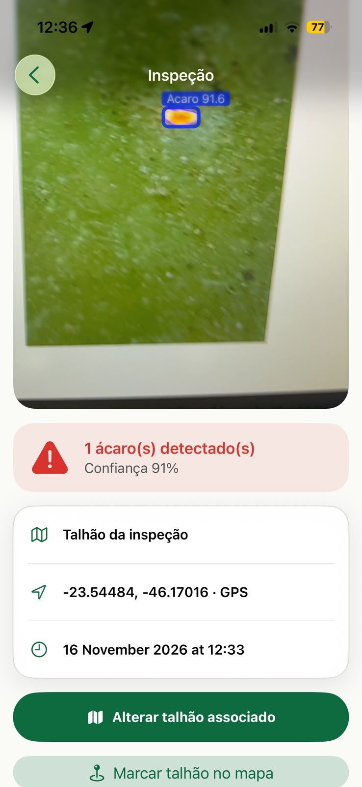

#### Figura 8 — Localização desligada

A câmera informa que a localização precisa deve ser ativada para salvar a inspeção no ponto correto do mapa.

A imagem sustenta a revisão de A01-V05 e o registro de orientação de recuperação em H9. Não demonstra o comportamento de uma falha da imagem com GPS funcionando.

#### Figura 9 — Desenho manual de talhão

O aplicativo apresenta vértices, quantidade de pontos e controles “Desfazer”, “Cancelar” e “Concluir”. A instrução solicita pelo menos três pontos.

Esta evidência comprova o desenho manual do talhão, não o salvamento de inspeção sem localização.

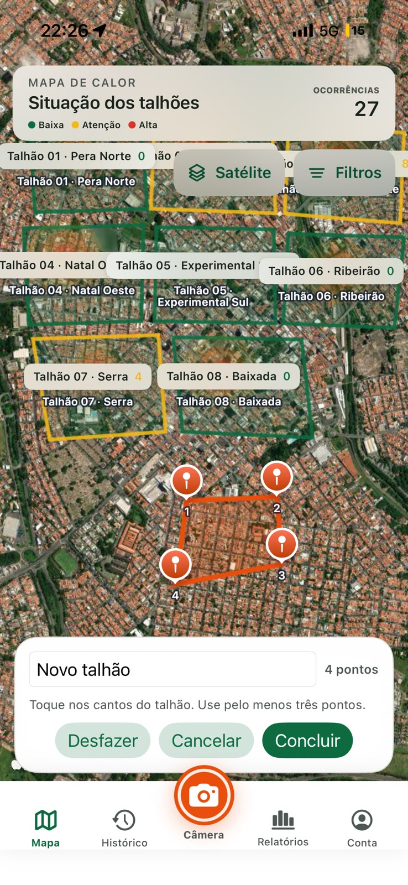

#### Figura 10 — Filtro do Histórico

A tela “Refinar registros” apresenta:

- períodos Hoje, 7 dias, 14 dias e 30 dias;
- busca e seleção de talhão;
- situação Todas, Verde, Amarelo e Vermelho;
- ação “Limpar filtros”;
- quantidade de registros no controle “Ver 13”.

A imagem confirma o escopo de A01-V03 e HC02 no Histórico.

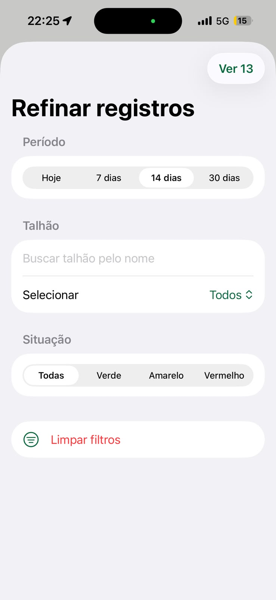

### Captura e estados de recuperação

Não foi possível salvar captura abaixo de 85%, pois o aplicativo bloqueia essa ação e informa o limiar. Esse bloqueio é uma condição de captura, não uma falha reproduzida de salvamento.

As orientações de aproximação e afastamento ajudam a ajustar a captura. Lucas não reproduziu falha depois de seguir essas orientações. Estados de erro não reproduzidos permanecem não verificados.

Nos exemplos examinados, Lucas não identificou indicação maior ou igual a 85% que reconhecesse como algo diferente de ácaro. Isso não demonstra ausência de falsos positivos nem valida a precisão do detector.

Sem localização, a mensagem informa que é necessário ativar a localização precisa. O desenho manual do talhão é uma função separada e não elimina essa exigência para salvar a inspeção.

### 6. Boas práticas

| H | Exemplo | Evidência | Justificativa |
|---|---|---|---|
| H1 | Confirmação de captura e armazenamento. | Figura 2 | Comunica conclusão da ação. |
| H3 | Refazer foto, editar informações e excluir imagem; desfazer/cancelar desenho. | Inspeção relatada e Figura 9 | Permite rever registros e corrigir desenho. |
| H5 | Bloqueio abaixo de 85%; desenho exige pelo menos três pontos. | Figura 1, ajuda examinada e Figura 9 | Previne ações fora dos requisitos definidos. |
| H6 | Busca, períodos e lista de talhões. | Figuras 4 e 10 | Permite reconhecer opções sem memorizar códigos. |
| H7 | Galeria, filtros e configuração/exportação de PDF. | Figuras 1, 5 e 10 | Oferece alternativas de entrada, consulta e compartilhamento. |
| H8 | Área central dedicada ao enquadramento. | Figura 1 | Mantém foco na captura. |
| H9 | Mensagem solicita ativar localização precisa. | Figura 8 | Explica a condição e uma ação para prosseguir. |
| H10 | Ajuda explica uso e limiar; desenho orienta marcação. | Inspeção da ajuda e Figura 9 | Orientação contextual para a tarefa. |

### Síntese individual — Lucas

- Quatro violações ativas no aplicativo: três de severidade individual 2 e uma de severidade individual 1. Os registros complementares FA estão separados abaixo e relacionados à consolidação geral.
- Três violações de H2 e uma de H4.
- A01-V05 reclassificado após evidência da orientação para ativar localização.
- Acesso e Conta examinados sem novas violações observadas por Lucas.
- Filtro do Histórico confirmado por relato e captura.
- HC01 e HC02 aprovados por Lucas e Pedro com severidade 2.
- PDF gerado e examinado; retorno do funcionário mantido como informal.
- Commit da instalação examinada não anotado.
- Os registros do aplicativo foram revisados conforme o feedback. A avaliação individual está concluída no escopo documentado; a consolidação da equipe é apresentada em seção própria.
- A análise FA passou a cobrir os dezesseis estados documentados. Lucas confirmou navegação própria; comportamentos específicos sem demonstração continuam não verificados.
- As três decisões de consolidação confirmadas por Lucas estão na seção 7. As demais severidades mantêm a autoria individual; não se presume votação coletiva de cada item.

### Avaliação de A01 — protótipo do agrônomo no Figma

**Atualização documental:** 23/11/2026.  
**Método:** navegação pelo fluxo, exame das telas, comparação de estados e registro de problemas com H1–H10. As capturas e o arquivo Figma documentam o conteúdo visual. Os retângulos vermelhos são marcações das evidências, não elementos da interface.  
**Comparação entre avaliações:** os registros FA foram confrontados com os de A02 e A03. As concordâncias são usadas na consolidação e não representam novas descobertas independentes.

**Cobertura visível:** FA01, FA01V, FA01C, FA02, FA02V, FA02R, FA02N, FA03, FA03A, FA03E, FA05, FA05V, FA06, FA06E, FA07 e FA07E. Os quatro estados restantes foram conferidos diretamente no arquivo Figma em 23/11/2026: FA01V (`5:124`), FA02R (`6:355`), FA05V (`9:449`) e FA06E (`10:1255`).

**Protótipo consultado:** <https://www.figma.com/proto/gvxtwmmYvnJVONwUOHOMVD/Orange-Box?node-id=10-1255>. O link recebido aponta para FA06E. A revisão dos quatro estados completa a cobertura visual documentada. Os resultados de navegação são considerados apenas quando descritos na avaliação. Os arquivos de evidência já referenciados nas seções individuais foram preservados. A foto circular é ilustrativa.

| Estado conferido | Conteúdo observado | Interpretação e limite |
|---|---|---|
| FA01V | Informa ausência de pedidos e detecções novas e oferece buscar no Histórico. | Boa prática de H1/H10: explica a lista vazia e oferece continuidade; destino anunciado pelo controle; comportamento específico não detalhado no registro. |
| FA02R | Informa revisão retomada, dois vereditos mantidos e três pontos pendentes em destaque. | Boa prática de H1: comunica a retomada; não comprova persistência real entre sessões. |
| FA05V | Informa ausência de detecções no período, mantém filtros e oferece ampliar para seis meses ou ver o talhão inteiro. | Boa prática de orientação e recuperação de busca sem resultado; resultado específico das ações não detalhado no registro. |
| FA06E | Informa produto e dose vazios, destaca ambos e comunica manutenção da área e dos pontos. | Boa prática de H5/H9 para campos vazios; não comprova validação de formato ou valores. |

#### Matriz de cobertura H1–H10 — capturas FA

| H | Telas/estados observados | Resultado | Registros |
|---|---|---|---|
| H1 | FA01, FA01V, FA01C, FA02, FA02V, FA02R e FA02N | Divergência entre conclusão do pedido e pendência de nova foto. | A01-FA01 |
| H2 | FA01, FA03, FA06 e FA07 | Sem violação observada na linguagem examinada; dados e avisos relacionados ao domínio. | Boa prática abaixo |
| H3 | FA01C, FA02V e FA06 | Controles de consulta e correção não estão explícitos nas capturas. | A01-FA02, A01-FA03, A01-FA13 |
| H4 | FA03, FA03E, FA03A, FA05, FA02N e FA06 | Diferenças de destaque, apresentação e nomenclatura. | A01-FA04–A01-FA07 |
| H5 | FA02 e FA06 | Ação de emitir parecer destacada com zero pontos confirmados; efeito do clique não verificado. | A01-FA08 |
| H6 | FA05 | Identificação do local cortada. | A01-FA09 |
| H7 | FA03 | Ausência de atalho visível para percorrer os pontos. | A01-FA10 |
| H8 | Todas as capturas fornecidas | Sem violação observada na organização geral. | Boa prática abaixo |
| H9 | FA03E, FA05V, FA06E e FA07E | FA06E explica campos vazios; FA05V orienta a busca. FA03E e FA07E comunicam preservação e nova tentativa, sem explicar a causa. | A01-FA11 e boa prática abaixo |
| H10 | FA03A e FA05 | Explicação insuficiente de “sinal forte/fraco”. | A01-FA12 |

“Sem violação observada” não equivale a aprovação de estados ou comportamentos não examinados. As severidades abaixo constituem a avaliação individual; as decisões coletivas registradas estão na seção 7.

#### Registros de problemas nas capturas FA

| ID | H | Tela/estado | Problema observado | Evidência | Severidade proposta | Justificativa e recomendação | Relação com registros existentes |
|---|---|---|---|---|---:|---|---|
| A01-FA01 | H1 | FA01C | Pedido T12 e aviso geral dizem “concluído”, mas a linha mantém “1 · nova foto pedida”. | 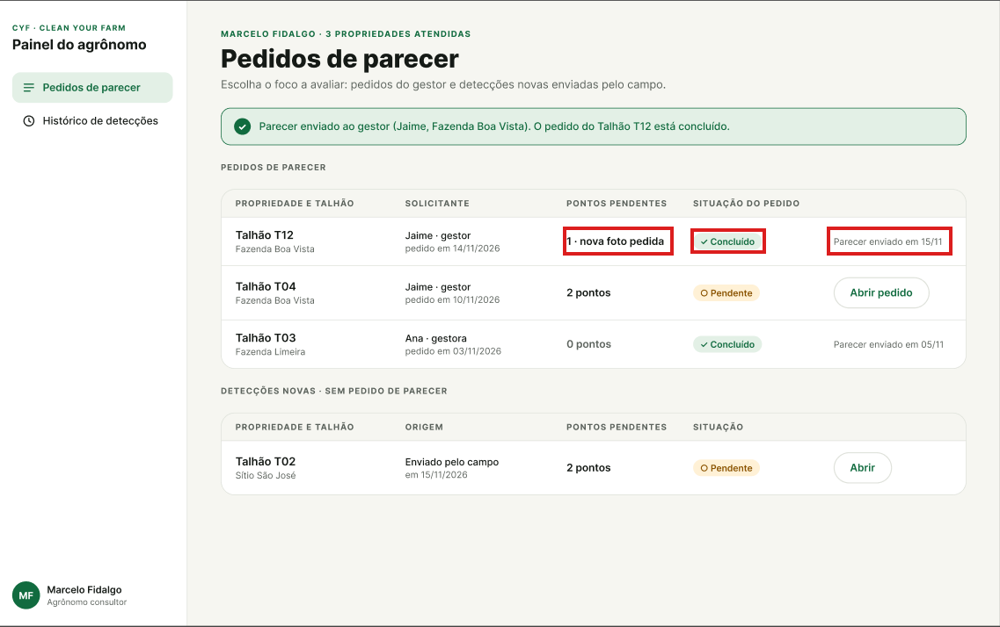 | 2 | O status pode ocultar uma pendência ainda existente. Separar “parecer enviado” de “ponto aguardando nova foto”. O efeito sobre o acompanhamento não foi observado em navegação. | A02-V01 e A03-VF01; A02 propôs 3; A01 e A03 propuseram 2. Lucas confirmou concordância da equipe com 2 na revisão atual. |
| A01-FA02 | H3 | FA01C | Pedidos concluídos mostram a data de envio, sem ação explícita para consultar o parecer. | 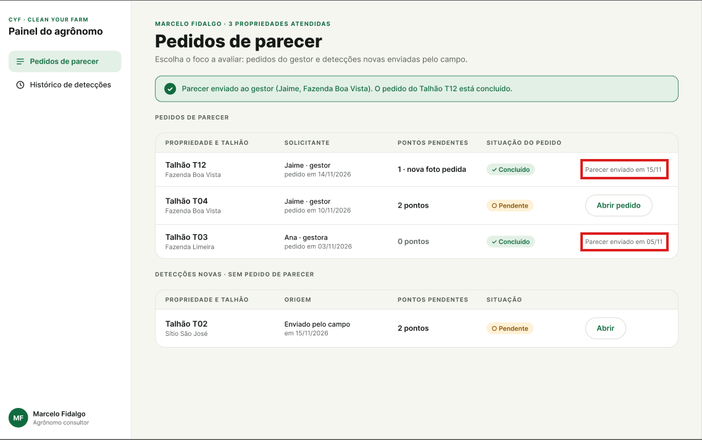 | 2 | Dificulta reconhecer como conferir o que foi enviado. Exibir “Consultar parecer”. Não se afirma que inexista acesso por outro caminho. | A02-V02 e A03-VF05. |
| A01-FA03 | H3 | FA06 | Não aparecem controles para desfazer vértice, limpar ou ajustar a área desenhada. |  | 2 | Uma correção de desenho não tem mecanismo explícito. Oferecer desfazer, limpar e ajuste. O redesenho confirmado no aplicativo não demonstra o mecanismo de edição do Figma. | A02-V03. |
| A01-FA04 | H4 | FA03 e FA03E | “Confirmar” aparece preenchido antes do veredito; na falha, “Confirmar · selecionado” fica mais claro. |  | 2 | O destaque não distingue claramente ação disponível e seleção. Adotar estado visual inequívoco e evitar sugerir confirmação anterior à escolha. | A02-V04. |
| A01-FA05 | H4 | FA03 e FA05 | A avaliação atual da IA está recolhida, mas sinais automáticos anteriores ficam expostos no resumo e no Histórico, sem esclarecer a regra de apresentação. | 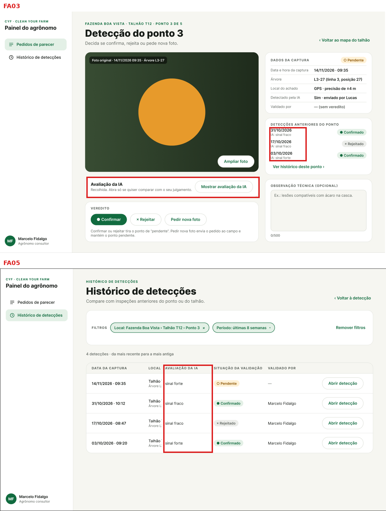 | 2 | Pode dificultar compreender por que alguns resultados automáticos ficam visíveis. Explicitar a regra e sua finalidade. Não foi demonstrada influência real no julgamento do usuário. | A02-V05. |
| A01-FA06 | H4 | FA02N | “Nova foto pedida” aparece na lista, mas mapa, legenda e contador a agrupam com os pontos apenas pendentes. |  | 2 | Não distingue quem pode avaliar agora de quem aguarda nova evidência. Usar estado, símbolo e contagem próprios. | A02-V06; relacionado a A03-VF06, que trata de terminologia. |
| A01-FA07 | H4 | FA06 | Há “Voltar ao mapa do talhão” e outro comando chamado apenas “Voltar”. |  | 1 | O segundo destino fica ambíguo. Explicitar o destino ou manter um retorno único; não foi confirmado se ambos levam ao mesmo quadro. | A02-V07 e A03-VF07. |
| A01-FA08 | H5 | FA02 | “Emitir parecer” tem aparência de ação disponível quando o contador mostra zero pontos confirmados. |  | 2 | No fluxo de aplicação sobre pontos confirmados, falta explicar a condição para avançar. Comunicar essa condição; verificar o clique antes de afirmar que a interface efetivamente permite avanço inválido. Não presumir que todo tipo de parecer exige detecção confirmada. | A02-V08 e A03-VF09; limitação comportamental explicitada. |
| A01-FA09 | H6 | FA05 | A coluna “Local” corta os nomes do talhão e da árvore. | 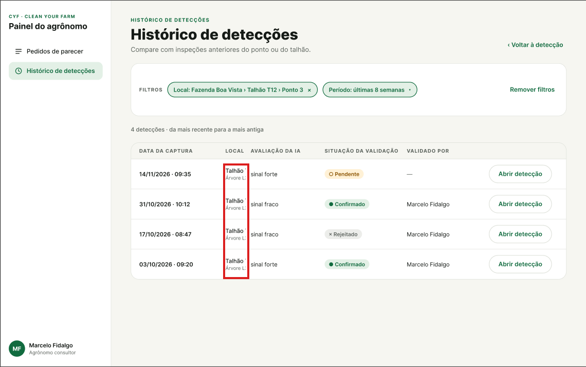 | 2 | A identificação dos registros fica incompleta. Ampliar a coluna ou permitir quebra de linha. | A02-V09 e A03-VF12. |
| A01-FA10 | H7 | FA03 | “Ponto 3 de 5” não vem acompanhado de controles visíveis de próximo/anterior. |  | 2 | A captura sugere retorno ao mapa para continuar a sequência. Oferecer navegação entre pontos; quantidade real de cliques não medida. | A02-V10 e A03-VF13. |
| A01-FA11 | H9 | FA03E e FA07E | Os avisos informam falha e nova tentativa, mas não esclarecem a causa nem uma alternativa se a repetição falhar. |  | 2 | Preservar dados é positivo, mas não basta para diagnosticar falha persistente. Informar causa quando conhecida e recuperação adequada. Foi informada nova tentativa após falha, sem descrição suficiente para avaliar todas as causas e alternativas de recuperação. | A02-V11; contrasta com a leitura de A03, que enfatiza preservação de dados. |
| A01-FA12 | H10 | FA03A e FA05 | “Sinal forte/fraco” é apresentado sem definir o que é medido; “intensidade do sinal: forte” repete o rótulo. |  | 2 | O agrônomo pode interpretar o valor como certeza ou gravidade. Explicar significado e limites, separando indicação automática de validação humana. | A02-V12 e A03-VF03; A03 classifica em H2. |
| A01-FA13 | H3 | FA02V | Pontos confirmados e rejeitados não mostram ação explícita para revisar o veredito. | 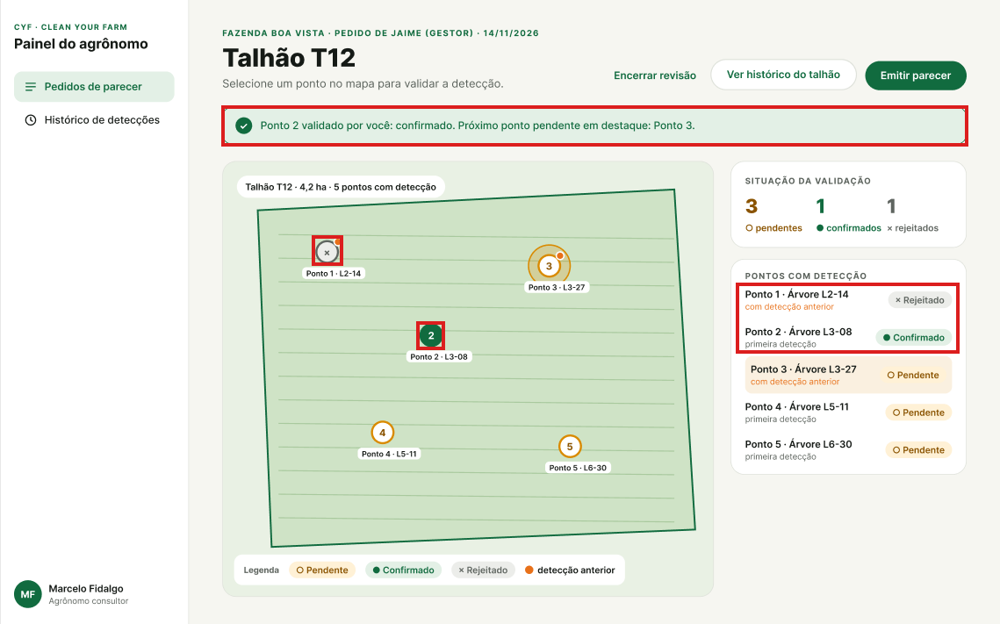 | 3 | Uma decisão incorreta pode afetar a área de aplicação. Tornar a revisão explícita antes do envio. A edição do nome foi confirmada; o resultado de mudar o veredito não foi descrito. | A02-V13 e A03-VF04; a impossibilidade funcional não foi confirmada nesta análise. |

#### Boas práticas nas capturas FA

| H | Exemplo observado | Evidência | Limite |
|---|---|---|---|
| H1 | Após validar ou pedir nova foto, o aviso informa o ponto e sua situação. | FA02V e FA02N; capturas já referenciadas acima. | Feedback representado em quadros; persistência não testada. |
| H2 | Árvore, talhão, produto, dose, período e aviso sobre receituário usam vocabulário do domínio. |  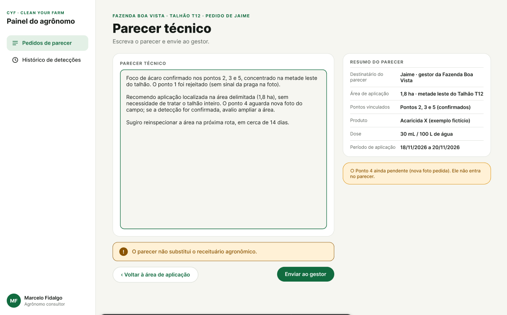 | A adequação profissional dos campos depende de validação com o público. |
| H5 | A área lista pontos confirmados e o parecer avisa que o ponto com nova foto pedida não entra na orientação. | FA06 e FA07. | A exclusão é representada visualmente; não foi testada uma seleção incorreta. |
| H8 | A lista de pedidos prioriza propriedade, solicitante, pendências e situação, com ação por linha. | 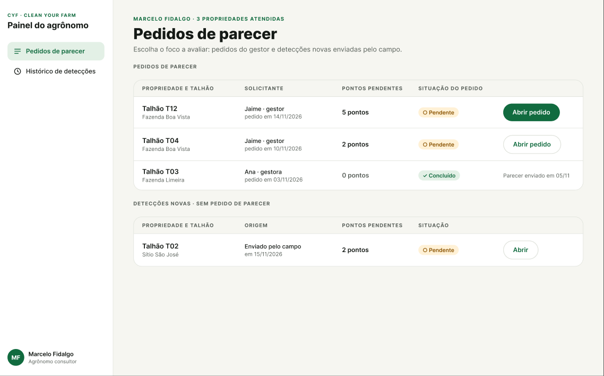 | Organização visual observada, sem medição de desempenho. |
| H9 | Os avisos de falha dizem que o veredito, a observação ou o texto foram mantidos. | FA03E e FA07E. | Boa comunicação de preservação; a causa continua sendo a questão de A01-FA11. |

#### Síntese da análise complementar

- Treze registros relacionados aos de A02, sem treze novas descobertas exclusivas: um de grau 3, onze de grau 2 e um de grau 1 na análise de A01.
- Dezesseis estados FA cobertos visualmente; Lucas confirmou navegação própria, com conclusões restritas aos resultados específicos documentados.
- As quatro telas antes ausentes foram verificadas e suas boas práticas acrescentadas.
- Pedido concluído com nova foto pendente: severidade consolidada 2. Explicação de sinal forte/fraco: H10, com relação a H2. Preservação do trabalho nos erros é boa prática, compatível com crítica à falta de diagnóstico em FA03E/FA07E.
- A avaliação reúne problemas, evidências, severidades individuais, recomendações e boas práticas. As seções de A02 e A03 são preservadas e as relações entre os registros ficam na consolidação.

## Avaliador A02 — Guilherme

**Autor:** Guilherme Morais Escudeiro — 24.123.005-1.

### Procedimento

Inspeção das telas FA01, FA01V, FA01C, FA02, FA02V, FA02R, FA02N, FA03, FA03A, FA03E, FA05, FA05V, FA06, FA06E, FA07 e FA07E.

O fluxo principal foi percorrido, incluindo Histórico, estados vazios e falhas. Depois, cada tela foi examinada com H1–H10. FA07E foi examinado como quadro desenhado: está fora do caminho navegável do protótipo (Entrega 11), então a recuperação da falha no envio não foi percorrida.

Os dados e interações são simulados. Os pontos QA21 da Entrega 12 foram considerados. Os IDs V01–V13 desta seção pertencem a A02.

**Versão inspecionada:** protótipo FA no Figma, inspeção registrada em 15/11/2026 (commit `ed4dbdc`). A data da versão do arquivo não foi anotada. As capturas desta seção são as da versão inspecionada. Os links de navegação foram corrigidos em 16/11/2026, depois da inspeção e antes do teste (Entrega 12, seção I); as violações abaixo não foram reexaminadas nessa versão.

**Limite de cobertura:** a inspeção original (V01–V13) abrange somente o protótipo FA. O aplicativo foi inspecionado depois por Guilherme, em 22/11/2026, só pelas capturas existentes (ver “Inspeção do aplicativo”). Nenhum outro avaliador inspecionou as telas FA: os treze problemas abaixo refletem uma única inspeção, e não se sabe se outro avaliador encontraria os mesmos problemas, outras violações, outra heurística ou outra severidade.

### 4. Matriz de cobertura

| H | Telas/estados | Violação? | IDs |
|---|---|---|---|
| H1 | FA01, FA01C, FA02, FA02V, FA02N | Sim | V01 |
| H2 | FA01, FA03, FA06, FA07 | Não nos estados observados | — |
| H3 | FA01C, FA02V, FA02R, FA03E, FA06, FA07E | Sim | V02, V03, V13 |
| H4 | FA02, FA02N, FA03, FA03E, FA05, FA06, FA07 | Sim | V04–V07 |
| H5 | FA02, FA06, FA07 | Sim | V08 |
| H6 | FA02, FA03, FA05, FA06 | Sim | V09 |
| H7 | FA02, FA03, FA05, FA06 | Sim | V10 |
| H8 | Todas as telas FA | Não nos estados observados | — |
| H9 | FA03E, FA05V, FA06E, FA07E | Sim | V11 |
| H10 | Todas as telas FA | Sim | V12 |

A matriz descreve o escopo observado por A02 nas telas FA da versão inspecionada. “Não nos estados observados” não significa que a heurística é atendida pelo protótipo inteiro nem pelo aplicativo, que não foi inspecionado por A02.

### 5. Declaração de violações

| ID | H | Tela/estado | Problema | Evidência | Severidade individual | Justificativa | Recomendação |
|---|---|---|---|---|---:|---|---|
| V01 | H1 | FA01C | Pedido aparece concluído com ponto aguardando nova foto, sem ação para reabrir. |  | 3 | Ponto pode permanecer sem avaliação após envio do parecer. Também se relaciona à consistência entre o estado real e o apresentado, H4, sem constituir outro achado. | Separar situação do parecer e do pedido; manter acesso e aviso da nova foto. |
| V02 | H3 | FA01C | Parecer enviado não pode ser aberto, revisto ou complementado. |  | 2 | Correções precisam ocorrer fora do sistema. | Permitir consulta e envio de correção ou complemento. |
| V03 | H3 | FA06 | Desenho sem desfazer vértice, mover ponto ou limpar área. |  | 2 | Clique errado dificulta corrigir área calculada. | Incluir desfazer, limpar e ajuste de vértices. |
| V04 | H4 | FA03/FA03E | “Confirmar” recebe destaque antes da seleção; estilo selecionado fica mais claro. |  | 2 | Pode confundir seleção e influenciar confirmação. | Mesmo peso inicial e estilo único de seleção. |
| V05 | H4 | FA03/FA05 | Avaliação da IA recolhida no ponto atual, mas aberta no Histórico. |  | 2 | Regra de apresentação inconsistente. | Adotar regra única conforme estado da validação. |
| V06 | H4 | FA02N | Nova foto pedida usa símbolo de pendência e não aparece separada no contador. |  | 2 | Usuário pode tentar avaliar ponto sem foto disponível. | Símbolo, legenda e contador próprios. |
| V07 | H4 | FA06 | Dois retornos ao mesmo local usam rótulos diferentes. |  | 1 | Destino do retorno pode ser interpretado incorretamente. | Padronizar rótulo ou manter um controle. |
| V08 | H5 | FA02 | “Emitir parecer” ativo sem ponto confirmado, levando ao erro posterior. |  | 2 | Destaca caminho ainda inviável. | Desativar e explicar necessidade de confirmar um ponto. |
| V09 | H6 | FA05 | Coluna de local cortada. |  | 2 | Sem filtro, registros não se distinguem adequadamente. | Ampliar coluna ou quebrar texto em linhas. |
| V10 | H7 | FA03 | Sequência “Ponto 3 de 5” sem próximo/anterior. |  | 2 | Requer voltar ao mapa a cada ponto. | Oferecer próximo pendente e anterior. |
| V11 | H9 | FA03E/FA07E | Falhas pedem nova tentativa, sem causa ou alternativa persistente. |  | 2 | Repetir ação pode não resolver. | Explicar causa e recuperação, preservando dados. |
| V12 | H10 | FA03A/FA03/FA05 | “Sinal forte/fraco” sem explicação. |  | 2 | Pode atribuir peso indevido ao modelo. | Explicar termos e responsabilidade da validação humana. |
| V13 | H3 | FA02V/FA02 | Veredito não pode ser desfeito ou alterado. |  | 3 | Erro de confirmação ou rejeição altera área e não tem correção. | Desfazer e reabrir ponto até envio, com autoria registrada. |

As severidades representam o julgamento individual de Guilherme. A01 e A03 inspecionaram depois as telas FA (A03 de forma não independente), e as equivalências estão na seção 7.4. Só HC05 teve a severidade revista (de 3 para 2), com concordância da equipe relatada por Lucas; a reavaliação coletiva das demais continua pendente.

### 6. Boas práticas

| H | Exemplo | Evidência | Justificativa |
|---|---|---|---|
| H2 | Identificação de árvore, dose e aviso sobre receituário em linguagem do domínio. |   | Relaciona informações à atividade do agrônomo. |
| H8 | Pedidos mostram informações necessárias à escolha, com uma ação por linha. |  | Detalhes ficam para etapas posteriores. |

### Síntese individual — Guilherme

- Treze problemas: dois de severidade 3, dez de severidade 2 e um de severidade 1.
- H4: quatro; H3: três; H1, H5, H6, H7, H9 e H10: um cada.
- H2 e H8 sem violação observada.
- Prioridades: V01, V13, V04 e V05.
- Estados intermediários e avaliação automática não seguem a mesma regra em todo o fluxo.
- QA21: aviso de pendentes aparece em FA06/FA07; situação do parecer gerou V01/V02; avaliação recolhida gerou V05; ordem de navegação por teclado não conferida nas capturas.
- Inspeção baseada nas telas FA, com conferência no Figma da impossibilidade de reabrir ponto validado.
- O desenho manual mostrado na Figura 9 pertence ao aplicativo e não elimina V03 do protótipo FA.
- Revisão de 22/11/2026: versão inspecionada e limite de cobertura registrados; FA07E examinado só como quadro desenhado; matriz limitada aos estados observados; V01 relacionado também a H4.
- A inspeção do aplicativo foi feita em 22/11/2026, só por capturas, com os limites registrados abaixo.
- Severidades individuais; registros FA de A01 e A03 relacionados depois (seção 7.4); reavaliação coletiva pendente, exceto HC05.

### Inspeção do aplicativo — Guilherme

**Data:** 22/11/2026, depois do feedback da Entrega 13.

**Procedimento:** Guilherme não executou o aplicativo. Examinou as 25 capturas disponíveis no repositório, aplicando H1–H10:

- as seis telas da Entrega 11 (F01 Acesso, F02 Câmera, F03 Histórico, F04 Mapa, F05 Conta e F06 Relatórios);
- as dez capturas de Lucas (Figuras 1–10);
- as nove capturas de Pedro (`v01`–`v15`), algumas com marcações de A03.

**Versão:** as capturas não têm commit anotado. A referência continua sendo `a36785f`, mas a equivalência não está comprovada.

**Limites:**
- Guilherme já conhecia os registros de A01 e A03 quando fez esta inspeção, então ela não é independente desses avaliadores. Achados coincidentes estão marcados como “também encontrado”.
- Estados que não aparecem em nenhuma captura não foram avaliados, como falhas de captura, registro de pulverização, gravações, edição em Conta e conteúdo do PDF.
- Os IDs A02-A01 a A02-A08 pertencem a esta inspeção e não se confundem com V01–V13 do FA.

#### Matriz de cobertura — aplicativo

| H | Telas/estados | Violação? | IDs |
|---|---|---|---|
| H1 | Câmera, confirmação de captura, Histórico, filtros, Relatórios | Não nos estados observados | — (A02-A08 também se relaciona) |
| H2 | Câmera, detalhe da inspeção, resultado, associação, Relatórios | Sim | A02-A02, A02-A03, A02-A04, A02-A05, A02-A08 |
| H3 | Acesso, Câmera, associação, desenho, Conta | Não nos estados observados | — |
| H4 | Câmera, resultado, Mapa, desenho, filtros, Relatórios | Sim | A02-A01, A02-A06 |
| H5 | Câmera, desenho, Acesso | Não nos estados observados | — |
| H6 | Mapa, Histórico, filtros | Não nos estados observados | — |
| H7 | Câmera, filtros, relatório PDF | Não nos estados observados | — |
| H8 | Todas as capturas | Sim | A02-A07 |
| H9 | Sem localização, câmera | Não nos estados observados | — |
| H10 | Câmera, desenho, Relatórios | Não nos estados observados | — |

“Não nos estados observados” se refere às capturas examinadas e não significa que a heurística é atendida pelo aplicativo inteiro.

#### Violações — aplicativo

| ID | H | Tela/estado | Problema | Evidência | Severidade individual | Justificativa | Recomendação | Relação com outros avaliadores |
|---|---|---|---|---|---:|---|---|---|
| A02-A01 | H4 | Câmera e resultado | A mesma confiança aparece em formatos e arredondamentos diferentes: “Ácaro 57%” no indicador e “Acaro 56.6” na caixa; no resultado, “Acaro 91.6” na caixa e “Confiança 91%” no cartão. | 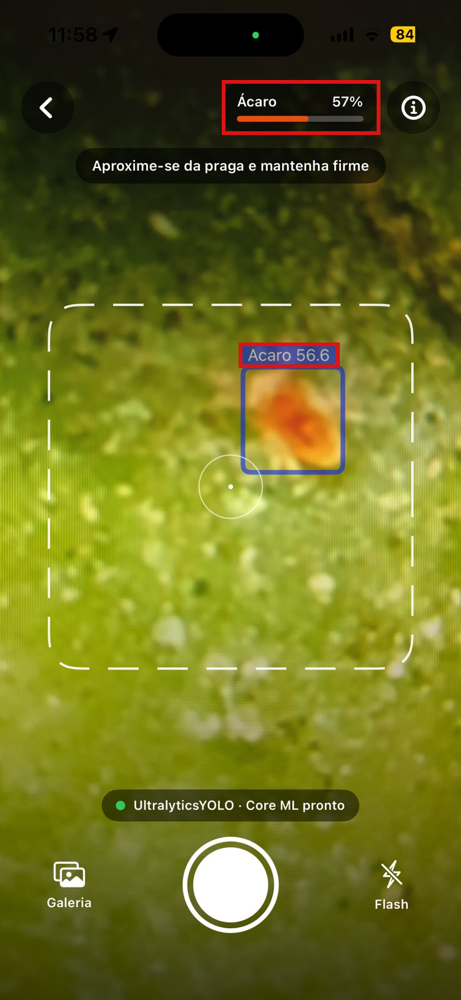 | 1 | Duas regras para o mesmo número, uma delas sem % e sem acento. Não impede a tarefa. | Mostrar a confiança num único formato, com %, em todos os lugares. | Novo. |
| A02-A02 | H2 | Câmera | “UltralyticsYOLO · Core ML pronto” usa termos de implementação. | 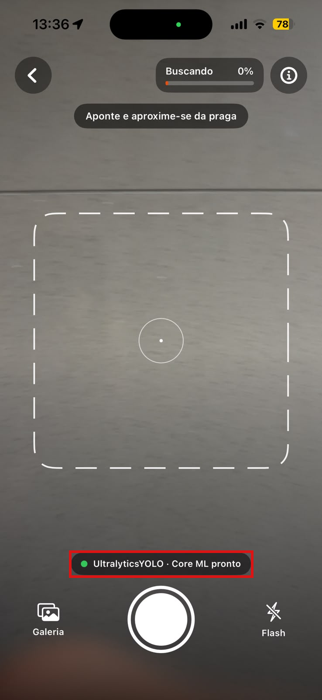 | 2 | Aparece em toda captura; o usuário não sabe o que significa nem se precisa agir. | Usar “Pronto para analisar”. | Também encontrado (HC01: A01-V01, A03-V07). |
| A02-A03 | H2 | Detalhe da inspeção e resultado | Localização exibida como coordenadas cruas (“-22.56500, -47.41120 · GPS”). |  | 1 | Números de sistema sem uso para a tarefa; o talhão, que é a informação útil, já aparece acima. Repete-se no resultado (Figura 7). | Mostrar o talhão e, se necessário, “Ver no mapa” no lugar das coordenadas. | Novo. |
| A02-A04 | H2 | Detalhe da inspeção e resultado | Data em inglês (“12 November 2026 at 13:15”). |  | 1 | Mudança de idioma em interface portuguesa; repete-se no resultado. | Usar data e hora no padrão local. | Também encontrado (HC03: A01-V02). |
| A02-A05 | H2 | Detalhe da inspeção e resultado | “4 ácaro(s) detectado(s)”, com alerta vermelho, apresenta a saída automática como constatação, sem indicar que ainda não foi validada por uma pessoa. | 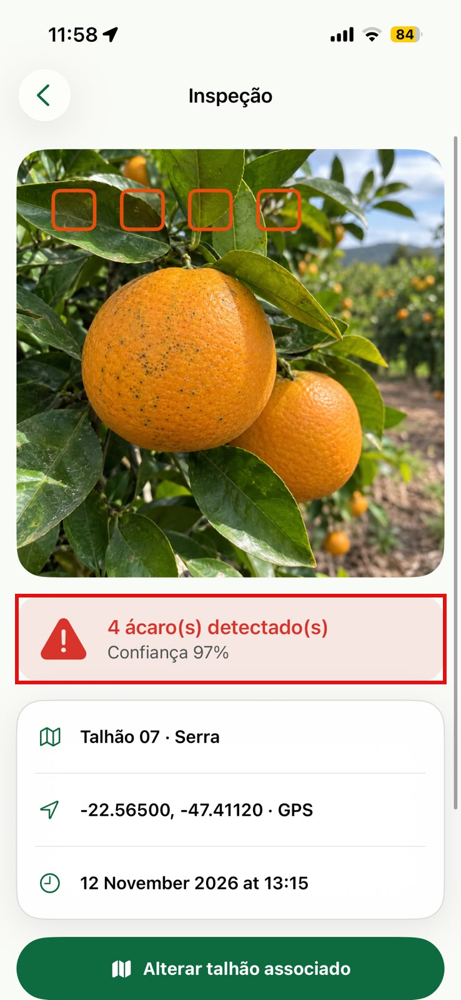 | 3 | Aparece em todo registro com detecção; o usuário pode tomar o resultado do modelo como diagnóstico e agir com base nele. | Identificar o resultado como automático e mostrar a situação da validação humana separadamente. | Novo; relacionado a HC22 (A03-V05), em outra tela e com outra causa. |
| A02-A06 | H4 | Desenho de talhão no Mapa | Pinos e contorno do novo talhão usam laranja-avermelhado próximo ao vermelho de “Alta”, cuja legenda está visível na mesma tela. | 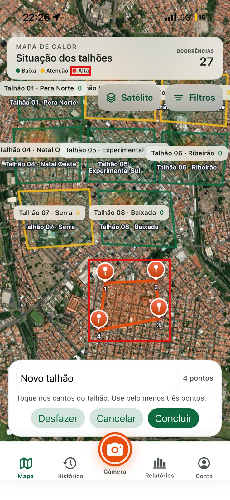 | 1 | Cor de alerta usada para outro significado. Durante o desenho o usuário sabe o que está fazendo; a captura não mostra se a cor permanece no talhão salvo. | Usar no desenho uma cor fora da escala de atenção. | Novo; relacionado a HC24 (A03-V08). |
| A02-A07 | H8 (H2 relacionada) | Associação da foto à área | “O mapa foi centralizado nas coordenadas GPS/EXIF da foto” informa um procedimento técnico desnecessário à escolha da área. | 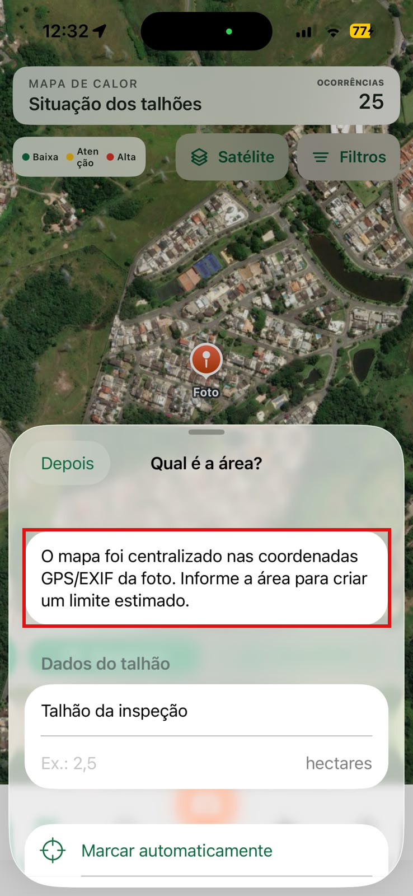 | 2 | O pino “Foto” já indica o local; a frase ocupa o topo do painel durante a associação de cada foto. | Trocar por “O ponto marca onde a foto foi tirada” ou retirar. | Também encontrado (HC04: A01-V04), com heurística divergente: A01 classificou em H2, A02 em H8. |
| A02-A08 | H2 (H1 relacionada) | Câmera | “Buscando 0%” não indica que o número é a confiança da detecção nem que a captura exige 85%; pode ser lido como progresso de carregamento. | 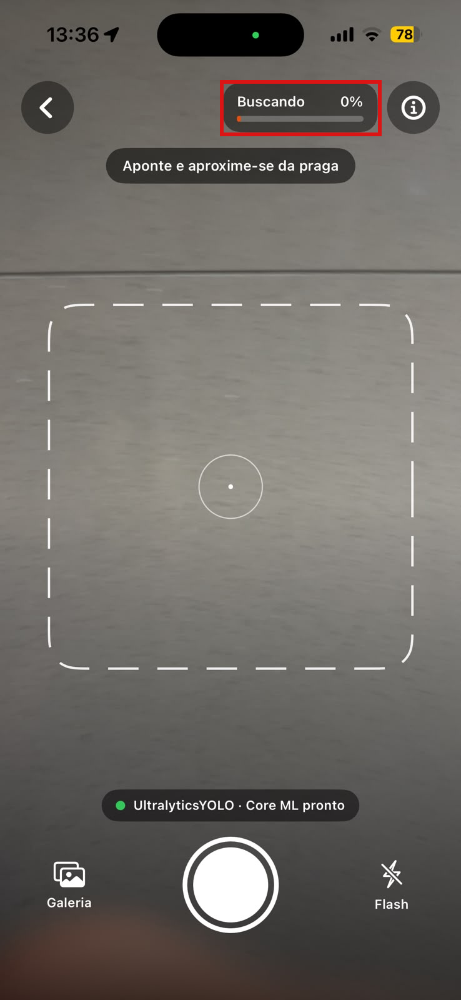 | 2 | O avaliador não identificou o significado sem comparar com outra captura. O usuário pode esperar a barra encher sem aproximar a câmera. A ajuda (i) explica o limiar, mas só se for aberta. | Rotular como “Confiança”, mostrar “Nenhuma praga no quadro” quando for 0 e marcar 85% na barra. | Novo. |

#### Boas práticas — aplicativo

Guilherme não registrou boas práticas no aplicativo.

#### Síntese — aplicativo

- Oito violações: uma de severidade 3, três de severidade 2 e quatro de severidade 1.
- H2: cinco; H4: duas; H8: uma.
- Três coincidem com registros de outros avaliadores (HC01, HC03 e HC04). Em HC04 a heurística diverge.
- Cinco são novas: A02-A01, A02-A03, A02-A05, A02-A06 e A02-A08.
- Prioridade: A02-A05, por apresentar a saída automática como constatação.
- Inspeção só por capturas, sem commit comprovado e sem independência em relação a A01 e A03.

## Avaliador A03 — Pedro

**Autor:** Pedro Henrique Ferreira Valim — 24.123.048-1.

### Procedimento

Inspeção das seis capturas da Entrega 11, das capturas adicionais de Lucas e leitura do código, aplicando H1–H10.

**Escopo de A03:** aplicativo iOS (perfis Administrador e Inspeção), de 16 a 20/11/2026, e telas FA do protótipo do agrônomo, em 22/11/2026 (seção “Inspeção de A03 nas telas FA”).

**Revisão de 20/11/2026:** somente problemas visíveis na interface ficam como violações. Os registros vistos apenas no código (V03, V10, V11 e V14) foram movidos para “Problemas potenciais pendentes de reprodução”: mantêm o ID para rastreabilidade, mas não entram na contagem de violações até haver captura do estado. V16 passou a ser observação sobre os dados de demonstração. V06 foi reclassificado de H2 para H4 e V02 teve a severidade revista para 2. Essas revisões são individuais de A03; a severidade final coletiva continua pendente.

V09 foi confirmado visualmente no Mapa e no Histórico pelas capturas de Lucas. V12 tem confirmação parcial.

### 4. Matriz de cobertura

| H | Telas/fluxos | Violação? | IDs |
|---|---|---|---|
| H1 | Relatórios, detalhe do talhão, câmera | Sim | V04 (hipóteses V03 e V11 pendentes de reprodução) |
| H2 | Acesso, câmera, relatórios | Sim | V05, V07 |
| H3 | Câmera, desenho, exclusões | Sim | V13 |
| H4 | Acesso, Mapa, Conta, relatórios, filtros | Sim | V01, V06, V08, V09 |
| H5 | Talhão, exclusões, Acesso | Não nos estados observados | — (hipótese V10 pendente de reprodução) |
| H6 | Mapa, Histórico, relatórios | Sim, condicional ao zoom | V02 |
| H7 | Câmera, associação e filtros | Sim, confirmação parcial | V12 |
| H8 | Todas as capturas | Não nos estados observados | — |
| H9 | Câmera, Acesso, Mapa | Não nos estados observados | — (hipótese V14 pendente de reprodução) |
| H10 | Câmera, Mapa, relatórios | Sim | V15 |

A matriz descreve o escopo observado por A03 nas capturas do aplicativo iOS. “Não nos estados observados” não significa que a heurística é atendida pelo sistema inteiro.

### 5. Declaração de violações

| ID | H | Tela/estado | Problema | Evidência | Severidade | Justificativa | Recomendação |
|---|---|---|---|---|---:|---|---|
| V01 | H4 | Mapa, Conta e Relatórios | Contagens diferentes sem explicar que Mapa considera detecções posteriores à última pulverização. |  | 3 | Gestor recebe números distintos sem conhecer a regra. | Unificar contagem ou explicitar período e critério. |
| V02 | H6 | Mapa | Polígonos sem nome/contagem visíveis no zoom capturado. **Confirmação parcial:** a Figura 9 mostra nomes e contagens em outro zoom. | 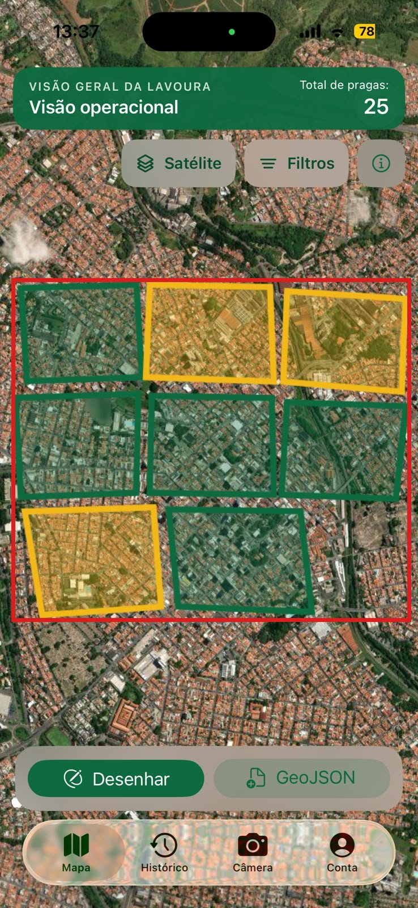 | 2 | Revisão de 20/11/2026 (antes 3): o problema depende do nível de zoom e não há evidência de que impeça abrir o talhão. Não foram verificados o zoom em que os rótulos somem nem se o polígono é tocável. | Manter identificação visível em todos os níveis de zoom e permitir tocar no polígono; verificar os pontos acima antes de nova revisão da severidade. |
| V04 | H1 | Relatórios | Variação positiva exibida sem dados no período anterior. |  | 2 | Pode sugerir crescimento sem base comparativa. | Mostrar “Sem dados no período anterior”. |
| V05 | H2 | Relatórios e ajuda | “Detecções confirmadas” nomeia saída do modelo com confiança alta. |  | 3 | Pode ser confundida com confirmação profissional. | Identificar resultado do modelo e separar validação humana. |
| V06 | H4 | Acesso | “Continuar com Google” entra em conta de teste, sem autenticação Google real. |  | 2 | Reclassificado de H2 para H4 em 20/11/2026: “Continuar com Google” é um padrão conhecido de login, e o botão não segue o comportamento que esse padrão promete. | Rotular como demonstração ou implementar autenticação real. |
| V07 | H2 | Câmera | “UltralyticsYOLO · Core ML pronto” usa termos de implementação. |  | 2 | Usuário pode não compreender se deve agir. | Usar “Pronto para analisar”. |
| V08 | H4 | Gráfico do relatório | Cores identificam talhões, mas também significam severidade em outras telas; gráfico sem legenda. |  | 2 | Vermelho pode ser interpretado como crítico. | Usar paleta adequada e legenda. |
| V09 | H4 | Filtros do Mapa e Histórico | Cores no filtro diferem dos nomes usados nos relatórios e na legenda do Mapa. |   | 2 | Exige traduzir cores para situações. | Padronizar rótulos, mantendo cor como apoio. |
| V12 | H7 | Após foto [código] | Saída da câmera para associação de área pode interromper capturas sucessivas. |  Pergunta confirmada fora de talhão; caso dentro de talhão não confirmado. | 3 | Pode adicionar passos repetidos à inspeção. | Associar quando possível e perguntar apenas quando necessário; confirmar comportamento no aparelho. |
| V13 | H3 | Câmera | Retorno leva ao Histórico, independentemente da origem, segundo código. |  | 1 | Impõe navegação adicional, sem perda de dados. | Voltar à origem ou manter navegação disponível. |
| V15 | H10 | Relatórios | Sem ajuda para indicadores e limites. |  | 2 | Indicadores podem não ser compreendidos. | Ajuda contextual com definições e limites. |

### Problemas potenciais encontrados na inspeção do código — pendentes de reprodução

Possíveis violações identificadas por inspeção de implementação. **Requerem reprodução na interface.** Não fazem parte da contagem de violações nem da priorização do plano de melhoria até serem reproduzidos. Para cada um, falta: reproduzir o estado no aparelho, fazer a captura, confirmar a heurística e revisar a severidade.

| ID | H provisória | Tela/estado | Comportamento esperado pela leitura do código | Evidência | Severidade provisória do autor | O que falta para confirmar |
|---|---|---|---|---|---:|---|
| V03 | H1 | Relatórios | Talhão não inspecionado recebe indicação semelhante a talhão inspecionado sem ocorrência; lista inicial limitada. | `DashboardView.swift`. | 3 | Captura no iPhone de um talhão sem inspeção no período ao lado de um inspecionado sem ocorrência. |
| V10 | H5 | Registrar pulverização | Um toque registra aplicação, muda contagem e datas sem confirmação ou desfazer. | `MapView.swift`. | 3 | Captura antes e depois do toque, mostrando ausência de confirmação e de desfazer. |
| V11 | H1 | Salvar nome/leitura/pulverização | Gravações sem mensagem de confirmação. | `MapView.swift`. | 2 | Captura imediatamente após cada gravação. |
| V14 | H9 | Falha de captura | Mensagem de localização também usada quando falha a captura da imagem. | `CameraView.swift`; a Figura 8 confirma só o caso sem localização. | 2 | Provocar falha da imagem com localização ativa e capturar a mensagem. |

**Evidência posterior, de outra versão:** na versão web, U02 não identificou o talhão sem inspeção (AU04, Entrega 14, 17/11/2026). Isso não reproduz V03 no aplicativo iOS inspecionado e não é usado aqui como confirmação; serve apenas para a comparação entre as Entregas 13 e 14.

### Observação sobre os dados de demonstração (fora da contagem heurística)

| ID | Tela | Observação | Evidência | Tratamento |
|---|---|---|---|---|
| V16 | Mapa demonstrativo | Talhões de exemplo desenhados sobre área urbana. |  | Retirado das violações em 20/11/2026: é limitação dos dados de demonstração e da preparação da avaliação, não da interface que um usuário real veria com seus próprios talhões. Recomenda-se reposicionar os exemplos em área agrícola antes de novos testes. |

### Observações sobre as novas evidências

A Figura 9 mostra nomes e contagens no zoom apresentado. Isso delimita V02: a ausência de rótulos não pode ser generalizada para todos os níveis de zoom, e por isso V02 passou a confirmação parcial, com severidade 2.

A Figura 8 confirma a mensagem quando falta localização. Não confirma que a mesma mensagem apareça em uma falha da imagem com localização disponível; por isso V14 está entre os problemas pendentes de reprodução.

A ausência de violação identificada por Lucas em Acesso e Conta não apaga automaticamente V06 ou V01 de Pedro. São resultados individuais, com métodos e evidências diferentes.

### 6. Boas práticas

| H | Exemplo | Evidência | Justificativa |
|---|---|---|---|
| H8 | Câmera concentra enquadramento, orientação, confiança e controles; indicadores ficam no relatório. |  | Mantém informações relacionadas à tarefa atual. |

### Síntese individual — Pedro

Revisada em 20/11/2026.

- Onze violações com evidência visual, uma delas (V12) com confirmação parcial e outra (V02) condicional ao zoom: três de severidade 3, sete de severidade 2 e uma de severidade 1.
- H4: quatro; H2: duas; H1, H3, H6, H7 e H10: uma cada.
- Quatro problemas potenciais pendentes de reprodução (V03, V10, V11 e V14), fora da contagem.
- Uma observação sobre os dados de demonstração (V16), fora da contagem heurística.
- Prioridades entre as violações confirmadas: V01, V05 e V12.
- Padrões principais: números e estados sem critério explicado e saída automática apresentada como confirmação.
- Telas FA inspecionadas depois, em 22/11/2026, de forma não independente (ver seção seguinte).

### Inspeção de A03 nas telas FA (22/11/2026)

**Procedimento:** inspeção das 16 capturas FA versionadas em `assets/11_figma/` (FA01, FA01V, FA01C, FA02, FA02V, FA02N, FA02R, FA03, FA03A, FA03E, FA05, FA05V, FA06, FA06E, FA07 e FA07E), aplicando H1–H10, sem navegar no protótipo clicável. Comportamentos que dependem de navegação não foram verificados.

**Independência:** a inspeção foi feita depois de A03 conhecer os registros de A02 (seção anterior) e o feedback do professor. Por isso **não é independente**: concordâncias com A02 podem ter sido influenciadas, e esta seção não comprova que outro avaliador encontraria os mesmos problemas sem esse conhecimento. Ela reduz, mas não elimina, a lacuna de cobertura de A03.

#### Matriz de cobertura — telas FA

| H | Telas/estados | Violação? | IDs |
|---|---|---|---|
| H1 | FA01C, FA02, FA02R | Sim | VF01, VF02 |
| H2 | FA03A, FA05 | Sim | VF03 |
| H3 | FA01C, FA02V, FA03 | Sim | VF04, VF05 |
| H4 | FA02N, FA06, FA07 | Sim | VF06, VF07, VF08 |
| H5 | FA02, FA03, FA06 | Sim | VF09, VF10, VF11 |
| H6 | FA05 | Sim | VF12 |
| H7 | FA03 | Sim | VF13 |
| H8 | Todas as capturas FA | Não nos estados observados | — |
| H9 | FA03E, FA05V, FA06E, FA07E | Não nos estados observados | — |
| H10 | FA02 (legenda), FA03 | Não nos estados observados | — |

#### Declaração de violações — telas FA

| ID | H | Tela/estado | Problema | Evidência | Severidade | Justificativa | Recomendação | Relação com A02 |
|---|---|---|---|---|---:|---|---|---|
| VF01 | H1 | FA01C | O pedido do T12 aparece “Concluído” enquanto a mesma linha mostra “1 · nova foto pedida”. |  | 2 | O estado do pedido contradiz a pendência visível. O parecer enviado registra o ponto 4, o que reduz a perda da informação. | Mostrar “Parecer enviado · 1 ponto aguardando nova foto” e manter acesso ao ponto. | Equivalente a A02-V01 (A02 atribuiu severidade 3). |
| VF02 | H1 | FA02 | “Encerrar revisão” não informa o que acontece com os vereditos já registrados; só FA02R, ao retomar, mostra que foram mantidos. |   | 1 | Gera dúvida antes da ação, mas o estado é preservado e a retomada informa isso. | Indicar no próprio comando ou em confirmação curta que os vereditos ficam salvos. | Novo. |
| VF03 | H2 | FA03A, FA05 | “Sinal forte/fraco” é explicado como “Intensidade do sinal: forte”, sem dizer o que o sinal mede. | 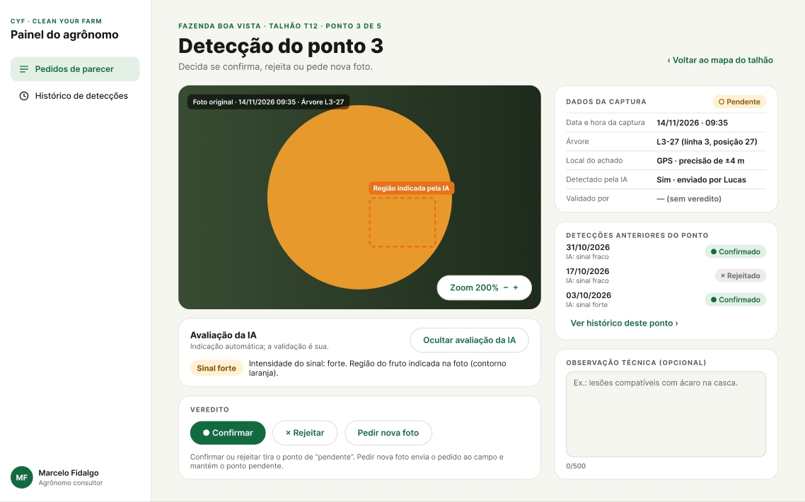 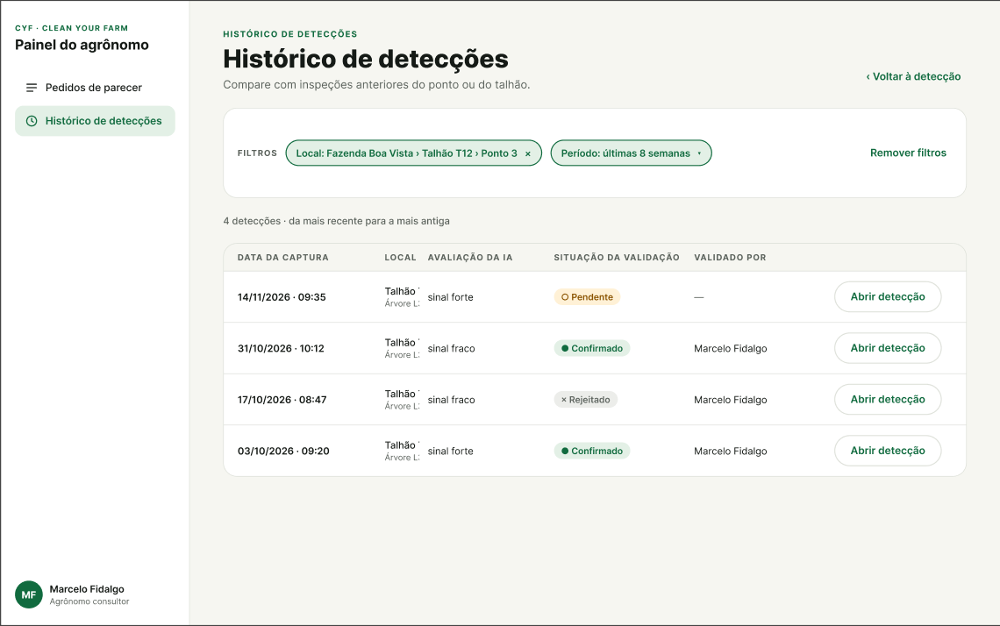 | 2 | O termo não corresponde a um conceito do agrônomo e pode receber peso indevido. | Explicar em linguagem do domínio o que o valor indica e o que não indica. | Equivalente a A02-V12 (A02 classificou em H10). |
| VF04 | H3 | FA02V, FA02 | Pontos confirmados ou rejeitados não oferecem ação para alterar o veredito. | 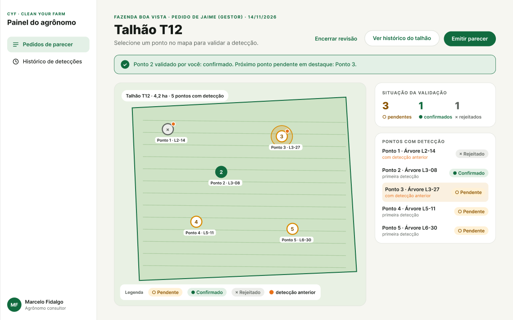 | 3 | Um veredito errado altera a área de aplicação e não tem correção visível. | Permitir revisar o veredito antes do envio do parecer, registrando a alteração. | Equivalente a A02-V13. |
| VF05 | H3 | FA01C | Pedido concluído mostra só “Parecer enviado em 15/11”, sem ação para abrir o parecer. |  | 2 | O agrônomo não consegue conferir o que enviou. | Permitir abrir o parecer enviado e, se necessário, complementá-lo. | Equivalente a A02-V02. |
| VF06 | H4 | FA01, FA02N, FA06, FA07 | “Pendente” tem sentidos diferentes: pedido sem resposta, ponto sem veredito e ponto com nova foto pedida. O ponto 4 aparece como “Nova foto pedida” em FA02N e como “pendente” em FA06 e FA07. |   | 2 | O mesmo termo muda de significado entre telas e o mesmo ponto recebe nomes diferentes. | Reservar “pendente” para ponto sem veredito e usar sempre “aguardando nova foto” para o ponto 4. | Relacionado a A02-V06 (símbolo), com causa diferente (terminologia). |
| VF07 | H4 | FA06 | Dois comandos de retorno: “‹ Voltar ao mapa do talhão” e “‹ Voltar”. |  | 1 | Não fica claro se levam ao mesmo lugar. | Manter um único retorno com destino explícito. | Equivalente a A02-V07. |
| VF08 | H4 | FA06 | Aviso com erro de grafia: “Ponto 4 ainda esta pendente”. |  | 1 | Problema cosmético que reduz a credibilidade da mensagem. | Corrigir para “está”. | Novo. |
| VF09 | H5 | FA02 | “Emitir parecer” aparece como ação principal com 0 pontos confirmados. |  | 2 | Convida a um caminho que ainda não pode ser concluído. | Desativar até haver ponto confirmado, explicando a condição. | Equivalente a A02-V08. |
| VF10 | H5 | FA06 | Produto e dose são campos de texto livre, sem unidade nem formato; a validação de FA06E só trata campo vazio. |   | 2 | Uma dose digitada errada não é prevenida. A obrigatoriedade desses campos continua hipótese do domínio (P03). | Separar valor e unidade e conferir o formato antes de continuar. | Novo. |
| VF11 | H5 | FA03 | A observação técnica fica em painel separado, sem indicar que é registrada junto com o veredito; só FA03E sugere isso. |  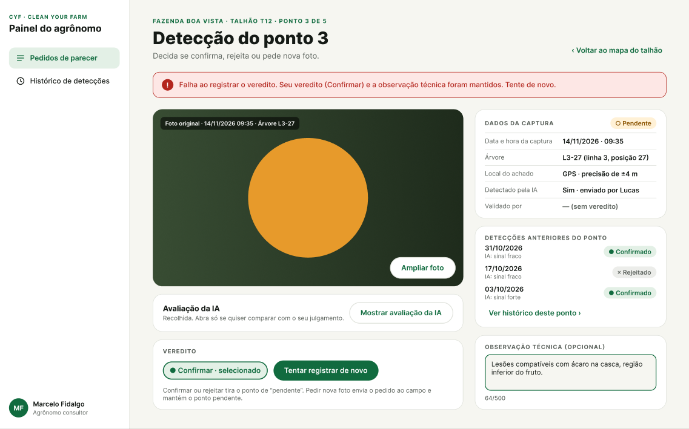 | 2 | Quem escrever a observação depois de escolher o veredito pode não saber se ela foi salva. O comportamento real não foi verificado na navegação. | Indicar que a observação é enviada com o veredito ou oferecer salvamento próprio. | Novo. |
| VF12 | H6 | FA05 | Coluna “Local” cortada (“Talhão…”). |  | 2 | Sem o filtro, os registros não se distinguem pelo local. | Ampliar a coluna ou quebrar o texto. | Equivalente a A02-V09. |
| VF13 | H7 | FA03 | “Ponto 3 de 5” sem ir ao próximo ou ao anterior; é preciso voltar ao mapa. |  | 2 | Acrescenta passos repetidos na validação de vários pontos. | Oferecer “próximo pendente” e “anterior”. | Equivalente a A02-V10. |

#### Boas práticas — telas FA

| H | Exemplo | Evidência | Justificativa |
|---|---|---|---|
| H9 | Os erros de FA06E e FA07E dizem o que falhou e que a área, os pontos ou o texto foram mantidos. |   | O usuário sabe o que corrigir sem perder o trabalho. A02 registrou em V11 que a causa da falha não é explicada; as duas leituras coexistem e vão para a consolidação. |
| H8 | Cada pedido em FA01 mostra só propriedade, solicitante, pontos pendentes e situação, com uma ação por linha. |  | Mantém o necessário para escolher o foco. |

#### Comparação com A02 — insumo para a consolidação coletiva

- **Equivalentes (8):** VF01↔V01, VF03↔V12, VF04↔V13, VF05↔V02, VF07↔V07, VF09↔V08, VF12↔V09 e VF13↔V10.
- **Divergências a discutir:** VF01 com severidade 2 (A02: 3); VF03 classificado em H2 (A02: H10); H9 sem violação para A03 (A02: V11).
- **Novos de A03 (5):** VF02, VF06, VF08, VF10 e VF11.
- **Registros de A02 não encontrados por A03 nas capturas:** V03 (desenho sem desfazer), V04 (destaque de “Confirmar”), V05 (avaliação da IA recolhida/aberta), V06 (símbolo de nova foto) e V11 (causa da falha).

Nenhuma unificação foi feita aqui. A consolidação desses registros com A02, a severidade final e a inclusão dos novos itens na tabela 7.4 dependem da reunião da equipe.

**Síntese de A03 nas telas FA:** treze violações (uma de severidade 3, nove de severidade 2 e três de severidade 1), oito equivalentes a A02 e cinco novas, todas com captura; inspeção não independente e sem navegação no protótipo.

## 7. Consolidação

### 7.1 Critério de consolidação

Foram comparados localização, causa, consequência e recomendação dos registros.

Foram unificados somente os pares que descrevem o mesmo problema na mesma interface. Problemas relacionados, mas com causas ou ações de correção diferentes, permanecem separados.

A revisão documental não é apresentada como uma nova inspeção realizada pelos integrantes nem como uma reunião não registrada.

### 7.2 Duplicidades consolidadas

Lucas confirmou que ele e Pedro concordaram com a unificação dos dois pares, mantendo severidade 2 para ambos.

| ID | Registros individuais | H | Problema consolidado | Escopo | Severidade | Decisão | Responsáveis |
|---|---|---|---|---|---:|---|---|
| HC01 | A01-V01 + V07/A03 | H2 | Câmera comunica prontidão com nomes técnicos da implementação. | Câmera do aplicativo. | 2 | Usar mensagens relacionadas à tarefa, como “Pronto para analisar”. | Lucas e Pedro. |
| HC02 | A01-V03 + V09/A03 | H4 | Filtros nomeiam situações pelas cores, divergindo dos demais rótulos do aplicativo. | Mapa e Histórico. | 2 | Padronizar nomes em filtros, Mapa e relatórios, mantendo cores como apoio. | Lucas e Pedro. |

### 7.3 Registro reclassificado

| Registro | Situação anterior | Evidência adicional | Decisão |
|---|---|---|---|
| A01-V05 | Ausência de orientação de recuperação sem GPS. | Figura 8 informa a necessidade de ativar localização precisa. | Retirado das violações ativas; mantido no histórico e registrado como boa prática de H9. |

O desenho manual da Figura 9 é registrado separadamente. Não comprova salvamento da inspeção sem GPS.

### 7.4 Relação consolidada

**Fechamento documental de 23/11/2026:** os treze registros complementares de A01 foram relacionados aos treze de A02. Oito registros FA de A03 correspondem a problemas já presentes; quatro acrescentam problemas visuais distintos, registrados como HC32–HC35. VF10/A03 permanece como hipótese comportamental, fora da contagem ativa. Os relatos individuais são mantidos como histórico, inclusive onde ainda mencionam uma consolidação futura.

**Participação e cronologia:** Lucas informou reunião com Pedro e Guilherme em **04/11/2026**, com discussão de fontes, usabilidade e acesso por perfil. Não se atribuem a essa reunião quadros ou achados documentados posteriormente. Na conversa de revisão de 23/11/2026, Lucas informou concordância da equipe com três propostas: severidade 2 para conclusão com pendência, H10 para explicação de sinal e separação entre preservação positiva de dados e diagnóstico insuficiente de falhas. A confirmação é um relato de Lucas; não há ata independente. A elaboração da tabela restante é consolidação documental, sem presumir deliberação coletiva de cada severidade.

**Inspeção do aplicativo por A02 (22/11/2026):** em HC01, HC03 e HC04, A02 encontrou o mesmo problema e atribuiu a mesma severidade individual; isso é concordância entre avaliadores, não reavaliação coletiva. As outras cinco violações de A02 no aplicativo foram consolidadas como HC36–HC40, numeradas após HC32–HC35 de A03.

| ID consolidado | Origem | Problema | Severidade | Situação da evidência |
|---|---|---|---:|---|
| HC01 | A01-V01; A03-V07; A02-A02 | Mensagem técnica na câmera. | 2 | Visual; unificação aprovada por Lucas e Pedro. Também encontrado por A02 (22/11/2026), com a mesma heurística e severidade individual 2. |
| HC02 | A01-V03; A03-V09 | Situações nomeadas por cores nos filtros. | 2 | Visual no Mapa e Histórico; unificação aprovada por Lucas e Pedro. |
| HC03 | A01-V02; A02-A04 | Data em inglês. | 1 | Visual; também encontrado por A02 com severidade individual 1; sem reavaliação coletiva. |
| HC04 | A01-V04; A02-A07 | Mensagem técnica na associação da foto (“GPS/EXIF”). | 2 | Visual; também encontrado por A02 com severidade individual 2. **Heurística divergente:** A01 classificou em H2 (sigla sem explicação); A02 em H8 (informação técnica desnecessária), com H2 relacionada. Sem reavaliação coletiva. |
| HC05 | A02-V01; A01-FA01; A03-VF01 | Pedido concluído com ponto pendente de nova foto. | 2 | Contradição visual; concordância da equipe relatada por Lucas. |
| HC06 | A02-V02; A01-FA02; A03-VF05 | Parecer enviado sem consulta ou complemento. | 2 | Protótipo FA. |
| HC07 | A02-V03; A01-FA03 | Desenho da área FA06 sem controles explícitos de correção; edição no aplicativo não comprova edição no Figma. | 2 | Protótipo FA. |
| HC08 | A02-V04; A01-FA04 | Destaque e seleção inconsistentes no veredito. | 2 | Protótipo FA. |
| HC09 | A02-V05; A01-FA05 | Exibição inconsistente da avaliação automática. | 2 | Protótipo FA. |
| HC10 | A02-V06; A01-FA06 | Nova foto pedida sem representação própria no mapa. | 2 | Protótipo FA. |
| HC11 | A02-V07; A01-FA07; A03-VF07 | Rótulos de retorno ambíguos; equivalência dos destinos não verificada por Lucas. | 1 | Protótipo FA. |
| HC12 | A02-V08; A01-FA08; A03-VF09 | Ação de emitir parecer aparenta estar disponível sem ponto confirmado; efeito do clique não verificado por Lucas. | 2 | Protótipo FA. |
| HC13 | A02-V09; A01-FA09; A03-VF12 | Local cortado no Histórico. | 2 | Protótipo FA. |
| HC14 | A02-V10; A01-FA10; A03-VF13 | Falta de navegação entre pontos. | 2 | Protótipo FA. |
| HC15 | A02-V11; A01-FA11 | Falha sem causa ou recuperação alternativa. | 2 | Protótipo FA. |
| HC16 | A02-V12; A01-FA12; A03-VF03 | Sinal forte/fraco sem explicação. | 2 | Protótipo FA. |
| HC17 | A02-V13; A01-FA13; A03-VF04 | Correção de veredito sem ação explícita; editar nome do registro não comprova alterar confirmado/rejeitado. | 3 | Protótipo FA e conferência de navegação. |
| HC18 | A03-V01 | Contagens divergentes entre telas. | 3 | Captura e regra identificada no código. |
| HC19 | A03-V02 | Identificação de talhões ausente em determinado zoom. | 2 | **Parcial** — captura; condicional ao zoom (revisão individual de A03, antes 3). |
| HC21 | A03-V04 | Variação sem base no período anterior. | 2 | Visual. |
| HC22 | A03-V05 | Detecção automática apresentada como confirmada. | 3 | Captura e descrição da regra no código. |
| HC23 | A03-V06 | Botão Google com comportamento demonstrativo (H4). | 2 | Captura e código. |
| HC24 | A03-V08 | Cores do gráfico conflitantes e sem legenda. | 2 | Visual. |
| HC27 | A03-V12 | Associação após foto pode interromper sequência. | 3 | **Parcial** — captura fora de talhão e código; condição dentro de talhão não confirmada. |
| HC28 | A03-V13 | Retorno da câmera não preserva origem. | 1 | Captura e código. |
| HC30 | A03-V15 | Indicadores sem ajuda contextual. | 2 | Visual. |
| HC32 | A03-VF02 | “Encerrar revisão” não explica previamente a manutenção dos vereditos; FA02R informa isso ao retornar. | 1 | Visual; proposta individual de A03. |
| HC33 | A03-VF06 | Terminologia “pendente” reúne pedido, ponto sem veredito e ponto aguardando nova foto. | 2 | Visual; separado de HC10, que trata da representação no mapa. |
| HC34 | A03-VF08 | Ausência de acento em “Ponto 4 ainda esta pendente” em FA06. | 1 | Visual; proposta individual de A03. |
| HC35 | A03-VF11 | Não fica explícito quando a observação técnica é registrada com o veredito. | 2 | Ambiguidade visual; persistência e ordem de edição não verificadas. |
| HC36 | A02-A01 | Mesma confiança em formatos e arredondamentos diferentes (câmera e resultado). | 1 | Visual (captura); severidade individual de Guilherme, sem reavaliação coletiva. |
| HC37 | A02-A03 | Localização exibida como coordenadas cruas no detalhe e no resultado. | 1 | Visual (captura); severidade individual de Guilherme, sem reavaliação coletiva. |
| HC38 | A02-A05 | Detecção automática apresentada como constatação no detalhe e no resultado, sem situação da validação humana. | 3 | Visual (captura); severidade individual de Guilherme, sem reavaliação coletiva. |
| HC39 | A02-A06 | Cor do desenho de talhão próxima ao vermelho de “Alta”. | 1 | Visual (captura); severidade individual de Guilherme, sem reavaliação coletiva. |
| HC40 | A02-A08 | “Buscando 0%” sem indicar que é confiança nem o limiar de 85%. | 2 | Visual (captura); severidade individual de Guilherme, sem reavaliação coletiva. |

#### 7.4.1 Registros fora da contagem de violações

Os IDs foram mantidos para preservar a rastreabilidade.

| ID consolidado | Origem | Problema | Estado |
|---|---|---|---|
| HC20 | A03-V03 | Não inspecionado confundido com sem ocorrência. | Pendente de reprodução no aplicativo iOS (só código). Problema equivalente observado depois na versão web (AU04, Entrega 14). |
| HC25 | A03-V10 | Pulverização sem confirmação ou desfazer. | Pendente de reprodução (só código). |
| HC26 | A03-V11 | Gravações sem feedback. | Pendente de reprodução (só código). |
| HC29 | A03-V14 | Mensagem de localização reutilizada em falha de imagem. | Pendente de reprodução (só código). |
| HC31 | A03-V16 | Talhões demonstrativos em área urbana. | Fora da heurística: limitação dos dados de demonstração. |

**Ressalva a VF10/A03:** a tela FA06 mostra “30 mL / 100 L de água”; portanto, não se sustenta a afirmação de ausência de unidade no exemplo. FA06E confirma somente a comunicação de campos vazios. Ausência de validação de valores, formato ou unidade não foi testada e fica fora da contagem de violações confirmadas.

**Acesso por perfil — correção relatada:** o inspetor visualizava Relatórios e a equipe restringiu a tela ao administrador. O relato não foi somado aos problemas ativos, pois não há evidência comparativa nem versão da correção. A revisão por perfil deve conferir também autorização efetiva, além de ocultar o item de navegação.

### 7.5 Relações preservadas sem unificação

- **HC04 e HC27:** tratam da associação da foto, mas HC04 é linguagem e HC27 é interrupção de fluxo.
- **HC05 e HC10:** tratam de pendências, mas um afeta situação do pedido e outro representação do ponto.
- **HC06 e HC17:** consulta/correção de parecer enviado e correção de veredito são ações diferentes.
- **HC09, HC16 e HC22:** consistência da apresentação, explicação da avaliação e uso do termo “confirmado” exigem correções distintas.
- **HC18 e HC21:** divergência de contagens e comparação sem base temporal têm causas diferentes.
- **HC22 e HC38:** ambos tratam a saída automática como resultado definitivo, mas HC22 é o termo “confirmadas” em Relatórios e HC38 é a apresentação do registro no detalhe da inspeção.
- **HC24 e HC39:** ambos usam vermelho fora do sentido de alerta, mas um está no gráfico do relatório e o outro no desenho de talhão.
- **HC36 e HC40:** ambos tratam do indicador de confiança, mas HC36 é inconsistência de formato e HC40 é o significado do número.
- **A01-V05 e HC29:** a orientação correta quando falta GPS não comprova o tratamento correto de uma falha da imagem.

### 7.6 Contagem documental atualizada

| Categoria | Quantidade |
|---|---:|
| Núcleo anterior | 26 |
| Novos problemas visuais de A03 (HC32–HC35) | 4 |
| Novos problemas visuais de A02 no aplicativo (HC36–HC40) | 5 |
| **Total documental após unificação** | **35** |
| Aplicativo, evidência visual | 16 |
| Protótipo FA, evidência visual | 17 |
| Confirmação parcial (HC19, HC27) | 2 |
| Severidade 3 | 5 |
| Severidade 2 | 22 |
| Severidade 1 | 8 |
| Severidade 4 | 0 |
| Hipóteses de código pendentes de reprodução | 4 |
| Hipótese de validação de dose/formato (A03-VF10) | 1 |
| Observação de dados demonstrativos, fora do total | 1 |
| Correção de acesso por perfil relatada, fora do total ativo | 1 |

A soma é 35 = 16 + 17 + 2. HC05 passou de 3 para 2; HC32–HC35 acrescentam dois itens de grau 1 e dois de grau 2; HC36–HC40 (A02, aplicativo, só por capturas) acrescentam três de grau 1, um de grau 2 e um de grau 3. As demais severidades são as propostas individuais, sem atribuição automática de consenso. A01-V05 continua retirado. Os treze registros FA de A01, oito equivalências FA de A03 e os registros A02-A02, A02-A04 e A02-A07 (coincidentes com HC01, HC03 e HC04) não são contados novamente. Os quatro potenciais de código e VF10 não entram no total. A quantidade de registros não mede isoladamente a qualidade da interface.

## 8. Síntese e plano de melhoria

### Prioridades

| Prioridade | Problemas | Ação | Responsável pelo acompanhamento |
|---|---|---|---|
| Alta | HC18, HC22 e HC38 | Esclarecer contagens e distinguir resultado automático de validação humana. | Pedro, Guilherme/equipe. |
| A reproduzir antes de priorizar | HC20, HC25, HC26 e HC29 | Reproduzir no aparelho e capturar; só então confirmar heurística e severidade. HC20 tem problema equivalente observado na versão web (AU04), o que justifica reproduzi-lo primeiro. | Pedro. |
| Alta | HC05 e HC17 | Manter acesso a pendências e permitir corrigir veredito. | Guilherme/equipe. |
| Alta (confirmação parcial) | HC27 | Conferir interrupções nas capturas dentro de talhão. | Pedro/equipe. |
| Média | HC19 | Verificar em que zoom os rótulos somem e se o polígono é tocável. | Pedro/equipe. |
| Média | HC01 | Traduzir mensagem técnica da câmera. | Lucas e Pedro. |
| Média | HC02 | Padronizar nomes nos filtros, Mapa e relatórios. | Lucas e Pedro. |
| Média | HC04 | Explicar associação da foto sem a sigla EXIF. | Lucas/equipe. |
| Média | HC06–HC10, HC12–HC16, HC21, HC23, HC24, HC30 e HC40 | Melhorar controle, consistência, ajuda e feedback conforme recomendações individuais. | Equipe. |
| Média | HC33 e HC35 | Distinguir pendências e explicar quando a observação é registrada. | Equipe. |
| Menor | HC32 e HC34 | Explicar a saída da revisão e corrigir a grafia. | Equipe. |
| Menor | HC03, HC11, HC28, HC36, HC37 e HC39 | Ajustar idioma, rótulos, retorno, formato da confiança, exibição da localização e cor do desenho. | Equipe. |
| Preparação de testes | HC31 | Reposicionar os talhões demonstrativos em área agrícola. | Equipe. |

A severidade não indica que a correção já foi implementada.

### Critérios para verificar as melhorias

| Grupo | Como verificar |
|---|---|
| Linguagem e datas | Conferir mensagens em português e termos relacionados à tarefa. |
| Filtros e gráficos | Usar a mesma nomenclatura e separar identificação de talhão de nível de atenção. |
| Contagens e períodos | Conferir regras iguais ou diferenças explicitadas; ausência de dados não deve aparecer como zero ou crescimento. |
| Validação e parecer | Permitir consultar, corrigir e reconhecer pendências sem perder os registros. |
| Ações com impacto | Confirmar consequências e permitir recuperação quando aplicável. |
| Falhas | Reproduzir cada causa separadamente e conferir mensagem e recuperação correspondentes. |
| Fluxo de captura | Conferir comportamento dentro e fora de talhões conhecidos e retorno à captura. |

### Conclusão

A revisão documental de 23/11/2026 organiza **35 problemas**, sendo 33 sustentados visualmente e dois com confirmação parcial. Cinco hipóteses permanecem fora da contagem: quatro dependem de reprodução no aplicativo e uma de verificar validação de dose/formato. Os achados individuais, imagens referenciadas e limitações foram preservados.

A parte de Lucas inclui seus quatro achados ativos no aplicativo, treze registros relacionados aos de A02, confirmação de navegação própria e cobertura visual dos dezesseis estados FA. Guilherme também inspecionou o aplicativo, só por capturas (HC36–HC40 e coincidências com HC01, HC03 e HC04). A análise FA complementar de Pedro e a comparação posterior dos registros de Lucas não constituem descobertas independentes dos achados anteriores.

As prioridades continuam sendo comunicar corretamente as contagens e o resultado automático, distinguir validação humana e permitir reconhecer e corrigir decisões relevantes. A edição do nome, a consulta à foto e o redesenho no aplicativo não demonstram correção de veredito, reabertura de parecer enviado ou edição no Figma. Nova tentativa após falha foi relatada, sem detalhamento suficiente para comprovar todos os cenários de recuperação.

Na revisão de 22/11/2026, Guilherme inspecionou também o aplicativo, só pelas capturas existentes: oito violações, das quais três coincidem com HC01, HC03 e HC04 e cinco foram consolidadas como HC36–HC40. Essa inspeção não tem commit comprovado e não é independente de A01 e A03.

O documento pode ser apresentado com essas limitações. Não se declara uma inspeção independente integral por cada integrante, implementação de todas as recomendações nem unanimidade em severidades não discutidas explicitamente.

## Checklist — equipe

- [x] Registros originais dos três integrantes e referências às imagens preservados.
- [x] Parte de Lucas atualizada com as confirmações prestadas.
- [x] Dezesseis estados FA cobertos visualmente na análise complementar.
- [x] Navegação de Lucas e exploração do aplicativo por Guilherme registradas como relatos, distinguindo evidência direta.
- [x] H1–H10 aparecem nas matrizes; não se exige uma violação por heurística.
- [x] Análise de usabilidade separada da precisão científica do detector.
- [x] Achados visuais, comportamentos parciais, hipóteses e correções relatadas distinguidos.
- [x] Equivalências de A01/A02/A03 relacionadas, sem duplicar a contagem.
- [x] HC05, sinal forte/fraco e leitura das mensagens de falha atualizados conforme concordância relatada.
- [x] Quatro problemas visuais adicionais de A03 incorporados; VF10 ressalvado e fora do total.
- [x] Contagem documental atualizada e rastreável.
- [x] Reunião de 04/11/2026 separada das análises posteriores.
- [ ] Inspeção independente completa de todo o escopo por cada integrante — não demonstrada; permanece limitação metodológica.
- [x] Inspeção de Guilherme no aplicativo registrada (22/11/2026; só por capturas, sem commit comprovado; HC36–HC40).
- [ ] Todos os comportamentos de falha, persistência e edição confirmados — não; limites descritos no texto.
- [ ] Reavaliação coletiva individualizada de todas as severidades — não documentada; propostas individuais preservadas.
- [ ] Todas as melhorias implementadas e verificadas — não faz parte do fechamento documental da avaliação.
