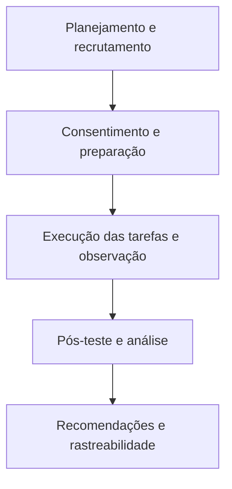

# Entrega 14 — Avaliação de usabilidade por observação de usuários

**Data:** 17/11/2026  
**Status:** 🟩 concluída — três sessões finais com participantes proxy registradas e analisadas, com consolidação da equipe e limitações documentadas.  
**Responsabilidade:** solução consolidada por equipe — Lucas Cabral, Guilherme e Pedro. São necessários três participantes finais, um acompanhado por cada integrante.

## Objetivo da atividade

Observar usuários realizando tarefas no **CYF — Clean Your Farm**, identificando problemas de eficácia, eficiência, compreensão e satisfação.

A avaliação trata da interação com o aplicativo ou protótipo, não da precisão científica do algoritmo. Os participantes finais não são integrantes da equipe. Participantes de piloto não contam na amostra final.

## A. Fluxograma do processo — equipe

**Fonte editável:** diagrama Mermaid incluído neste documento.

## B. Procedimento de preparação e execução — equipe

### Passo 1 — Objetivos e versão avaliada

**Produto:** CYF — Clean Your Farm.  
**Repositório:** <https://github.com/Cabral100/App_Orange_Box>, pasta `ios-native/`.

**Versão avaliada por U01:** versão do aplicativo disponível em 14/11/2026. O hash do commit não foi anotado.  
**Dispositivo de U01:** iPhone 16 Pro Max, com GPS funcionando. O iOS era o mais recente disponível no aparelho na data; número e build não foram anotados.

**Versão avaliada por U03:** protótipo FA no Figma, versão de 16/11/2026, com correção de links de navegação, sem aplicar as alterações propostas na avaliação heurística.  
**Link:** <https://www.figma.com/proto/gvxtwmmYvnJVONwUOHOMVD/Orange-Box?node-id=10-1255>.  
**Dispositivo de U03:** computador com navegador, protótipo em modo de apresentação.

O aplicativo não possui perfil próprio de agrônomo. Por isso, U03 avaliou o fluxo M01 exclusivamente no protótipo FA. Seus resultados não demonstram que esse fluxo está implementado no aplicativo.

No protótipo FA, os dados são fictícios e os resultados, a área de aplicação e o envio do parecer são simulados por navegação entre quadros. A foto é ilustrativa.

**Versão avaliada por U02:** versão web do CYF (`frontend/` e `backend/` do mesmo repositório), commit `1b924ae`, de 16/11/2026, servida pelo notebook de Pedro e acessada pelo celular do participante por um endereço HTTPS temporário. A versão web não tem perfil de administrador nem dados de exemplo. Para a sessão, a cópia local recebeu uma carga automática de dados fictícios, que não faz parte do repositório: 6 talhões em Bebedouro (SP) e 21 fotos de exemplo, nos últimos 30 dias e nos 30 dias anteriores. No período atual, o Talhão 04 tem o maior aumento (26 contra 12), o Talhão 02 o maior aumento percentual (14 contra 4), o Talhão 03 a maior redução (6 contra 18), o Talhão 01 foi inspecionado sem detecção e o **Talhão 05 não teve nenhuma inspeção** (0 contra 5). As fotos são imagens desenhadas com o aviso “FOTO DE EXEMPLO”.  
**Dispositivo de U02:** iPhone do participante, navegador Safari.

A sessão de U02 avalia a mesma interação de MU03 e MU04 em outra versão do produto; a comparação com a inspeção heurística da Entrega 13, feita no aplicativo iOS, é limitada.

#### Metas do aplicativo

| ID | Meta operacional | Ligação com o projeto |
|---|---|---|
| MU01 | Capturar uma imagem e compreender os avisos de ajuste da captura e o estado da análise. | CI02; O02/O03; M02; F02. |
| MU02 | Localizar uma inspeção e identificar talhão, data e resultado, distinguindo indicação da IA de confirmação humana. | CI02; O03/O04; M02; F03. |
| MU03 | Localizar um talhão, usar filtros e compreender os indicadores do mapa. | CI01; O06/O07; M03; F04. |
| MU04 | Consultar o relatório e encontrar informações na tela ou no arquivo extraído. | CI01; O09/O10; M03; F06. |

**Critério de atendimento:** não foram documentados limites quantitativos prévios para MU01–MU04. Portanto, os resultados são descritivos, sem declarar aprovação estatística ou criar critérios depois da coleta.

#### Metas do protótipo do agrônomo

Os identificadores QA são os usados na Entrega 12.

| ID | Meta | Critério definido antes da coleta | Tarefa |
|---|---|---|---|
| QA04 | Concluir abertura do pedido, validação e envio do parecer. | Concluir com, no máximo, uma dica; validação reduzida ao ponto 3. | UT07 e UT05 |
| QA05 | Excluir pontos pendentes ou rejeitados da área de aplicação. | Zero inclusão indevida dos pontos 4 ou 1. | UT05 |
| QA06 | Consultar ocorrências anteriores do ponto. | Resposta correta em até 20 segundos. | UT06 |
| QA07 | Realizar o fluxo em sessão curta. | Não avaliada integralmente; tempos usados como referência. | UT07 e UT05 |
| QA08 | Reconhecer o envio do parecer ao gestor. | Resposta correta com base no retorno FA01C. | UT05 |
| QA09 | Considerar as tarefas fáceis. | Nota mínima de 5,5 por tarefa. | UT06, UT07 e UT05 |
| QA19 | Distinguir detecção automática, validação e pendência de nova foto. | Análise qualitativa das explicações. | UT05 e pós-teste |
| QA20 | Observar a influência da avaliação automática no julgamento. | Análise qualitativa, sem aprovação ou reprovação. | UT07 e pós-teste |

Com um participante, os resultados dessas metas valem somente para a sessão observada.

### Passo 2 — Participantes

| ID | Perfil efetivamente registrado | Justificativa e limitação | Responsável | Situação |
|---|---|---|---|---|
| U01 | Estudante de Ciência da Computação, 21 anos, sem experiência em inspeção agrícola. | Participante proxy, fora da equipe. Permite observar navegação inicial, mas não representa trabalhador de campo experiente. | Lucas Cabral | Sessão realizada em 14/11/2026. |
| U02 | Profissional de tecnologia que trabalha com gestão de ferramentas de IA em um centro de IA; experiência com gestão e interfaces digitais, sem atuação na agricultura. | Participante proxy, fora da equipe, pois nenhum gestor de propriedade estava acessível. Permite observar a leitura do relatório, mas não representa um gestor de citros. | Pedro | Sessão realizada em 17/11/2026. |
| U03 | Estudante de engenharia, sem experiência direta em agronomia. | Proxy recrutado por conveniência, pois não havia agrônomo acessível. Não participou da elaboração das telas nem do piloto. | Guilherme | Sessão realizada em 16/11/2026. |

**Limitação de U01:** não possui experiência agrícola. Suas observações permitem discutir o primeiro contato com a interface, mas não validar o processo de trabalho ou o uso real em campo.

**Limitação de U02:** não tem experiência agrícola; a sessão usou a versão web com dados de demonstração, e não o aplicativo iOS.

**Limitação de U03:** somente o ponto 3 permite validação no protótipo; a área de aplicação vem pronta. Não foram avaliados o desenho da área, o fluxo completo de cinco pontos ou a recuperação após falha no envio.

### Passo 3 — Consentimento e privacidade

- **U01:** aceite verbal antes da sessão; não há termo assinado nem arquivo separado de consentimento. Não houve gravação, apenas anotações.
- **U03:** consentimento verbal obtido antes do pré-teste e das tarefas; sem gravação.
- **U02:** informado por mensagem, antes da chamada, do objetivo do teste e da gravação da tela. Sessão remota ao vivo por chamada de vídeo do WhatsApp, com a tela do celular compartilhada; a gravação fica só com o moderador, para apoio à análise, não é publicada e será descartada até 30 dias após o fim da disciplina. Nenhum dado real de propriedade foi usado.
- **Anonimização:** usar somente U01, U02 e U03 nos resultados publicados.
- **Dados necessários:** experiência pertinente, ações observadas, conclusão das tarefas, dificuldades, ajudas, tempos e comentários.
- **Registro de U01:** os resultados disponíveis foram consolidados neste documento de forma anônima. O local de guarda e o prazo de descarte das anotações originais não foram informados.
- **Política adotada para os registros de Lucas a partir desta revisão:** manter eventuais anotações originais sob acesso restrito ao responsável, à equipe e ao docente; não publicar dados identificáveis; descartar os registros originais até 30 dias após o encerramento da disciplina.
- **Armazenamento de U03:** anotações acessíveis somente à equipe e ao docente, com descarte até 30 dias após o fim da disciplina.
- Não publicar nomes, contatos ou dados identificáveis no GitHub.

**Termo de referência de U03:** [`instrumentos/termo_consentimento_modelo.md`](../instrumentos/termo_consentimento_modelo.md), seção do protótipo do agrônomo.

### Passo 4 — Teste piloto

#### Piloto — Lucas

**Participantes:** pais de Lucas, sem contar na amostra final.  
**Data:** 10/11/2026, aproximadamente às 10h20.  
**Duração:** cerca de 10 minutos.  
**Dispositivo:** iPhone com o aplicativo.

**Atividades realizadas:**

- Tirar uma foto.
- Marcar um talhão no mapa.
- Extrair um relatório.

**Alterações após o piloto:** inclusão de métricas no relatório e simplificação das interfaces do mapa e da câmera, reduzindo informações visuais. Não foram relatadas outras alterações.

Os resultados desse piloto não são contabilizados como resultados de U01.

#### Piloto — Guilherme

**Participante:** estudante de engenharia, fora da equipe e sem participação na produção das telas FA.  
**Data:** 16/11/2026.  
**Modalidade:** remota, pelo Google Meet.  
**Duração:** aproximadamente 25 minutos.  
**Moderador:** Guilherme, sem observador.

**Validações:** abertura do link sem permissão; navegação entre quadros; entendimento de UT06 e UT07; possibilidade de cronometrar e anotar; duração compatível com 35 minutos.

Em UT05, foi necessário esclarecer o significado de controle e sua relação com a orientação dada a Jaime.

**Mudanças após o piloto:**

1. Antes de UT05, explicar que controlar o ácaro significa aplicar um produto nas árvores afetadas.
2. Permitir esclarecimento sobre o conceito de controle sem indicar botões ou pontos.
3. Registrar o horário de início das tarefas.

Os critérios das metas não foram alterados.

**Registro:** [`instrumentos/piloto_p03.md`](../instrumentos/piloto_p03.md).

#### Piloto — Pedro

Não houve piloto com outra pessoa. Antes da sessão, Pedro fez um ensaio do fluxo do gestor na versão web, com apoio de uma ferramenta de IA e sem participante, para conferir se as tarefas eram possíveis. O ensaio mostrou que o site começa sem dados, o que levou à carga de dados fictícios descrita no Passo 1. O ensaio não é usado como resultado.

### Passo 5 — Tarefas

O moderador lê somente a instrução ao participante, sem indicar controles ou caminhos.

| ID | Instrução ao participante | Critério de sucesso | Métricas | Ligação com o modelo |
|---|---|---|---|---|
| UT01 | “Você encontrou um fruto que gostaria de examinar. Use o aplicativo para registrar uma imagem e me diga o que está acontecendo durante a análise e o que o resultado permite concluir.” | Capturar a imagem, reconhecer os avisos e interpretar o resultado como indicação automática, sem atribuir confirmação a especialista. | Sucesso, tempo, erros, ajudas e satisfação. | C02; T02; O02/O03; M02; F02. |
| UT02 | “Você precisa reencontrar uma inspeção realizada anteriormente e dizer em qual talhão e data ela foi registrada.” | Localizar o registro e identificar talhão e data sem orientação sobre onde tocar. | Sucesso, tempo, dificuldades, ajudas e satisfação. | C02; T01/T03; O04; M02; F03. |
| UT03 | “Você precisa descobrir quais talhões merecem atenção no período mostrado. Examine a situação da fazenda e selecione um talhão para conferir as informações disponíveis.” | Encontrar um talhão e interpretar os indicadores sem confundir ausência de inspeção com ausência de praga. | Sucesso, tempo, erros, ajudas e satisfação. | C01; T09; O06/O07; M03; F04. |
| UT04 | “Você precisa preparar uma conversa sobre a situação recente da fazenda. Consulte o relatório e encontre informações sobre ocorrências e irrigação úteis para essa conversa.” | Encontrar os indicadores na tela ou no arquivo extraído, registrando limitações da versão. | Sucesso, tempo, informação localizada, ajudas e satisfação. | C01; T04/T08; O09/O10; M03; F06. |
| UT06 | “Esta é a suspeita registrada na árvore L3-27 de um pomar que você atende. Antes de decidir qualquer coisa, descubra se já apareceu suspeita do ácaro nesse mesmo local em outras vistorias, quando e o que foi concluído.” | Informar as ocorrências de 31/10 confirmada, 17/10 rejeitada e 03/10 confirmada. | Sucesso, tempo, erros, ajudas e satisfação. | C03; T06; O15; M01 S3/S5; FA03/FA05. |
| UT07 | “Jaime, dono da Fazenda Boa Vista, pediu sua opinião sobre uma área onde o pessoal do campo encontrou suspeitas do ácaro. Vá até a suspeita da árvore L3-27 e deixe registrada a sua decisão. Considere que, na foto, você reconheceria lesões do ácaro.” | Abrir o pedido do T12 e registrar o ponto 3 como confirmado. | Sucesso, tempo, erros, ajudas, satisfação e consulta à IA. | C03; T07; O13/O14; M01 S1–S3; FA01–FA03. |
| UT05 | “Agora indique onde deve ser feito o controle, confira sua orientação e faça-a chegar a Jaime.” | Citar pontos 2, 3 e 5 na área, excluir o ponto 4 e reconhecer o envio. | Sucesso, tempo, erros, ajudas e satisfação. | C03; T05; O17–O19; M01 S6/S7; FA06/FA07/FA01C. |

**Instruções aplicadas a U02:** adaptadas à versão web, na ordem UT03, UT08 e UT04:

- **UT03:** “Imagine que você é o dono desta fazenda. Nos últimos 30 dias, a equipe passou olhando as laranjeiras. Me diga quais áreas te preocupam mais e se alguma área ficou sem ser vista.” Sucesso: aponta o Talhão 04 e identifica o Talhão 05 como não inspecionado, sem tratá-lo como livre da praga.
- **UT08** (T08 da Entrega 5): “Agora compare com o mês anterior. Em qual área o problema mais cresceu e em qual diminuiu?” Sucesso: aponta o Talhão 04 (ou o 02, justificando pelo percentual) e o Talhão 03.
- **UT04:** “Você quer mandar a situação da fazenda para o agrônomo. Prepare isso pelo aplicativo.” Sucesso: chega à exportação do relatório. A menção à irrigação foi retirada, porque a versão testada não tem esse dado.

As instruções não usam “Relatórios”, “Mapa”, “Contagem e tendência”, “Sem ocorrência” nem “PDF”.

**Ordem de U01:** UT01 e UT02.  
**Ordem de U03:** UT06, UT07 e UT05.

Em UT06, o moderador inicia em FA03. Antes de UT05, informa que os outros pontos já foram avaliados e apresenta o esclarecimento sobre controle definido no piloto.

**Limite de U03:** encerrar caso UT07 e UT05 somem 16 minutos, registrando a tarefa em andamento como não concluída.

**Escala planejada:** 1 = muito difícil; 7 = muito fácil. Pergunta complementar: “O que tornou a tarefa fácil ou difícil?”

**Desvio de aplicação em U01:** não foi coletada nota numérica; somente comentário qualitativo. Os tempos foram estimados, sem cronometragem formal.

**Tempos resumidos de U01:** aproximadamente 40 segundos em UT01 e 2 minutos e 30 segundos em UT02. Esses valores são estimativas retrospectivas dentro dos intervalos relatados, não tempos medidos.

#### Definições adotadas

- **Sucesso total:** cumprir o critério sem receber indicação do caminho.
- **Sucesso parcial:** cumprir parte do critério ou concluir com ajuda.
- **Falha:** abandonar, não alcançar o objetivo ou apresentar conclusão incompatível com os dados.
- **Erro:** ação ou interpretação equivocada observável.
- **Ajuda:** intervenção além da repetição neutra da instrução.
- **Tempo:** intervalo entre a instrução e a conclusão, abandono ou encerramento.

### Passo 6 — Protocolo do moderador

1. Explicar que o produto está sendo avaliado, não a pessoa.
2. Informar o objetivo, a duração e o uso dos registros.
3. Obter consentimento antes da coleta.
4. Registrar somente o perfil necessário.
5. Informar quais dados e resultados são demonstrativos.
6. Ler a tarefa sem indicar botões.
7. Observar e anotar dificuldades e intervenções.
8. Aplicar avaliação pós-tarefa.
9. Fazer perguntas finais e agradecer.
10. Salvar registros com identificador anônimo.

**Lucas:** conduziu a sessão presencial de U01 na FEI. Não houve gravação, apenas anotações. Em UT02, houve ajuda, sem registro do conteúdo exato. A análise distingue o comportamento observado das informações que não foram coletadas.

**Pedro:** conduziu UT03, UT08 e UT04 remotamente, sem observador, lendo cada instrução sem indicar abas ou botões.

**Guilherme:** conduziu UT06, UT07 e UT05 sem observador. Cliques em áreas sem ligação foram anotados separadamente e não classificados como erro. Não houve dicas durante as tarefas.

**Roteiro de U03:** [`instrumentos/roteiro_teste_usabilidade.md`](../instrumentos/roteiro_teste_usabilidade.md).  
**Planilha de U03:** [`instrumentos/planilha_observacao_modelo.md`](../instrumentos/planilha_observacao_modelo.md).

## C. Resultados — por participante

### U01 — participante acompanhado por Lucas Cabral

**Perfil:** 21 anos, estudante de Ciência da Computação, sem experiência em inspeção agrícola; participante proxy, fora da equipe.  
**Data:** 14/11/2026, às 14h40.  
**Local:** FEI, presencialmente, sem interferências relatadas.  
**Dispositivo:** iPhone 16 Pro Max, iOS mais recente disponível no aparelho à época; versão exata não anotada; GPS funcionando.  
**Versão:** aplicativo disponível na data, sem hash registrado.  
**Moderador:** Lucas Cabral.  
**Registro:** anotações, sem gravação.  
**Consentimento:** verbal, antes da sessão.

| Tarefa | Grau de sucesso | Erros | Dificuldade | Ajudas | Tempo | Satisfação | Evidência |
|---|---|---|---|---|---|---|---|
| UT01 | Captura concluída sem ajuda; critério completo de interpretação não verificável. | Nenhum erro observado na captura. | Acompanhou a orientação para ajustar a distância. | Nenhuma registrada. | Aproximadamente 40 s, por estimativa retrospectiva dentro do intervalo de 20 s a 1 min; não cronometrado. | Comentário positivo; sem nota numérica. | Fotografou sem ajuda e acompanhou o aviso de aproximação/ajuste da distância. A fala sobre a diferença entre resultado automático e confirmação humana não foi registrada. |
| UT02 | Parcial. | Sem contagem formal. | Inicialmente não encontrou a funcionalidade para localizar a inspeção. | Houve ajuda; conteúdo e quantidade não anotados. | Aproximadamente 2 min 30 s, por estimativa retrospectiva dentro do intervalo de 2–3 min; não cronometrado. | Comentário geral positivo; sem nota numérica. | Encontrou a inspeção após ajuda. Não há registro suficiente para confirmar todos os campos previstos no critério. |

#### Funcionamento observado da câmera

O aplicativo exige confiança maior ou igual a 85% para permitir a captura. Abaixo desse limite, apresenta orientações para ajustar a distância ou o enquadramento.

O participante acompanhou a orientação e concluiu a captura. A necessidade de ajustar a distância foi tratada como parte da interação preventiva, não como erro do participante.

A sessão não avaliou a precisão científica do modelo. Não observar um falso positivo nessa sessão não demonstra que o sistema seja incapaz de produzi-lo.

#### Interpretação dos resultados

U01 conseguiu compreender operacionalmente a orientação de ajuste da câmera e utilizá-la para concluir a captura sem ajuda.

O comentário de que a interface era didática, com campos e botões perceptíveis e textos grandes, indica percepção positiva de clareza visual naquela sessão.

Não foi registrada uma explicação sobre a diferença entre indicação automática e confirmação humana. Portanto, essa compreensão não é apresentada como verificada.

Em UT02, o participante encontrou a inspeção após ajuda, caracterizando sucesso parcial e indicando uma oportunidade de melhoria na descoberta do histórico.

#### Pós-teste e decisão

O participante considerou o aplicativo didático, com campos e botões fáceis de perceber. Comentou que os textos grandes facilitam a leitura em campo. Esse comentário é uma síntese do relato, não uma transcrição literal.

**Sugestão:** permitir refazer a foto, editar informações e excluir a imagem pelo histórico.

**Decisão:** revisar o acesso ao histórico e avaliar essas ações de manutenção dos registros. A sugestão não é tratada como comprovação isolada da necessidade de todas as funções.

**Intervenções:** ajuda em UT02, sem descrição exata registrada.

**Limitações:** participante sem experiência agrícola; ausência de gravação; tempos estimados; satisfação numérica não coletada; interpretação detalhada do resultado não anotada. A sessão ocorreu na FEI, não no campo. Não é possível generalizar os resultados para trabalhadores agrícolas.

**Rastreabilidade:** R09 e R10 da matriz; cadeia `UT02 → U01 → AU03 → revisão do histórico`.

**Situação da parte de Lucas:** relato e análise preenchidos com os dados disponíveis. As informações não coletadas permanecem explicitadas como limitações, sem preenchimento retrospectivo como se tivessem sido medidas.

### U02 — participante acompanhado por Pedro

**Perfil:** profissional de tecnologia que trabalha com gestão de ferramentas de IA em um centro de IA; experiência com gestão e interfaces digitais, sem atuação na agricultura; participante proxy, fora da equipe.  
**Data:** 17/11/2026; tarefas entre 11:32 e 11:35 (relógio do celular do participante).  
**Local:** remoto, ao vivo, por chamada de vídeo do WhatsApp com a tela do celular compartilhada.  
**Dispositivo:** iPhone do participante, navegador Safari.  
**Versão:** versão web do CYF, commit `1b924ae`, com dados de demonstração (Passo 1).  
**Moderador:** Pedro; sem observador.  
**Registro:** gravação da tela para apoio à análise (não publicada) e anotações.  
**Consentimento:** informado do objetivo e da gravação por mensagem antes da chamada.

| Tarefa | Grau de sucesso | Erros | Dificuldade | Ajudas | Tempo | Satisfação | Evidência |
|---|---|---|---|---|---|---|---|
| UT03 | Parcial. | 1 | Não identificou a área sem inspeção: perguntado se alguma área ficou sem ser vista, não apontou nenhuma, e o Talhão 05 não foi mencionado. | 0 | Não medido separadamente. | 6 | Apontou os Talhões 04 e 02 como os piores, pela tabela “Contagem e tendência”. Usou só a aba Relatórios, subindo e descendo a página várias vezes; não abriu o Mapa nem o detalhe de nenhum talhão. |
| UT08 | Indeterminado. | 0 | Nenhuma observada. | 0 | Não medido separadamente. | 6 | Disse que a “Visão do período” mostra a comparação e que os Talhões 04 e 02 foram os que mais cresceram. A resposta sobre onde diminuiu não foi registrada. Abriu o filtro de talhões e o calendário sem alterar. |
| UT04 | Total. | 0 | Nenhuma observada. | 0 | Não medido separadamente. | 6 | Tocou em “Imprimir / salvar dashboard em PDF”, chegou à prévia de impressão e disse que deu para baixar o relatório. Não salvou nem enviou o arquivo durante a sessão. |

**Tempo total das três tarefas:** cerca de 3 minutos.  
**Satisfação:** nota 6, com o comentário de que achou fácil; a nota não foi separada por tarefa.

#### Interpretação dos resultados

U02 encontrou sozinho as seções que respondem a cada pergunta e resolveu as três tarefas pela aba Relatórios, sem abrir o Mapa.

Ao apontar os talhões que mais cresceram, considerou tanto o maior aumento em número (Talhão 04) quanto o maior aumento percentual (Talhão 02).

O Talhão 05, que não teve inspeção no período, não foi identificado. No caminho percorrido, ele aparecia como “Sem ocorrência · 0 · −5 · 100%”, com a mesma cor e o mesmo rótulo do Talhão 01, que foi inspecionado sem detecção; a indicação “0 fotos no período” só existe no detalhe do talhão no Mapa. Uma hipótese, não verificada, é que o participante tenha lido o 05 como área sem praga.

**Pós-teste:** perguntas pós-teste não aplicadas.  
**Intervenções:** nenhuma ajuda durante as tarefas. O moderador apenas apresentou o contexto da sessão e leu as instruções, conforme o roteiro.  
**Limitações:** participante proxy sem experiência agrícola; sem observador; tempos e notas por tarefa não registrados; resposta de UT08 sobre a redução não registrada; perguntas pós-teste não aplicadas; versão web com dados de demonstração, diferente do aplicativo iOS.

**Registro:** [`instrumentos/sessao_u02.md`](../instrumentos/sessao_u02.md).

### U03 — participante acompanhado por Guilherme

**Situação:** piloto e sessão final realizados em 16/11/2026.

**Perfil:** estudante de engenharia, fora da equipe, sem experiência direta em agronomia. Não viu o piloto nem as telas FA antes da sessão. Recrutado por conveniência porque nenhum agrônomo ou técnico agrícola estava acessível.

**Proxy:** sim. As conclusões tratam da navegação e compreensão das telas, não equivalendo às de um agrônomo consultor. As perguntas técnicas fornecem somente indícios.

**Pré-teste:** as seis perguntas sobre formação, citros, atendimento, propriedades, relatos do campo e mapas digitais ficaram sem resposta por não se aplicarem ao perfil.

**Data e ambiente:** 16/11/2026, presencialmente, sem interrupções registradas.  
**Consentimento:** verbal, antes do pré-teste e das tarefas.  
**Versão:** protótipo FA de 16/11/2026, com links corrigidos e sem as correções da inspeção heurística.  
**Dispositivo:** computador com navegador, em modo de apresentação.  
**Moderador:** Guilherme.  
**Observador:** nenhum; o moderador conduziu, cronometrou e anotou.

| Tarefa | Grau de sucesso | Erros | Dificuldade | Ajudas | Tempo | Satisfação 1–7 | Evidência |
|---|---|---:|---|---:|---|---:|---|
| UT06 | Total. | 0 | Não soube se “confirmado” e “rejeitado” eram decisão do agrônomo ou da IA. | 0 | 1 min 04 s | 6 | Informou corretamente três ocorrências: 31/10 confirmada, 17/10 rejeitada e 03/10 confirmada. Usou a barra lateral de detecções anteriores e a considerou evidente. |
| UT07 | Total. | 0 | Havia dois pedidos de Jaime; escolheu T12 porque o outro não respondia ao clique. | 0 | 47 s | 6 | Registrou o ponto 3 como confirmado. Não abriu a avaliação da IA. Comentou a ambiguidade entre os dois pedidos. |
| UT05 | Total. | 0 | Nenhuma dificuldade registrada. Não voltou para conferir o ponto 4. | 0 | 1 min 18 s | 7 | Citou pontos 2, 3 e 5 na área de controle. Reconheceu o envio pelo aviso verde em FA01C. |

**UT07 + UT05:** 2 min 05 s, apenas como referência; MU07 não foi avaliada integralmente.

**Pós-teste:**

1. Diferença entre local avaliado e não avaliado: não perguntada.
2. Árvore L5-11: entendeu que aguarda nova foto e continua sem veredito.
3. Área de controle: pontos 2, 3 e 5.
4. Recebimento por Jaime: reconheceu pelo aviso verde.
5. Avaliação automática: não a abriu; não é possível inferir sua influência em julgamento técnico real.
6. Informação que faltou: nenhuma.

**Intervenções:** nenhuma ajuda durante as tarefas. A abertura de FA03 antes de UT06 e a leitura do contexto antes de UT05 seguiram o roteiro.

**Gravação:** não houve.

**Limitações:** participante proxy; pré-teste não aplicável; ausência de observador; pergunta sobre detecção automática versus validação não aplicada; horários de início não registrados; limitações de navegação do protótipo.

**Registro:** [`instrumentos/sessao_u03.md`](../instrumentos/sessao_u03.md).

## D. Consolidação por tarefa

As proporções consideram somente quem executou cada tarefa. Tempos estimados não são tratados como cronometrados.

| Tarefa | Participante | Sucesso total | Tempo | Dificuldade | Satisfação | Meta atendida? |
|---|---|---|---|---|---|---|
| UT01 | U01 | Não verificável para o critério completo; captura concluída sem ajuda. | Aproximadamente 40 s; estimativa retrospectiva. | Sem dificuldade de captura; interpretação detalhada não registrada. | Comentário positivo; sem nota. | MU01 parcialmente observada. |
| UT02 | U01 | 0/1 sem ajuda; conclusão parcial com ajuda. | Aproximadamente 2 min 30 s; estimativa retrospectiva. | Não encontrou inicialmente a funcionalidade. | Comentário geral positivo; sem nota. | MU02 não atendida sem ajuda. |
| UT03 | U02 | 0/1 (parcial). | Não medido separadamente. | Área sem inspeção não identificada. | 6. | MU03 não atendida. |
| UT08 | U02 | Indeterminado. | Não medido separadamente. | Nenhuma observada. | 6. | MU04 parcialmente observada: maior aumento correto; redução não registrada. |
| UT04 | U02 | 1/1. | Não medido separadamente. | Nenhuma observada. | 6. | MU04 atendida. |
| UT06 | U03 | 1/1. | 1 min 04 s. | Dúvida sobre autor do veredito. | 6. | QA06 não; QA09 sim. |
| UT07 | U03 | 1/1. | 47 s. | Escolha do pedido por eliminação. | 6. | QA04 e QA09 sim. |
| UT05 | U03 | 1/1. | 1 min 18 s. | Nenhuma registrada. | 7. | QA04, QA05, QA08 e QA09 sim. |

## E. Achados e recomendações

São casos isolados, sem evidência suficiente para afirmar recorrência.

| ID | Achado | Evidência | Impacto | Recomendação | Artefatos |
|---|---|---|---|---|---|
| AU01 | Histórico não deixa claro quem confirmou ou rejeitou a ocorrência. | U03/UT06 respondeu corretamente, mas não soube se o veredito era do agrônomo ou da IA. | Confusão entre indicação automática e validação humana. | Indicar autor e data do veredito; separar a avaliação automática. | FA03, FA05; M01 S3/S5; T06. |
| AU02 | Dois pedidos do mesmo gestor não foram distinguidos com clareza. | U03/UT07 escolheu T12 porque o outro pedido não respondia ao clique. | Possibilidade de abrir o pedido errado em uma implementação completa. | Diferenciar pedidos por talhão, data e pontos pendentes; testar novamente. | FA01; M01 S1; T05. |
| AU03 | Dificuldade inicial para localizar a inspeção anterior. | U01/UT02 concluiu com ajuda após não encontrar a funcionalidade; duração estimada de 2 min 30 s. | Redução de autonomia ao consultar registros. | Revisar o acesso e os rótulos do histórico; verificar novamente com usuário representativo. | Histórico do aplicativo; F03; M02; R10. |
| AU04 | O talhão sem nenhuma inspeção no período não foi percebido. | U02/UT03: perguntado se alguma área ficou sem ser vista, não apontou nenhuma e não mencionou o Talhão 05, que aparecia como “Sem ocorrência · 0 · −5 · 100%”, igual ao Talhão 01, inspecionado sem detecção. | É o erro central do cenário C01: o gestor pode deixar de tratar uma área que ninguém inspecionou; a variação “−5 · 100%” pode ser lida como melhora. | Mostrar “Não inspecionado no período” como estado próprio, com símbolo e cor diferentes de “Sem ocorrência”, na tabela e no mapa; incluir a quantidade de fotos por talhão; não calcular variação para talhão sem inspeção; testar novamente. | Relatórios (F06) e Mapa (F04); CI01; M03 S2; V03 de A03; T09. |

**Sugestão de U01:** refazer foto, editar informações e excluir imagem pelo histórico. Registrar como proposta de melhoria, sem tratá-la como falha comprovada de todas essas funções.

**Aspecto positivo observado em U01:** captura concluída sem ajuda e acompanhamento da orientação de distância.

**Decisão de Lucas:** priorizar a facilidade de acesso ao histórico e avaliar as ações sugeridas, mantendo a câmera com orientações objetivas e evitando excesso de informações.

## F. Comparação com a avaliação heurística

| Problema da inspeção | Na heurística? | Nas sessões? | Aprendizado |
|---|---|---|---|
| V07 — termos técnicos na câmera, como “Core ML pronto”. | Sim. | Não determinado em U01. | O participante acompanhou a orientação de distância, mas não foi anotada a interpretação desse termo técnico. |
| V12 — passos adicionais após fotografar. | Sim; inicialmente identificado no código. | Não determinado em U01. | A captura ocorreu sem ajuda, mas o efeito dos passos posteriores não foi documentado. |
| V02 — identificação dos talhões no mapa. | Sim. | Não exposto. | U02 resolveu UT03 pela aba Relatórios, sem abrir o Mapa. Na versão web, os nomes dos talhões aparecem no mapa. |
| V03/A03 — talhão sem inspeção com o mesmo rótulo “Sem ocorrência”. | Sim; identificado no código do aplicativo iOS. | Sim, U02 (AU04). | O mesmo rótulo existe na versão web, e U02 não identificou o talhão sem inspeção. Problema apontado na inspeção e observado no teste. |
| V05 — “detecções confirmadas” sugerir validação humana. | Sim. | Não determinado em U01. | A interpretação detalhada do resultado não foi anotada; não afirmar compreensão ou confusão sem evidência. |
| V04/A02 — destaque inicial de “Confirmar”. | Sim. | Efeito não isolado. | U03 confirmou conforme o cenário; não é possível atribuir influência ao destaque. |
| V05/A02 — avaliação da IA recolhida na validação e aberta no histórico. | Sim. | Não como dificuldade. | U03 decidiu sem abrir a avaliação; a dúvida foi sobre o autor do veredito. |
| V06/A02 — símbolo de nova foto igual ao de pendência. | Sim. | Não. | U03 entendeu que o ponto aguardava nova foto; um caso não comprova suficiência do símbolo. |
| V01/A02 — pedido concluído com ponto pendente. | Sim. | Não exposto diretamente. | U03 reconheceu o envio; o significado de “Concluído” para o ponto 4 não foi perguntado. |
| V13/A02 — impossibilidade de desfazer o veredito. | Sim. | Não exposto. | U03 não precisou corrigir o veredito. |
| AU01 — autor do veredito no histórico. | Não. | Sim, U03. | Reforça a necessidade de separar IA e validação humana. |
| AU02 — pedidos semelhantes do mesmo gestor. | Não. | Sim, U03. | O pedido sem ligação mascarou a ambiguidade do protótipo. |
| AU03 — dificuldade para localizar inspeção anterior. | Sem correspondência confirmada no registro disponível. | Sim, U01. | Revisar a descoberta do histórico e testar novamente. |
| AU04 — talhão sem inspeção não percebido. | Sim (V03/A03). | Sim, U02. | Confirma no teste um problema já apontado na inspeção. |

## G. Conclusão

### 1. Metas atingidas

**U01 — Lucas:**

- A captura de foto foi concluída sem ajuda, em aproximadamente 40 segundos por estimativa retrospectiva.
- O participante acompanhou a orientação de ajuste da distância.
- A compreensão operacional da orientação foi observada; a distinção entre resultado automático e confirmação humana não foi verificada.
- A inspeção anterior foi encontrada com ajuda, em aproximadamente 2 minutos e 30 segundos por estimativa retrospectiva.
- O critério de consulta independente não foi atingido.
- Não houve nota numérica de satisfação; o comentário qualitativo foi positivo.
- Os resultados sustentam uma revisão do acesso ao histórico, não uma aprovação geral do aplicativo.

**U03 — Guilherme:**

- QA04: atingida; UT07 e UT05 concluídas sem ajuda.
- QA05: atingida; citou pontos 2, 3 e 5, excluindo os demais.
- QA06: não atingida; 64 segundos, acima dos 20 segundos previstos, apesar da resposta correta.
- QA07: não avaliada integralmente; soma de 2 min 05 s apenas como referência.
- QA08: atingida; reconheceu o envio pelo aviso verde.
- QA09: atingida; notas 6, 6 e 7.
- QA19: parcialmente observada; compreendeu a pendência de nova foto, mas apresentou dúvida sobre o autor do veredito.
- QA20: não consultou a avaliação da IA; não permite concluir influência em julgamento técnico real.

**U02 — Pedro:**

- MU03: não atendida; identificou os talhões mais preocupantes, mas não o talhão sem inspeção (AU04); não usou o Mapa; abriu os filtros sem alterá-los.
- MU04: atendida; localizou o relatório do período, apontou o maior aumento e gerou o relatório em PDF.
- Satisfação: nota 6, sem separação por tarefa.
- Os resultados sustentam distinguir “não inspecionado no período” de “sem ocorrência”, não uma aprovação geral do relatório.

### 2. Problemas e perfis afetados

U01 apresentou dificuldade para localizar uma inspeção anterior. U03 apresentou dúvida sobre o autor do veredito e sobre a distinção entre pedidos do mesmo gestor. U02 não percebeu o talhão sem inspeção no período.

Cada achado foi observado em um participante proxy; não há base para classificá-los como recorrentes.

### 3. O que surpreendeu a equipe

U01 fotografou sem ajuda, mas precisou de apoio para localizar o histórico. A opinião positiva sobre clareza visual não eliminou a dificuldade de encontrar uma funcionalidade.

U03 concluiu as tarefas e revelou duas ambiguidades não identificadas na inspeção: autoria do veredito e distinção entre pedidos.

U02 resolveu todas as tarefas pela aba Relatórios, sem abrir o Mapa, e o único problema observado é o mesmo apontado na inspeção heurística (V03/A03).

### 4. Mudanças prioritárias

- **Lucas:** revisar a localização das inspeções no histórico e avaliar as sugestões de refazer foto, editar informações e excluir imagem.
- **Guilherme:** explicitar o autor do veredito em FA03/FA05 e diferenciar os pedidos em FA01.
- **Pedro:** distinguir “não inspecionado no período” de “sem ocorrência” nos Relatórios e no Mapa e não calcular variação para talhão sem inspeção (AU04; M03 S2; F04/F06), a confirmar com novo teste.
- **Equipe:** consolidar os resultados das três sessões e manter os mesmos identificadores nos artefatos.

### 5. Limitações

As três sessões finais foram feitas, todas com participantes proxy, sem experiência agrícola ou agronômica. Os testes ocorreram em contextos diferentes e avaliaram versões distintas: aplicativo iOS (U01), versão web com dados de demonstração (U02) e protótipo no Figma (U03).

Em U01, não houve cronometragem formal, nota de satisfação ou registro detalhado da interpretação do resultado. Os tempos de 40 segundos e 2 minutos e 30 segundos são resumos aproximados dos intervalos relatados, não medições exatas.

Em U02, os tempos e as notas não foram registrados por tarefa, a resposta sobre a redução em UT08 não foi registrada e as perguntas pós-teste não foram aplicadas.

Em U03, o protótipo tinha navegação limitada e uma pergunta pós-teste não foi aplicada.

Esses fatores impedem generalizações sobre profissionais de campo ou agrônomos.

### 6. Consolidação da equipe

**Visão geral das três sessões:** os três participantes concluíram a maior parte das tarefas sem ajuda (U01 só precisou de ajuda em UT02) e avaliaram positivamente a facilidade (U02: 6; U03: 6, 6 e 7; U01: comentário positivo, sem nota). Os quatro problemas observados têm a mesma natureza: a interface não deixou claro **o estado de uma informação**, seja onde está o registro (AU03), quem decidiu (AU01), qual pedido é qual (AU02) ou se o talhão foi inspecionado (AU04). Os participantes encontraram as funções principais com pouca dificuldade e tropeçaram na interpretação.

**Achados consolidados:** cada achado foi observado uma única vez, em participante proxy, e por isso nenhum é classificado como recorrente. A gravidade usa a escala de 0 a 4 da Entrega 12, considerando se o problema impede a tarefa e se leva a uma conclusão equivocada no trabalho.

| ID | Achado | Participante e tarefa | Na inspeção heurística? | Gravidade | Prioridade | Responsável | Artefatos a alterar |
|---|---|---|---|---:|---|---|---|
| AU04 | Talhão sem inspeção no período não percebido; aparece como “Sem ocorrência”. | U02, UT03 | Sim, V03/A03 | 3 | 1 | Pedro | Relatórios (F06), Mapa (F04); M03 S2 |
| AU01 | Histórico não mostra quem confirmou ou rejeitou a ocorrência. | U03, UT06 | Não | 3 | 2 | Guilherme | FA03, FA05; M01 S3/S5 |
| AU03 | Dificuldade inicial para localizar a inspeção anterior. | U01, UT02 | Sem correspondência confirmada | 2 | 3 | Lucas | Histórico (F03); M02 |
| AU02 | Dois pedidos do mesmo gestor não se distinguem com clareza. | U03, UT07 | Não | 2 | 4 | Guilherme | FA01; M01 S1 |

**Justificativa da ordem:** AU04 e AU01 vêm primeiro porque podem levar a uma decisão de manejo errada: tratar como limpa uma área que ninguém inspecionou, ou tomar a indicação da IA por validação humana. Os dois tocam o princípio, definido nas Entregas 8 e 9, de separar o que o sistema indica do que uma pessoa confirmou. AU03 reduz a autonomia, mas a tarefa foi concluída com ajuda. AU02 foi parcialmente mascarado pela navegação limitada do protótipo e precisa ser testado com os dois pedidos funcionando.

**Inspeção e teste:** dos quatro achados, apenas AU04 tinha sido apontado na inspeção heurística; AU01, AU02 e AU03 só apareceram com os participantes. Por outro lado, vários problemas da inspeção não foram expostos nas tarefas (seção F). As duas avaliações se complementam: nenhuma delas substitui a outra.

**O que os três testes não permitem concluir:** que trabalhadores de campo, gestores ou agrônomos reais teriam os mesmos resultados; que os problemas são frequentes; que a precisão do modelo é adequada; ou que o fluxo do agrônomo, testado só no protótipo, funciona no aplicativo.

**Próximos passos da equipe:** aplicar as correções na ordem da tabela, mantendo os mesmos identificadores na matriz de rastreabilidade, e repetir as tarefas UT02, UT03, UT06 e UT07 com participantes do perfil correspondente quando houver acesso a eles.

### Rastreabilidade

As relações abaixo estão descritas na versão atualizada da matriz de rastreabilidade:

- `UT01 → U01 → R09 → manter orientação operacional da câmera`.
- `UT02 → U01 → AU03 → R10 → revisar acesso ao histórico`.
- `UT06 → U03 → AU01 → R05 → explicitar autor do veredito`.
- `UT07 → U03 → AU02 → R03 → diferenciar pedidos`.
- `UT03 → U02 → AU04 → R01 → distinguir talhão não inspecionado`.
- `UT08/UT04 → U02 → R02 → manter comparação entre períodos e exportação`.

## Checklist

- [x] Três participantes finais foram observados.
- [x] Todos os participantes têm perfil documentado e não são membros da equipe.
- [x] U01, U02 e U03 foram identificados como proxy, com limitações explícitas.
- [x] A avaliação separa interação e desempenho técnico do algoritmo.
- [x] As tarefas estão relacionadas aos cenários, objetivos e modelos.
- [x] Consentimento e anonimização registrados para todos.
- [x] Consentimento verbal e forma de registro de U01 documentados.
- [x] Pilotos de Lucas e Guilherme realizados e alterações descritas.
- [x] Critérios de sucesso das tarefas apresentados.
- [x] Ajuda em U01/UT02 documentada como intervenção e considerada na classificação de sucesso parcial.
- [x] Resultados de todos os participantes preenchidos.
- [x] Métricas coletadas conforme possível, com ausências documentadas como limitação: U01 sem tempo cronometrado nem nota numérica; U02 sem tempo nem nota por tarefa.
- [x] Os resultados disponíveis distinguem observações, estimativas e informações não coletadas.
- [x] Os achados disponíveis geraram recomendações.
- [x] Relações de U01, U02 e U03 descritas na matriz de rastreabilidade atualizada.
- [x] Consolidação final da equipe concluída.
