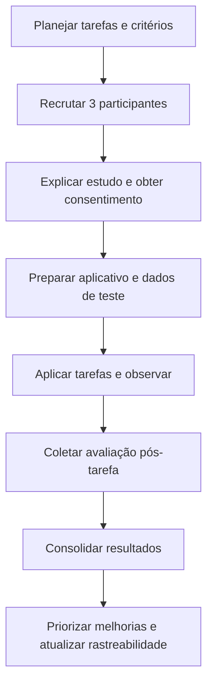

# Entrega 14 — Avaliação de usabilidade por observação de usuários

**Data:** 15/11/2026  
**Status:** 🟨 em andamento — planejamento e partes de Lucas e Guilherme preparados; testes com participantes finais pendentes  
**Responsabilidade:** solução consolidada por equipe — Lucas Cabral, Guilherme e Pedro. Serão necessários **3 participantes finais**, um acompanhado por cada integrante.

## Objetivo da atividade

Observar pessoas que tenham relação com as atividades da fazenda usando o aplicativo **CYF — Clean Your Farm**. O teste avaliará se conseguem realizar as tarefas, entender os resultados e recuperar-se de dúvidas ou erros. A avaliação é da **interação com o aplicativo**, não da precisão científica do modelo de detecção.

Os participantes finais não podem ser Lucas, Guilherme ou Pedro. Um integrante pode testar o roteiro como piloto, mas não contará entre U01, U02 e U03.

## A. Fluxograma do processo — equipe

**Fonte editável:** este próprio diagrama Mermaid no arquivo `.md`.

## B. Procedimento de preparação e execução — equipe

### Passo 1 — Objetivos e versão avaliada

**Produto:** aplicativo iOS CYF — Clean Your Farm.  
**Repositório do aplicativo:** <https://github.com/Cabral100/App_Orange_Box>, pasta `ios-native/`.  
**Versão/commit efetivamente testado:** {{registrar o hash antes do primeiro teste e usar a mesma versão com U01–U03; caso haja alteração, registrar qual participante viu cada versão}}.  
**Dispositivo e sistema:** {{modelo do iPhone e versão do iOS}}.  
**Dados de demonstração:** informar aos participantes quais registros são exemplos e manter os mesmos dados iniciais em todas as sessões.

**Versão avaliada por U03 (Guilherme):** o aplicativo não tem perfil de agrônomo; U03 usa o protótipo web do fluxo do agrônomo no Figma, telas FA01–FA07 e seus estados (Entrega 11, MoLIC M01): <https://www.figma.com/proto/gvxtwmmYvnJVONwUOHOMVD/Orange-Box?node-id=10-1255>. **Data da versão do arquivo usada na sessão:** {{registrar no dia da sessão}}. **Dispositivo:** computador ou notebook com navegador, mouse e internet, protótipo em modo de apresentação ajustado à tela. **Dados simulados:** todos os dados das telas FA são fictícios; o veredito, a área de aplicação e o envio do parecer são simulados por links entre quadros, e a foto é uma figura ilustrativa (Entrega 12, seção B).

**Metas de usabilidade a verificar:**

| ID | Meta operacional para esta avaliação | Ligação com o projeto |
|---|---|---|
| MU01 | O trabalhador consegue capturar uma imagem e compreender se a análise está em andamento ou se precisa ajustar a captura. | CI02; O02/O03; M02; F02. |
| MU02 | O trabalhador consegue localizar uma inspeção registrada e identificar seu talhão, data e resultado sem confundir a indicação da IA com confirmação humana. | CI02; O03/O04; M02; F03. |
| MU03 | O gestor consegue localizar um talhão no mapa, usar filtros e compreender o que os indicadores representam antes de decidir a próxima ação. | CI01; O06/O07; M03; F04. |
| MU04 | O gestor consegue consultar o relatório do período e encontrar as informações necessárias na tela ou no relatório extraído. | CI01; O09/O10; M03; F06. |

**Critério de atendimento das metas:** definir antes da coleta a proporção mínima de sucesso por tarefa e o limite aceitável de ajudas/erros, após conferir a duração no piloto. Não classificar uma meta como atingida apenas porque o participante disse que gostou da interface.

**Metas verificadas com U03 (Guilherme):** as metas do agrônomo já definidas na Entrega 12, com os limites fixados antes da coleta. Os IDs são os da Entrega 12 (QA__), para não confundir com MU01–MU04 acima.

| ID | Meta (Entrega 12) | Critério definido antes da coleta | Tarefa |
|---|---|---|---|
| QA04 | Concluir sem ajuda: abrir o pedido, validar o ponto, seguir para a área de aplicação e enviar o parecer. | MU04 adaptada: conclui; no máximo uma dica. Validação reduzida ao ponto 3. | UT07, UT05 |
| QA05 | Não considerar dentro da área de aplicação pontos pendentes ou rejeitados. | MU05 adaptada: zero ocorrência (resposta com o ponto 4 ou o ponto 1 conta como erro). | UT05 |
| QA06 | Descobrir se o ponto já teve detecção antes. | MU06: ≤ 20 segundos, com resposta correta. | UT06 |
| QA07 | Fluxo em sessão curta. | MU07 não avaliada como escrita; tempo de UT07 + UT05 só como referência. | UT07, UT05 |
| QA08 | Saber se o parecer foi enviado ao gestor. | MU08 adaptada: resposta correta, com base em FA01C. | UT05 |
| QA09 | Considerar as tarefas fáceis. | MU09: nota ≥ 5,5 em cada tarefa. | UT06, UT07, UT05 |
| QA19 | Distinguir ponto detectado pela IA de ponto validado e entender que o ponto com nova foto pedida continua pendente. | Qualitativa: registrar explicações corretas e equivocadas. | UT05 e pós-teste |
| QA20 | Observar se a avaliação da IA interfere no julgamento. | Qualitativa, sem critério de aprovação; apenas indício, pois a foto é ilustrativa. | UT07 e pós-teste |

Com um único participante, os limites de “mediana”, “média” e “todos os participantes” da Entrega 12 são comparados com o valor individual de U03; o resultado vale apenas para essa sessão e não é generalizado.

### Passo 2 — Participantes

O recrutamento deve considerar as tarefas que cada pessoa realmente desempenha. Não é necessário ter uma pessoa de cada persona se os três participantes disponíveis não corresponderem aos três perfis; nesse caso, informar exatamente quais fluxos foram avaliados e quais ficaram sem cobertura.

| ID | Perfil buscado | Critérios que justificam participação | Integrante responsável | Situação |
|---|---|---|---|---|
| U01 | Trabalhador de campo que inspeciona frutos ou realiza atividade próxima. | Já ter feito inspeção, acompanhamento de pragas ou registro de observações em talhões. Registrar experiência com smartphone e ferramentas usadas na rotina. | **Lucas Cabral** | {{nome mantido fora do relatório; recrutamento pendente}} |
| U02 | Gestor, proprietário ou responsável por acompanhar talhões e decidir ações na fazenda. | Tomar ou apoiar decisões com base em inspeções, ocorrências e relatórios. | **Pedro** | {{recrutamento pendente}} |
| U03 | Engenheiro(a) agrônomo(a) ou técnico(a) agrícola que orienta o manejo de pragas em propriedades de citros (persona P03, cenário C03). | Ter 18 anos ou mais e ter emitido ou orientado recomendação de manejo de pragas em citros nos últimos 12 meses (critério da Entrega 12). Excluídos integrantes da equipe e quem ajudou a produzir as telas FA. Se não houver agrônomo acessível, o substituto (por exemplo, estudante de agronomia) é identificado como proxy e não apresentado como agrônomo consultor. | **Guilherme** | {{recrutamento pendente}} |

**Limite de escopo:** o aplicativo avaliado não possui perfil próprio de agrônomo. Portanto, não afirmar que o fluxo M01 de emitir parecer foi testado no aplicativo: ele é testado apenas no protótipo FA do Figma (Entrega 11), conforme a decisão abaixo.

**Decisão de Guilherme para U03:** o fluxo M01 é avaliado no protótipo FA do Figma, e não no aplicativo, conforme planejado na Entrega 12. Os resultados de U03 valem para o protótipo e não indicam que o aplicativo tem esse fluxo. Ficam sem teste com U03 a validação dos cinco pontos (só o ponto 3 abre), o desenho da área (vem pronto), o tempo do fluxo completo (MU07) e a recuperação após falha no envio.

### Passo 3 — Consentimento e privacidade

- **Termo/registro de consentimento:** {{inserir caminho do termo preenchido e aprovado para aplicação}}.
- **Antes do teste:** explicar objetivo, duração, tarefas, voluntariedade, possibilidade de desistência e uso dos dados.
- **Gravação:** {{marcar: nenhuma / tela / áudio / vídeo}}. Só iniciar gravação após autorização específica. Caso a pessoa não concorde em gravar, usar observação e anotações, se ela aceitar participar nessas condições.
- **Anonimização:** identificar participantes apenas como `U01`, `U02` e `U03` no relatório. Manter nome e contato, se necessários ao agendamento, separados das respostas.
- **Dados coletados:** função/experiência pertinente, ações observadas, tempos, erros, pedidos de ajuda, avaliação pós-tarefa e comentários. Não solicitar dados pessoais ou informações sigilosas da fazenda sem necessidade.
- **Armazenamento:** {{definir pasta de acesso restrito aos integrantes/docente, prazo de retenção e descarte antes da coleta}}. Não publicar gravações ou nomes reais no GitHub.
- **U03 (Guilherme):** termo específico do teste do protótipo do agrônomo em [`instrumentos/termo_consentimento_modelo.md`](../instrumentos/termo_consentimento_modelo.md) (seção “Termo de consentimento — teste do protótipo do agrônomo (P03)”), com assinatura ou aceite verbal registrado pelo moderador na sessão remota. Sem gravação de tela, áudio ou vídeo; na sessão remota, a tela compartilhada é vista só ao vivo. Anotações individuais acessíveis apenas à equipe e ao docente e apagadas até 30 dias após o fim da disciplina. A planilha de P03 usa o código A__; neste relatório, o participante aparece como U03.

### Passo 4 — Teste piloto

**Responsável:** Lucas Cabral, com apoio de um integrante da equipe que não contará na amostra final.  
**Data:** {{preencher após realizar}}.  
**Objetivo:** verificar se o aplicativo abre no dispositivo, se os dados de demonstração estão consistentes, se as instruções não indicam botões, se as tarefas cabem no tempo previsto e se a planilha permite registrar as observações.  
**Duração observada:** {{...}}.  
**Mudanças após o piloto:** {{registrar mudanças reais; se não houver, escrever “nenhuma” após a execução}}.

**Piloto de U03 (Guilherme, protótipo FA):** um colega que não participou da produção das telas FA. Validar se as instruções são entendidas sem explicação, se os links levam aos quadros certos (inclusive os desvios para FA05 e FA02N), se o link abre sem pedir permissão em janela anônima, se o anotador consegue registrar o veredito e se a sessão cabe em 35 minutos.  
**Data:** {{preencher após realizar}}.  
**Duração observada:** {{...}}.  
**Mudanças após o piloto:** {{registrar mudanças reais; se não houver, escrever “nenhuma” após a execução}}.

O piloto não fornece resultados de usabilidade dos participantes finais.

### Passo 5 — Tarefas

O moderador lê apenas a instrução da tarefa. Os nomes de controles e os caminhos abaixo servem para análise da equipe e **não** devem ser lidos ao participante.

| ID | Cenário/instrução apresentada | Critério de sucesso observável | Métricas | Ligação com o modelo | Público |
|---|---|---|---|---|---|
| UT01 | “Você encontrou um fruto que gostaria de examinar. Use o aplicativo para registrar uma imagem e me diga o que está acontecendo durante a análise e o que o resultado permite concluir.” | Captura a imagem, identifica o feedback de andamento e descreve o resultado como indicação da foto, sem afirmar que a praga foi confirmada por um especialista. | Sucesso, tempo, erros de captura/interpretação, ajudas e satisfação. | C02; T02; O02/O03; M02; F02. | U01; U03 se o perfil justificar. |
| UT02 | “Você precisa reencontrar uma inspeção realizada anteriormente e dizer em qual talhão e data ela foi registrada.” | Localiza um registro coerente com os dados preparados e identifica talhão e data sem orientação sobre onde tocar. | Sucesso, tempo, erros de filtro/leitura, ajudas e satisfação. | C02; T01/T03; O04; M02; F03. | U01; U03 se o perfil justificar. |
| UT03 | “Você precisa descobrir quais talhões merecem atenção no período mostrado. Examine a situação da fazenda e selecione um talhão para conferir as informações disponíveis.” | Usa ou examina o mapa e os filtros, encontra um talhão e explica o significado das informações exibidas sem tratar ausência de inspeção como ausência de praga. | Sucesso, tempo, erros de seleção/interpretação, ajudas e satisfação. | C01; T09; O06/O07; M03; F04. | U02; U03 se o perfil justificar. |
| UT04 | “Você precisa preparar uma conversa sobre a situação recente da fazenda. Consulte o relatório e encontre as informações sobre ocorrências e irrigação que seriam úteis para essa conversa.” | Localiza o relatório do período e, se a exportação funcionar na versão testada, encontra no arquivo extraído os indicadores de irrigação informados pela equipe. Se a exportação não estiver disponível, registrar essa limitação como impedimento do fluxo, sem indicar ao participante outro caminho. | Sucesso, tempo, erros, ajudas, satisfação e informação localizada. | C01; T04/T08; O09/O10; M03; F06. | U02; U03 se o perfil justificar. |
| UT06 | (O moderador abre FA03, detecção do ponto 3.) “Esta é a suspeita registrada na árvore L3-27 de um pomar que você atende. Antes de decidir qualquer coisa, descubra se já apareceu suspeita do ácaro nesse mesmo local em outras vistorias, quando e o que foi concluído.” | Informa as três ocorrências anteriores (31/10 confirmada, 17/10 rejeitada, 03/10 confirmada), sem ajuda. | Sucesso, tempo (QA06), erros, ajudas e satisfação. | C03; T06 (método M3); O15; M01 S3/S5; FA03, FA05. | U03. |
| UT07 | (O moderador reinicia o protótipo em FA01.) “Jaime, dono da Fazenda Boa Vista, pediu sua opinião sobre uma área onde o pessoal do campo encontrou suspeitas do ácaro. Vá até a suspeita da árvore L3-27 e deixe registrada a sua decisão. Considere que, na foto, você reconheceria lesões do ácaro.” | Abre o pedido do Talhão T12, chega ao ponto 3 e o registra como confirmado, sem ajuda. | Sucesso, tempo de referência (QA07), erros, ajudas, satisfação e se/quando abre a avaliação da IA (QA20). | C03; T07; O13/O14; M01 S1–S3; FA01, FA02, FA03. | U03. |
| UT05 | (Antes, o moderador diz: “Considere que você já avaliou os outros locais dessa área”.) “Agora indique onde deve ser feito o controle, confira sua orientação e faça-a chegar a Jaime.” | Segue para a área de aplicação e o parecer, diz que entram os pontos 2, 3 e 5 e não o ponto 4, e diz corretamente que o parecer foi enviado. | Sucesso, tempo de referência (QA07), erros, ajudas, satisfação, pontos citados (QA05) e resposta sobre o envio (QA08). | C03; T05; O17–O19; M01 S6/S7; FA06, FA07, FA01C. | U03. |

**Tarefas de U03:** aplicadas na ordem UT06, UT07, UT05 (Entrega 12), para que o participante ainda não tenha visto o histórico do ponto ao fazer UT06. As instruções não usam “pedido de parecer”, “confirmar”, “rejeitar”, “nova foto”, “histórico”, “detecção”, “área de aplicação”, “parecer” nem “enviar”, que são rótulos das telas FA. A sessão é encerrada se UT07 e UT05 somarem 16 minutos, e a tarefa em andamento é registrada como não concluída.

**Escala pós-tarefa:** “De 1 a 7, quão fácil ou difícil foi concluir esta tarefa?”, sendo **1 = muito difícil** e **7 = muito fácil**. Em seguida: “O que tornou a tarefa fácil ou difícil?”

**Definições anteriores à coleta:**

- **Sucesso total:** atinge o critério da tarefa sem receber indicação do caminho pelo moderador.
- **Sucesso parcial:** atinge parte do critério, mas não interpreta uma informação essencial ou conclui apenas com uma ajuda que aponta o caminho.
- **Falha:** abandona, não alcança o objetivo ou tira uma conclusão incompatível com a informação apresentada.
- **Erro:** ação equivocada observável ou interpretação incorreta, anotada com seu contexto.
- **Ajuda:** intervenção do moderador além da repetição neutra da instrução; registrar o texto e o momento.
- **Tempo:** intervalo entre o fim da leitura da instrução e a conclusão, abandono ou encerramento da tarefa.

### Passo 6 — Protocolo do moderador

1. Receber a pessoa e explicar: **“Estamos avaliando o aplicativo, não a sua capacidade.”**
2. Explicar que algumas informações podem ser dados de demonstração; o teste não avalia a precisão do algoritmo.
3. Apresentar o termo e obter consentimento antes de coletar informações ou gravar.
4. Registrar apenas o perfil necessário: relação com a atividade, experiência aproximada e uso de aplicativos na rotina.
5. Ler cada instrução sem dizer em qual aba, botão ou filtro tocar.
6. Observar ações, erros, hesitações, comentários e pedidos de ajuda. Permitir silêncio; não interpretá-lo sozinho como dificuldade.
7. Se houver bloqueio, usar primeiro uma pergunta neutra, como “O que você esperava encontrar?”. Registrar qualquer intervenção.
8. Após cada tarefa, aplicar a escala de 1 a 7 e pedir um comentário curto.
9. Ao final, perguntar: “O que mais dificultou seu uso?” e “Houve alguma informação que você interpretou de maneira diferente do esperado?”
10. Agradecer, explicar o uso dos registros e salvar os dados com o ID anônimo.

**Responsável por U01 — Lucas:** conduzir UT01 e UT02 com o participante de campo, mantendo o mesmo roteiro e as mesmas definições acima. Lucas não deve apresentar como observação real o feedback recebido por Vitor na Entrega 6; são atividades e participantes de avaliação diferentes.

**Responsável por U03 — Guilherme:** conduzir UT06, UT07 e UT05 seguindo o [roteiro P03](../instrumentos/roteiro_teste_usabilidade.md) (abertura padronizada, perfil pré-teste, tarefas e perguntas pós-teste) e registrar na [planilha de observação de P03](../instrumentos/planilha_observacao_modelo.md), com um colega anotando. Cliques em áreas sem ligação no protótipo são anotados à parte e não contam como erro; dica de interação é registrada separadamente de intervenção técnica (link do Figma ou conexão da sessão remota). O moderador pode esclarecer que a foto é ilustrativa e que o julgamento já é dado pelo cenário, mas não diz qual pedido abrir, qual ponto clicar nem o rótulo dos botões.

## C. Resultados — por participante

> Preencher apenas depois das sessões. Não copiar resultados da avaliação heurística ou do walkthrough formativo para estas tabelas.

### U01 — participante acompanhado por Lucas Cabral

**Perfil resumido:** {{função e experiência, sem nome real}}  
**Data e ambiente:** {{...}}  
**Versão/dispositivo:** {{...}}  
**Moderador:** Lucas Cabral  
**Observador, se houver:** {{...}}

| Tarefa | Grau de sucesso | Erros | Tipos de erro/dificuldade | Ajudas | Tempo | Satisfação 1–7 | Evidência/observação |
|---|---|---:|---|---:|---|---:|---|
| UT01 | {{total/parcial/falha}} | {{n}} | {{...}} | {{n}} | {{mm:ss}} | {{n}} | {{ação ou comentário observado}} |
| UT02 | {{total/parcial/falha}} | {{n}} | {{...}} | {{n}} | {{mm:ss}} | {{n}} | {{ação ou comentário observado}} |

**Link da gravação, somente se autorizada e em local restrito:** {{... ou “não houve gravação”}}  
**Resposta pós-teste:** {{...}}  
**Intervenções do moderador:** {{... ou “nenhuma”}}  
**Limitações da sessão:** {{... ou “nenhuma identificada”}}

### U02 — participante acompanhado por Pedro

**Perfil resumido:** {{...}}  
**Data e ambiente:** {{...}}  
**Versão/dispositivo:** {{...}}  
**Moderador:** Pedro

| Tarefa | Grau de sucesso | Erros | Tipos de erro/dificuldade | Ajudas | Tempo | Satisfação 1–7 | Evidência/observação |
|---|---|---:|---|---:|---|---:|---|
| UT03 | {{...}} | {{...}} | {{...}} | {{...}} | {{...}} | {{...}} | {{...}} |
| UT04 | {{...}} | {{...}} | {{...}} | {{...}} | {{...}} | {{...}} | {{...}} |

**Link da gravação, se autorizada:** {{...}}  
**Resposta pós-teste:** {{...}}  
**Limitações da sessão:** {{...}}

### U03 — participante acompanhado por Guilherme

> **Situação:** o piloto e a sessão de U03 **ainda não foram realizados**. Os campos abaixo serão preenchidos somente depois da sessão, com o que for efetivamente observado. O protótipo FA será testado na versão inspecionada na Entrega 13, sem as correções lá apontadas (Entrega 12, QA21).

**Perfil resumido e justificativa do perfil:** {{formação, faixa de tempo de atuação com citros, tipo de atendimento e como recebe relatos do campo, conforme o pré-teste do roteiro P03, sem nome real}}  
**Participante proxy?** {{não / sim; se sim, informar a experiência real e que as conclusões não equivalem às de um agrônomo consultor}}  
**Data e ambiente:** {{data; presencial ou remota (Google Meet); conexão, tamanho da tela, interrupções}}  
**Versão/dispositivo:** protótipo FA no Figma, versão de {{data}}; {{computador/navegador}}  
**Moderador:** Guilherme  
**Observador, se houver:** {{...}}  
**Tarefas aplicadas conforme a função real da pessoa:** UT06, UT07 e UT05, nessa ordem (fluxo do agrônomo no protótipo FA).

| Tarefa | Grau de sucesso | Erros | Tipos de erro/dificuldade | Ajudas | Tempo | Satisfação 1–7 | Evidência/observação |
|---|---|---:|---|---:|---|---:|---|
| UT06 | {{total/parcial/falha}} | {{n}} | {{...}} | {{n}} | {{ss — comparar com QA06}} | {{n}} | {{resposta dada sobre as ocorrências anteriores}} |
| UT07 | {{total/parcial/falha}} | {{n}} | {{...}} | {{n}} | {{mm:ss}} | {{n}} | {{veredito registrado; se e quando abriu a avaliação da IA}} |
| UT05 | {{total/parcial/falha}} | {{n}} | {{...}} | {{n}} | {{mm:ss}} | {{n}} | {{pontos citados como parte da área; resposta sobre o envio}} |

**Tempo de referência UT07 + UT05 (MU07 não avaliada):** {{mm:ss}}  
**Link da gravação, se autorizada:** não haverá gravação (termo e roteiro P03).  
**Resposta pós-teste:** {{respostas às seis perguntas do roteiro P03: diferença entre local avaliado e não avaliado; situação da árvore L5-11; locais da área de controle; se Jaime recebeu a orientação; uso da avaliação automática; informação que faltou}}  
**Intervenções do moderador:** {{... ou “nenhuma”}}  
**Limitações da sessão:** {{... ou “nenhuma identificada”}}; limites do protótipo descritos no Passo 2.

## D. Consolidação por tarefa

Calcular a taxa somente com os participantes que **realmente executaram** cada tarefa. Exemplo de notação: `1/2`, e não `50% dos três participantes` quando apenas dois a realizaram. Apresentar tempo típico somente se houver observações suficientes; com poucos casos, listar os tempos individuais.

| Tarefa | Participantes que a executaram | Sucesso total | Tempos observados | Erros recorrentes | Satisfação observada | Meta atendida? | Problemas prioritários |
|---|---|---|---|---|---|---|---|
| UT01 | {{IDs}} | {{n/N}} | {{...}} | {{...}} | {{...}} | {{sim/não/indeterminado}} | {{...}} |
| UT02 | {{IDs}} | {{n/N}} | {{...}} | {{...}} | {{...}} | {{sim/não/indeterminado}} | {{...}} |
| UT03 | {{IDs}} | {{n/N}} | {{...}} | {{...}} | {{...}} | {{sim/não/indeterminado}} | {{...}} |
| UT04 | {{IDs}} | {{n/N}} | {{...}} | {{...}} | {{...}} | {{sim/não/indeterminado}} | {{...}} |
| UT06 | U03 | {{n/1}} | {{ss}} | {{...}} | {{n}} | {{QA06 e QA09: sim/não/indeterminado}} | {{...}} |
| UT07 | U03 | {{n/1}} | {{mm:ss (referência)}} | {{...}} | {{n}} | {{QA04 e QA09: sim/não/indeterminado}} | {{...}} |
| UT05 | U03 | {{n/1}} | {{mm:ss (referência)}} | {{...}} | {{n}} | {{QA04, QA05, QA08 e QA09: sim/não/indeterminado}} | {{...}} |

## E. Achados e recomendações

Incluir somente problemas sustentados por comportamento, fala ou resultado observado nas sessões. Distinguir uma dificuldade recorrente de um caso isolado. Não transformar automaticamente toda sugestão em requisito.

| ID | Achado observado | Evidência quantitativa e qualitativa | Impacto | Recomendação | Artefatos a revisar |
|---|---|---|---|---|---|
| AU01 | {{preencher após os testes}} | {{IDs, tarefas, contagens e comportamento/fala}} | {{...}} | {{...}} | {{MoLIC M02/M03; tela F__; signos; tarefa}} |
| AU02 | {{...}} | {{...}} | {{...}} | {{...}} | {{...}} |

**Parte de Lucas:** relacionar achados de UT01/UT02 à orientação da câmera, feedback de análise, interpretação do resultado e consulta ao histórico, conforme o que U01 realmente fizer. Se não aparecer problema em uma dessas partes, registrar o resultado observado sem criar um achado artificial.

**Parte de Guilherme:** relacionar achados de UT06, UT07 e UT05 ao histórico do ponto, ao registro do veredito, à situação dos pontos (pendente, confirmado, rejeitado, nova foto pedida), à área de aplicação e ao retorno do envio do parecer, conforme o que U03 realmente fizer, e indicar como artefatos MoLIC M01 e telas FA. QA19 e QA20 entram como evidência qualitativa. Se não aparecer problema em uma dessas partes, registrar o resultado observado sem criar um achado artificial.

## F. Comparação com a avaliação heurística

A Entrega 13 contém problemas identificados por inspeção; a tabela abaixo só poderá ser concluída após os testes. A ausência de um problema na sessão não demonstra que ele não existe: talvez a condição não tenha ocorrido.

| Problema/hipótese da Entrega 13 | Detectado na heurística? | Detectado por usuários? | O que aprendemos |
|---|---|---|---|
| V07 — termos técnicos na câmera, como “Core ML pronto”. | Sim. | {{sim/não/não exposto}} | {{Como U01 interpretou a mensagem em UT01.}} |
| V12 — passos adicionais após fotografar um fruto. | Sim; identificado inicialmente no código, a confirmar no aparelho. | {{sim/não/não exposto}} | {{Efeito sobre a continuidade da inspeção em UT01.}} |
| V02 — talhões sem identificação sempre visível no mapa. | Sim. | {{sim/não/não exposto}} | {{Como U02/U03 localizaram o talhão em UT03.}} |
| V05 — “detecções confirmadas” pode sugerir validação humana. | Sim. | {{sim/não/não exposto}} | {{Como o participante interpretou o relatório em UT04.}} |
| V04 (A02) — em FA03, “Confirmar” aparece destacado antes de qualquer escolha, e o estilo de selecionado fica invertido. | Sim. | {{sim/não/não exposto}} | {{Se U03 escolheu o veredito pelo destaque do botão ou percebeu o que estava selecionado em UT07.}} |
| V05 (A02) — avaliação da IA recolhida em FA03, mas aberta no histórico (FA03 e FA05). | Sim. | {{sim/não/não exposto}} | {{Se e quando U03 viu a avaliação da IA em UT06/UT07 (QA20).}} |
| V06 (A02) — ponto com nova foto pedida tem o mesmo símbolo dos pendentes no mapa. | Sim. | {{sim/não/não exposto}} | {{Resposta de U03 sobre a árvore L5-11 no pós-teste (QA19).}} |
| V01 (A02) — em FA01C, pedido “Concluído” com ponto ainda pendente. | Sim. | {{sim/não/não exposto}} | {{Como U03 respondeu se Jaime recebeu a orientação em UT05 (QA08).}} |
| V13 (A02) — veredito registrado não pode ser desfeito. | Sim. | {{sim/não/não exposto}} | {{Só exposto se U03 errar o veredito em UT07.}} |
| {{novo problema visto apenas no teste, se houver}} | Não. | {{sim}} | {{...}} |

## G. Conclusão

Preencher após consolidar U01–U03:

1. **Metas atingidas:** {{MU01–MU04, com numerador/denominador e evidência de cada tarefa}}. Para U03 (Guilherme): {{QA04, QA05, QA06, QA08 e QA09 classificadas como atingida, parcialmente atingida, não atingida ou não avaliada, com o valor individual de U03; QA07 não avaliada (tempo só de referência); QA19 e QA20 resumidas como evidência qualitativa}}.
2. **Problemas recorrentes e perfis afetados:** {{IDs AU__, tarefas e participantes}}.
3. **O que surpreendeu a equipe:** {{resultado efetivamente observado, inclusive diferenças em relação à avaliação heurística}}.
4. **Mudanças prioritárias:** {{ação, responsável e artefato a alterar}}.
5. **Limitações:** amostra de três pessoas; distribuição real dos perfis; eventual participante proxy; uso de dados de demonstração; funcionalidades ausentes ou não exercitadas; possíveis diferenças entre versões do aplicativo.

**Atualização da rastreabilidade:** depois de analisar os dados, relacionar `UT__ → U__ → AU__ → recomendação/decisão` em `RASTREABILIDADE.md`. Não registrar hipótese como validada apenas pela opinião de um participante ou por um resultado técnico simulado.

## Checklist

- [ ] Três participantes finais foram observados.
- [ ] Participantes têm relação documentada com as tarefas e não são membros da equipe.
- [ ] Eventuais participantes proxy foram justificados, com a limitação explícita.
- [x] O plano avalia a interação, separadamente do desempenho técnico do modelo.
- [x] As tarefas propostas são rastreáveis aos cenários, objetivos, MoLIC e telas disponíveis.
- [ ] Consentimento foi obtido e os registros foram anonimizados.
- [ ] O teste piloto foi executado e suas alterações registradas.
- [x] Critérios de sucesso e definições das métricas foram preparados antes do teste.
- [ ] Moderadores aplicaram as tarefas sem ensinar o caminho.
- [ ] Resultados foram preenchidos por participante e por tarefa.
- [ ] Sucesso, erros, ajudas, tempo e satisfação foram registrados.
- [ ] A conclusão combina resultados quantitativos e observações qualitativas.
- [ ] Achados geraram recomendações e atualização de `RASTREABILIDADE.md`.
