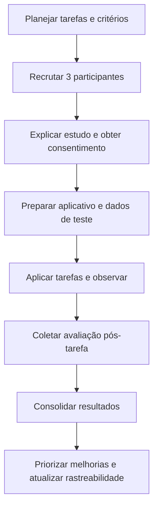

# Entrega 14 — Avaliação de usabilidade por observação de usuários

**Data:** 15/11/2026  
**Status:** 🟨 em andamento — planejamento e parte de Lucas preparados; testes com participantes finais pendentes  
**Responsabilidade:** solução consolidada por equipe — Lucas Cabral, Guilherme e Pedro. Serão necessários **3 participantes finais**, um acompanhado por cada integrante.

## Objetivo da atividade

Observar pessoas que tenham relação com as atividades da fazenda usando o aplicativo **CYF — Clean Your Farm**. O teste avaliará se conseguem realizar as tarefas, entender os resultados e recuperar-se de dúvidas ou erros. A avaliação é da **interação com o aplicativo**, não da precisão científica do modelo de detecção.

Os participantes finais não podem ser Lucas, Guilherme ou Pedro. Um integrante pode testar o roteiro como piloto, mas não contará entre U01, U02 e U03.

## A. Fluxograma do processo — equipe

**Fonte editável:** este próprio diagrama Mermaid no arquivo `.md`.

## B. Procedimento de preparação e execução — equipe

### Passo 1 — Objetivos e versão avaliada

**Produto:** aplicativo iOS CYF — Clean Your Farm.  
**Repositório do aplicativo:** <https://github.com/Cabral100/App_Orange_Box>, pasta `ios-native/`.  
**Versão/commit efetivamente testado:** {{registrar o hash antes do primeiro teste e usar a mesma versão com U01–U03; caso haja alteração, registrar qual participante viu cada versão}}.  
**Dispositivo e sistema:** {{modelo do iPhone e versão do iOS}}.  
**Dados de demonstração:** informar aos participantes quais registros são exemplos e manter os mesmos dados iniciais em todas as sessões.

**Metas de usabilidade a verificar:**

| ID | Meta operacional para esta avaliação | Ligação com o projeto |
|---|---|---|
| MU01 | O trabalhador consegue capturar uma imagem e compreender se a análise está em andamento ou se precisa ajustar a captura. | CI02; O02/O03; M02; F02. |
| MU02 | O trabalhador consegue localizar uma inspeção registrada e identificar seu talhão, data e resultado sem confundir a indicação da IA com confirmação humana. | CI02; O03/O04; M02; F03. |
| MU03 | O gestor consegue localizar um talhão no mapa, usar filtros e compreender o que os indicadores representam antes de decidir a próxima ação. | CI01; O06/O07; M03; F04. |
| MU04 | O gestor consegue consultar o relatório do período e encontrar as informações necessárias na tela ou no relatório extraído. | CI01; O09/O10; M03; F06. |

**Critério de atendimento das metas:** definir antes da coleta a proporção mínima de sucesso por tarefa e o limite aceitável de ajudas/erros, após conferir a duração no piloto. Não classificar uma meta como atingida apenas porque o participante disse que gostou da interface.

### Passo 2 — Participantes

O recrutamento deve considerar as tarefas que cada pessoa realmente desempenha. Não é necessário ter uma pessoa de cada persona se os três participantes disponíveis não corresponderem aos três perfis; nesse caso, informar exatamente quais fluxos foram avaliados e quais ficaram sem cobertura.

| ID | Perfil buscado | Critérios que justificam participação | Integrante responsável | Situação |
|---|---|---|---|---|
| U01 | Trabalhador de campo que inspeciona frutos ou realiza atividade próxima. | Já ter feito inspeção, acompanhamento de pragas ou registro de observações em talhões. Registrar experiência com smartphone e ferramentas usadas na rotina. | **Lucas Cabral** | {{nome mantido fora do relatório; recrutamento pendente}} |
| U02 | Gestor, proprietário ou responsável por acompanhar talhões e decidir ações na fazenda. | Tomar ou apoiar decisões com base em inspeções, ocorrências e relatórios. | **Pedro** | {{recrutamento pendente}} |
| U03 | Outro profissional relacionado às tarefas efetivamente disponíveis no aplicativo. | {{descrever função real, tarefas e motivo da escolha antes da sessão}}. Se for participante proxy, explicar por que o perfil ideal não foi recrutado e quais conclusões ficam limitadas. | **Guilherme** | {{recrutamento pendente}} |

**Limite de escopo:** a versão documentada na Entrega 11 não possui perfil próprio de agrônomo. Portanto, não afirmar que o fluxo M01 de emitir parecer foi testado no aplicativo se esse fluxo não existir na versão avaliada. Guilherme pode conduzir um participante em tarefas disponíveis de inspeção, histórico, mapa ou relatório e registrar a diferença em relação à persona ideal.

### Passo 3 — Consentimento e privacidade

- **Termo/registro de consentimento:** {{inserir caminho do termo preenchido e aprovado para aplicação}}.
- **Antes do teste:** explicar objetivo, duração, tarefas, voluntariedade, possibilidade de desistência e uso dos dados.
- **Gravação:** {{marcar: nenhuma / tela / áudio / vídeo}}. Só iniciar gravação após autorização específica. Caso a pessoa não concorde em gravar, usar observação e anotações, se ela aceitar participar nessas condições.
- **Anonimização:** identificar participantes apenas como `U01`, `U02` e `U03` no relatório. Manter nome e contato, se necessários ao agendamento, separados das respostas.
- **Dados coletados:** função/experiência pertinente, ações observadas, tempos, erros, pedidos de ajuda, avaliação pós-tarefa e comentários. Não solicitar dados pessoais ou informações sigilosas da fazenda sem necessidade.
- **Armazenamento:** {{definir pasta de acesso restrito aos integrantes/docente, prazo de retenção e descarte antes da coleta}}. Não publicar gravações ou nomes reais no GitHub.

### Passo 4 — Teste piloto

**Responsável:** Lucas Cabral, com apoio de um integrante da equipe que não contará na amostra final.  
**Data:** {{preencher após realizar}}.  
**Objetivo:** verificar se o aplicativo abre no dispositivo, se os dados de demonstração estão consistentes, se as instruções não indicam botões, se as tarefas cabem no tempo previsto e se a planilha permite registrar as observações.  
**Duração observada:** {{...}}.  
**Mudanças após o piloto:** {{registrar mudanças reais; se não houver, escrever “nenhuma” após a execução}}.

O piloto não fornece resultados de usabilidade dos participantes finais.

### Passo 5 — Tarefas

O moderador lê apenas a instrução da tarefa. Os nomes de controles e os caminhos abaixo servem para análise da equipe e **não** devem ser lidos ao participante.

| ID | Cenário/instrução apresentada | Critério de sucesso observável | Métricas | Ligação com o modelo | Público |
|---|---|---|---|---|---|
| UT01 | “Você encontrou um fruto que gostaria de examinar. Use o aplicativo para registrar uma imagem e me diga o que está acontecendo durante a análise e o que o resultado permite concluir.” | Captura a imagem, identifica o feedback de andamento e descreve o resultado como indicação da foto, sem afirmar que a praga foi confirmada por um especialista. | Sucesso, tempo, erros de captura/interpretação, ajudas e satisfação. | C02; T02; O02/O03; M02; F02. | U01; U03 se o perfil justificar. |
| UT02 | “Você precisa reencontrar uma inspeção realizada anteriormente e dizer em qual talhão e data ela foi registrada.” | Localiza um registro coerente com os dados preparados e identifica talhão e data sem orientação sobre onde tocar. | Sucesso, tempo, erros de filtro/leitura, ajudas e satisfação. | C02; T01/T03; O04; M02; F03. | U01; U03 se o perfil justificar. |
| UT03 | “Você precisa descobrir quais talhões merecem atenção no período mostrado. Examine a situação da fazenda e selecione um talhão para conferir as informações disponíveis.” | Usa ou examina o mapa e os filtros, encontra um talhão e explica o significado das informações exibidas sem tratar ausência de inspeção como ausência de praga. | Sucesso, tempo, erros de seleção/interpretação, ajudas e satisfação. | C01; T09; O06/O07; M03; F04. | U02; U03 se o perfil justificar. |
| UT04 | “Você precisa preparar uma conversa sobre a situação recente da fazenda. Consulte o relatório e encontre as informações sobre ocorrências e irrigação que seriam úteis para essa conversa.” | Localiza o relatório do período e, se a exportação funcionar na versão testada, encontra no arquivo extraído os indicadores de irrigação informados pela equipe. Se a exportação não estiver disponível, registrar essa limitação como impedimento do fluxo, sem indicar ao participante outro caminho. | Sucesso, tempo, erros, ajudas, satisfação e informação localizada. | C01; T04/T08; O09/O10; M03; F06. | U02; U03 se o perfil justificar. |

**Escala pós-tarefa:** “De 1 a 7, quão fácil ou difícil foi concluir esta tarefa?”, sendo **1 = muito difícil** e **7 = muito fácil**. Em seguida: “O que tornou a tarefa fácil ou difícil?”

**Definições anteriores à coleta:**

- **Sucesso total:** atinge o critério da tarefa sem receber indicação do caminho pelo moderador.
- **Sucesso parcial:** atinge parte do critério, mas não interpreta uma informação essencial ou conclui apenas com uma ajuda que aponta o caminho.
- **Falha:** abandona, não alcança o objetivo ou tira uma conclusão incompatível com a informação apresentada.
- **Erro:** ação equivocada observável ou interpretação incorreta, anotada com seu contexto.
- **Ajuda:** intervenção do moderador além da repetição neutra da instrução; registrar o texto e o momento.
- **Tempo:** intervalo entre o fim da leitura da instrução e a conclusão, abandono ou encerramento da tarefa.

### Passo 6 — Protocolo do moderador

1. Receber a pessoa e explicar: **“Estamos avaliando o aplicativo, não a sua capacidade.”**
2. Explicar que algumas informações podem ser dados de demonstração; o teste não avalia a precisão do algoritmo.
3. Apresentar o termo e obter consentimento antes de coletar informações ou gravar.
4. Registrar apenas o perfil necessário: relação com a atividade, experiência aproximada e uso de aplicativos na rotina.
5. Ler cada instrução sem dizer em qual aba, botão ou filtro tocar.
6. Observar ações, erros, hesitações, comentários e pedidos de ajuda. Permitir silêncio; não interpretá-lo sozinho como dificuldade.
7. Se houver bloqueio, usar primeiro uma pergunta neutra, como “O que você esperava encontrar?”. Registrar qualquer intervenção.
8. Após cada tarefa, aplicar a escala de 1 a 7 e pedir um comentário curto.
9. Ao final, perguntar: “O que mais dificultou seu uso?” e “Houve alguma informação que você interpretou de maneira diferente do esperado?”
10. Agradecer, explicar o uso dos registros e salvar os dados com o ID anônimo.

**Responsável por U01 — Lucas:** conduzir UT01 e UT02 com o participante de campo, mantendo o mesmo roteiro e as mesmas definições acima. Lucas não deve apresentar como observação real o feedback recebido por Vitor na Entrega 6; são atividades e participantes de avaliação diferentes.

## C. Resultados — por participante

> Preencher apenas depois das sessões. Não copiar resultados da avaliação heurística ou do walkthrough formativo para estas tabelas.

### U01 — participante acompanhado por Lucas Cabral

**Perfil resumido:** {{função e experiência, sem nome real}}  
**Data e ambiente:** {{...}}  
**Versão/dispositivo:** {{...}}  
**Moderador:** Lucas Cabral  
**Observador, se houver:** {{...}}

| Tarefa | Grau de sucesso | Erros | Tipos de erro/dificuldade | Ajudas | Tempo | Satisfação 1–7 | Evidência/observação |
|---|---|---:|---|---:|---|---:|---|
| UT01 | {{total/parcial/falha}} | {{n}} | {{...}} | {{n}} | {{mm:ss}} | {{n}} | {{ação ou comentário observado}} |
| UT02 | {{total/parcial/falha}} | {{n}} | {{...}} | {{n}} | {{mm:ss}} | {{n}} | {{ação ou comentário observado}} |

**Link da gravação, somente se autorizada e em local restrito:** {{... ou “não houve gravação”}}  
**Resposta pós-teste:** {{...}}  
**Intervenções do moderador:** {{... ou “nenhuma”}}  
**Limitações da sessão:** {{... ou “nenhuma identificada”}}

### U02 — participante acompanhado por Pedro

**Perfil resumido:** {{...}}  
**Data e ambiente:** {{...}}  
**Versão/dispositivo:** {{...}}  
**Moderador:** Pedro

| Tarefa | Grau de sucesso | Erros | Tipos de erro/dificuldade | Ajudas | Tempo | Satisfação 1–7 | Evidência/observação |
|---|---|---:|---|---:|---|---:|---|
| UT03 | {{...}} | {{...}} | {{...}} | {{...}} | {{...}} | {{...}} | {{...}} |
| UT04 | {{...}} | {{...}} | {{...}} | {{...}} | {{...}} | {{...}} | {{...}} |

**Link da gravação, se autorizada:** {{...}}  
**Resposta pós-teste:** {{...}}  
**Limitações da sessão:** {{...}}

### U03 — participante acompanhado por Guilherme

**Perfil resumido e justificativa do perfil:** {{...}}  
**Participante proxy?** {{não / sim; justificar e descrever o limite}}  
**Data e ambiente:** {{...}}  
**Versão/dispositivo:** {{...}}  
**Moderador:** Guilherme  
**Tarefas aplicadas conforme a função real da pessoa:** {{UT01/UT02 e/ou UT03/UT04; definir antes da sessão}}

| Tarefa | Grau de sucesso | Erros | Tipos de erro/dificuldade | Ajudas | Tempo | Satisfação 1–7 | Evidência/observação |
|---|---|---:|---|---:|---|---:|---|
| {{UT__}} | {{...}} | {{...}} | {{...}} | {{...}} | {{...}} | {{...}} | {{...}} |
| {{UT__}} | {{...}} | {{...}} | {{...}} | {{...}} | {{...}} | {{...}} | {{...}} |

**Link da gravação, se autorizada:** {{...}}  
**Resposta pós-teste:** {{...}}  
**Limitações da sessão:** {{...}}

## D. Consolidação por tarefa

Calcular a taxa somente com os participantes que **realmente executaram** cada tarefa. Exemplo de notação: `1/2`, e não `50% dos três participantes` quando apenas dois a realizaram. Apresentar tempo típico somente se houver observações suficientes; com poucos casos, listar os tempos individuais.

| Tarefa | Participantes que a executaram | Sucesso total | Tempos observados | Erros recorrentes | Satisfação observada | Meta atendida? | Problemas prioritários |
|---|---|---|---|---|---|---|---|
| UT01 | {{IDs}} | {{n/N}} | {{...}} | {{...}} | {{...}} | {{sim/não/indeterminado}} | {{...}} |
| UT02 | {{IDs}} | {{n/N}} | {{...}} | {{...}} | {{...}} | {{sim/não/indeterminado}} | {{...}} |
| UT03 | {{IDs}} | {{n/N}} | {{...}} | {{...}} | {{...}} | {{sim/não/indeterminado}} | {{...}} |
| UT04 | {{IDs}} | {{n/N}} | {{...}} | {{...}} | {{...}} | {{sim/não/indeterminado}} | {{...}} |

## E. Achados e recomendações

Incluir somente problemas sustentados por comportamento, fala ou resultado observado nas sessões. Distinguir uma dificuldade recorrente de um caso isolado. Não transformar automaticamente toda sugestão em requisito.

| ID | Achado observado | Evidência quantitativa e qualitativa | Impacto | Recomendação | Artefatos a revisar |
|---|---|---|---|---|---|
| AU01 | {{preencher após os testes}} | {{IDs, tarefas, contagens e comportamento/fala}} | {{...}} | {{...}} | {{MoLIC M02/M03; tela F__; signos; tarefa}} |
| AU02 | {{...}} | {{...}} | {{...}} | {{...}} | {{...}} |

**Parte de Lucas:** relacionar achados de UT01/UT02 à orientação da câmera, feedback de análise, interpretação do resultado e consulta ao histórico, conforme o que U01 realmente fizer. Se não aparecer problema em uma dessas partes, registrar o resultado observado sem criar um achado artificial.

## F. Comparação com a avaliação heurística

A Entrega 13 contém problemas identificados por inspeção; a tabela abaixo só poderá ser concluída após os testes. A ausência de um problema na sessão não demonstra que ele não existe: talvez a condição não tenha ocorrido.

| Problema/hipótese da Entrega 13 | Detectado na heurística? | Detectado por usuários? | O que aprendemos |
|---|---|---|---|
| V07 — termos técnicos na câmera, como “Core ML pronto”. | Sim. | {{sim/não/não exposto}} | {{Como U01 interpretou a mensagem em UT01.}} |
| V12 — passos adicionais após fotografar um fruto. | Sim; identificado inicialmente no código, a confirmar no aparelho. | {{sim/não/não exposto}} | {{Efeito sobre a continuidade da inspeção em UT01.}} |
| V02 — talhões sem identificação sempre visível no mapa. | Sim. | {{sim/não/não exposto}} | {{Como U02/U03 localizaram o talhão em UT03.}} |
| V05 — “detecções confirmadas” pode sugerir validação humana. | Sim. | {{sim/não/não exposto}} | {{Como o participante interpretou o relatório em UT04.}} |
| {{novo problema visto apenas no teste, se houver}} | Não. | {{sim}} | {{...}} |

## G. Conclusão

Preencher após consolidar U01–U03:

1. **Metas atingidas:** {{MU01–MU04, com numerador/denominador e evidência de cada tarefa}}.
2. **Problemas recorrentes e perfis afetados:** {{IDs AU__, tarefas e participantes}}.
3. **O que surpreendeu a equipe:** {{resultado efetivamente observado, inclusive diferenças em relação à avaliação heurística}}.
4. **Mudanças prioritárias:** {{ação, responsável e artefato a alterar}}.
5. **Limitações:** amostra de três pessoas; distribuição real dos perfis; eventual participante proxy; uso de dados de demonstração; funcionalidades ausentes ou não exercitadas; possíveis diferenças entre versões do aplicativo.

**Atualização da rastreabilidade:** depois de analisar os dados, relacionar `UT__ → U__ → AU__ → recomendação/decisão` em `RASTREABILIDADE.md`. Não registrar hipótese como validada apenas pela opinião de um participante ou por um resultado técnico simulado.

## Checklist

- [ ] Três participantes finais foram observados.
- [ ] Participantes têm relação documentada com as tarefas e não são membros da equipe.
- [ ] Eventuais participantes proxy foram justificados, com a limitação explícita.
- [x] O plano avalia a interação, separadamente do desempenho técnico do modelo.
- [x] As tarefas propostas são rastreáveis aos cenários, objetivos, MoLIC e telas disponíveis.
- [ ] Consentimento foi obtido e os registros foram anonimizados.
- [ ] O teste piloto foi executado e suas alterações registradas.
- [x] Critérios de sucesso e definições das métricas foram preparados antes do teste.
- [ ] Moderadores aplicaram as tarefas sem ensinar o caminho.
- [ ] Resultados foram preenchidos por participante e por tarefa.
- [ ] Sucesso, erros, ajudas, tempo e satisfação foram registrados.
- [ ] A conclusão combina resultados quantitativos e observações qualitativas.
- [ ] Achados geraram recomendações e atualização de `RASTREABILIDADE.md`.
